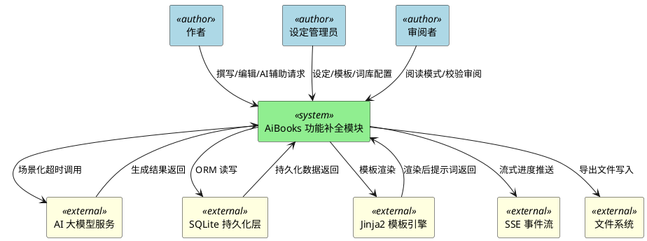
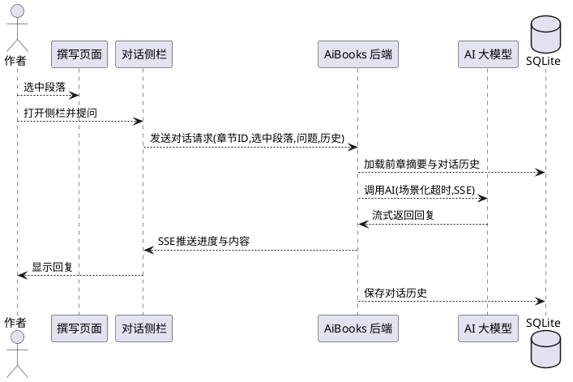

# AiBooks 功能补全需求规格说明书

> 文档版本：v1.0  
> 生成日期：2026-09-23  
> 需求格式：EARS（Easy Approach to Requirements Syntax）  
> 范围：23项缺欠功能补全（已排除"写作目标与打卡"）

---

# 1. 组件定位

## 1.1 核心职责

本组件负责在 AiBooks 现有功能闭环基础上，补全对标成熟 AI 小说写作软件的 23 项缺欠能力，实现内容生成增强、编辑管理增强、辅助工具、导出格式、用户体验五大模块的全覆盖。

## 1.2 核心输入

1. **用户操作指令**：撰写页面、章节编辑页面、大纲页面、角色设定页面、世界观设定页面、校验页面、项目页面发起的功能请求（续写/扩写/缩写、对话、批量查找替换、章节合并拆分、拖拽排序、版本管理、锁定、批注、命名生成、模板应用、敏感词扫描、摘要生成、情感分析、字数统计、多格式导出、阅读模式、快捷键等）。
2. **AI 大模型调用请求**：通过四种路由策略（manual/failover/load_balance/cost_first）调用 8 个预设国内免费中文大模型，传入场景化超时参数。
3. **章节正文与上下文**：当前章节标题、选中段落文本、前一章结尾摘要、前后段落、章节大纲、角色设定、世界观设定。
4. **持久化数据**：21 个 ORM 表的读写请求，含章节、版本、批注、时间线节点、角色关系、敏感词库、模板库等。
5. **Jinja2 提示词模板**：30 个已有模板及新增模板的渲染请求，通过 manifest.yaml 注册。

## 1.3 核心输出

1. **AI 生成内容响应**：续写/扩写/缩写结果、对话回复、命名建议、场景大纲、章节摘要、衔接优化建议、情感曲线数据，通过 SSE 流式返回进度。
2. **编辑操作结果**：批量替换报告、合并/拆分后的章节列表、排序后的章节编号、版本差异对比、锁定状态变更、批注增删改。
3. **可视化数据**：时间线节点序列、角色关系图谱节点边集合、情感曲线数据点、字数统计图表数据。
4. **导出文件**：TXT/DOCX/EPUB/Markdown/PDF 五种格式文件，按排版模板渲染。
5. **校验报告**：敏感词命中位置与替换建议、时序冲突告警、衔接断裂告警。
6. **SSE 流式事件**：进度百分比、当前处理章节、暂停/续写状态、错误事件。

## 1.4 职责边界

本组件**不负责**以下事项：

1. **不负责**写作目标与打卡功能（已明确排除）。
2. **不负责**AI 大模型本身的训练、微调、权重管理，仅负责调用与路由。
3. **不负责**WebDAV 云存储集成（百度网盘、阿里云盘等由独立模块处理）。
4. **不负责**全局默认超时回退，所有 AI 调用须传入场景化超时。
5. **不负责**针对特定小说的硬编码 Bug 修复，所有修复须从根因层面通用处理。
6. **不负责**非中文大模型的接入，当前仅支持 8 个预设国内免费中文大模型。

---

# 2. 领域术语

**EARS 格式**
: 一种需求语句语法，包含 Ubiquitous（无处不在的）、EventDriven（事件驱动的）、StateDriven（状态驱动的）、Optional（可选的）、Unwanted（不期望的）五种句型，用于编写可测试的需求语句。

**对话式写作辅助**
: 在撰写页面侧栏与 AI 进行的多轮对话交互，上下文携带当前章节标题、选中段落文本、前一章结尾摘要，对话历史按章节保存。

**续写/扩写/缩写**
: 对选中段落执行的三种 AI 文本操作：续写从末尾延续保持风格，扩写丰富内容，缩写精简表达。

**章节衔接优化**
: AI 分析相邻两章节的衔接质量，检测断裂感、时序跳跃、角色状态不一致，并提供优化建议与自动衔接段落。

**场景级大纲**
: 在章节大纲基础上将每章拆分为 3-5 个场景，每个场景包含场景目标、出场角色、关键事件、情绪基调、预计字数。

**命名生成器**
: AI 根据世界观和已有命名风格，批量生成角色名、地名、势力名、物品名、功法名等命名资源。

**写作套路模板**
: 预设常见小说类型（玄幻升级流、都市重生流、穿越种田流、系统流等）的阶段划分、爽点节奏、角色配置建议、大纲骨架。

**批量查找替换**
: 全书或按章节范围进行的查找替换操作，支持普通模式与正则模式，替换前预览匹配项并逐项或全部确认。

**章节合并/拆分**
: 合并将相邻多章正文合并为一章并重新生成标题；拆分将一章按段落位置分为多章并自动编号。

**大纲拖拽排序**
: 在大纲页面通过拖拽调整章节顺序，拖拽后自动重新编号并检测时间线约束违反。

**多版本管理**
: 对章节正文保存多个历史版本，含自动版本（每次保存生成）与手动版本（用户命名标记），支持差异查看与回滚。

**章节锁定**
: 对章节设置锁定标记，锁定后正文只读，防止误改已定稿内容，锁定/解锁需确认。

**批注**
: 锚定到段落级别的章节正文批注，可包含文字备注与 AI 建议，状态为"已处理"或"待处理"。

**时间线节点**
: 可视化时间线中的事件单元，包含事件名、时间点（小说内时间）、涉及角色、关联章节、事件描述。

**角色关系图谱**
: 以节点（角色）和边（关系）形式展示的人物关系网络，关系类型含亲属、师徒、朋友、敌对、主仆、情人等。

**情感曲线**
: AI 分析全书或指定章节范围情感走向生成的数据序列，每章一个数据点，含紧张度与情绪起伏维度。

**敏感词库**
: 内置政治、暴力、色情等分类的敏感词集合，支持自定义添加，用于全书内容扫描。

**世界观模板**
: 预设常见小说世界观（修仙、武侠、末日、星际等）的力量体系、社会结构、地理设定、种族设定、核心规则。

**章节摘要**
: AI 为每章生成的 100-200 字简短摘要，用于快速浏览、衔接优化、情感分析。

**多格式导出**
: 在 TXT 基础上新增 DOCX、EPUB、Markdown、PDF 四种导出格式，支持章节分页、大纲包含、角色设定包含、封面页等选项。

**排版模板**
: 定义字体、字号、行距、章节标题样式、首行缩进、页眉页脚的导出排版方案，预设网文风格、出版风格、简洁风格。

**阅读模式**
: 章节编辑页面中以书籍排版样式展示内容的预览模式，隐藏编辑工具栏，支持字体大小、行距、背景色调整。

**快捷键体系**
: 为常用操作定义的键盘快捷键映射，含保存、查找、替换、新建章节、AI 对话、续写等，支持自定义。

**场景化超时**
: 按 AI 调用场景（续写/对话/摘要/情感分析等）分别配置的超时参数，不回退全局默认超时。

**SSE 流式进度**
: 通过 Server-Sent Events 向前端推送的生成进度事件流，含百分比、当前章节、暂停/续写状态。

---

# 3. 角色与边界

## 3.1 核心角色

1. **作者**：小说撰写的主导用户，使用撰写页面、章节编辑页面、大纲页面进行创作，调用 AI 辅助功能、编辑管理功能、辅助工具。
2. **设定管理员**：负责维护角色设定、世界观设定、时间线、角色关系图谱、敏感词库、模板库的配置用户（通常与作者为同一人）。
3. **审阅者**：以读者视角使用阅读模式、情感曲线、字数统计、校验报告审阅作品的用户。

## 3.2 外部系统

1. **AI 大模型服务**：8 个预设国内免费中文大模型，通过四种路由策略调用，返回文本生成结果。
2. **SQLite 持久化层**：21 个 ORM 表的读写，存储章节、版本、批注、时间线、角色关系、敏感词、模板等数据。
3. **Jinja2 模板引擎**：渲染 30 个已有模板及新增提示词模板，通过 manifest.yaml 注册。
4. **SSE 事件流**：向前端推送 AI 生成进度、批量任务进度、错误事件。
5. **文件系统**：导出 TXT/DOCX/EPUB/Markdown/PDF 文件的写入目标。

## 3.3 交互上下文

---

# 4. DFX 约束

## 4.1 性能

1. **单次 AI 调用响应时间**：当发起单次 AI 调用（续写/扩写/缩写/对话/命名生成/摘要生成）时，系统应当在场景化超时时间内返回结果，超时时间按场景分别配置，禁止回退全局默认超时。
2. **批量生成吞吐量**：当发起批量生成（批量命名、批量摘要、情感分析、敏感词扫描）时，系统应当逐章/逐批生成并即时返回中间结果，支持暂停与续写。
3. **SSE 流式推送延迟**：当 AI 生成过程中产生进度事件时，系统应当在 500ms 内通过 SSE 推送至前端。
4. **UI 主线程响应**：当执行 AI 调用、批量任务、导出等耗时操作时，系统应当保持 UI 主线程响应，耗时操作在后台线程执行。
5. **章节列表加载时间**：当打开包含 100 章的项目时，系统应当在 2 秒内完成章节列表加载与渲染。
6. **导出文件生成时间**：当导出 50 万字小说为任意支持格式时，系统应当在 30 秒内完成文件生成。

## 4.2 可靠性

1. **AI 调用失败处理**：当 AI 调用失败或超时时，系统应当按当前路由策略（failover/load_balance）自动切换至下一个可用模型，并记录失败原因。
2. **批量任务可恢复性**：当批量任务（批量摘要、情感分析、敏感词扫描）被中断时，系统应当保存已完成的进度，支持从断点续写。
3. **版本数据完整性**：当章节正文保存时，系统应当自动生成版本快照，确保任意时刻可回滚至历史版本。
4. **持久化事务一致性**：当执行章节合并/拆分、拖拽排序、批量替换等结构性变更时，系统应当在单一事务内完成，失败时整体回滚。
5. **SSE 连接稳定性**：当 SSE 连接断开时，系统应当自动重连并恢复进度推送，不丢失已生成内容。

## 4.3 安全性

1. **敏感词扫描覆盖**：当执行敏感词扫描时，系统应当覆盖政治、暴力、色情等内置分类及用户自定义词库，标记所有命中位置。
2. **AI 提示词注入防护**：当用户输入作为上下文传入 AI 提示词模板时，系统应当对 Jinja2 模板进行安全渲染，防止模板注入。
3. **导出文件路径校验**：当执行文件导出时，系统应当校验目标路径合法性，禁止路径穿越攻击。
4. **章节锁定强制只读**：当章节处于锁定状态时，系统应当拒绝所有正文编辑请求，仅允许解锁操作（需确认）。

## 4.4 可维护性

1. **Bug 修复根因通用性**：当修复任何 Bug 时，系统应当从根因层面通用修复，禁止针对特定小说硬编码。
2. **提示词模板注册**：当新增提示词模板时，系统应当通过 manifest.yaml 注册，使用 Jinja2 语法，文件命名 kebab-case。
3. **UI 页面统一范式**：当新增 UI 页面时，系统应当遵循"标题→思路输入栏→状态标签→内容区→底部按钮栏→进度标签"的统一结构。
4. **命名规范**：当新增代码时，系统应当文件命名使用 kebab-case，变量/函数命名使用 snake_case，类命名使用 PascalCase，私有成员以下划线前缀。
5. **日志可追踪性**：当 AI 调用、批量任务、导出操作执行时，系统应当记录可追踪日志，含场景、模型、耗时、结果状态。

## 4.5 兼容性

1. **Python 版本兼容**：系统应当兼容 Python 3.12.9 运行环境。
2. **前端框架兼容**：系统应当基于 PySide6 实现前端 UI，保持与现有 14 个 UI 页面、11 个自定义控件的兼容。
3. **后端框架兼容**：系统应当基于 FastAPI+Uvicorn 实现后端，保持与现有 14 个路由文件的兼容。
4. **持久化层兼容**：系统应当基于 SQLAlchemy+SQLite 实现持久化，保持与现有 21 个 ORM 表的兼容，新增表通过迁移脚本创建。
5. **导出格式向后兼容**：当新增 DOCX/EPUB/Markdown/PDF 导出时，系统应当保持现有 TXT 导出功能不变。

---

# 5. 核心能力

## 5.1 内容生成增强

### 5.1.1 AI 对话式写作辅助

#### 业务规则

1. **对话侧栏可用性**：当作者在撰写页面选中段落并打开对话侧栏时，系统应当显示与 AI 的对话交互界面，支持多轮对话。
2. **对话上下文携带**：当发起对话时，系统应当将当前章节标题、选中段落文本、前一章结尾摘要作为上下文传入 AI 提示词模板。
3. **对话历史按章节保存**：当对话发生时，系统应当将对话历史按章节 ID 持久化，切换章节时加载对应历史。
4. **对话功能覆盖**：当作者在对话侧栏提问时，系统应当支持针对选中段落提问、请求改写、获取写作建议、讨论剧情走向四类操作。
5. **SSE 流式回复**：当 AI 生成对话回复时，系统应当通过 SSE 流式返回生成进度与最终内容。
6. **内容长度校验**：当 AI 返回内容不足 50 字时，系统应当返回 HTTP 422 错误并提示重试。

#### 交互流程

#### 异常场景

1. **AI 调用超时**
   - 触发条件：AI 调用超过场景化超时时间
   - 系统行为：按路由策略切换模型重试，记录失败日志
   - 用户感知：侧栏显示"AI 响应超时，正在重试..."提示
2. **选中段落为空**
   - 触发条件：作者未选中段落即发起对话
   - 系统行为：提示需先选中段落或切换为整章上下文模式
   - 用户感知：侧栏显示"请先选中段落或切换整章模式"提示
3. **对话历史加载失败**
   - 触发条件：章节对话历史持久化读取异常
   - 系统行为：初始化空历史，记录错误日志
   - 用户感知：侧栏显示空对话，不阻塞当前使用

### 5.1.2 续写/扩写/缩写

#### 业务规则

1. **三种操作可用性**：当作者在撰写页面或章节编辑页面选中段落时，系统应当提供续写、扩写、缩写三种 AI 操作入口。
2. **续写规则**：当执行续写时，系统应当从选中段落末尾继续写作，保持风格一致，上下文含章节标题与前后段落。
3. **扩写规则**：当执行扩写时，系统应当将选中段落扩展为更丰富的内容，保持原意。
4. **缩写规则**：当执行缩写时，系统应当将选中段落精简为更简洁的内容，保持核心信息。
5. **结果处理选项**：当 AI 生成结果后，系统应当提供"替换原文"和"插入到原文后"两个选项供作者选择。
6. **SSE 流式返回**：当执行三种操作时，系统应当通过 SSE 流式返回生成进度。
7. **内容长度校验**：当生成内容不足 50 字时，系统应当返回 HTTP 422 错误。

#### 异常场景

1. **生成内容风格偏离**
   - 触发条件：AI 生成内容与原文风格明显不一致
   - 系统行为：在结果区显示风格一致性提示，由作者决定是否采纳
   - 用户感知：结果区显示"风格一致性较低，请审阅后决定"提示
2. **替换原文误操作**
   - 触发条件：作者选择"替换原文"
   - 系统行为：弹出确认对话框，确认后执行替换并生成版本快照
   - 用户感知：显示"确认替换？原内容将保存为历史版本"确认框

### 5.1.3 章节间衔接优化

#### 业务规则

1. **衔接分析可用性**：当作者在撰写页面或章节编辑页面选择两相邻章节时，系统应当提供衔接优化分析入口。
2. **断裂检测**：当执行衔接分析时，系统应当检测断裂感、时序跳跃、角色状态不一致三类问题。
3. **优化建议生成**：当检测到问题时，系统应当提供优化建议文本与自动衔接段落。
4. **SSE 流式返回**：当执行分析时，系统应当通过 SSE 流式返回分析进度与结果。
5. **结果应用**：当作者确认采纳自动衔接段落时，系统应当将其插入到两章节之间或替换指定段落。

#### 异常场景

1. **章节内容不足分析**
   - 触发条件：任一章节正文不足 100 字
   - 系统行为：提示内容过少无法有效分析
   - 用户感知：显示"章节内容过少，建议补充后再分析"提示

### 5.1.4 场景级大纲细化

#### 业务规则

1. **场景拆分可用性**：当作者在大纲页面选择章节时，系统应当提供场景级大纲细化入口。
2. **场景数量约束**：当执行场景拆分时，系统应当将每章拆分为 3-5 个场景。
3. **场景内容完整**：当生成场景时，系统应当为每个场景包含场景目标、出场角色、关键事件、情绪基调、预计字数五项内容。
4. **撰写引导**：当场景大纲生成后，系统应当作为撰写时的更细粒度引导，在撰写页面可查看当前章节的场景列表。
5. **SSE 流式返回**：当执行场景拆分时，系统应当通过 SSE 流式返回生成进度。

#### 异常场景

1. **章节大纲缺失**
   - 触发条件：选中章节无大纲内容
   - 系统行为：提示先生成章节大纲
   - 用户感知：显示"请先生成章节大纲再细化场景"提示

### 5.1.5 命名生成器

#### 业务规则

1. **命名生成可用性**：当作者在角色设定页面或世界观设定页面时，系统应当提供命名生成器入口。
2. **命名类型覆盖**：当执行命名生成时，系统应当支持角色名、地名、势力名、物品名、功法名五类命名。
3. **批量生成数量**：当执行批量生成时，系统应当一次生成 10 个命名候选。
4. **风格一致性**：当生成命名时，系统应当根据世界观和已有命名风格保持一致性。
5. **按类型筛选**：当查看生成结果时，系统应当支持按命名类型筛选显示。
6. **收藏常用**：当作者标记命名为常用时，系统应当持久化收藏状态，支持快速调用。
7. **SSE 流式返回**：当执行批量生成时，系统应当通过 SSE 流式返回生成进度。

#### 异常场景

1. **世界观设定为空**
   - 触发条件：项目未配置世界观设定
   - 系统行为：使用通用命名规则生成，提示设定世界观可提升质量
   - 用户感知：显示"未检测到世界观设定，已使用通用规则生成"提示

### 5.1.6 写作模板/套路库

#### 业务规则

1. **模板预设完整性**：系统应当预设玄幻升级流、都市重生流、穿越种田流、系统流等常见小说类型的写作套路模板。
2. **模板内容完整**：每个模板应当包含阶段划分、爽点节奏、角色配置建议、大纲骨架四项内容。
3. **模板应用入口**：当作者在项目管理或新建项目时，系统应当提供模板选择入口。
4. **基于模板启动**：当作者选择模板启动新书时，系统应当将模板的阶段划分、角色配置建议、大纲骨架填充至新项目对应位置。
5. **模板可扩展**：系统应当支持用户自定义模板，持久化至模板库。

#### 异常场景

1. **模板加载失败**
   - 触发条件：模板库持久化读取异常
   - 系统行为：加载内置默认模板，记录错误日志
   - 用户感知：显示内置模板，不阻塞新建项目

## 5.2 编辑管理增强

### 5.2.1 批量查找替换

#### 业务规则

1. **批量查找替换可用性**：当作者在撰写页面或章节编辑页面时，系统应当提供批量查找替换入口。
2. **范围选择**：当执行批量查找替换时，系统应当支持全书范围或指定章节范围。
3. **模式支持**：系统应当支持普通模式与正则模式两种查找方式。
4. **大小写敏感**：系统应当支持区分大小写选项。
5. **预览匹配项**：当执行查找时，系统应当预览所有匹配项，显示所在章节与上下文。
6. **逐项确认**：当预览匹配项后，系统应当支持逐项确认替换或全部确认替换。
7. **替换报告**：当替换完成后，系统应当生成替换报告，含替换数量、所在章节列表。

#### 异常场景

1. **正则表达式无效**
   - 触发条件：作者输入的正则表达式语法错误
   - 系统行为：提示正则语法错误，不执行查找
   - 用户感知：显示"正则表达式语法错误，请检查"提示
2. **匹配项过多**
   - 触发条件：匹配项超过 1000 个
   - 系统行为：分页加载匹配项，提示确认是否继续
   - 用户感知：显示"匹配项较多，已分页显示"提示

### 5.2.2 章节合并/拆分

#### 业务规则

1. **合并可用性**：当作者在大纲页面或撰写页面选择相邻多个章节时，系统应当提供合并入口。
2. **合并规则**：当执行合并时，系统应当将选中章节正文合并为一个章节，重新生成章节标题，自动重新编号。
3. **拆分可用性**：当作者选择单个章节时，系统应当提供拆分入口。
4. **拆分位置指定**：当执行拆分时，系统应当按作者指定的段落位置将章节拆分为多个章节，自动编号。
5. **事务一致性**：当执行合并/拆分时，系统应当在单一事务内完成，失败时整体回滚。
6. **版本快照**：当执行合并/拆分前，系统应当为受影响章节生成版本快照。

#### 异常场景

1. **合并非相邻章节**
   - 触发条件：选择合并的章节不相邻
   - 系统行为：拒绝合并，提示需选择相邻章节
   - 用户感知：显示"仅支持合并相邻章节"提示
2. **拆分位置无效**
   - 触发条件：指定拆分位置不在章节段落范围内
   - 系统行为：拒绝拆分，提示有效位置范围
   - 用户感知：显示"拆分位置无效，请选择段落间位置"提示

### 5.2.3 大纲拖拽排序

#### 业务规则

1. **拖拽排序可用性**：当作者在大纲页面时，系统应当支持拖拽调整章节顺序。
2. **自动重新编号**：当拖拽完成后，系统应当自动重新编号所有章节。
3. **时间线约束检测**：当拖拽完成后，系统应当检测是否违反时间线约束（历史节点顺序），违反时告警。
4. **批量拖拽**：系统应当支持单章拖拽和多章批量拖拽。
5. **事务一致性**：当执行拖拽排序时，系统应当在单一事务内完成编号更新。

#### 异常场景

1. **时间线约束违反**
   - 触发条件：拖拽后章节顺序与时间线节点顺序冲突
   - 系统行为：弹出告警对话框，由作者确认是否保留调整
   - 用户感知：显示"检测到时间线约束违反，是否保留调整？"确认框

### 5.2.4 多版本管理

#### 业务规则

1. **自动版本生成**：当章节正文保存时，系统应当自动生成版本快照。
2. **手动版本标记**：当作者请求时，系统应当支持为当前版本命名标记，生成手动版本。
3. **版本列表查看**：当作者在章节编辑页面时，系统应当提供版本列表查看入口。
4. **版本差异查看**：当作者选择两个版本时，系统应当显示版本差异对比。
5. **版本回滚**：当作者选择回滚到指定版本时，系统应当将章节正文恢复为该版本内容，并生成新版本快照。
6. **版本持久化**：系统应当将所有版本快照持久化至版本表。

#### 异常场景

1. **回滚误操作**
   - 触发条件：作者请求回滚
   - 系统行为：弹出确认对话框，确认后执行回滚并生成新版本
   - 用户感知：显示"确认回滚？当前内容将保存为新版本"确认框

### 5.2.5 章节锁定

#### 业务规则

1. **锁定入口可用性**：当作者在撰写页面或章节编辑页面时，系统应当提供章节锁定/解锁入口。
2. **锁定确认**：当执行锁定或解锁时，系统应当弹出确认对话框，确认后执行。
3. **锁定后只读**：当章节处于锁定状态时，系统应当拒绝所有正文编辑请求，正文区域显示为只读。
4. **锁定状态持久化**：系统应当将锁定状态持久化至章节表。
5. **锁定状态可视化**：当章节处于锁定状态时，系统应当在章节列表与编辑页面显示锁定图标。

#### 异常场景

1. **锁定状态下编辑请求**
   - 触发条件：章节锁定后发起编辑请求
   - 系统行为：拒绝编辑，提示需先解锁
   - 用户感知：显示"章节已锁定，请先解锁"提示

### 5.2.6 注释/批注

#### 业务规则

1. **批注入口可用性**：当作者在章节编辑页面时，系统应当提供批注添加入口。
2. **段落级锚定**：当添加批注时，系统应当将批注锚定到段落级别。
3. **批注内容支持**：批注应当支持文字备注与 AI 建议两类内容。
4. **批注状态管理**：批注应当可标记为"已处理"或"待处理"两种状态。
5. **批注持久化**：系统应当将批注持久化至批注表，含锚定段落位置、内容、状态。
6. **批注列表查看**：系统应当提供批注列表查看入口，支持按状态筛选。

#### 异常场景

1. **锚定段落被删除**
   - 触发条件：批注锚定的段落被删除
   - 系统行为：标记批注为"锚定失效"，保留批注内容
   - 用户感知：批注列表显示"锚定失效"状态

## 5.3 辅助工具

### 5.3.1 时间线管理

#### 业务规则

1. **时间线页面可用性**：系统应当提供可视化时间线管理页面。
2. **节点内容完整**：每个时间线节点应当包含事件名、时间点（小说内时间）、涉及角色、关联章节、事件描述五项内容。
3. **拖拽调整顺序**：当作者拖拽时间线节点时，系统应当支持调整事件时间顺序。
4. **时序冲突检测**：当时间线节点顺序变更时，系统应当检测时序冲突（如角色在事件 A 后死亡却在事件 B 出现）。
5. **冲突告警**：当检测到时序冲突时，系统应当高亮显示冲突节点并给出告警。
6. **节点持久化**：系统应当将时间线节点持久化至时间线表。

#### 异常场景

1. **角色状态冲突**
   - 触发条件：角色在死亡事件后仍出现在后续事件
   - 系统行为：高亮冲突节点，显示冲突原因
   - 用户感知：显示"角色[XXX]在[事件A]后死亡，却在[事件B]出现"告警

### 5.3.2 角色关系图谱

#### 业务规则

1. **关系图谱页面可用性**：系统应当提供可视化角色关系图谱页面。
2. **图谱元素**：图谱应当以节点（角色）和边（关系）形式展示人物关系网络。
3. **关系类型覆盖**：系统应当支持亲属、师徒、朋友、敌对、主仆、情人等关系类型。
4. **节点详情查看**：当点击角色节点时，系统应当显示角色详情。
5. **关系类型筛选**：系统应当支持按关系类型筛选显示。
6. **自动关系提取**：系统应当支持从角色设定中自动提取关系生成图谱。
7. **图谱持久化**：系统应当将角色关系持久化至关系表。

#### 异常场景

1. **角色设定无关系信息**
   - 触发条件：角色设定未配置关系字段
   - 系统行为：显示孤立节点，提示可手动添加关系
   - 用户感知：显示"未检测到关系信息，可手动添加"提示

### 5.3.3 情感曲线分析

#### 业务规则

1. **情感分析可用性**：当作者在撰写页面或校验报告页面时，系统应当提供情感曲线分析入口。
2. **分析范围选择**：系统应当支持全书或指定章节范围的情感分析。
3. **数据点粒度**：当生成情感曲线时，系统应当每章生成一个数据点。
4. **数据维度**：每个数据点应当包含紧张度与情绪起伏两个维度。
5. **折线图展示**：当生成数据后，系统应当在 UI 上用折线图展示情感曲线。
6. **SSE 流式返回**：当执行分析时，系统应当通过 SSE 流式返回分析进度。

#### 异常场景

1. **章节内容不足分析**
   - 触发条件：指定范围章节正文普遍不足 100 字
   - 系统行为：提示内容过少，结果可能不准确
   - 用户感知：显示"章节内容较少，分析结果仅供参考"提示

### 5.3.4 字数统计可视化

#### 业务规则

1. **字数统计可用性**：当作者在撰写页面时，系统应当提供字数统计可视化入口。
2. **统计维度**：系统应当支持按章节、按卷、按角色视角三个维度统计字数。
3. **图表类型**：系统应当用柱状图/饼图可视化展示字数分布。
4. **统计内容**：统计应当包含各章字数分布、日均写作量趋势、目标字数完成度三项内容。
5. **实时更新**：当章节正文变更保存后，系统应当支持刷新字数统计。

#### 异常场景

1. **目标字数未设置**
   - 触发条件：项目未设置目标字数
   - 系统行为：完成度项显示"未设置目标"
   - 用户感知：完成度区域显示"未设置目标字数"提示

### 5.3.5 敏感词检测

#### 业务规则

1. **敏感词库内置**：系统应当内置政治、暴力、色情等分类的敏感词库。
2. **自定义词库**：系统应当支持用户自定义添加敏感词及分类。
3. **全书扫描**：当执行敏感词扫描时，系统应当对全书内容进行扫描。
4. **命中位置标记**：当扫描到敏感词时，系统应当标记命中位置（章节、段落、偏移）。
5. **替换建议**：当检测到敏感词时，系统应当提供替换建议。
6. **扫描入口**：当作者在校验页面时，系统应当提供敏感词扫描入口。
7. **扫描报告**：当扫描完成后，系统应当生成扫描报告，含命中数量、分类统计、位置列表。

#### 异常场景

1. **敏感词库为空**
   - 触发条件：内置与自定义词库均为空
   - 系统行为：提示无敏感词可扫描
   - 用户感知：显示"敏感词库为空，请先添加敏感词"提示

### 5.3.6 世界观模板库

#### 业务规则

1. **模板预设完整性**：系统应当预设修仙世界、武侠世界、末日世界、星际世界等常见小说世界观模板。
2. **模板内容完整**：每个模板应当包含力量体系、社会结构、地理设定、种族设定、核心规则五项内容。
3. **模板应用入口**：当作者在世界观设定页面时，系统应当提供模板选择入口。
4. **基于模板构建**：当作者选择模板时，系统应当将模板的五项内容填充至世界观设定对应位置。
5. **模板可扩展**：系统应当支持用户自定义世界观模板，持久化至模板库。

#### 异常场景

1. **模板加载失败**
   - 触发条件：世界观模板库持久化读取异常
   - 系统行为：加载内置默认模板，记录错误日志
   - 用户感知：显示内置模板，不阻塞世界观设定

### 5.3.7 章节摘要自动生成

#### 业务规则

1. **摘要生成可用性**：当作者在大纲页面或撰写页面时，系统应当提供章节摘要生成入口。
2. **摘要字数约束**：当生成摘要时，系统应当生成 100-200 字的简短摘要。
3. **单章与批量**：系统应当支持单章生成与批量生成两种模式。
4. **批量逐章生成**：当执行批量生成时，系统应当逐章生成并即时返回，支持暂停与续写。
5. **摘要用途**：生成的摘要应当用于快速浏览全书内容、衔接优化、情感分析等场景。
6. **SSE 流式返回**：当执行生成时，系统应当通过 SSE 流式返回生成进度。
7. **摘要持久化**：系统应当将章节摘要持久化至章节表或摘要表。

#### 异常场景

1. **章节内容不足**
   - 触发条件：章节正文不足 100 字
   - 系统行为：提示内容过少，生成摘要可能无意义
   - 用户感知：显示"章节内容较少，摘要质量可能较低"提示

## 5.4 导出格式

### 5.4.1 多格式导出

#### 业务规则

1. **格式支持完整性**：系统应当在现有 TXT 导出基础上，新增 DOCX、EPUB、Markdown、PDF 四种导出格式。
2. **导出入口可用性**：当作者在项目页面时，系统应当提供多格式导出入口。
3. **章节分页选项**：每种格式应当支持按章节分页或不分页选项。
4. **大纲包含选项**：每种格式应当支持包含或不包含大纲选项。
5. **角色设定包含选项**：每种格式应当支持包含或不包含角色设定选项。
6. **封面页选项**：每种格式应当支持封面页选项。
7. **导出文件生成**：当执行导出时，系统应当生成对应格式文件并保存至指定路径。

#### 异常场景

1. **导出格式不支持**
   - 触发条件：选择的导出格式未实现
   - 系统行为：提示格式不支持
   - 用户感知：显示"该格式暂不支持，请选择其他格式"提示
2. **导出路径不可写**
   - 触发条件：目标路径无写入权限
   - 系统行为：提示路径不可写，建议更换路径
   - 用户感知：显示"目标路径不可写，请更换保存位置"提示

### 5.4.2 导出排版模板

#### 业务规则

1. **模板内容完整**：排版模板应当定义字体、字号、行距、章节标题样式、首行缩进、页眉页脚等排版参数。
2. **预设模板**：系统应当预设网文风格、出版风格、简洁风格三种常见排版模板。
3. **模板选择入口**：当执行导出时，系统应当提供排版模板选择入口。
4. **自定义模板**：系统应当支持用户自定义排版模板，持久化至模板库。
5. **模板应用**：当选择排版模板导出时，系统应当按模板参数渲染导出文件。

#### 异常场景

1. **模板参数缺失**
   - 触发条件：排版模板部分参数未配置
   - 系统行为：使用默认值填充缺失参数，提示已使用默认值
   - 用户感知：显示"部分排版参数使用默认值"提示

## 5.5 用户体验

### 5.5.1 阅读模式预览

#### 业务规则

1. **阅读模式入口**：当作者在章节编辑页面时，系统应当提供阅读模式入口。
2. **工具栏隐藏**：当进入阅读模式时，系统应当隐藏编辑工具栏。
3. **书籍排版样式**：当进入阅读模式时，系统应当以书籍排版样式展示章节内容。
4. **字体大小调整**：当在阅读模式时，系统应当支持调整字体大小。
5. **行距调整**：当在阅读模式时，系统应当支持调整行距。
6. **背景色调整**：当在阅读模式时，系统应当支持调整背景色，含护眼模式选项。
7. **退出阅读模式**：当作者请求退出时，系统应当返回编辑模式。

#### 异常场景

1. **章节内容为空**
   - 触发条件：进入阅读模式时章节正文为空
   - 系统行为：显示空内容提示
   - 用户感知：显示"章节内容为空"提示

### 5.5.2 快捷键体系

#### 业务规则

1. **预设快捷键**：系统应当为常用操作预设快捷键：保存（Ctrl+S）、查找（Ctrl+F）、替换（Ctrl+H）、新建章节（Ctrl+N）、AI 对话（Ctrl+Shift+D）、续写（Ctrl+Shift+R）等。
2. **快捷键生效范围**：当按下预设快捷键时，系统应当在对应页面触发对应操作。
3. **自定义快捷键**：系统应当支持用户自定义快捷键设置。
4. **快捷键冲突检测**：当自定义快捷键与已有快捷键冲突时，系统应当提示冲突并要求重新设置。
5. **快捷键持久化**：系统应当将自定义快捷键持久化至配置表。

#### 异常场景

1. **快捷键冲突**
   - 触发条件：自定义快捷键与已有快捷键重复
   - 系统行为：拒绝设置，提示冲突
   - 用户感知：显示"该快捷键已被占用，请重新设置"提示

---

# 6. 数据约束

## 6.1 章节对话历史

1. **章节ID**：关联章节表主键，必填，唯一标识对话所属章节。
2. **对话轮次**：整数，必填，标识对话在章节内的顺序。
3. **角色**：枚举（user/assistant），必填，标识对话发起方。
4. **内容**：文本，必填，长度≥1。
5. **上下文选中段落**：文本，可选，发起对话时选中的段落文本。
6. **创建时间**：时间戳，必填，自动生成。

## 6.2 章节版本

1. **版本ID**：主键，必填。
2. **章节ID**：关联章节表主键，必填。
3. **版本类型**：枚举（auto/manual），必填，标识自动版本或手动版本。
4. **版本名称**：字符串，手动版本必填，自动版本可为空。
5. **正文内容**：文本，必填。
6. **创建时间**：时间戳，必填，自动生成。
7. **字数**：整数，必填，自动计算。

## 6.3 章节批注

1. **批注ID**：主键，必填。
2. **章节ID**：关联章节表主键，必填。
3. **锚定段落索引**：整数，必填，标识批注锚定的段落位置。
4. **批注内容**：文本，必填。
5. **批注类型**：枚举（note/ai_suggestion），必填，标识文字备注或 AI 建议。
6. **状态**：枚举（pending/processed/anchor_invalid），必填，默认 pending。
7. **创建时间**：时间戳，必填，自动生成。

## 6.4 时间线节点

1. **节点ID**：主键，必填。
2. **项目ID**：关联项目表主键，必填。
3. **事件名**：字符串，必填，长度≥1。
4. **时间点**：字符串，必填，小说内时间描述。
5. **涉及角色**：JSON 数组，必填，关联角色 ID 列表。
6. **关联章节**：JSON 数组，可选，关联章节 ID 列表。
7. **事件描述**：文本，必填。
8. **顺序**：整数，必填，标识时间线中的顺序。

## 6.5 角色关系

1. **关系ID**：主键，必填。
2. **项目ID**：关联项目表主键，必填。
3. **源角色ID**：关联角色表主键，必填。
4. **目标角色ID**：关联角色表主键，必填。
5. **关系类型**：枚举（family/master_apprentice/friend/hostile/servant_master/lover/custom），必填。
6. **关系描述**：字符串，可选，关系补充说明。

## 6.6 敏感词

1. **敏感词ID**：主键，必填。
2. **词语**：字符串，必填，长度≥1。
3. **分类**：枚举（political/violent/sexual/custom），必填。
4. **替换建议**：字符串，可选。
5. **是否启用**：布尔，必填，默认 true。

## 6.7 场景大纲

1. **场景ID**：主键，必填。
2. **章节ID**：关联章节表主键，必填。
3. **场景顺序**：整数，必填，标识场景在章节内的顺序。
4. **场景目标**：文本，必填。
5. **出场角色**：JSON 数组，必填，关联角色 ID 列表。
6. **关键事件**：文本，必填。
7. **情绪基调**：字符串，必填。
8. **预计字数**：整数，必填。

## 6.8 写作套路模板

1. **模板ID**：主键，必填。
2. **模板名称**：字符串，必填，长度≥1。
3. **小说类型**：字符串，必填（如玄幻升级流、都市重生流等）。
4. **阶段划分**：JSON，必填，含阶段名与阶段描述列表。
5. **爽点节奏**：JSON，必填，含爽点位置与爽点描述列表。
6. **角色配置建议**：JSON，必填，含角色类型与配置建议。
7. **大纲骨架**：JSON，必填，含章节大纲结构。
8. **是否内置**：布尔，必填，标识是否为系统预设模板。

## 6.9 世界观模板

1. **模板ID**：主键，必填。
2. **模板名称**：字符串，必填，长度≥1。
3. **世界类型**：字符串，必填（如修仙世界、武侠世界等）。
4. **力量体系**：文本，必填。
5. **社会结构**：文本，必填。
6. **地理设定**：文本，必填。
7. **种族设定**：文本，必填。
8. **核心规则**：文本，必填。
9. **是否内置**：布尔，必填，标识是否为系统预设模板。

## 6.10 排版模板

1. **模板ID**：主键，必填。
2. **模板名称**：字符串，必填，长度≥1。
3. **适用格式**：枚举（txt/docx/epub/markdown/pdf），必填。
4. **字体**：字符串，必填。
5. **字号**：整数，必填。
6. **行距**：浮点数，必填。
7. **章节标题样式**：JSON，必填，含字体、字号、对齐方式等。
8. **首行缩进**：整数，必填，单位为字符数。
9. **页眉**：字符串，可选。
10. **页脚**：字符串，可选。
11. **是否内置**：布尔，必填，标识是否为系统预设模板。

## 6.11 章节摘要

1. **章节ID**：关联章节表主键，必填，唯一标识章节。
2. **摘要内容**：文本，必填，长度 100-200 字。
3. **生成时间**：时间戳，必填，自动生成。
4. **生成模型**：字符串，必填，标识生成摘要的 AI 模型。

## 6.12 情感曲线数据点

1. **数据点ID**：主键，必填。
2. **项目ID**：关联项目表主键，必填。
3. **章节ID**：关联章节表主键，必填。
4. **紧张度**：浮点数，必填，取值范围 0.0-1.0。
5. **情绪起伏**：浮点数，必填，取值范围 0.0-1.0。
6. **生成时间**：时间戳，必填，自动生成。

## 6.13 快捷键配置

1. **配置ID**：主键，必填。
2. **操作名称**：字符串，必填，标识快捷键对应的操作。
3. **快捷键组合**：字符串，必填，如"Ctrl+S"。
4. **是否自定义**：布尔，必填，标识是否为用户自定义。
5. **是否启用**：布尔，必填，默认 true。

## 6.14 命名收藏

1. **收藏ID**：主键，必填。
2. **项目ID**：关联项目表主键，必填。
3. **命名类型**：枚举（character/place/faction/item/skill），必填。
4. **命名内容**：字符串，必填，长度≥1。
5. **收藏时间**：时间戳，必填，自动生成。

---

# 7. 非功能需求

## 7.1 性能需求

1. **单次 AI 调用**：当发起单次 AI 调用时，系统应当在场景化超时时间内返回结果，禁止回退全局默认超时。
2. **批量生成**：当发起批量生成时，系统应当逐章/逐批生成并即时返回，支持暂停与续写。
3. **SSE 推送延迟**：当生成进度事件产生时，系统应当在 500ms 内通过 SSE 推送至前端。
4. **UI 主线程**：当执行耗时操作时，系统应当保持 UI 主线程响应，耗时操作在后台线程执行。
5. **章节列表加载**：当打开 100 章项目时，系统应当在 2 秒内完成加载与渲染。
6. **导出文件生成**：当导出 50 万字小说时，系统应当在 30 秒内完成文件生成。

## 7.2 安全需求

1. **敏感词扫描**：当执行敏感词扫描时，系统应当覆盖内置分类及自定义词库，标记所有命中位置。
2. **提示词注入防护**：当用户输入传入 Jinja2 模板时，系统应当安全渲染，防止模板注入。
3. **导出路径校验**：当执行导出时，系统应当校验目标路径合法性，禁止路径穿越。
4. **章节锁定强制**：当章节锁定时，系统应当拒绝所有正文编辑请求。

## 7.3 可用性需求

1. **AI 调用失败处理**：当 AI 调用失败时，系统应当按路由策略自动切换模型并记录原因。
2. **批量任务可恢复**：当批量任务中断时，系统应当保存进度并支持续写。
3. **版本数据完整**：当章节保存时，系统应当自动生成版本快照。
4. **事务一致性**：当执行结构性变更时，系统应当在单一事务内完成，失败时整体回滚。
5. **SSE 连接稳定**：当 SSE 断开时，系统应当自动重连并恢复进度。

## 7.4 可维护性需求

1. **Bug 修复通用性**：当修复 Bug 时，系统应当从根因层面通用修复，禁止硬编码。
2. **模板注册**：当新增提示词模板时，系统应当通过 manifest.yaml 注册，使用 Jinja2 语法。
3. **UI 统一范式**：当新增 UI 页面时，系统应当遵循"标题→思路输入栏→状态标签→内容区→底部按钮栏→进度标签"结构。
4. **命名规范**：当新增代码时，系统应当文件命名 kebab-case，变量/函数 snake_case，类 PascalCase。
5. **日志可追踪**：当执行关键操作时，系统应当记录可追踪日志。

---

# 8. 验收标准

## 8.1 内容生成增强验收

### 8.1.1 AI 对话式写作辅助

1. 当作者在撰写页面选中段落并打开对话侧栏时，系统应当显示对话界面，支持多轮对话。
2. 当发起对话时，系统应当将章节标题、选中段落、前章摘要作为上下文传入 AI。
3. 当对话发生时，系统应当按章节 ID 持久化对话历史，切换章节时加载对应历史。
4. 当 AI 生成回复时，系统应当通过 SSE 流式返回进度与内容。
5. 当 AI 返回内容不足 50 字时，系统应当返回 HTTP 422 错误。

### 8.1.2 续写/扩写/缩写

1. 当作者选中段落时，系统应当提供续写、扩写、缩写三种操作入口。
2. 当执行续写时，系统应当从段落末尾续写，保持风格一致。
3. 当执行扩写时，系统应当扩展内容，保持原意。
4. 当执行缩写时，系统应当精简内容，保持核心信息。
5. 当生成结果后，系统应当提供"替换原文"和"插入到原文后"两个选项。
6. 当生成内容不足 50 字时，系统应当返回 HTTP 422 错误。

### 8.1.3 章节间衔接优化

1. 当作者选择相邻两章节时，系统应当提供衔接优化分析入口。
2. 当执行分析时，系统应当检测断裂感、时序跳跃、角色状态不一致三类问题。
3. 当检测到问题时，系统应当提供优化建议与自动衔接段落。
4. 当执行分析时，系统应当通过 SSE 流式返回进度。

### 8.1.4 场景级大纲细化

1. 当作者在大纲页面选择章节时，系统应当提供场景级大纲细化入口。
2. 当执行场景拆分时，系统应当将每章拆分为 3-5 个场景。
3. 当生成场景时，系统应当包含场景目标、出场角色、关键事件、情绪基调、预计字数五项内容。
4. 当场景大纲生成后，系统应当在撰写页面可查看当前章节的场景列表。

### 8.1.5 命名生成器

1. 当作者在角色设定或世界观设定页面时，系统应当提供命名生成器入口。
2. 当执行命名生成时，系统应当支持角色名、地名、势力名、物品名、功法名五类。
3. 当执行批量生成时，系统应当一次生成 10 个候选。
4. 当生成命名时，系统应当根据世界观和已有命名风格保持一致性。
5. 当作者标记命名常用时，系统应当持久化收藏状态。

### 8.1.6 写作模板/套路库

1. 系统应当预设玄幻升级流、都市重生流、穿越种田流、系统流等模板。
2. 每个模板应当包含阶段划分、爽点节奏、角色配置建议、大纲骨架四项内容。
3. 当作者在项目管理或新建项目时，系统应当提供模板选择入口。
4. 当选择模板启动新书时，系统应当将模板内容填充至新项目对应位置。

## 8.2 编辑管理增强验收

### 8.2.1 批量查找替换

1. 当作者在撰写或章节编辑页面时，系统应当提供批量查找替换入口。
2. 当执行批量查找替换时，系统应当支持全书或指定章节范围。
3. 系统应当支持普通模式与正则模式。
4. 系统应当支持区分大小写选项。
5. 当执行查找时，系统应当预览所有匹配项。
6. 当预览后，系统应当支持逐项确认或全部确认替换。

### 8.2.2 章节合并/拆分

1. 当作者选择相邻多章节时，系统应当提供合并入口。
2. 当执行合并时，系统应当合并正文、重新生成标题、自动编号。
3. 当作者选择单章节时，系统应当提供拆分入口。
4. 当执行拆分时，系统应当按指定段落位置拆分并自动编号。
5. 当执行合并/拆分时，系统应当在单一事务内完成，失败时整体回滚。

### 8.2.3 大纲拖拽排序

1. 当作者在大纲页面时，系统应当支持拖拽调整章节顺序。
2. 当拖拽完成后，系统应当自动重新编号。
3. 当拖拽完成后，系统应当检测时间线约束违反并告警。
4. 系统应当支持单章拖拽和多章批量拖拽。

### 8.2.4 多版本管理

1. 当章节保存时，系统应当自动生成版本快照。
2. 当作者请求时，系统应当支持为版本命名标记生成手动版本。
3. 当作者在章节编辑页面时，系统应当提供版本列表查看入口。
4. 当选择两个版本时，系统应当显示版本差异对比。
5. 当选择回滚时，系统应当恢复为该版本内容并生成新版本快照。

### 8.2.5 章节锁定

1. 当作者在撰写或章节编辑页面时，系统应当提供锁定/解锁入口。
2. 当执行锁定或解锁时，系统应当弹出确认对话框。
3. 当章节锁定时，系统应当拒绝所有正文编辑请求。
4. 当章节锁定时，系统应当在章节列表与编辑页面显示锁定图标。

### 8.2.6 注释/批注

1. 当作者在章节编辑页面时，系统应当提供批注添加入口。
2. 当添加批注时，系统应当锚定到段落级别。
3. 批注应当支持文字备注与 AI 建议两类内容。
4. 批注应当可标记为"已处理"或"待处理"。
5. 系统应当提供批注列表查看入口，支持按状态筛选。

## 8.3 辅助工具验收

### 8.3.1 时间线管理

1. 系统应当提供可视化时间线管理页面。
2. 每个节点应当包含事件名、时间点、涉及角色、关联章节、事件描述五项内容。
3. 当作者拖拽节点时，系统应当支持调整时间顺序。
4. 当节点顺序变更时，系统应当检测时序冲突并告警。

### 8.3.2 角色关系图谱

1. 系统应当提供可视化角色关系图谱页面。
2. 图谱应当以节点和边形式展示人物关系网络。
3. 系统应当支持亲属、师徒、朋友、敌对、主仆、情人等关系类型。
4. 当点击节点时，系统应当显示角色详情。
5. 系统应当支持按关系类型筛选显示。
6. 系统应当支持从角色设定中自动提取关系。

### 8.3.3 情感曲线分析

1. 当作者在撰写或校验报告页面时，系统应当提供情感曲线分析入口。
2. 系统应当支持全书或指定章节范围分析。
3. 当生成数据时，系统应当每章生成一个数据点。
4. 每个数据点应当包含紧张度与情绪起伏两个维度。
5. 当生成数据后，系统应当用折线图展示。

### 8.3.4 字数统计可视化

1. 当作者在撰写页面时，系统应当提供字数统计可视化入口。
2. 系统应当支持按章节、按卷、按角色视角三个维度统计。
3. 系统应当用柱状图/饼图展示。
4. 统计应当包含各章字数分布、日均写作量趋势、目标字数完成度。

### 8.3.5 敏感词检测

1. 系统应当内置政治、暴力、色情等分类的敏感词库。
2. 系统应当支持自定义添加敏感词及分类。
3. 当执行扫描时，系统应当对全书内容扫描。
4. 当扫描到敏感词时，系统应当标记命中位置。
5. 当检测到敏感词时，系统应当提供替换建议。

### 8.3.6 世界观模板库

1. 系统应当预设修仙、武侠、末日、星际等世界观模板。
2. 每个模板应当包含力量体系、社会结构、地理设定、种族设定、核心规则五项内容。
3. 当作者在世界观设定页面时，系统应当提供模板选择入口。
4. 当选择模板时，系统应当将五项内容填充至对应位置。

### 8.3.7 章节摘要自动生成

1. 当作者在大纲或撰写页面时，系统应当提供摘要生成入口。
2. 当生成摘要时，系统应当生成 100-200 字内容。
3. 系统应当支持单章与批量生成两种模式。
4. 当执行批量生成时，系统应当逐章生成并即时返回，支持暂停与续写。

## 8.4 导出格式验收

### 8.4.1 多格式导出

1. 系统应当新增 DOCX、EPUB、Markdown、PDF 四种导出格式。
2. 当作者在项目页面时，系统应当提供多格式导出入口。
3. 每种格式应当支持章节分页/不分页选项。
4. 每种格式应当支持包含/不包含大纲选项。
5. 每种格式应当支持包含/不包含角色设定选项。
6. 每种格式应当支持封面页选项。

### 8.4.2 导出排版模板

1. 排版模板应当定义字体、字号、行距、章节标题样式、首行缩进、页眉页脚等参数。
2. 系统应当预设网文风格、出版风格、简洁风格三种模板。
3. 当执行导出时，系统应当提供排版模板选择入口。
4. 系统应当支持用户自定义排版模板。

## 8.5 用户体验验收

### 8.5.1 阅读模式预览

1. 当作者在章节编辑页面时，系统应当提供阅读模式入口。
2. 当进入阅读模式时，系统应当隐藏编辑工具栏。
3. 当进入阅读模式时，系统应当以书籍排版样式展示内容。
4. 当在阅读模式时，系统应当支持调整字体大小、行距、背景色（含护眼模式）。

### 8.5.2 快捷键体系

1. 系统应当预设保存（Ctrl+S）、查找（Ctrl+F）、替换（Ctrl+H）、新建章节（Ctrl+N）、AI 对话（Ctrl+Shift+D）、续写（Ctrl+Shift+R）等快捷键。
2. 当按下预设快捷键时，系统应当触发对应操作。
3. 系统应当支持用户自定义快捷键设置。
4. 当自定义快捷键冲突时，系统应当提示冲突并要求重新设置。

---

# 9. 技术约束汇总

1. **运行环境**：系统应当基于 Python 3.12.9 运行。
2. **前端框架**：系统应当基于 PySide6 实现前端 UI。
3. **后端框架**：系统应当基于 FastAPI+Uvicorn 实现后端。
4. **持久化层**：系统应当基于 SQLAlchemy+SQLite 实现持久化。
5. **提示词模板**：系统应当使用 Jinja2 渲染提示词模板，通过 manifest.yaml 注册。
6. **AI 调用超时**：所有 AI 调用须传入场景化超时，禁止回退全局默认超时。
7. **内容长度校验**：AI 生成内容须≥50 字，不足返回 HTTP 422。
8. **批量生成**：批量生成须逐章/逐批生成、即时返回、可暂停/续写。
9. **Bug 修复**：所有 Bug 修复须从根因层面通用修复，禁止针对特定小说硬编码。
10. **SSE 流式返回**：新增 AI 调用须通过 SSE 流式返回进度。
11. **UI 页面范式**：UI 页面遵循"标题→思路输入栏→状态标签→内容区→底部按钮栏→进度标签"统一结构。
12. **命名规范**：文件命名 kebab-case，变量/函数命名 snake_case，类命名 PascalCase，私有成员以下划线前缀。

---

> **文档结束**  
> 本文档覆盖 AiBooks 项目 23 项缺欠功能的 EARS 格式需求规格，已排除"写作目标与打卡"功能。所有需求均以可测试的 EARS 句型表述，含业务规则、交互流程、异常场景、数据约束、非功能需求与验收标准。