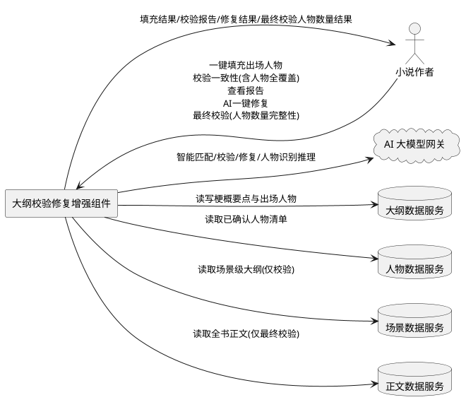
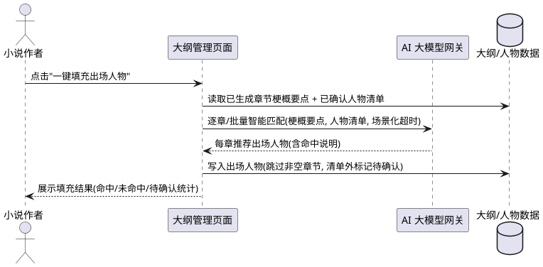
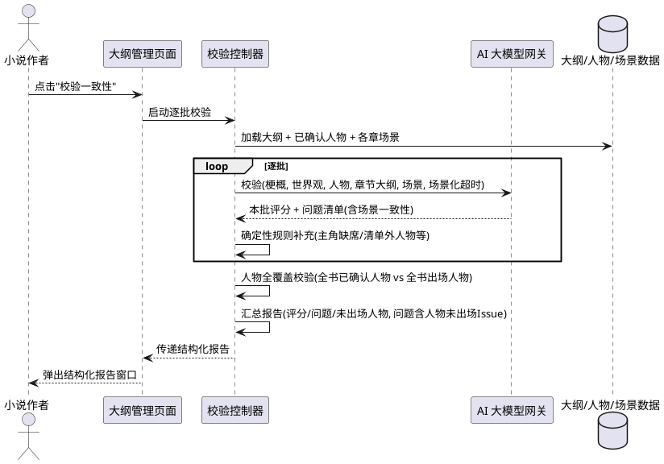
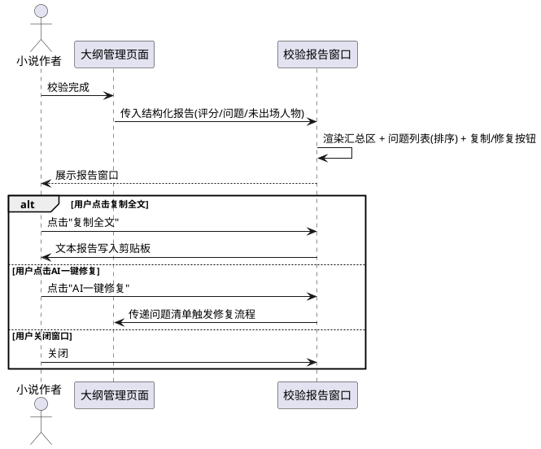
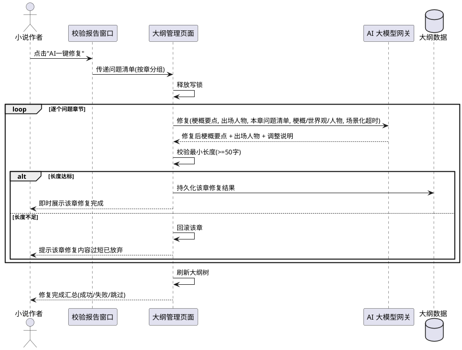
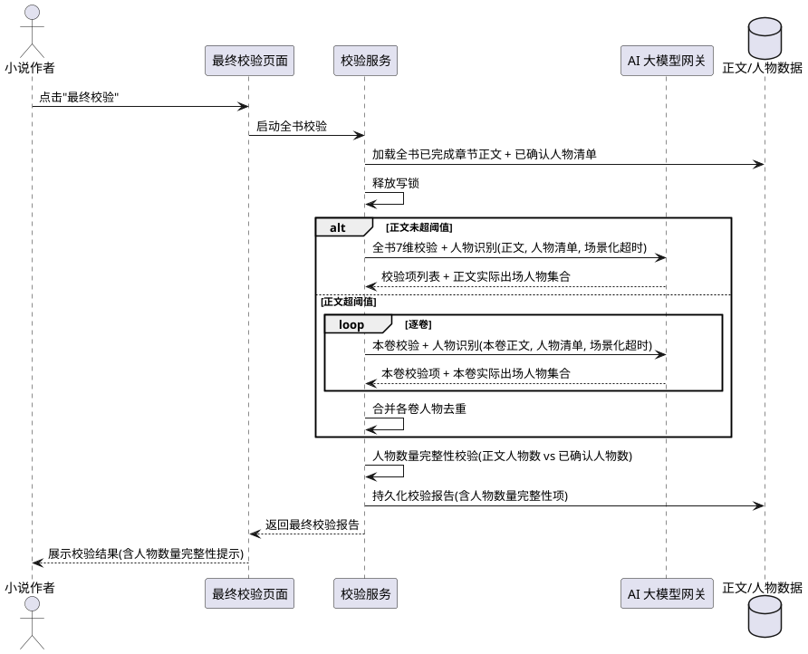

# 大纲校验修复增强 需求规格说明书

# **1. 组件定位**

## **1.1 核心职责**
本组件负责增强大纲管理页面的出场人物填充、一致性校验（含人物全覆盖校验）、校验报告展示与大纲一键修复能力，并增强全书最终校验的人物数量完整性校验能力，实现大纲层"校验→展示问题→AI修复→同步更新"的闭环与全书成稿层"最终校验→人物数量完整性提示"的闭环。

## **1.2 核心输入**
1. 用户在大纲管理页面点击"一键填充出场人物"按钮的操作指令（针对选中章节或全书已生成章节）
2. 用户点击"校验一致性"按钮的操作指令（触发逐批校验，含人物全覆盖校验）
3. 用户在校验报告窗口点击"AI一键修复"按钮的操作指令（携带问题清单）
4. 用户对修复结果的确认或放弃指令
5. 上游已有数据：故事梗概、世界观设定、已确认人物清单、章卷大纲（含梗概要点与出场人物）、场景级大纲（目标/角色/关键事件/情绪/字数）
6. 用户在全书撰写完成后触发"最终校验"的操作指令（针对全书已完成章节正文）

## **1.3 核心输出**
1. 返回给用户的出场人物填充结果（每章补全后的出场人物列表，含命中与未命中说明）
2. 推送给用户的结构化校验报告（评分、问题清单、未出场人物统计，问题清单含人物未出场问题）
3. 返回给用户的大纲修复结果（逐章修复后的梗概要点与出场人物、调整说明）
4. 触发大纲树刷新通知，使大纲管理页面同步展示修复后的内容
5. 返回给用户的最终校验报告中的人物数量完整性校验结果（正文实际出场人物数、已确认人物数、是否满足数量要求及提示性问题描述）

## **1.4 职责边界**
1. 本组件不负责从零生成全书大纲（由既有大纲生成流程承担）
2. 本组件不负责场景级大纲的生成与编辑（由既有场景细化流程承担），仅在校验时读取场景数据做一致性比对
3. 本组件不负责正文内容的润色修改（由既有正文润色服务承担），仅修复大纲层的梗概要点与出场人物
4. 本组件不负责人物清单的创建与确认（由既有人物管理承担），仅消费已确认人物清单做匹配
5. 本组件不负责世界观与梗概的编写，仅将其作为校验与修复的参照基准
6. 本组件不负责正文的生成与润色（由既有正文生成与润色服务承担），仅在最终校验时读取正文统计其中出现的人物数量
7. 本组件不负责最终校验的其他既有维度（梗概贴合、世界观一致等 7 维校验），仅增强其人物数量完整性维度

# **2. 领域术语**

**出场人物（characters_appearing）**
: 每章大纲中登记的、本章实际出场或推动情节的人物姓名集合，以"、"分隔的字符串形式存储。
: 备注：生成模板中列为铁律 E，不得为空；本组件增强其智能填充能力。

**梗概要点（synopsis_points）**
: 每章大纲对该章核心情节的概括描述，字数建议 100-300 字。
: 备注：校验与修复的核心对象之一。

**已确认人物清单**
: 用户在人物管理中确认过的、可信的人物集合，含姓名、身份、简介、关系。
: 备注：出场人物填充与校验的比对基准。

**校验问题（Issue）**
: 一致性校验发现的单个问题，含严重程度（严重/一般/轻微）、关联章号、问题类型、问题描述、修改建议。
: 备注：修复功能的输入依据。

**场景一致性**
: 场景级大纲与本章梗概要点、出场人物之间的吻合程度，包括场景是否推进本章梗概、场景角色是否属于本章出场人物、场景关键事件是否合理。

**历史节点顺序**
: 针对根植于真实历史或约定故事体系（封神/洪荒/西游/三国等）的题材，人物出场与重大事件须遵循既定时间先后。
: 备注：修复时禁止跨历史阶段混搭人物与情节。

**逐章修复**
: 大纲修复按章节逐章调用 AI、即时返回、可暂停续写的模式，避免一次性全书修复导致 AI 超时。
: 备注：与既有分批生成、逐批校验对称。

**人物全覆盖校验**
: 一致性校验的一个维度，检查人物管理页面中所有已确认人物是否都至少在某一章的出场人物（characters_appearing）中登记，未在任何章节登记者作为正式校验问题（Issue）纳入报告。
: 备注：区别于既有报告末尾的未出场人物提示文本，本维度将未出场人物提升为结构化校验问题，参与问题排序、修复入口与复制全文。

**人物数量完整性校验**
: 全书最终校验的一个维度，要求全书正文中实际出现的人物数量大于人物管理列表中已确认人物数量，用于发现已确认人物未在正文出场或正文未引入任何额外人物的情况。
: 备注：提示性问题，不硬性拦截；撰写过程中自动生成的临时配角、路人等不在人物管理列表中属合理情况。

**全书正文中实际出现的人物**
: 通过姓名匹配或 AI 识别从全书已完成章节正文中统计得到的人物姓名集合，含人物管理列表中人物与撰写过程中自动生成的临时人物。
: 备注：最终校验人物数量完整性校验的统计对象。

# **3. 角色与边界**

## **3.1 核心角色**
- 小说作者：在大纲管理页面操作出场人物填充、校验一致性、查看报告、触发并确认 AI 修复的唯一人类角色。

## **3.2 外部系统**
- AI 大模型网关：承担出场人物智能匹配、一致性校验、大纲修复、最终校验人物识别的 AI 推理调用。
- 大纲数据服务：提供章卷大纲、梗概要点、出场人物的读写。
- 人物数据服务：提供已确认人物清单的读取。
- 场景数据服务：提供场景级大纲的读取（仅校验阶段）。
- 正文数据服务：提供全书已完成章节正文内容的读取（仅最终校验人物数量统计时）。

## **3.3 交互上下文**

# **4. DFX约束**

## **4.1 性能**
1. 单章出场人物填充的 AI 调用响应时间上限：场景化超时参数控制，不得回退全局默认超时
2. 单批一致性校验（含场景维度）的 AI 调用响应时间上限：沿用既有分批超时配置
3. 单章大纲修复的 AI 调用响应时间上限：场景化超时参数控制，不得回退全局默认超时
4. 校验报告窗口的渲染须在 1 秒内完成，问题清单支持滚动浏览
5. 全书修复须逐章进行、即时返回每章结果，禁止一次性提交全书导致超时

## **4.2 可靠性**
1. 出场人物填充失败时不得破坏既有大纲数据，原出场人物非空章节默认跳过
2. 校验过程须与既有逐批校验一致：单批失败不影响其他批次，最终汇总已成功批次
3. 修复过程须可暂停、可续写，暂停时已完成章节的修复结果已持久化
4. 修复后的大纲须通过最小长度校验（梗概要点 ≥ 50 字），不足则该章回滚并提示
5. 长耗时 AI 调用前须释放写锁，避免阻塞自动保存与网关计数器写回

## **4.3 安全性**
1. 所有 AI 调用须通过统一网关出口，携带模块名、场景名、项目 ID 与场景化超时参数
2. 修复操作须可审计：记录修复触发时间、涉及章节、问题清单摘要
3. 修复不得针对特定小说硬编码任何人物名、地名、情节

## **4.4 可维护性**
1. 新增提示词模板须放置于大纲提示词目录并完成注册
2. AI 调用日志中的场景名称须使用中文，便于运维定位
3. 校验问题类型须可扩展，新增校验维度无须改动报告窗口结构

## **4.5 兼容性**
1. 既有无出场人物的存量大纲数据须兼容：填充与校验前自动兜底，不强制用户先重新生成
2. 既有纯文本校验报告用户须可继续复制：结构化报告窗口须保留"复制全文"能力
3. 既有校验接口的请求与响应结构须向后兼容，新增场景校验维度不得破坏既有调用方

# **5. 核心能力**

## **5.1 出场人物一键填充**

### **5.1.1 业务规则**
1. **按钮可用性**：当大纲管理页面存在已生成章节（梗概要点非空）且存在已确认人物清单时，系统应当启用"一键填充出场人物"按钮；否则应当禁用并提示前置条件缺失。
   - 验收条件：[无已生成章节或无已确认人物] → [按钮禁用，悬停提示"请先生成大纲并确认人物清单"]
2. **按钮位置**：系统必须将"一键填充出场人物"按钮放置于"细化场景"按钮附近，与既有大纲操作按钮同属一行。
   - 验收条件：[打开大纲管理页面] → [按钮位于细化场景按钮邻近位置，可见且可点击]
3. **智能匹配范围**：当用户触发一键填充时，系统应当以每章梗概要点文本与已确认人物清单为输入，调用 AI 进行智能匹配（含代词、简称、别名识别），为出场人物为空的章节推荐出场人物。
   - 验收条件：[某章出场人物为空且梗概要点提及某人物（含代词/简称）] → [AI 匹配后该章出场人物包含该人物姓名]
4. **非空跳过**：系统必须跳过出场人物已非空的章节，不覆盖用户已确认或已手动填写的内容。
   - 验收条件：[某章出场人物已有值] → [该章不被填充覆盖，保持原值]
5. **结果归属校验**：填充结果中的人物姓名必须存在于已确认人物清单；AI 推荐了清单外人物时，系统应当将其标记为"待确认"而非直接写入。
   - 验收条件：[AI 推荐了清单外姓名] → [该姓名标记待确认，不直接写入出场人物字段]
6. **通用性**：填充逻辑禁止针对特定小说硬编码任何人物名或匹配规则。
   - 验收条件：[对不同小说项目执行填充] → [均依据该项目已确认人物清单与梗概要点动态匹配，无硬编码]
7. **超时控制**：AI 调用必须传入场景化超时参数，禁止回退全局默认超时。
   - 验收条件：[触发填充] → [AI 调用携带场景化超时，超时后返回明确提示而非无限等待]

### **5.1.2 交互流程**

### **5.1.3 异常场景**
1. **无已确认人物**
   - 触发条件：项目下已确认人物清单为空
   - 系统行为：禁用按钮，不发起 AI 调用
   - 用户感知：按钮置灰，悬停提示"请先确认人物清单"
2. **无已生成章节**
   - 触发条件：大纲中所有章节梗概要点为空
   - 系统行为：禁用按钮
   - 用户感知：按钮置灰，悬停提示"请先生成大纲"
3. **AI 调用超时**
   - 触发条件：AI 智能匹配超过场景化超时阈值
   - 系统行为：终止本次调用，不写入部分结果
   - 用户感知：提示"出场人物填充超时，请重试或检查网络"
4. **AI 返回无法解析**
   - 触发条件：AI 返回内容无法解析为人物姓名结构
   - 系统行为：该章跳过，继续处理其他章节
   - 用户感知：结果中标注"第 X 章匹配结果解析失败，已跳过"

## **5.2 校验一致性增强**

### **5.2.1 业务规则**
1. **校验维度扩展**：当用户触发校验一致性时，系统必须在校验既有五维度（梗概贴合度、世界观一致性、人物出场逻辑、情节衔接、历史节点）基础上，增加场景一致性维度与人物全覆盖校验维度。
   - 验收条件：[触发校验且章节已细化场景] → [校验结果包含场景一致性相关问题]；[触发校验且存在未在任何章节登场的已确认人物] → [校验结果包含人物未出场相关问题]
2. **场景一致性子维度**：场景一致性必须包含以下子项：
   - 场景是否与本章梗概要点匹配（场景目标/关键事件是否推进本章梗概）
   - 场景角色是否与本章出场人物一致（场景中出现的人物是否均登记于本章出场人物）
   - 场景关键事件是否合理（有无与梗概冲突、有无重复事件）
   - 验收条件：[某章场景角色含未登记人物] → [产出"一般"级别问题，建议补充登记或调整场景角色]
3. **无场景时降级**：当待校验章节尚未细化场景时，系统应当跳过场景一致性维度，仅校验既有五维度，不报"无场景"错误。
   - 验收条件：[章节无场景数据] → [正常完成既有五维度校验，不因缺场景报错]
4. **分批对称**：场景一致性校验必须与既有分批校验对称，逐批进行、单批输入规模可控，避免整本一次校验超时。
   - 验收条件：[全书章节较多] → [按批次校验，每批含场景数据，单批不超时]
5. **问题结构复用**：场景一致性发现的问题必须复用既有问题结构（严重程度/章号/类型/描述/建议），新增的"问题类型"取值包含"场景一致性"。
   - 验收条件：[场景一致性问题] → [问题 type 为"场景一致性"，其余字段结构不变]
6. **兜底保留**：校验前对出场人物为空章节的兜底补全逻辑必须保留，避免对存量数据重复报"未登记出场人物"。
   - 验收条件：[存量章节出场人物为空] → [校验前自动补全，不重复报未登记]
7. **历史节点约束**：针对根植于真实历史或约定故事体系的题材，校验与后续修复须核对人物出场与重大事件的时间先后，禁止跨历史阶段混搭。
   - 验收条件：[历史题材且人物跨阶段出场] → [产出"严重"级别历史节点问题]
8. **人物全覆盖校验**：校验一致性时，系统必须同步检查人物管理页面中所有已确认人物是否都至少在某一章的出场人物（characters_appearing）中登记；未在任何章节出场人物中登记的已确认人物，必须作为正式校验问题（Issue）纳入报告，级别为"一般"，类型为"人物未出场"，建议为"请确认该人物在后续情节中的出场安排，或从已确认人物列表中移除"。
   - 验收条件：[某已确认人物未在任何章节 characters_appearing 中出现] → [报告问题清单含一条 level=一般、type=人物未出场 的 Issue，detail 指明该人物姓名，suggestion 为出场安排或移除建议]
9. **人物全覆盖校验全书维度**：人物全覆盖校验为全书级维度，须在所有批次校验完成后、汇总报告时基于全书大纲与全部已确认人物统一计算，不得按批次局部判定（避免某人物在本批未出场但在他批已出场时误报）。
   - 验收条件：[某人物在 A 批未出场但在 B 批已出场] → [汇总报告不产出该人物的人物未出场 Issue]
10. **人物全覆盖校验与既有提示并存**：人物全覆盖校验产出的正式 Issue 与既有报告末尾的未出场人物提示（missing_characters）并存，正式 Issue 参与问题排序、修复入口与复制全文，提示文本保留作为汇总区统计。
    - 验收条件：[存在未出场已确认人物] → [问题清单含对应 Issue 且报告汇总区仍展示未出场人物统计]
11. **人物全覆盖校验空清单降级**：当已确认人物清单为空时，系统应当跳过人物全覆盖校验维度，不报"无人物"错误。
    - 验收条件：[已确认人物清单为空] → [正常完成其他维度校验，不因缺人物报错]

### **5.2.2 交互流程**

### **5.2.3 异常场景**
1. **场景数据加载失败**
   - 触发条件：场景数据服务不可用或章节场景读取异常
   - 系统行为：该批降级为既有五维度校验，记录告警
   - 用户感知：校验正常完成，报告中该批无场景一致性维度，日志含告警
2. **梗概或世界观缺失**
   - 触发条件：未输入故事梗概或世界观
   - 系统行为：终止校验，提示前置条件
   - 用户感知：提示"请先输入故事梗概/世界观"
3. **AI 校验超时**
   - 触发条件：单批校验 AI 调用超过场景化超时
   - 系统行为：该批标记失败，继续后续批次
   - 用户感知：报告中标注"第 X 批校验超时已跳过"，其余批次正常
4. **出场人物大面积缺失**
   - 触发条件：全书章节的 characters_appearing 字段大面积为空（如存量数据未填充）
   - 系统行为：人物全覆盖校验仍正常执行，将未出场已确认人物作为"一般"级别 Issue 列出，并在报告建议中提示先执行"一键填充出场人物"
   - 用户感知：报告中含大量"人物未出场"Issue，建议提示先填充出场人物再校验

## **5.3 校验报告窗口**

### **5.3.1 业务规则**
1. **结构化展示**：校验完成后，系统必须以结构化对话框（QDialog）替代既有纯文本消息弹窗，展示问题清单。
   - 验收条件：[校验完成] → [弹出 QDialog 报告窗口，非 QMessageBox 纯文本]
2. **问题列表字段**：问题列表每条必须展示严重程度、卷号、章号、问题类型、问题描述、修改建议。
   - 验收条件：[报告含 N 条问题] → [列表展示 N 行，每行含级别/卷/章/类型/详情/建议六列]
3. **排序规则**：问题列表必须按严重程度（严重→一般→轻微）优先排序，同级别按卷号、章号升序。
   - 验收条件：[含多级别问题] → [严重在前，同级按卷章顺序]
4. **汇总信息**：报告窗口顶部必须展示整体评分、已校验章节数、问题总数、未出场人物统计。
   - 验收条件：[打开报告] → [顶部显示评分 X/100、校验 N 章、问题 M 条、未出场 K 人]
5. **复制能力保留**：报告窗口必须保留"复制全文"按钮，生成与既有纯文本报告一致的文本供复制。
   - 验收条件：[点击复制全文] → [剪贴板含完整文本报告，格式与既有一致]
6. **修复按钮**：报告窗口底部必须提供"AI一键修复"按钮；当问题清单为空时该按钮禁用。
   - 验收条件：[存在问题] → [修复按钮可点击]；[无问题] → [修复按钮禁用]
7. **空问题友好提示**：当校验未发现问题时，系统应当展示"未发现问题"的肯定性提示而非空列表。
   - 验收条件：[问题清单为空] → [展示"大纲与梗概、世界观、人物设定基本一致"]
8. **对话框返回值**：报告窗口须使用正确的对话框接受/拒绝枚举，禁止使用不存在的枚举常量。
   - 验收条件：[点击修复或关闭] → [使用 QDialog.DialogCode.Accepted/Rejected，无属性错误]

### **5.3.2 交互流程**

### **5.3.3 异常场景**
1. **问题数据字段缺失**
   - 触发条件：某条问题缺少级别或章号字段
   - 系统行为：以默认值（"提示"/0）填充并正常展示
   - 用户感知：该行正常显示，无崩溃
2. **报告数据为空**
   - 触发条件：校验返回空结果
   - 系统行为：展示"未发现问题"提示，修复按钮禁用
   - 用户感知：窗口正常弹出，无空列表闪烁

## **5.4 大纲AI一键修复**

### **5.4.1 业务规则**
1. **修复入口**：当用户在校验报告窗口点击"AI一键修复"时，系统必须以当前问题清单为输入，启动大纲修复流程。
   - 验收条件：[点击修复且问题清单非空] → [启动修复流程，传入问题清单]
2. **逐章修复**：修复必须按章节逐章进行、即时返回每章结果、可暂停续写，禁止一次性全书修复。
   - 验收条件：[问题涉及多章] → [逐章调用 AI，每章完成后即时返回，可暂停]
3. **修复对象**：AI 修复的对象为对应章节的梗概要点与出场人物，不得改动正文内容、世界观、梗概或人物清单本身。
   - 验收条件：[修复完成] → [仅梗概要点与出场人物变化，正文/世界观/人物清单不变]
4. **问题驱动**：AI 修复必须以问题清单中该章的问题（描述+建议）为依据，针对性地修正，而非无差别重写。
   - 验收条件：[某章有"人物出场"问题] → [修复聚焦补全/调整该章出场人物]
5. **最小长度校验**：修复后的梗概要点必须 ≥ 50 字，不足则该章修复视为失败并回滚。
   - 验收条件：[修复后梗概 < 50 字] → [该章回滚原值，提示"修复内容过短已放弃"]
6. **出场人物同步完善**：修复时必须同步完善该章出场人物设置，确保修复后出场人物与梗概要点提及的人物一致且归属已确认清单。
   - 验收条件：[修复后梗概提及新人物] → [出场人物同步包含该人物（须在已确认清单内）]
7. **大纲树同步**：修复完成后必须同步更新大纲管理页面的大纲树，展示修复后的梗概要点与出场人物。
   - 验收条件：[某章修复成功] → [大纲树该章节点刷新展示新内容]
8. **历史节点顺序约束**：针对历史题材，修复须按既定历史节点顺序调整人物与情节，禁止跨历史阶段混搭。
   - 验收条件：[历史题材修复] → [修复后人物出场与事件符合历史时间线]
9. **通用性**：修复逻辑禁止针对特定小说硬编码任何人物、地点、情节。
   - 验收条件：[对不同小说执行修复] → [均依据该项目数据动态修复，无硬编码]
10. **超时与写锁**：每章修复的 AI 调用必须传入场景化超时参数，且长耗时调用前须释放写锁。
    - 验收条件：[触发修复] → [AI 调用携带场景化超时，调用前已释放写锁]
11. **修复范围可选**：系统应当支持用户选择修复范围（全部问题章节或仅严重/一般级别问题章节），默认修复全部问题章节。
    - 验收条件：[用户选择仅修复严重问题] → [仅对含严重问题的章节执行修复]

### **5.4.2 交互流程**

### **5.4.3 异常场景**
1. **AI 修复超时**
   - 触发条件：单章修复 AI 调用超过场景化超时
   - 系统行为：该章标记失败，继续下一章，可续写重试
   - 用户感知：汇总中标注"第 X 章修复超时"，可对该章重试
2. **修复内容过短**
   - 触发条件：修复后梗概要点 < 50 字
   - 系统行为：该章回滚原值，不计入成功
   - 用户感知：提示"第 X 章修复内容过短已放弃，请手动处理"
3. **AI 返回无法解析**
   - 触发条件：修复返回无法解析为梗概要点与出场人物结构
   - 系统行为：该章跳过，保留原值
   - 用户感知：汇总中标注"第 X 章修复结果解析失败"
4. **修复中途暂停**
   - 触发条件：用户点击暂停
   - 系统行为：停止后续章节，已完成章节结果已持久化
   - 用户感知：提示"修复已暂停，已完成章节已保存，可续写"
5. **写锁冲突**
   - 触发条件：修复期间自动保存触发写锁竞争
   - 系统行为：修复前已释放写锁，AI 调用期间不持有写锁
   - 用户感知：无"database is locked"报错，修复与自动保存并行无冲突
6. **历史节点冲突**
   - 触发条件：修复建议将人物跨历史阶段混搭
   - 系统行为：AI 提示词约束按历史节点顺序，拒绝跨阶段混搭
   - 用户感知：修复后人物出场符合历史时间线，或该章标记需人工处理

## **5.5 全书最终校验人物数量完整性校验**

### **5.5.1 业务规则**
1. **校验入口**：当全书撰写完成、用户触发"最终校验"时，系统必须在既有全书 7 维校验基础上，增加"人物数量完整性"校验维度。
   - 验收条件：[全书撰写完成并触发最终校验] → [最终校验结果包含人物数量完整性校验项]
2. **统计对象**：人物数量完整性校验须统计两个数量：
   - 全书正文中实际出现的人物数量（通过姓名匹配或 AI 识别从全书已完成章节正文中提取）
   - 人物管理列表中已确认人物数量
   - 验收条件：[触发最终校验] → [校验结果含正文实际出场人物数与已确认人物数两个统计值]
3. **数量要求**：要求全书正文中实际出现的人物数量 > 人物管理列表中已确认人物数量。
   - 验收条件：[正文实际出场人物数 > 已确认人物数] → [人物数量完整性校验结果为通过]；[正文实际出场人物数 ≤ 已确认人物数] → [校验结果为不通过并产出提示性问题]
4. **数量要求含义**：撰写过程中可能自动生成了临时配角、路人等额外人物，这些人物出现在正文中但不在人物管理列表中，属合理情况；若正文人物数 ≤ 已确认人物数，说明可能有人物管理列表中的人物未在正文出场，或正文没有引入任何额外人物。
   - 验收条件：[正文含临时配角且不在人物管理列表] → [正文人物数 > 已确认人物数，校验通过]
5. **提示性问题**：当正文实际出场人物数 ≤ 已确认人物数时，系统必须产出一条提示性问题，问题描述须指明两个数量值与差距，问题建议须提示用户检查已确认人物是否均在正文出场或正文是否过于依赖既有人物未引入新人物。
   - 验收条件：[正文人物数 ≤ 已确认人物数] → [产出提示性问题，problem_desc 含两个数量与差距，含检查建议]
6. **非硬性拦截**：人物数量完整性校验为提示性问题，不硬性拦截全书发布或后续流程，仅作为最终校验报告中的一条校验项呈现。
   - 验收条件：[人物数量完整性不通过] → [最终校验报告含该提示项，但不阻断后续操作]
7. **正文人物识别方式**：统计全书正文中实际出现的人物时，系统应当优先采用姓名匹配（以已确认人物清单姓名在正文中检索），并可通过 AI 识别补充发现正文中的额外人物（不在已确认清单中的姓名）。
   - 验收条件：[正文提及已确认人物姓名] → [计入正文实际出场人物]；[正文含未登记姓名且 AI 识别为人物] → [计入正文实际出场人物]
8. **空正文降级**：当全书无已完成章节正文时，系统应当跳过人物数量完整性校验，不报"无正文"错误。
   - 验收条件：[无已完成章节正文] → [最终校验正常完成其他维度，不因缺正文报错]
9. **空人物清单降级**：当已确认人物清单为空时，系统应当跳过人物数量完整性校验，不报"无人物"错误。
   - 验收条件：[已确认人物清单为空] → [最终校验正常完成其他维度，不因缺人物报错]
10. **分批对称**：当全书正文字数超过校验批处理阈值时，人物数量统计须与既有分批校验对称，按卷分批统计后合并去重，避免一次性处理全书正文超时。
    - 验收条件：[全书正文字数超阈值] → [按卷分批统计人物并合并去重，单批不超时]
11. **结果结构复用**：人物数量完整性校验结果必须复用既有最终校验项结构（check_type/result/problem_desc/volume_no/chapter_no），新增的 check_type 取值为"character_count_integrity"。
    - 验收条件：[人物数量完整性校验项] → [check_type 为"character_count_integrity"，其余字段结构不变]
12. **通用性**：人物数量完整性校验逻辑禁止针对特定小说硬编码任何人物名或识别规则。
    - 验收条件：[对不同小说项目执行最终校验] → [均依据该项目正文与已确认人物动态统计，无硬编码]

### **5.5.2 交互流程**

### **5.5.3 异常场景**
1. **正文人物识别 AI 调用超时**
   - 触发条件：AI 人物识别调用超过场景化超时
   - 系统行为：降级为仅姓名匹配统计已确认人物在正文中的出现数，记录告警
   - 用户感知：最终校验正常完成，人物数量完整性校验项标注"AI 识别降级为姓名匹配"，日志含告警
2. **正文人物识别 AI 返回无法解析**
   - 触发条件：AI 返回内容无法解析为人物姓名集合
   - 系统行为：降级为仅姓名匹配统计，记录告警
   - 用户感知：最终校验正常完成，人物数量完整性校验项标注"AI 识别结果解析失败，已降级"
3. **无已完成章节正文**
   - 触发条件：全书无已完成章节正文
   - 系统行为：跳过人物数量完整性校验，既有 7 维校验由上游提示"无已完成章节"
   - 用户感知：提示"无已完成章节"或最终校验报告中无人物数量完整性项
4. **正文数据加载失败**
   - 触发条件：正文数据服务不可用或章节正文读取异常
   - 系统行为：跳过人物数量完整性校验，记录告警，其他维度正常完成
   - 用户感知：最终校验报告中无人物数量完整性项，日志含告警
5. **写锁冲突**
   - 触发条件：最终校验期间自动保存触发写锁竞争
   - 系统行为：校验前已释放写锁，AI 调用期间不持有写锁
   - 用户感知：无"database is locked"报错，校验与自动保存并行无冲突

# **6. 数据约束**

## **6.1 校验问题（Issue）**
1. **level**：严重程度，取值范围为"严重""一般""轻微"，空值按"提示"处理
2. **chapter_no**：关联章号，正整数；0 表示整批级别问题
3. **volume_no**：关联卷号，正整数（报告汇总时补充）
4. **type**：问题类型，取值包含"偏离梗概""世界观冲突""人物出场""人物未出场""情节衔接""历史节点""场景一致性""其他"，可扩展
5. **detail**：问题描述，须指明具体章节与位置，非空字符串
6. **suggestion**：修改建议，可执行的文本，可为空

## **6.2 校验报告**
1. **score**：整体一致性评分，整数，范围 0-100，分数越低表示偏差越大
2. **checked_chapter_count**：已校验章节数，非负整数
3. **issues**：问题清单，按级别与卷章排序
4. **missing_characters**：未在大纲中出场的已确认人物列表，每项含姓名与身份
5. **text**：可复制的纯文本报告，与结构化数据内容一致

## **6.3 出场人物填充结果**
1. **chapter_no**：章号，正整数
2. **matched**：命中的人物姓名列表，须归属已确认人物清单
3. **pending**：待确认的人物姓名列表（AI 推荐但不在已确认清单中）
4. **skipped**：是否因原值非空而跳过，布尔值

## **6.4 大纲修复结果**
1. **chapter_no**：章号，正整数
2. **synopsis_points_new**：修复后梗概要点，须 ≥ 50 字
3. **characters_appearing_new**：修复后出场人物，"、"分隔，须归属已确认人物清单
4. **adjust_notes**：调整说明列表，每项含调整位置、原因、原文、改后文
5. **status**：修复状态，取值"成功""失败""跳过""回滚"
6. **fail_reason**：失败/回滚原因，status 非"成功"时非空

## **6.5 场景数据（校验只读参照）**
1. **goal**：场景目标，非空
2. **characters**：场景出场角色，分隔符分隔的姓名串
3. **key_event**：场景关键事件，非空
4. **mood**：情绪基调，可为空
5. **est_words**：预计字数，非负整数

## **6.6 最终校验人物数量完整性校验项**
1. **check_type**：校验类型，固定取值"character_count_integrity"
2. **result**：校验结果，取值"pass""fail"；全书正文中实际出场人物数 > 已确认人物数时为"pass"，否则为"fail"
3. **problem_desc**：问题描述，result 为"fail"时非空，须含正文实际出场人物数、已确认人物数与差距及检查建议；result 为"pass"时可为空
4. **volume_no**：关联卷号，可为空（全书级校验项）
5. **chapter_no**：关联章号，可为空（全书级校验项）
6. **content_character_count**：全书正文中实际出现的人物数量，非负整数（校验结果附带的统计值）
7. **confirmed_character_count**：人物管理列表中已确认人物数量，非负整数（校验结果附带的统计值）