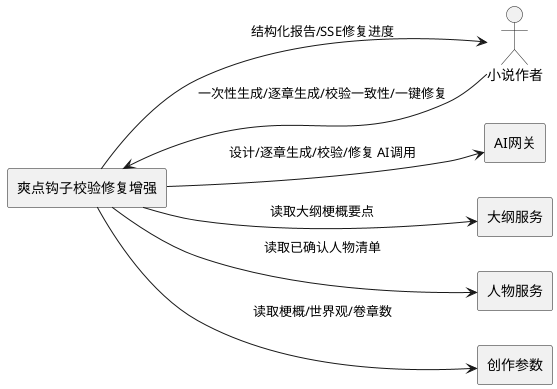
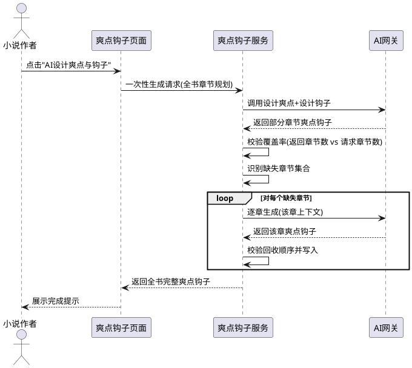
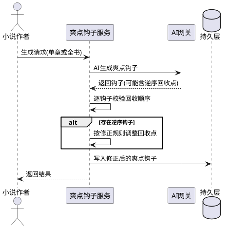
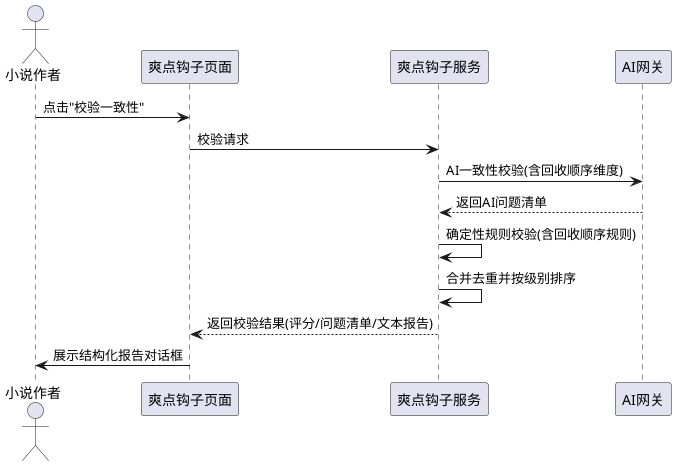
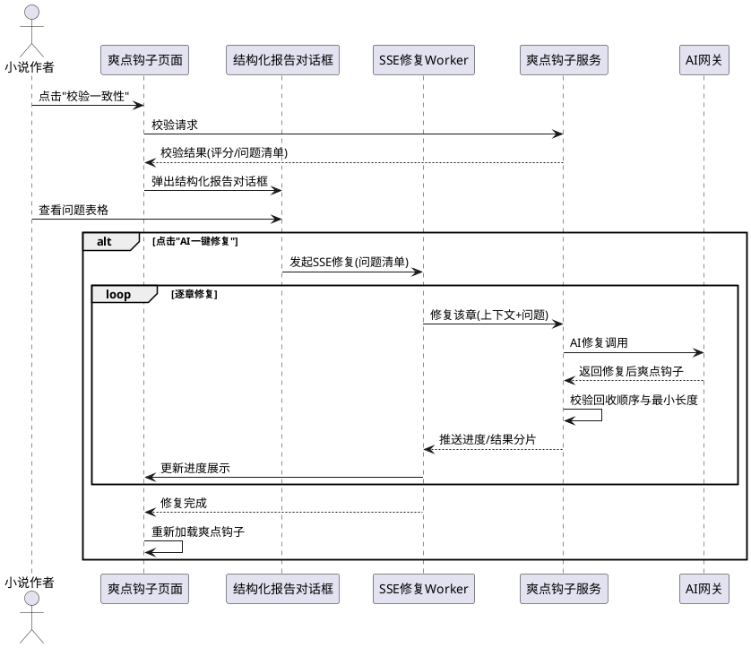

# 爽点钩子校验修复增强 需求规格

> 功能名称：hook_check_repair
> 所属项目：AiBooks（全自动小说撰写桌面软件）
> 文档定位：本文件描述"爽点钩子校验修复增强"功能的需求规格，仅规定"做什么"，不规定"怎么做"。

---

# 1. 组件定位

## 1.1 核心职责
本组件负责校验与修复爽点钩子的全书覆盖率、回收顺序一致性与结构化报告展示，实现全书每卷每章爽点钩子完整、回收逻辑正确、问题可视化且可一键 AI 修复。

## 1.2 核心输入
1. 小说作者在爽点钩子页面点击"AI设计爽点与钩子"发起的一次性生成请求，含全书卷数、每卷章数与章节规划清单。
2. 小说作者点击"校验一致性"发起的一致性校验请求。
3. 小说作者在结构化报告对话框中点击"AI一键修复"发起的修复请求，含待修复问题清单。
4. AI 网关返回的爽点钩子设计结果（可能仅覆盖部分章节，且回收章号可能逆序）。
5. 大纲服务提供的大纲各章梗概要点、人物服务提供的已确认人物清单、创作参数提供的故事梗概与世界观。

## 1.3 核心输出
1. 全书每卷每章完整的爽点与钩子数据（覆盖率 100%）。
2. 一致性校验结果，含评分、总体评价、问题清单（含回收顺序错误维度）与可复制纯文本报告。
3. 结构化校验报告对话框，以六列表格展示问题，含级别/卷/章/类型/详情/建议。
4. SSE 流式修复进度与逐章修复结果，支持暂停、续写、跳过失败章节。

## 1.4 职责边界
- 不负责爽点钩子的具体文学内容质量评判，文学质量由 AI 模型保证。
- 不负责大纲、人物、梗概、世界观、章节正文的创建与管理，由各自专属页面/服务负责。
- 不负责章节正文生成时的回收状态联动扫描，由正文生成流程负责。
- 不负责针对特定小说硬编码任何人物、地点、势力、功法、物品或情节，修复须保持通用性。
- 不负责一次性生成时 AI 模型本身的输出长度扩容，仅负责对 AI 未返回章节的补齐与校验。

---

# 2. 领域术语

**爽点**
: 每章中能引发读者愉悦感或满足感的情节设计点，包含爽点类型与内容描述。
: 备注：对应数据对象 CoolPoint。

**钩子**
: 每章中设置的悬念、伏笔或未解之谜，用于驱动读者继续阅读，必须配有回收计划。
: 备注：对应数据对象 Hook。

**埋钩点**
: 钩子所在的卷号与章号二元组 (volume_no, chapter_no)，表示钩子被埋设的位置。

**回收点**
: 钩子计划被揭晓或解决的卷号与章号二元组 (recycle_volume_no, recycle_chapter_no)，表示钩子被回收的位置。

**回收顺序**
: 回收点相对于埋钩点的时序关系。正确的回收顺序要求回收点严格晚于埋钩点，即按 (卷号, 章号) 字典序比较时回收点大于埋钩点。
: 备注：逆序即"回收点早于或等于埋钩点"，属严重逻辑错误。

**回收距离**
: 回收点卷号与埋钩点卷号之差的绝对值，以卷为单位衡量回收跨度，上限为 3 卷。

**覆盖率**
: 已生成爽点钩子的章节数占全书规划章节数（卷数 × 每卷章数）的比例，一次性生成后须达到 100%。

**一次性生成**
: 单次 AI 调用为全书所有章节生成爽点钩子的模式，受 AI 输出长度限制可能仅返回部分章节。

**逐章生成**
: 按章节顺序逐次 AI 调用生成爽点钩子的模式，单次只处理一章，不受全书输出长度限制。

**补齐生成**
: 对一次性生成中 AI 未返回的章节，自动以逐章生成方式补全的过程，确保全书覆盖率达标。

**一致性校验**
: 对爽点钩子与故事梗概、世界观、人物清单、大纲梗概的一致性进行确定性规则检查与 AI 检查的双重校验。

**确定性规则校验**
: 不依赖 AI 模型的硬编码规则检查，包括钩子未回收、回收距离超限、回收顺序逆序等。

**结构化报告对话框**
: 以表格形式展示校验问题的对话框，含级别、卷、章、类型、详情、建议六列，列宽可调节且单元格支持悬浮提示。

**SSE 流式修复**
: 通过 Server-Sent Events 逐章推送 AI 修复进度与结果的长连接修复模式，支持暂停、续写、跳过。

**回收顺序错误**
: 钩子的回收点早于或等于埋钩点时产生的严重问题，级别为"严重"，类型为"回收顺序错误"。

---

# 3. 角色与边界

## 3.1 核心角色
- 小说作者：操作爽点钩子页面，发起一次性生成、逐章生成、一致性校验、一键修复请求，查看结构化报告并决策修复范围。

## 3.2 外部系统
- AI 网关：执行爽点钩子设计、逐章生成、一致性校验、修复的 AI 调用与结果解析，统一出口为 call_and_parse。
- 大纲服务：提供大纲各章梗概要点，作为逐章生成、一致性校验、修复的上下文输入。
- 人物服务：提供已确认人物清单与命名收藏，作为生成、校验、修复的上下文输入。
- 创作参数：提供故事梗概、世界观、卷数、每卷章数等全局设定。

## 3.3 交互上下文

---

# 4. DFX约束

## 4.1 性能
1. 一次性生成补齐阶段，单章补齐的 AI 调用须使用场景化超时参数控制，禁止回退全局默认超时。
2. SSE 流式修复须逐章推送进度，不得等待全书修复完成才一次性返回。
3. 一致性校验的 AI 调用须使用专属超时参数，与生成、修复超时相互独立。

## 4.2 可靠性
1. 一次性生成完成后，全书覆盖率必须达到 100%，即每卷每章均须存在至少一个爽点与至少一个钩子。
2. 回收顺序校验须在数据写入持久层之前完成，逆序数据禁止落库，须自动修正后再写入。
3. SSE 流式修复中单章修复失败不得中断后续章节修复，须标记跳过并继续。
4. 补齐生成中单章补齐失败须记录失败章节并继续后续章节，最终汇总未补齐章节。

## 4.3 安全性
1. 修复逻辑禁止硬编码任何人物姓名、地点、势力、功法、物品或情节，须保持通用性。
2. 修复提示词须注入项目上下文（梗概、世界观、人物清单、大纲梗概、原爽点钩子、问题清单），不得依赖外部固定语料。
3. 回收顺序修正须基于全书卷章规划自动推算，不得依赖特定小说的预设章节映射。

## 4.4 可维护性
1. 新增提示词模板须在 manifest.yaml 中注册，由提示词框架统一管理。
2. 新增 SSE 修复端点须复用现有 SSE Worker 基类，保持与大纲修复链路一致的交互范式。
3. 新增结构化报告对话框须对标现有大纲校验报告对话框的列结构与交互方式。

## 4.5 兼容性
1. 新增修复端点与结构化报告不得影响现有一次性生成、逐章生成、校验一致性、保存、删除端点的行为。
2. 新增回收顺序校验规则不得改变现有"钩子未回收""回收距离超限"规则的判定结果与级别。
3. 提示词模板的回收顺序约束为新增条款，不得删除现有"回收距离不超过3卷"等既有约束。

---

# 5. 核心能力

## 5.1 一次性生成覆盖率补齐

### 5.1.1 业务规则

1. **覆盖率校验规则**：一次性生成完成后，系统必须校验 AI 返回的爽点与钩子覆盖的章节数是否等于请求的章节数（卷数 × 每卷章数）。
   a. 验收条件：[一次性生成返回章节数 < 请求章节数] → [系统识别缺失章节集合并触发补齐生成]

2. **补齐生成规则**：对 AI 未返回爽点或钩子的章节，系统必须自动以逐章生成方式补齐，补齐须复用逐章生成的上下文装配逻辑（梗概、世界观、人物、大纲梗概、前序钩子）。
   a. 验收条件：[某章既无爽点也无钩子] → [系统对该章发起逐章生成并写入结果]

3. **补齐范围规则**：补齐生成仅针对缺失章节，不得重复生成已返回数据的章节，不得覆盖已存在的爽点钩子。
   a. 验收条件：[某章已由一次性生成返回完整数据] → [系统跳过该章不发起补齐]

4. **覆盖率达标规则**：补齐生成全部完成后，全书每卷每章必须同时存在至少一个爽点与至少一个钩子。
   a. 验收条件：[补齐完成] → [对任意 (v, c) 均存在爽点与钩子记录]

5. **禁止项**：禁止在一次性生成阶段直接放弃缺失章节并以部分覆盖率返回成功。
   a. 验收条件：[存在缺失章节且未补齐] → [系统不得向作者返回"生成完成"成功提示]

### 5.1.2 交互流程

### 5.1.3 异常场景

1. **AI 一次性生成返回空数据**
   a. 触发条件：AI 网关返回的爽点列表与钩子列表均为空
   b. 系统行为：将全书所有章节标记为缺失，对每章发起逐章生成
   c. 用户感知：页面提示"AI一次性生成未返回数据，已转为逐章生成模式"

2. **补齐生成中某章 AI 超时**
   a. 触发条件：单章补齐 AI 调用超过场景化超时阈值
   b. 系统行为：标记该章补齐失败，继续补齐后续章节，最终汇总失败章节
   c. 用户感知：完成提示中列出未补齐章节，建议重试逐章生成

3. **补齐生成中某章大纲梗概缺失**
   a. 触发条件：缺失章节的大纲梗概要点为空
   b. 系统行为：跳过该章补齐并记录原因，继续后续章节
   c. 用户感知：完成提示中列出因梗概缺失而跳过的章节

## 5.2 回收顺序校验与修正

### 5.2.1 业务规则

1. **回收顺序约束规则**：每个钩子的回收点必须严格晚于埋钩点，即按 (卷号, 章号) 字典序比较时 (recycle_volume_no, recycle_chapter_no) > (volume_no, chapter_no)。
   a. 验收条件：[回收点 ≤ 埋钩点] → [该钩子被判定为回收顺序错误]

2. **写入前修正规则**：在爽点钩子写入持久层之前，系统必须校验每个钩子的回收顺序，逆序时须自动修正回收点为埋钩点之后的某章。
   a. 验收条件：[AI返回钩子回收点早于埋钩点] → [系统自动修正回收点为当前章之后章节后写入]

3. **修正优先级规则**：回收顺序修正须优先保持回收距离不超过 3 卷的既有约束；若同卷内存在后续章节则修正为同卷末章，否则修正为下一卷某章。
   a. 验收条件：[逆序且同卷存在后续章节] → [修正回收点为同卷末章]
   b. 验收条件：[逆序且同卷无后续章节] → [修正回收点为下一卷某章且回收距离≤3卷]

4. **提示词约束规则**：一次性生成与逐章生成的提示词模板必须明确要求"回收点必须在埋钩点之后"，作为对 AI 输出的前置约束。
   a. 验收条件：[AI生成钩子] → [提示词包含回收点晚于埋钩点的明确文字约束]

5. **禁止项**：禁止将回收点等于埋钩点的钩子视为合法（同章设钩同章回收属逻辑错误）。
   a. 验收条件：[回收点 == 埋钩点] → [判定为回收顺序错误并修正]

### 5.2.2 交互流程

### 5.2.3 异常场景

1. **全书末章钩子无法找到后续回收章节**
   a. 触发条件：埋钩点为全书最后一卷最后一章，无任何后续章节可作为回收点
   b. 系统行为：将回收点修正为埋钩点本身并标记 recycle_status 为 unrecycled，记录警告
   c. 用户感知：校验报告中提示"末章钩子无后续章节可回收，建议调整埋钩位置"

2. **修正后回收距离仍超 3 卷**
   a. 触发条件：按修正规则推算的回收点与埋钩点距离超过 3 卷
   b. 系统行为：优先满足回收顺序正确，同时在校验报告中产出"回收距离超限"问题
   c. 用户感知：校验报告同时列出"回收顺序已修正"与"回收距离超限"两条问题

## 5.3 一致性校验增强

### 5.3.1 业务规则

1. **确定性回收顺序规则**：确定性规则校验必须新增回收顺序检查，对每个钩子比较 (recycle_volume_no, recycle_chapter_no) 与 (volume_no, chapter_no) 的字典序。
   a. 验收条件：[回收点 ≤ 埋钩点] → [产出级别为"严重"、类型为"回收顺序错误"的校验问题]

2. **回收顺序问题建议规则**：回收顺序错误问题的建议须指明应将回收点调整至埋钩点之后的章节。
   a. 验收条件：[产出回收顺序错误问题] → [建议包含"将回收章节调整至第N卷第M章之后"的明确指引]

3. **AI 校验维度增强规则**：AI 一致性校验提示词必须新增"回收顺序"校验维度，要求 AI 检查每个钩子的回收点是否晚于埋钩点。
   a. 验收条件：[AI校验提示词] → [包含回收点须晚于埋钩点的校验维度描述]

4. **规则与 AI 协同规则**：确定性规则产出的回收顺序问题与 AI 校验产出的其他问题须合并为统一问题清单，去重后按级别排序展示。
   a. 验收条件：[确定性规则与AI均产出问题] → [合并去重后按严重→一般→轻微排序]

5. **禁止项**：禁止删除现有"钩子未回收""回收距离超限""爽点涉及人物不在清单"等既有确定性规则。
   a. 验收条件：[执行一致性校验] → [既有规则与新规则均被执行]

### 5.3.2 交互流程

### 5.3.3 异常场景

1. **AI 校验超时**
   a. 触发条件：AI 一致性校验调用超过专属超时阈值
   b. 系统行为：仅返回确定性规则校验结果，标记 AI 校验未完成
   c. 用户感知：报告提示"AI校验超时，仅展示规则校验结果，建议重试"

2. **确定性规则与 AI 规则对同一章节产出重复问题**
   a. 触发条件：同一 (卷, 章) 的同一类型问题被确定性规则与 AI 同时产出
   b. 系统行为：按 (卷, 章, 类型) 去重，保留级别更高的一条
   c. 用户感知：报告中同一章节同一类型问题仅出现一条

## 5.4 结构化报告与一键AI修复

### 5.4.1 业务规则

1. **结构化报告展示规则**：一致性校验完成后，系统必须以结构化对话框展示结果，含六列表格（级别、卷、章、类型、详情、建议），替代纯文本弹窗。
   a. 验收条件：[校验完成且存在问题] → [弹出结构化报告对话框而非纯文本弹窗]

2. **表格列宽与提示规则**：表格列宽必须可调节，每个单元格内容须支持悬浮 tooltip 显示完整文本。
   a. 验收条件：[鼠标悬停于单元格] → [显示该单元格完整内容的tooltip]
   b. 验收条件：[拖动列分隔线] → [列宽随之调整]

3. **问题排序规则**：表格中的问题须按级别（严重→一般→轻微）优先、卷号次之、章号再次的顺序排列。
   a. 验收条件：[存在多级别多章节问题] → [按级别→卷号→章号排序展示]

4. **级别着色规则**：级别为"严重"的问题须以红色字体标识，"一般"以暗黄色标识，便于快速识别。
   a. 验收条件：[问题级别为严重] → [级别单元格字体为红色]
   b. 验收条件：[问题级别为一般] → [级别单元格字体为暗黄色]

5. **一键修复入口规则**：结构化报告对话框必须提供"AI一键修复"按钮，仅在存在问题时可点击，点击后以 SSE 流式逐章修复爽点钩子。
   a. 验收条件：[存在问题且点击修复按钮] → [发起 SSE 流式修复并关闭对话框]
   b. 验收条件：[不存在问题] → [修复按钮置灰不可点击]

6. **SSE 流式修复规则**：修复须逐章串行执行，每章修复前推送进度分片，修复完成后推送该章结果分片，支持暂停与续写。
   a. 验收条件：[修复第 N 章] → [先推送进度分片再推送结果分片]
   b. 验收条件：[作者点击暂停] → [停止后续章节修复并可续写]

7. **修复内容最小长度规则**：修复后的爽点描述与钩子内容长度必须不少于 50 字，不达标须标记修复失败。
   a. 验收条件：[修复后内容长度 < 50 字] → [标记该章修复失败]

8. **修复通用性规则**：修复提示词须注入项目上下文与问题清单，由 AI 基于上下文生成修复内容，禁止硬编码任何特定小说的情节。
   a. 验收条件：[发起修复] → [提示词包含梗概/世界观/人物/大纲/原数据/问题清单]

9. **复制全文规则**：结构化报告对话框须提供"复制全文"按钮，点击后将纯文本报告复制到系统剪贴板。
   a. 验收条件：[点击复制全文] → [剪贴板包含纯文本校验报告]

10. **禁止项**：禁止在修复过程中硬编码任何人物、地点、势力、功法、物品名称或特定情节走向。
    a. 验收条件：[修复任意项目] → [修复内容均由 AI 基于该项目上下文生成]

### 5.4.2 交互流程

### 5.4.3 异常场景

1. **修复中某章 AI 超时**
   a. 触发条件：单章修复 AI 调用超过场景化超时阈值
   b. 系统行为：推送该章跳过分片，继续修复后续章节
   c. 用户感知：进度展示中该章标记"跳过（AI超时）"

2. **修复后回收顺序仍逆序**
   a. 触发条件：AI 修复返回的钩子回收点仍早于埋钩点
   b. 系统行为：按回收顺序修正规则自动修正后再写入，并在结果分片中标注"已自动修正"
   c. 用户感知：该章修复结果提示"回收顺序已自动修正"

3. **修复后内容长度不足 50 字**
   a. 触发条件：AI 修复返回的爽点描述或钩子内容长度小于 50 字
   b. 系统行为：标记该章修复失败，不写入，继续后续章节
   c. 用户感知：进度展示中该章标记"修复失败（内容过短）"

4. **SSE 连接中断**
   a. 触发条件：修复过程中 SSE 连接异常断开
   b. 系统行为：Worker 报告连接异常，已修复章节保留，未修复章节可续写
   c. 用户感知：错误提示"修复连接中断，已完成 N 章，可重新发起修复续写"

5. **问题清单为空时点击修复**
   a. 触发条件：校验未发现问题但修复按钮被触发
   b. 系统行为：修复按钮处于置灰状态，不响应点击
   c. 用户感知：按钮不可点击，无修复请求发出

---

# 6. 数据约束

## 6.1 钩子（Hook）
1. **volume_no**：埋钩点卷号，取值范围 1 至 20 的整数，必填。
2. **chapter_no**：埋钩点章号，取值范围 1 至 100 的整数，必填。
3. **hook_content**：钩子内容描述，非空字符串，长度不少于 50 字，必填。
4. **recycle_volume_no**：回收点卷号，取值范围 1 至 20 的整数，必填，且须满足 (recycle_volume_no, recycle_chapter_no) > (volume_no, chapter_no)。
5. **recycle_chapter_no**：回收点章号，取值范围 1 至 100 的整数，必填，且回收距离 |recycle_volume_no - volume_no| ≤ 3。
6. **recycle_status**：回收状态，取值为 pending（未回收）、recycled（已回收）、unrecycled（不可回收）三者之一，默认 pending。
7. **source**：数据来源，取值为 ai_design 或 manual 之一。

## 6.2 爽点（CoolPoint）
1. **volume_no**：所在卷号，取值范围 1 至 20 的整数，必填。
2. **chapter_no**：所在章号，取值范围 1 至 100 的整数，必填。
3. **cool_type**：爽点类型，非空字符串，必填。
4. **content_desc**：爽点内容描述，非空字符串，长度不少于 50 字，必填。
5. **source**：数据来源，取值为 ai_design 或 manual 之一。

## 6.3 校验问题（HookConsistencyIssue）
1. **level**：问题级别，取值为"严重"、"一般"、"轻微"三者之一，必填。
2. **volume_no**：问题所在卷号，非负整数，必填。
3. **chapter_no**：问题所在章号，非负整数，必填。
4. **type**：问题类型，取值包括"回收顺序错误"、"回收距离超限"、"钩子未回收"、"爽点偏离梗概"、"人物未登记"、"基调冲突"、"其他"等，必填。
5. **detail**：问题描述，须指明具体章节与问题位置，非空字符串，必填。
6. **suggestion**：修复建议，须给出可操作的调整指引，非空字符串，必填。

## 6.4 校验结果（HookConsistencyResult）
1. **score**：一致性评分，取值范围 0 至 100 的整数，必填。
2. **summary**：总体评价，字符串，建议不超过 100 字。
3. **issues**：问题清单，为校验问题列表，按级别→卷号→章号排序。
4. **text**：可复制的纯文本报告，须与结构化表格内容一致。

## 6.5 修复流式分片（RepairStreamChunk）
1. **type**：分片类型，取值为 progress（进度）、chapter_done（单章完成）、chapter_skip（单章跳过）、error（错误）、completed（全部完成）之一，必填。
2. **volume_no**：当前修复章节卷号，正整数（进度与结果分片必填）。
3. **chapter_no**：当前修复章节章号，正整数（进度与结果分片必填）。
4. **done**：已完成章节数，非负整数（进度分片必填）。
5. **total**：待修复章节数，正整数（进度分片必填）。
6. **status**：单章修复状态，取值为"成功"、"跳过"、"失败"之一（结果分片必填）。
7. **fail_reason**：失败或跳过原因，字符串（跳过/失败分片选填）。

---

# 7. EARS 需求条目汇总

> 以下以 EARS（Easy Approach to Requirements Syntax）格式集中列出可测试的需求条目。

## 7.1 一次性生成覆盖率补齐

| 编号 | EARS 条目 |
|------|-----------|
| REQ-CH-01 | **WHEN** 小说作者发起一次性生成且 AI 返回章节数少于请求章节数 **THE** 系统 SHALL 自动对缺失章节发起逐章补齐生成 |
| REQ-CH-02 | **WHEN** 一次性生成与补齐全部完成 **THE** 系统 SHALL 保证全书每卷每章均存在至少一个爽点与至少一个钩子 |
| REQ-CH-03 | **IF** 某章已由一次性生成返回完整数据 **THEN** 系统 SHALL 跳过该章不发起补齐生成 |
| REQ-CH-04 | **IF** 存在缺失章节且未完成补齐 **THEN** 系统 SHALL NOT 向作者返回"生成完成"成功提示 |
| REQ-CH-05 | **WHEN** 补齐生成中某章 AI 超时 **THE** 系统 SHALL 标记该章失败并继续补齐后续章节 |

## 7.2 回收顺序校验与修正

| 编号 | EARS 条目 |
|------|-----------|
| REQ-CH-06 | **WHEN** AI 返回钩子的回收点早于或等于埋钩点 **THE** 系统 SHALL 在写入前自动修正回收点为埋钩点之后的章节 |
| REQ-CH-07 | **IF** 逆序且同卷存在后续章节 **THEN** 系统 SHALL 将回收点修正为同卷末章 |
| REQ-CH-08 | **IF** 逆序且同卷无后续章节 **THEN** 系统 SHALL 将回收点修正为下一卷某章且回收距离不超过 3 卷 |
| REQ-CH-09 | **WHERE** 一次性生成或逐章生成的提示词模板被使用 **THE** 提示词 SHALL 明确约束回收点必须晚于埋钩点 |
| REQ-CH-10 | **IF** 回收点等于埋钩点 **THEN** 系统 SHALL 判定为回收顺序错误并修正 |

## 7.3 一致性校验增强

| 编号 | EARS 条目 |
|------|-----------|
| REQ-CH-11 | **WHEN** 确定性规则校验发现回收点早于或等于埋钩点 **THE** 系统 SHALL 产出级别为"严重"、类型为"回收顺序错误"的校验问题 |
| REQ-CH-12 | **WHERE** AI 一致性校验提示词被使用 **THE** 提示词 SHALL 包含回收顺序校验维度 |
| REQ-CH-13 | **WHEN** 确定性规则与 AI 校验均产出问题 **THE** 系统 SHALL 合并去重后按级别排序展示 |
| REQ-CH-14 | **WHILE** 执行一致性校验 **THE** 系统 SHALL 同时执行既有规则（未回收、距离超限）与新增回收顺序规则 |

## 7.4 结构化报告与一键 AI 修复

| 编号 | EARS 条目 |
|------|-----------|
| REQ-CH-15 | **WHEN** 一致性校验完成且存在问题 **THE** 系统 SHALL 弹出结构化报告对话框而非纯文本弹窗 |
| REQ-CH-16 | **WHERE** 校验报告表格被展示 **THE** 表格 SHALL 支持列宽可调节且单元格悬浮 tooltip 显示完整内容 |
| REQ-CH-17 | **WHEN** 存在多级别问题 **THE** 表格 SHALL 按级别→卷号→章号排序展示 |
| REQ-CH-18 | **IF** 问题级别为严重 **THEN** 级别单元格 SHALL 以红色字体标识 |
| REQ-CH-19 | **IF** 问题级别为一般 **THEN** 级别单元格 SHALL 以暗黄色字体标识 |
| REQ-CH-20 | **WHEN** 存在问题且作者点击"AI一键修复" **THE** 系统 SHALL 发起 SSE 流式逐章修复 |
| REQ-CH-21 | **IF** 不存在问题 **THEN** 修复按钮 SHALL 处于置灰不可点击状态 |
| REQ-CH-22 | **WHILE** SSE 流式修复进行中 **THE** 系统 SHALL 逐章推送进度分片与结果分片 |
| REQ-CH-23 | **IF** 修复后爽点描述或钩子内容长度小于 50 字 **THEN** 系统 SHALL 标记该章修复失败 |
| REQ-CH-24 | **WHERE** 修复提示词被使用 **THE** 提示词 SHALL 注入梗概、世界观、人物、大纲、原数据与问题清单且不硬编码任何特定小说情节 |
| REQ-CH-25 | **WHEN** 作者点击"复制全文" **THE** 系统 SHALL 将纯文本校验报告复制到系统剪贴板 |
| REQ-CH-26 | **IF** 修复中单章 AI 超时 **THEN** 系统 SHALL 推送跳过分片并继续修复后续章节 |
| REQ-CH-27 | **IF** 修复后回收顺序仍逆序 **THEN** 系统 SHALL 自动修正后再写入并在结果分片标注 |

---

# 8. 约束与非目标

## 8.1 约束
1. SSE 流式修复端点禁止使用依赖注入式会话管理，须在生成器内部以会话上下文管理器管理数据库会话。
2. 长耗时 AI 调用前须释放写锁，避免并发自动保存撞锁。
3. 新增 AI 调用服务须传入场景化超时参数，禁止回退全局默认超时。
4. PySide6 枚举须使用完整枚举路径（如 QDialog.DialogCode.Accepted），禁止使用已废弃的简写。
5. 新增提示词模板须放置于 hook 提示词目录并由 manifest.yaml 注册。
6. AI 网关调用须统一经由 call_and_parse 出口，传入 module、scene、params、project_id、timeout_seconds。
7. 修复逻辑禁止硬编码任何人物、地点、势力、功法、物品或情节。
8. 表格 UI 须支持列宽可调节与悬浮 tooltip。
9. 爽点描述与钩子内容最小长度校验阈值为 50 字。
10. 新增结构化报告对话框与 SSE Worker 须对标现有大纲校验修复链路的交互范式。

## 8.2 非目标
1. 本功能不改造 AI 模型本身的输出长度能力，仅通过补齐生成应对输出截断。
2. 本功能不负责章节正文生成时的回收状态自动联动扫描。
3. 本功能不负责爽点钩子的文学质量主观评分，文学质量由 AI 模型保证。
4. 本功能不重构现有逐章生成控制器与 SSE Worker 基类，仅新增修复专用 Worker 与端点。
5. 本功能不针对任何特定小说硬编码修复策略，修复须基于项目上下文通用生成。
6. 本功能不改变现有爽点钩子的批量保存、删除、编辑端点行为。