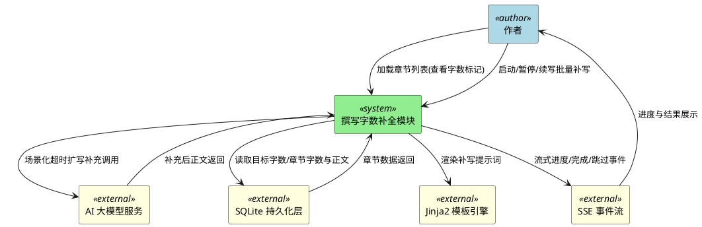
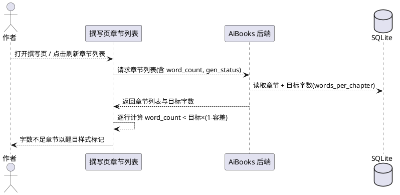
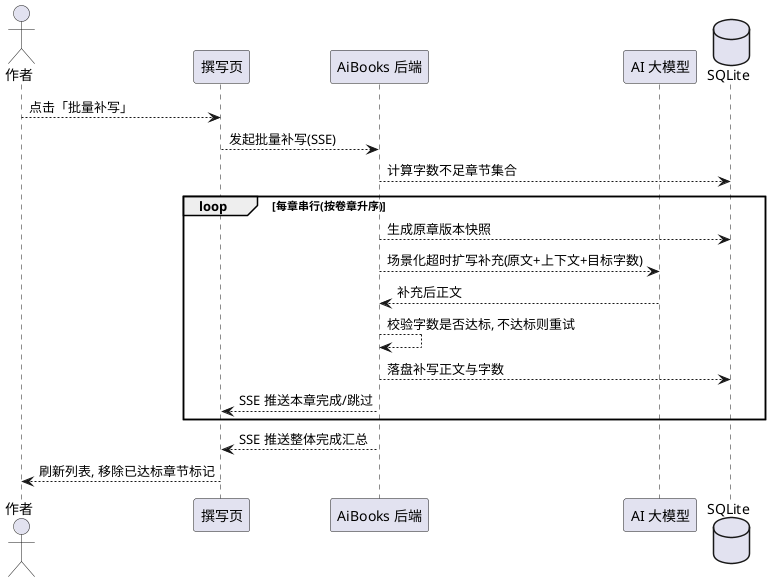

# AiBooks 撰写字数补全需求规格说明书

> 文档版本：v1.0
> 生成日期：2026-09-30
> 需求格式：EARS（Easy Approach to Requirements Syntax）
> 范围：撰写页章节列表字数不足主动标记、批量补写字数不足章节、README 操作说明补全

---

# 1. 组件定位

## 1.1 核心职责

本组件负责对已撰写完成的小说章节进行「字数不足」的主动检测标注与批量补写（在原章节基础上扩写补充），实现「字数不足章节一键识别 + 一键补齐」的核心价值。

## 1.2 核心输入

1. **用户操作指令**：撰写页加载/刷新章节列表、启动「批量补写」、暂停/续写补写任务。
2. **章节数据与上下文**：已撰写章节的正文（content）、当前字数（word_count）、目标字数（words_per_chapter）、生成状态（gen_status），以及补写所需的梗概、世界观、已确认人物、大纲梗概要点、风格库特征、前一章末尾衔接文本。
3. **AI 大模型调用请求**：通过统一网关按场景化超时调用，传入扩写补充提示词与目标字数。
4. **持久化数据**：项目（Project，含 words_per_chapter）、章节（Chapter）的读写。
5. **Jinja2 提示词模板**：新增「字数补写」场景模板的渲染请求，通过 manifest.yaml 注册。

## 1.3 核心输出

1. **字数不足标记**：撰写页章节列表对低字数的已撰写章节施加醒目标记（颜色/样式提示）。
2. **批量补写结果**：逐章补写后的完整正文、更新后的字数，通过 SSE 流式返回进度。
3. **SSE 流式事件**：进度事件（当前卷/章、完成比例）、单章完成/跳过事件、整体完成汇总事件。
4. **用户手册补充**：README.md 新增已撰写小说「字数不足、剧情与大纲不符」的补全操作说明。

## 1.4 职责边界

本组件**不负责**以下事项：

1. **不负责**修复「剧情与大纲不符」的一致性问题——该职责由既有「校验一致性 → 报告窗口一键修复」（`check_consistency` + `repair_writing_stream`）承担，本组件仅补字数。
2. **不负责**重新生成章节——补写是「在原章节基础上扩写补充」，必须保留既有剧情，禁止重写/替换原有情节主线。
3. **不负责**字数不足判定阈值以外的其他质量检查（如敏感词、风格偏离、人物出场等）。
4. **不负责**AI 大模型本身的训练与路由策略实现，仅负责按场景化超时发起调用。
5. **不负责**对尚未撰写完成（无正文）的章节进行补写——补写仅作用于已有正文且字数不足的章节。

---

# 2. 领域术语

**字数不足**
: 已撰写章节的当前字数低于「目标字数 × (1 - 字数容差)」这一判定阈值的状态。凡落入该状态的章节应在列表中醒目提示。

**目标字数（words_per_chapter）**
: 项目创建时设定的每章期望字数（如 3000 字），是字数不足判定与补写的基准值。

**字数容差（writing_words_tolerance）**
: 允许目标字数向下浮动的比例（当前配置为 0.5，即允许低至目标的 50%）。与目标字数共同决定「字数不足」判定阈值。

**字数不足判定阈值**
: `words_per_chapter × (1 - writing_words_tolerance)`。章节字数低于该阈值即判定为字数不足。
: 备注：别名「低字数线」。默认示例：目标 3000 字、容差 0.5 时，阈值为 1500 字。

**批量补写**
: 对当前判定为「字数不足」的章节集合，一键逐章发起 AI 扩写补充，使每章达到目标字数。支持 SSE 流式进度、暂停与续写。

**扩写补充**
: 以章节原文为基础、在不改变既有剧情/人物/大纲一致性的前提下增加细节、描写与情节推进，使字数提升至目标值的操作。区别于「重新生成」。
: 备注：反义词为「重新生成」。

**断点续写（补写）**
: 批量补写暂停后再次启动时，仅补写「当前仍字数不足」的章节，已达标章节自动跳过，无需维护额外断点游标。

**场景化超时**
: 按 AI 调用场景分别配置的超时参数（本功能新增「补写」场景超时），禁止回退全局默认超时。

---

# 3. 角色与边界

## 3.1 核心角色

1. **作者**：小说创作主导用户，在撰写页查看章节字数、识别字数不足章节，并触发批量补写、执行暂停/续写。

## 3.2 外部系统

1. **AI 大模型服务**：接收「字数补写」场景的扩写补充请求（携带原文、目标字数、梗概/世界观/人物/大纲/风格上下文），返回补充后的完整正文。
2. **SQLite 持久化层**：读写项目（words_per_chapter）与章节（content、word_count、状态）数据。
3. **Jinja2 模板引擎**：渲染「字数补写」提示词模板，经 manifest.yaml 注册。
4. **SSE 事件流**：向前端推送补写进度、单章完成/跳过、整体完成事件。

## 3.3 交互上下文

---

# 4. DFX 约束

## 4.1 性能

1. **章节列表字数判定**：当撰写页加载/刷新章节列表（含 100 章内项目）时，系统应当在 2 秒内完成字数不足判定与标记渲染，标记计算应为纯本地确定性计算，不得触发 AI 调用。
2. **补写单章响应**：当对单章发起扩写补充时，系统应当在「补写」场景化超时时间内返回结果，超时按场景独立配置，禁止回退全局默认超时。
3. **批量补写顺序执行**：当启动批量补写时，系统应当逐章串行生成并即时返回中间进度事件，支持暂停与续写，禁止并行并发调用同一项目的补写。
4. **UI 主线程响应**：当执行批量补写、章节列表加载等耗时操作时，系统应当保持 UI 主线程响应，耗时操作在后台线程/异步流中执行（沿用 SSE worker 模式）。
5. **SSE 进度推送延迟**：当补写产生进度事件时，系统应当在每章完成/跳过时立即推送，进度比例实时更新。

## 4.2 可靠性

1. **AI 调用失败处理**：当单章补写 AI 调用失败或超时时，系统应当跳过该章并记录失败原因，不中断整批任务，继续后续章节。
2. **重试策略**：当单章补写后字数仍不足目标值时，系统应当按配置的最大重试次数对该章重试补写；重试后仍不足的，保留「取字数最优结果」，并在汇总中标记该章仍不足。
3. **批量任务可恢复性**：当批量补写被暂停或中断时，系统应当保证已完成补写的章节结果已落盘；再次启动时自动跳过已达标章节，从剩余不足章节继续。
4. **数据完整性**：当补写覆盖章节正文时，系统应当先为原正文生成版本快照，确保可回滚至补写前版本。
5. **长耗时 AI 调用写锁释放**：当进入单章补写 AI 调用前，系统应当先提交/释放事务写锁，避免长耗时 AI 调用期间持续持有写锁阻塞其他端点写入。
6. **SSE 连接稳定性**：当 SSE 连接断开时，已补写完成的章节结果不应丢失（逐章落盘），前端可重新发起补写继续剩余章节。

## 4.3 安全性

1. **提示词模板安全渲染**：当章节原文与上下文传入补写提示词模板时，系统应当通过 Jinja2 安全渲染，防止模板注入。
2. **章节锁定约束**：补写不得绕过章节锁定——已锁定章节应当跳过或拒绝补写（与既有批量保存/修复的锁定约束一致）。

## 4.4 可维护性

1. **提示词模板注册**：当新增「字数补写」提示词模板时，系统应当通过 manifest.yaml 注册，使用 Jinja2 语法，文件命名 kebab-case，独立于现有 `repair-writing` 场景。
2. **命名规范**：新增代码文件命名使用 snake_case，场景名使用 kebab-case，配置项使用写作域既有命名约定。
3. **日志可追踪性**：当执行字数判定与批量补写时，系统应当记录可追踪日志（含场景、目标字数、补写前字数、补写后字数、耗时、失败原因、重试次数）。
4. **文档同步**：README 操作说明与功能实现行为应当保持一致，补写按钮的名称/位置/暂停续写语义应在文档中如实描述。

## 4.5 兼容性

1. **判定阈值兼容**：字数不足判定公式必须复用既有配置 `writing_words_tolerance`，不得另起一套硬编码阈值破坏既有撰写「字数校验重试」语义。
2. **状态字段兼容**：补写后的章节状态变更不得破坏既有 `gen_status` 语义（已完成章节补写后仍应为已完成），仅通过 `modify_status` 表达「已补写」标记。
3. **既有功能不受影响**：本功能不得改变「撰写」「校验一致性」「一键修复」的行为；修复一致性与补写字数两者相互独立、可先后执行。
4. **Python 3.12 / PySide6 / FastAPI / SQLAlchemy(SQLite)**：本功能应当基于现有技术栈实现，不引入新运行时依赖。

---

# 5. 核心能力

## 5.1 章节列表字数不足主动标记

### 5.1.1 业务规则

1. **判定范围**：当撰写页加载或刷新章节列表时，系统应当对所有「已完成且已有正文」的章节执行字数不足判定；无正文（待撰写/已规划/撰写中/失败）的章节不参与判定。

2. **判定公式**：系统应当以 `word_count < words_per_chapter × (1 - writing_words_tolerance)` 作为字数不足的判定条件。
   a. 验收条件：目标 3000 字、容差 0.5、实际 1300 字 → 判定为字数不足。
   b. 验收条件：目标 3000 字、容差 0.5、实际 3500 字 → 判定为字数充足，不标记。

3. **醒目标记样式**：当章节判定为字数不足时，系统应当在章节列表该行的字数列（或整行）施加醒目标记（如红色/高亮背景），使用户无需逐章比对即可一眼识别。
   a. 验收条件：字数不足章节的行/字数列 → 呈现醒目颜色标记。
   b. 验收条件：字数充足章节的行/字数列 → 保持默认样式。

4. **标记即时刷新**：当批量补写完成后（或单章补写后），系统应当刷新章节列表并重新计算字数不足标记，使已补足的章节移除标记。
   a. 验收条件：补写后字数达标的章节 → 标记消失。

5. **标记非阻断性**：字数不足标记仅作为视觉提示，不应当阻断用户查看正文、发起校验、保存、导出等既有操作。

### 5.1.2 交互流程

### 5.1.3 异常场景

1. **目标字数配置异常**
   a. 触发条件：项目 words_per_chapter 为空、为 0 或读取失败。
   b. 系统行为：按既有项目配置兜底或跳过判定，记录告警日志。
   c. 用户感知：章节列表正常展示，不标记字数不足，不报错中断。

2. **章节字数读取异常**
   a. 触发条件：某章 word_count 缺失或异常（负值）。
   b. 系统行为：按 0 处理并参与判定（视为不足）或跳过该章，记录日志。
   c. 用户感知：该章要么被标记为不足、要么保持原样式，不影响其余章节展示。

3. **判定阈值边界**
   a. 触发条件：字数恰好等于阈值 `目标 × (1 - 容差)`。
   b. 系统行为：使用严格小于（`<`）判定，等于阈值视为「充足」，不标记。
   c. 用户感知：等于阈值的章节不被标记。

---

## 5.2 批量补写字数不足章节

### 5.2.1 业务规则

1. **补写对象确定**：当用户点击「批量补写」时，系统应当以「当前字数不足」的已完成章节为补写对象集合，按卷号、章号升序串行逐章补写。
   a. 验收条件：字数不足的章节全部进入补写队列，已达标章节不在队列中。

2. **补写语义（扩写补充）**：当对某章补写时，系统应当以该章原文为基础进行扩写补充，保留既有剧情、人物、大纲要点，仅增加细节与情节推进以达到目标字数，禁止抛弃原文重写。
   a. 验收条件：补写结果正文须包含原文的核心情节与关键信息。

3. **补写目标字数**：补写完成后，章节字数应当达到 words_per_chapter（目标字数）。
   a. 验收条件：补写前 1300 字、目标 3000 字 → 补写后字数 ≥ 3000 字。

4. **单章重试策略**：当补写后字数仍未达到目标值时，系统应当对该章按配置的最大重试次数重试补写；若多次结果均不足，系统应当保留字数最优的一次结果。
   a. 验收条件：首轮补写不达标 → 触发重试；重试后仍不足 → 保留字数最多的结果并在汇总标记该章仍不足。

5. **逐章流式返回**：当批量补写执行时，系统应当通过 SSE 逐章返回进度（当前卷/章、已完成数/总数），每章返回完成或跳过事件。
   a. 验收条件：每处理完一章，前端进度与日志立即更新。

6. **暂停与续写**：当批量补写执行中，用户应当可暂停任务；暂停后再启动补写时，系统应当重新计算「当前字数不足」的章节集合，已达标章节自动跳过，仅补写剩余不足章节。
   a. 验收条件：暂停后再次启动，已补足章节不再重复补写。

7. **逐章落盘**：系统应当在每章补写成功后立即将补写正文与字数落盘，而非整批结束时统一提交，保证暂停/中断不丢失已完成结果。

8. **版本快照**：当补写覆盖某章原文时，系统应当先为该章生成版本快照，支持回滚。

9. **状态流转**：
   - 补写前：章节 `gen_status` 为「已完成」；
   - 补写中：该章进入「补写中」的过程态（不改变「已完成」的终态语义）；
   - 补写成功：`gen_status` 保持「已完成」，`modify_status` 标记为「已补写」。
   a. 验收条件：补写成功章节在列表中状态仍显示「已完成」，不发生回退。

10. **跳过场景**：当某章无正文、正文为空、AI 返回内容过短（如低于最小有效长度）或补写后字数未增加时，系统应当跳过该章并给出跳过原因。

### 5.2.2 交互流程

### 5.2.3 异常场景

1. **无字数不足章节**
   a. 触发条件：用户点击批量补写时，不存在任何字数不足的已完成章节。
   b. 系统行为：立即返回「无字数不足章节」提示，不发起 AI 调用。
   c. 用户感知：界面提示「当前无字数不足章节」。

2. **AI 调用超时**
   a. 触发条件：单章补写 AI 调用超过「补写」场景化超时时间。
   b. 系统行为：跳过该章，记录失败原因，继续后续章节。
   c. 用户感知：该章在进度/日志中显示「AI 超时，已跳过」。

3. **AI 返回内容过短或无法解析**
   a. 触发条件：AI 返回正文为空、无法解析 JSON 或字数低于最小有效长度且未增加。
   b. 系统行为：跳过该章并记录原因，不覆盖原文。
   c. 用户感知：该章显示「返回内容过短，已跳过」，原文保持不变。

4. **补写后字数未增加**
   a. 触发条件：重试后补写结果字数仍不足、甚至低于原文。
   b. 系统行为：保留字数最优结果并落盘，在汇总中标记该章「仍字数不足」。
   c. 用户感知：汇总报告列出仍不足的章节，提示可再次补写或手动处理。

5. **章节已锁定**
   a. 触发条件：补写队列中某章处于锁定状态。
   b. 系统行为：跳过该章或提示先解锁，不执行补写。
   c. 用户感知：提示「章节已锁定，请先解锁」。

6. **批量任务中断/暂停**
   a. 触发条件：用户在补写执行中暂停或连接中断。
   b. 系统行为：当前已完成的章节结果已落盘，未处理章节保持原状。
   c. 用户感知：提示「补写已暂停」，再次点击可继续剩余不足章节。

---

## 5.3 用户手册（README）补全操作说明

### 5.3.1 业务规则

1. **补充位置一（撰写工具表）**：系统应当在 README「第六步：撰写」的撰写页工具表中，新增「批量补写」按钮说明，描述其「一键为字数不足章节扩写补全、支持暂停/续写」的用途。

2. **补充位置二（补全优化说明）**：文档应当新增一个操作说明条目，覆盖「已撰写小说如何针对字数不足、剧情与大纲不符进行补全优化」的两条路径：
   - 字数不足 → 撰写页「批量补写」；
   - 剧情与大纲不符 → 撰写页「校验一致性」→ 报告窗口「一键修复」。

3. **补充位置三（已知限制规避）**：文档应当在「已知限制与规避方法」表中补充与字数不足相关的现状说明与规避路径，确保与「AI 输出被截断 / 章节字数低于目标」等既有条目呼应。

4. **补充位置四（常见问题）**：文档应当在「常见问题」中新增一条问答，说明「章节字数不足如何批量补齐」「补写与一键修复的区别」。

5. **文档行为一致性**：文档描述的按钮名称、入口位置、暂停/续写语义，必须与实际实现保持一致。

### 5.3.2 交互流程

> 本章为纯文档交付，无运行时交互流程（无时序图）。

### 5.3.3 异常场景

1. **文档与实现不一致**
   a. 触发条件：功能上线后按钮名称/位置/语义发生变更。
   b. 系统行为：同步更新 README 对应条目。
   c. 用户感知：文档描述与实际界面一致，无误导。

---

# 6. 数据约束

## 6.1 字数不足判定

1. **目标字数（words_per_chapter）**：正整数，来自项目配置，决定补写目标值；为 0 或缺失时不参与判定。
2. **字数容差（writing_words_tolerance）**：浮点比例，取值范围 (0, 1)，当前默认 0.5；参与判定阈值计算。
3. **判定阈值**：`words_per_chapter × (1 - writing_words_tolerance)`；判定采用严格小于（`<`）。
4. **当前字数（word_count）**：非负整数，为章节正文字符计数；缺失按 0 处理。

## 6.2 补写任务

1. **补写对象集合**：所有 `gen_status = 已完成` 且 `word_count < 判定阈值` 的章节，按卷号、章号升序。
2. **补写目标字数**：等于 `words_per_chapter`。
3. **单章最大重试次数**：正整数，来自配置（建议与撰写既有 `writing_chapter_max_retries` 同量级，默认 3），影响补写不达标时的重试上限。
4. **补写结果下限**：补写结果正文长度须大于既有 `min_ai_content_length`（当前默认 50 字），低于该值视为无效结果并跳过。
5. **补写后状态**：`gen_status` 保持「已完成」，`modify_status` 标记为「已补写」（补齐后状态语义可复用/扩展既有 modify_status 枚举）。

---

# 7. 待用户确认的关键决策点清单

以下为本需求实现前需用户确认的关键决策点（已按影响程度排序）：

1. **【阈值口径】字数不足判定阈值是否严格沿用 `words_per_chapter × (1 - writing_words_tolerance)`？**
   - 现状：`writing_words_tolerance = 0.5`，即目标 3000 字时阈值 = 1500 字。
   - 冲突点：您举例「实际 1300–2000 字都算字数不足」，但按该公式 2000 > 1500，**不会被判定为不足**。
   - 选项 A：严格沿用现有公式（阈值 = 目标的一半），改动最小、与撰写重试语义一致；
   - 选项 B：引入独立的「补写判定容差」（如 0.2，阈值 = 目标 80% = 2400 字），更贴合「明显不足」的直觉，但需新增配置项。

2. **【补写目标】补写目标是「一次性达到 words_per_chapter」，还是允许分多轮渐进补齐（首轮扩充到阈值之上、后续再补到目标）？**
   - 建议：单次补写即瞄准目标字数（words_per_chapter），配合重试策略，避免二次往返。

3. **【重试策略】单章补写不达标时的重试方式与次数？**
   - 建议：每次补写后校验字数，不足则重试，最多 N 次（默认 3）；最终取字数最优结果并在汇总标记「仍不足」，不无限循环。

4. **【结果保存】补写结果是否自动覆盖原章（仅生成版本快照供回滚），还是默认先放草稿等待用户确认？**
   - 建议：沿用「一键修复」的覆盖 + 版本快照模式，补写后自动落盘，用户可在版本管理中回滚（对标现有 `repair_writing_stream`）。

5. **【状态标记】补写后的章节用哪个状态值表达「已补写」（在既有 `modify_status` 基础上新增取值，还是复用 `repaired`/`modified`）？**
   - 建议：新增「已补写」语义，避免与「已修复（一致性）」混淆，便于后续统计与筛查。

6. **【判定范围】是否仅对 `gen_status = 已完成` 的章节做标记与补写？含正文但状态异常的章节（如 `failed` 但有残稿）是否纳入？**
   - 建议：仅对「已完成且有正文」章节判定与补写，避免触碰失败残稿。

7. **【锁定处理】已锁定的字数不足章节，补写时是「自动跳过」还是「阻止启动并提示先解锁」？**
   - 建议：跳过并提示，与既有批量保存的一致性约束保持一致。

8. **【提示词】是否新增独立「补写/扩写补充」提示词场景（如 `writing` module 下新增 `supplement` 场景），而非复用既有 `continue` / `expand` / `repair-writing`？**
   - 建议：新增独立场景模板，明确「以原文为基础扩到目标字数、保留既有剧情」的约束，与「修复一致性」解耦。

9. **【超时参数】「补写」场景的独立超时秒数取值（场景化超时，禁止回退全局默认）？**
   - 建议：参考撰写单章超时（`writing_chapter_timeout_seconds = 180`）设定，建议 180 秒，待确认。

10. **【README 落点】README 补全说明是否按第 5.3 节所述四个位置（撰写工具表 / 新增补全优化说明 / 已知限制规避表 / 常见问题）补齐，是否还需增补到「第七步：章节编辑与校验」？**
    - 建议：按 5.3 的四个位置补齐即可，第七步可加一条「补写针对字数、一键修复针对一致性」的区分说明，待确认。

---

> 说明：本文档仅描述「做什么」（需求规格），不含数据库表结构、类设计、接口签名等实现细节；后续由 spec-design-agent 输出设计文档（design.md）、spec-task-agent 输出任务清单（tasks.md）。