# AiBooks 撰写正文乱码与格式错乱检测修复需求规格

> 功能名称：garbled
> 所属项目：AiBooks（全自动小说撰写桌面软件）
> 需求格式：EARS（Easy Approach to Requirements Syntax）
> 文档定位：本文件描述"撰写页及编辑页各 AI 处理与校验场景中的正文及文本字段乱码与格式错乱检测修复"功能需求，仅规定"做什么"，不规定"怎么做"。
> 覆盖场景：批量补写（scene=supplement）、撰写页校验一致性（scene=check-consistency/writing）、AI 一键修复（scene=repair-writing）、编辑润色（scene=auto-polish）、直接更新章节正文（update_chapter_content）、大纲校验（scene=check-consistency/outline）、大纲修复（scene=repair-outline）、爽点钩子校验（scene=check-consistency/hook）、爽点钩子修复（scene=repair-hook）、章节编辑页校验一致性（scene=check-consistency/chapter）、梗概与世界观 AI 润色、校验报告展示

---

# 1. 组件定位

## 1.1 核心职责

本组件负责在批量补写、撰写页校验一致性、AI 一键修复、编辑润色、直接更新章节正文、大纲校验与修复、爽点钩子校验与修复、章节编辑页校验一致性、梗概与世界观 AI 润色等全部覆盖场景中，统一检测并修复各场景作用文本字段中的非文字类字符乱码与显示格式错乱，实现文本字符洁净与格式规范的通用保障。

## 1.2 核心输入

1. **用户操作指令**：作者在撰写页触发「批量补写」「校验一致性」、在结构化报告窗口点击「AI 一键修复」、在章节编辑页点击「AI润色」「校验一致性」「保存并再校验」、在创作参数页点击梗概/世界观「AI润色」、在校验页面触发大纲校验/大纲修复/钩子校验/钩子修复。
2. **章节正文数据**：已完成章节的正文（content）、当前字数（word_count）、生成状态（gen_status）、修改状态（modify_status）、章节锁定状态（is_locked）。
3. **AI 处理结果**：补写/修复/润色场景返回的处理后正文、各校验场景返回的问题清单（issues）、大纲修复返回的大纲文本、钩子修复返回的爽点与钩子文本。
4. **既有上下文数据**：大纲梗概要点、风格库特征、已确认人物清单、故事梗概、世界观、前一章末尾衔接文本、爽点内容描述、钩子内容（沿用既有链路，不新增）。
5. **规范化配置**：本功能需新增 **UI 开关与自定义参数** 供作者控制——作者可通过开关启用或禁用"乱码与格式检测修复"（开关默认开启），并可自定义判定阈值（对齐 6.5 所列阈值项），未自定义时使用默认值。配置采用"全局默认 + 项目可覆盖"模式，优先级为**内置默认值 < 全局配置 < 项目级配置**。作者设置须沿 UI→Worker→服务层→AI 调用链路完整传递并在全部覆盖场景生效（详见 5.6、6.6）。

## 1.3 核心输出

1. **规范化后文本**：各场景在结果落盘或展示前，经统一字符与格式规范化处理后的章节正文或文本字段。
2. **结构化检测问题**：各校验场景中，将检测到的字符乱码与格式错乱作为结构化校验问题（Issue）纳入报告清单。
3. **字符修复统计**：补写、修复、润色、直接更新等场景中，每次检测到的乱码/格式问题数量、已修复字符数、剩余问题数与命中类别的统计及整体汇总。
4. **SSE 流式事件**：沿用既有补写/修复/钩子修复 chunk 结构，附加字符与格式修复统计信息。
5. **纯文本报告补充**：各校验场景生成的纯文本报告中包含字符乱码与格式错乱条目。
6. **字符修复明细窗口**：AI 一键修复场景中，除日志与完成统计外，向作者弹出独立明细窗口，逐条展示被检出/修复的乱码与格式问题（类型、位置或片段、处理动作）。

## 1.4 职责边界

本组件**不负责**以下事项：

1. **不负责**修正情节、逻辑、人物一致性、时间线等业务一致性问题——该职责由既有各校验与修复流程的业务逻辑承担，本组件仅新增字符与格式维度。
2. **不负责**改写、润色、扩写或删减正文的文字内容——规范化仅在不改变文字内容与语义的前提下清洗异常字符、规整格式。
3. **不负责**非字符层面的排版美化（字体、字号、行距、颜色、对齐等视觉样式），由编辑器与主题渲染承担。
4. **不负责**图片、表格、富文本、公式等非纯文本内容的处理。
5. **不负责**从零生成或补写正文本身（由既有撰写、补写、修复、润色流程承担），仅在全部覆盖场景内提供统一的检测与规范化能力。
6. **不负责**对全部存量章节做一次性全量清洗——仅在覆盖场景被触发时，对其作用的文本字段执行。
7. **不负责**针对任何特定小说、特定章节、特定人物或情节硬编码乱码字符或修复规则，所有判定与修复必须从根因层面通用处理。

---

# 2. 领域术语

**非文字类字符乱码**
: 文本字段中出现的、不属于正常文字表达（排除合法标点、合法换行与正常排版空白）的异常字符或异常字符序列。涵盖控制字符、零宽/不可见字符、Unicode 替换字符、私用区字符、孤立代理码位、编码错误产生的怪异符号序列等类别。

**控制字符**
: Unicode 码位处于 U+0000–U+001F 或 U+007F–U+009F 范围内的字符。合法的换行符（\n）及确有排版用途者不视为乱码。
: 备注：正文中除换行外的控制字符（如退格、响铃、垂直制表等）均属乱码。

**不可见字符（零宽字符）**
: 在正常阅读时不显示为可见字形、却占据码位且无正常语义的字符，包含零宽空格（U+200B）、零宽连接符（U+200C）、零宽非连接符（U+200D）、字节序标记（U+FEFF）、软连字符（U+00AD）等。
: 备注：区别于正常排版用途的普通空格与全角空格。

**Unicode 替换字符**
: 码位为 U+FFFD 的字符，通常表现为「�」，是编码或解码失败时产生的替代符号，属典型乱码。

**私用区字符**
: Unicode 私用区（如 U+E000–U+F8FF）中、被非法用于正文表达的字符。

**乱码符号序列**
: 因编码错误形成的连续异常符号串，表现为对正常中文语句无意义的高位字符或符号组合。

**显示格式错乱**
: 文本在正常阅读展示下出现的排版异常，包含异常换行/多余空白、重复标点、段落结构错乱、非法字符序列等，使阅读体验受损。

**异常换行/多余空白**
: 文本中超出正常排版需要的空白异常，例如连续空行超过允许上限、行首行尾冗余空白、段落内异常空格、非断行空格（U+00A0）或全角空格（U+3000）被滥用、制表符（\t）出现在文本中。

**重复标点**
: 同一标点被连续重复到超出正常语义需要的程度，例如连续多个句号、逗号、顿号，或中英文标点在正式中文文本中异常混排。

**段落结构错乱**
: 段落切分异常，例如多个语义段落被挤压在同一段无换行、段落首行缩进完全不一致、对话与叙述段落混排错位。

**正文规范化**
: 在不改变文字内容与语义的前提下，对文本执行统一的字符清洗与格式规整处理，使文本达到「字符洁净 + 格式规范」。

**统一字符规范化机制**
: 供全部覆盖场景共用、可复用的字符检测与规范化能力，避免在各场景重复实现；同一输入经该机制处理应得到一致的规范化结果。

**检测作用文本字段**
: 某场景中须执行字符乱码与格式错乱检测的文本对象的集合。不同场景的检测作用文本字段不同：章节正文类场景（批量补写、撰写页校验、AI 一键修复、编辑润色、直接更新章节正文、章节编辑页校验）为 chapter.content；大纲校验/修复场景为大纲各章的梗概要点（synopsis_points）与章节名等文本字段；爽点钩子校验/修复场景为爽点内容描述（content_desc）与钩子内容（hook_content）等文本字段；梗概/世界观润色场景为梗概正文（synopsis.content）与世界观正文（worldview.content）。
: 备注：对不写回 chapter.content 的场景（大纲、钩子），检测范围是其作用的文本字段而非章节正文。

**乱码修复开关（UI 开关）**
: 撰写页提供的、用于启用或禁用"乱码与格式检测修复"能力的开关控件，默认开启，支持"全局默认 + 项目可覆盖"；关闭时全部覆盖场景均不执行字符与格式检测修复。

**判定阈值配置（自定义参数）**
: 作者可自定义的乱码/格式判定参数集合，对齐 6.5 所列阈值项（如连续空行上限、连续标点重复上限等），采用"全局默认 + 项目可覆盖"两层；未自定义时使用内置默认值。

**字符修复报告**
: 记录每次检测到的乱码/格式问题数量、已修复字符数、剩余问题数及命中类别的结构化统计对象，并包含逐条修复明细（问题类型、位置或原文片段、处理动作）。
: 备注：其明细部分在 AI 一键修复场景以「字符修复明细窗口」形式向作者展示。

**字符修复明细窗口**
: AI 一键修复场景中独立弹出的窗口，逐条列出本次修复过程中被检出/修复的乱码与格式问题，每条包含问题类型、位置或原文片段、处理动作（如"删除零宽字符""压缩连续空行""清除替换字符"）。
: 备注：区别于补写/修复场景的日志与完成统计，为本功能新增的独立呈现方式。

**检测豁免内容**
: 文本中语义合法、必须原样保留的字符，包含中文标点（含省略号「……」、破折号「——」、书名号、引号等）、英文正文及其标点、数字与单位、正常排版空格与换行。

**场景化超时**
: 按 AI 调用场景分别配置的超时参数（补写、校验、修复、润色等各自独立）。本功能不得改变既有场景化超时语义。

---

# 3. 角色与边界

## 3.1 核心角色

1. **作者**：在撰写页触发批量补写、校验一致性、AI 一键修复，在章节编辑页触发 AI 润色、校验一致性、保存并再校验，在创作参数页触发梗概/世界观 AI 润色，在校验页面触发大纲校验/修复、钩子校验/修复，设置乱码修复开关与判定阈值参数，并查看校验报告与修复进度、结果统计的唯一人类角色。

## 3.2 外部系统

1. **AI 大模型服务**：接收补写、校验、修复、润色等场景的调用；本功能通过既有提示词模板将"输出规范字符、禁止乱码与格式错乱"作为前置约束下达，并接收其返回文本与问题清单。
2. **SQLite 持久化层**：读写章节正文、大纲、爽点钩子、梗概、世界观、字数与状态数据，并读写作者设置的乱码修复开关与判定阈值配置。
3. **SSE 事件流**：向撰写页与校验页推送补写/修复/钩子修复进度、单章结果与整体完成统计。
4. **Jinja2 模板引擎**：渲染补写、校验、修复、润色等提示词模板。
5. **统一字符规范化机制（内部能力）**：本组件对外呈现的可复用能力，被全部覆盖场景共同引用。

## 3.3 交互上下文

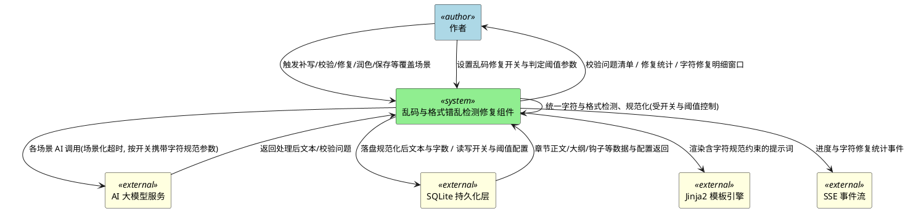

---

# 4. DFX 约束

## 4.1 性能

1. **本地确定性处理**：当对单个文本字段执行字符乱码与格式错乱检测及规范化时，系统应当在 100 毫秒量级内完成，该处理为纯本地确定性计算，不得额外发起 AI 调用。
2. **不显著增加场景耗时**：当在各覆盖场景中接入规范化处理时，系统不得使单次处理的总体耗时显著增加，AI 调用仍须使用各场景既有场景化超时参数，禁止回退全局默认超时。
3. **复用既有批次**：当校验场景对全书章节或大纲/钩子做乱码/格式检测时，系统应当复用既有校验的数据读取与批次，不得为字符检测单独发起额外的全书遍历或额外 AI 调用。
4. **流式逐章推送**：当补写、修复或钩子修复执行时，系统应当在每章处理完成时立即推送包含字符修复统计的 SSE 事件，不得等待整批结束才一次性返回。
5. **明细窗口渲染**：当 AI 一键修复弹出「字符修复明细窗口」时，系统应当在 1 秒内完成明细渲染，并支持滚动浏览。

## 4.2 可靠性

1. **语义不改变**：当执行文本规范化时，系统不得改变文字内容、语义、情节与对话，仅清洗异常字符、规整格式。
2. **规范化失败回退**：当规范化处理发生异常时，系统应当回退为处理前的原始文本，禁止出现文本丢失、截断或内容为空。
3. **最小长度保护**：当规范化后文本长度低于场景既有最小有效长度阈值时（如补写正文低于最小有效长度），系统应当按既有跳过规则处理，不得将不合格文本落盘。
4. **AI 失败时降级**：当补写、修复或润色的 AI 调用失败、超时时，系统应当按既有规则跳过该章；若原始文本已成功读取，可对原文执行确定性规范化作为可选降级（不得因此中断整批任务）。
5. **修复前版本快照**：当 AI 一键修复（repair-writing）在写入章节正文之前，系统应当先为该章创建自动版本快照（与批量补写场景一致），保证可回滚至修复前版本。
6. **既有可靠性语义不变**：逐章落盘、暂停/续写、写锁释放、章节锁定跳过等既有可靠性行为不得因本功能改变；补写与一键修复场景均须保持修复前版本快照。

## 4.3 安全性

1. **通用性约束**：检测与规范化规则禁止硬编码任何特定小说的人物姓名、地点、势力、功法、物品或情节。
2. **审计可追踪**：当执行规范化或修复时，系统应当记录可审计信息（场景、卷章、命中类别、修复字符数量），便于追溯。
3. **模板安全渲染**：当文本传入提示词模板时，系统应当沿用既有安全渲染方式，防止模板注入。

## 4.4 可维护性

1. **统一机制**：字符乱码与格式错乱的检测、修复能力必须实现为全部覆盖场景共用的统一可复用机制，禁止在每个场景内各写一套。
2. **规则可扩展**：判定类别与修复规则应当可扩展、可配置（含作者自定义阈值），新增类别不应改动各场景的接入逻辑与报告结构。
3. **日志规范**：日志应当记录场景、卷章号、命中乱码/格式类别、修复数量、剩余数量，场景名沿用既有约定。
4. **命名规范**：新增代码文件采用 snake_case，模板文件采用 kebab-case，并沿用写作域既有命名约定。

## 4.5 兼容性

1. **结构向后兼容**：SSE chunk 结构与校验报告结构的新增统计信息必须向后兼容，不得破坏既有前端解析与既有字段语义。
2. **既有校验不受影响**：不得改变既有确定性规则（偏离大纲、风格偏差、人物出场、敏感词、时间线、角色关系、情感曲线）与 AI 校验问题的判定结果、级别与排序。
3. **既有功能不受影响**：不得改变撰写、补写、校验、修复、润色的既有业务行为；字符与格式维度为新增叠加能力。
4. **不误伤合法内容**：合法标点（含省略号、破折号、书名号、引号）、英文与中英混排正文、数字与单位、正常排版空白不得被误判为乱码或格式错乱。
5. **技术栈兼容**：基于现有 Python 3.12 / PySide6 / FastAPI / SQLAlchemy(SQLite) 技术栈实现，不引入新运行时依赖。
6. **新增 UI 参数并保证链路完整传递**：本功能须新增 UI 开关与自定义参数（开关默认开启，配置采用"全局默认 + 项目可覆盖"，优先级**内置默认值 < 全局配置 < 项目级配置**），该配置必须沿 UI→Worker→服务层→AI 调用链路完整传递，禁止只写不读；判定阈值未自定义时使用默认值（详见 5.6、6.6）。

---

# 5. 核心能力

## 5.1 字符乱码与格式错乱的定义、分类与判定

### 5.1.1 业务规则

1. **检测范围规则**：当对某文本字段执行检测时，系统应当以该字段完整文本为检测对象，覆盖全部段落与字符；空文本不产生检测问题。
   a. 验收条件：[文本字段为空或全为空白] → [不产出任何乱码/格式问题，检测正常结束]

2. **非文字类字符乱码判定规则**：系统应当将文本中命中以下任一子类的字符判定为非文字类字符乱码：
   - **控制字符**：除合法换行（\n）外，处于 U+0000–U+001F 或 U+007F–U+009F 的字符。
   - **不可见/零宽字符**：零宽空格（U+200B）、零宽连接符/非连接符（U+200C/U+200D）、字节序标记（U+FEFF）、软连字符（U+00AD）等无正常语义的不可见字符。
   - **Unicode 替换字符**：码位为 U+FFFD 的字符「�」。
   - **私用区字符**：非法用于正文的私用区码位（如 U+E000–U+F8FF）。
   - **乱码符号序列**：因编码错误形成的、对正常语句无意义的连续异常符号串。
   a. 验收条件：[文本含 U+FFFD 替换字符] → [该字符被判定为字符乱码并计入检测结果]
   b. 验收条件：[文本含零宽空格 U+200B] → [该字符被判定为字符乱码]
   c. 验收条件：[文本含除换行外的控制字符] → [该字符被判定为字符乱码]

3. **不可逆乱码处理规则**：当文本含 U+FFFD 等已丢失原始信息的不可逆乱码时，系统必须清除该字符，并在检测结果、修复统计与报告中明确标注"不可逆乱码已清除"；禁止臆造、猜测或生成任何替代文字。
   a. 验收条件：[文本含替换字符 U+FFFD] → [该字符被清除，统计/报告标注为不可逆乱码，且不生成任何替代文字]

4. **显示格式错乱判定规则**：系统应当将文本中命中以下任一子类的现象判定为显示格式错乱：
   - **异常换行/多余空白**：连续空行超过允许上限、行首行尾冗余空白、段落内异常空格、非断行空格（U+00A0）或全角空格（U+3000）滥用、文本中出现制表符（\t）。
   - **重复标点**：同一标点连续重复超过语义需要（如连续多个句号/逗号/顿号），或正式中文文本中中英文标点异常混排。
   - **段落结构错乱**：多个语义段落被挤压为无换行的超长段落、段落缩进严重不一致、对话与叙述段落混排错位。
   - **非法字符序列**：不符合正常书写习惯的字符组合。
   a. 验收条件：[文本连续空行数超过上限（默认 ≥2 个连续空行）] → [判定为异常换行/多余空白]
   b. 验收条件：[某标点连续重复超过上限（默认 ≥3 次）如「。。。」] → [判定为重复标点]
   c. 验收条件：[文本行首或行尾出现冗余空白] → [判定为多余空白]

5. **判定阈值默认值规则**：系统必须内置以下合理默认阈值（作为作者可自定义项，作者未自定义时按默认值生效）：
   - **连续空行上限**：默认允许最多 1 个空行，出现 ≥2 个连续空行判定为异常；
   - **连续标点/符号重复上限**：默认允许同一标点最多连续 2 次，出现 ≥3 次判定为重复标点；省略号「……」、破折号「——」等合法的多字符标点豁免；
   - **行首行尾多余空白**：默认 0 容忍，一律去除；
   - **段落内连续普通空格**：默认压缩为 1 个；
   - **制表符（\t）**：默认 0 容忍，文本中出现即视为异常并去除；
   - **非断行空格（U+00A0）**：默认替换为普通空格并按连续空格规则压缩；
   - **全角空格（U+3000）**：仅允许用于段落首行缩进，默认统一规整为 2 个全角空格；非行首位置的全角空格视为异常；
   - **零宽/不可见字符、控制字符（换行除外）**：默认 0 容忍，一律删除。
   a. 验收条件：[文本出现 2 个连续空行] → [判定为异常并规整为最多 1 个空行]
   b. 验收条件：[文本含制表符] → [制表符被去除并计入格式问题]
   c. 验收条件：[段落首行缩进为 2 个全角空格] → [缩进保留，不判定为异常]

6. **开关控制规则**：字符乱码与格式错乱的检测修复受撰写页"乱码修复开关"控制，开关默认开启；开关开启时全部覆盖场景均执行检测修复，开关关闭时全部覆盖场景均不执行。
   a. 验收条件：[开关开启] → [全部覆盖场景均执行字符与格式检测修复]
   b. 验收条件：[开关关闭] → [全部覆盖场景均不执行检测修复，文本不被规范化]

7. **检测豁免规则**：系统必须对检测豁免内容原样保留，不得判定为乱码或格式错乱，包含：中文标点（省略号「……」、破折号「——」、书名号「《》」、引号等）、英文正文及其标点、数字与单位、正常排版空格与换行。
   a. 验收条件：[文本含合法省略号「……」或破折号「——」] → [不判定为重复标点]
   b. 验收条件：[文本为纯英文段落含英文标点] → [不判定为乱码或格式错乱]
   c. 验收条件：[文本含正常单个句号、逗号] → [不判定为重复标点]

8. **通用性规则**：判定规则必须基于字符类别与格式模式，禁止针对特定小说、特定章节硬编码具体字符或文本。
   a. 验收条件：[对不同小说项目的文本执行检测] → [均依据统一字符/格式规则判定，无硬编码特例]

9. **可配置规则**：判定阈值（如连续空行上限、连续标点重复上限、是否启用某类别）应当可由作者通过撰写页参数自定义；未自定义时使用第 5 条所列默认值。作者设置须沿 UI→Worker→服务层→AI 调用链路传递至服务层。
   a. 验收条件：[作者调整连续空行上限] → [全部覆盖场景的检测结果随该设置变化，无需改动代码逻辑]

10. **禁止项**：禁止将合法文本内容、正常中英文标点、数字与单位误判为乱码或格式错乱。
    a. 验收条件：[对无乱码无格式问题的正常文本执行检测] → [检测结果为空，不产生误报]

### 5.1.2 交互流程

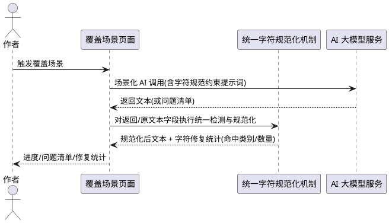

### 5.1.3 异常场景

1. **检测规则与合法内容冲突**
   a. 触发条件：某字符既可能属异常又可能是合法排版字符（如连续标点在对话强调语境下使用）。
   b. 系统行为：按豁免规则优先保留语义合法内容，仅在超出配置阈值时判定。
   c. 用户感知：不产生误报，合法强调性标点被保留。

2. **配置缺失或非法**
   a. 触发条件：判定阈值配置为空、为负或读取失败。
   b. 系统行为：使用内置默认阈值继续检测，记录告警日志。
   c. 用户感知：检测正常进行，不因配置异常中断。

3. **文本编码已损坏不可逆**
   a. 触发条件：文本存在无法还原为原始文字的乱码（如 U+FFFD 已丢失原始信息）。
   b. 系统行为：清除该乱码字符，并在统计中记录"不可逆乱码已清除"，不臆造内容。
   c. 用户感知：修复统计中显示已清除的不可逆乱码数量。

---

## 5.2 批量补写场景的乱码与格式检测修复

### 5.2.1 业务规则

1. **补写接入规则**：当执行批量补写（scene=supplement）对某章生成补写正文后、写回章节之前，系统应当对该补写正文执行统一的字符乱码与格式错乱检测与规范化。
   a. 验收条件：[补写返回含零宽字符或异常空行的正文] → [落盘的补写正文中该乱码/格式问题已被修复]

2. **原文保护规则**：当补写输入的原章节正文本身含乱码或格式错乱时，系统应当在补写处理链路中一并检测；规范化仅针对异常字符与格式，不得删除原文关键情节与对话。
   a. 验收条件：[原章节正文含乱码] → [补写结果与统计中体现该乱码已被处理，且原情节保留]

3. **提示词约束规则**：补写提示词模板必须新增"输出规范字符、禁止输出控制字符/不可见字符/替换字符等乱码，禁止异常换行与重复标点等格式错乱"的明确约束。
   a. 验收条件：[补写提示词模板] → [包含禁止乱码与格式错乱的明确文字约束]

4. **修复统计规则**：当某章补写完成时，系统应当统计并随 SSE 事件返回该章的字符修复统计（检测乱码/格式问题数、修复字符数、剩余问题数）。
   a. 验收条件：[某章补写含乱码修复] → [该章补写完成事件携带字符修复统计]

5. **整体汇总规则**：当批量补写整体完成时，系统应当在完成汇总中体现字符与格式修复的总量（涉及章节数、累计修复字符数）。
   a. 验收条件：[批量补写结束] → [完成汇总包含字符/格式修复统计]

6. **不改变补写语义规则**：字符规范化不得改变补写的扩写语义与字数目标判定；字数以规范化后的正文为准计算。
   a. 验收条件：[补写后规范化导致字符数变化] → [字数按规范化后正文重新计算，落盘值与之一致]

7. **配置遵循规则**：批量补写场景必须读取作者设置的乱码修复开关与判定阈值——开关关闭时跳过字符与格式检测修复，开关开启时按作者阈值（未自定义则按默认值）执行。
   a. 验收条件：[开关关闭后触发批量补写] → [补写正常进行但不执行字符/格式检测修复]
   b. 验收条件：[作者自定义空行阈值后触发批量补写] → [按自定义阈值执行规整]

### 5.2.2 交互流程

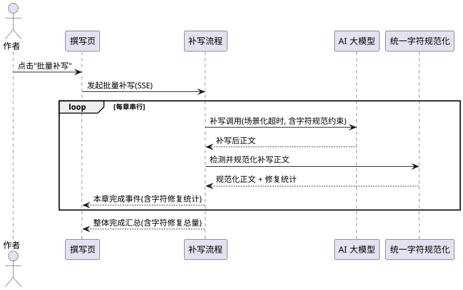

### 5.2.3 异常场景

1. **补写正文规范化后过短**
   a. 触发条件：清除乱码后补写正文低于最小有效长度或字数不再增长。
   b. 系统行为：按既有跳过规则跳过该章，不落盘不合格正文。
   c. 用户感知：SSE 跳过事件中给出原因（如"规范化后内容过短"）。

2. **补写正文含不可逆乱码**
   a. 触发条件：补写正文含已无法还原的替换字符。
   b. 系统行为：清除不可逆乱码字符并保留其余内容，统计中标注。
   c. 用户感知：修复统计显示已清除的不可逆乱码数量。

3. **章节锁定或无正文**
   a. 触发条件：目标章节已锁定或无正文。
   b. 系统行为：按既有规则跳过，不执行规范化与落盘。
   c. 用户感知：既有跳过提示保持一致。

---

## 5.3 撰写页校验一致性场景的乱码与格式检测与报告

### 5.3.1 业务规则

1. **校验接入规则**：当作者触发撰写一致性校验（scene=check-consistency/writing）时，系统应当在既有校验维度之外，对每章正文执行字符乱码与格式错乱检测，并将检测结果作为结构化校验问题（Issue）纳入统一问题清单。
   a. 验收条件：[某章正文含乱码或格式错乱] → [校验问题清单包含对应条目]

2. **问题类型规则**：字符与格式检测产出的问题必须复用既有问题结构（级别、卷号、章号、类型、问题描述、修改建议）；新增的问题类型取值包含"字符乱码"与"格式错乱"。
   a. 验收条件：[产出字符乱码问题] → [问题类型为"字符乱码"，其余字段结构不变]
   b. 验收条件：[产出格式错乱问题] → [问题类型为"格式错乱"，其余字段结构不变]

3. **级别判定规则**：字符乱码问题的级别按影响程度判定——U+FFFD 替换字符与连续乱码符号序列判为不低于"一般"（情节可读性严重受损时可为"严重"）；单个不可见/零宽字符判为"轻微"；格式错乱问题默认判为"轻微"。
   a. 验收条件：[某章含替换字符 U+FFFD 或连续乱码符号序列] → [产出字符乱码问题，级别不低于"一般"]
   b. 验收条件：[某章仅含单个零宽字符] → [产出字符乱码问题，级别为"轻微"]
   c. 验收条件：[某章仅含多余空行等格式问题] → [产出格式错乱问题，级别为"轻微"]

4. **详细定位规则**：字符乱码与格式错乱问题的描述应当指明命中类别与大致位置（如所在段落或上下文片段），修改建议应当给出可执行的规范化指引（清除异常字符/规整空白/整理标点）。
   a. 验收条件：[产出字符乱码问题] → [detail 指明乱码类别，suggestion 给出修复指引]

5. **确定性检测规则**：字符与格式检测应当为确定性规则检测，不依赖 AI 模型，不得因 AI 校验超时或失败而缺失字符维度的检测结果。
   a. 验收条件：[AI 校验超时降级] → [字符与格式检测结果仍然产出并纳入报告]

6. **AI 维度协同规则**：AI 校验提示词应当新增"检查正文是否存在乱码/异常字符与格式错乱"的校验维度；AI 产出的乱码/格式问题与确定性检测结果合并去重。
   a. 验收条件：[AI 校验提示词] → [包含字符乱码与格式错乱校验维度]

7. **报告合并规则**：字符与格式问题必须与既有问题一并参与去重、按级别排序、显示于结构化报告窗口，并写入纯文本报告。
   a. 验收条件：[存在字符/格式问题] → [结构化报告与纯文本报告均包含该问题条目]

8. **仅检测不改写规则**：撰写页校验一致性场景仅检测与报告字符/格式问题，不得在校验阶段自动改写章节正文；正文的修复须由作者通过 AI 一键修复发起。
   a. 验收条件：[执行撰写页校验一致性] → [章节正文未被修改，仅产出问题清单]

9. **配置遵循规则**：撰写页校验一致性场景必须读取作者设置的开关与阈值——开关关闭时不产出字符/格式问题，开关开启时按作者阈值（未自定义则按默认值）检测。
   a. 验收条件：[开关关闭后触发校验一致性] → [报告不含字符/格式问题条目，既有校验不受影响]
   b. 验收条件：[作者自定义判级相关阈值后触发校验] → [按自定义配置产出问题]

### 5.3.2 交互流程

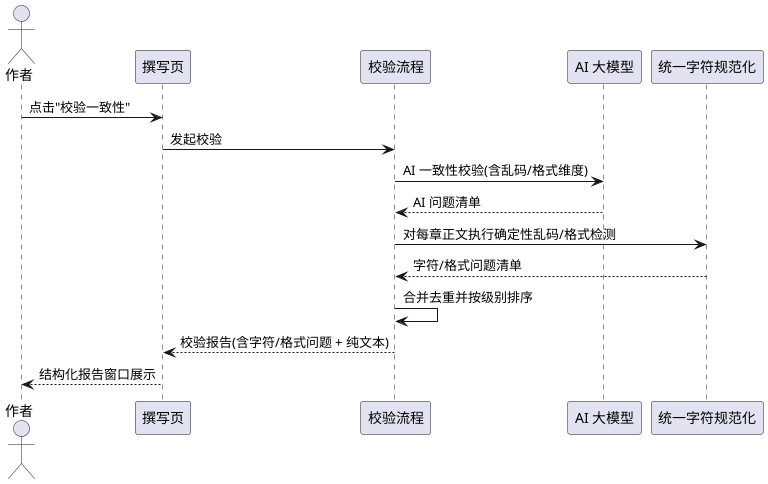

### 5.3.3 异常场景

1. **AI 校验超时或失败**
   a. 触发条件：AI 一致性校验超过场景化超时或返回异常。
   b. 系统行为：仅返回确定性规则结果（含字符与格式检测），标记 AI 校验未完成。
   c. 用户感知：报告提示"AI校验超时，仅展示规则校验结果"，且其中包含字符/格式问题。

2. **同一乱码被规则与 AI 重复产出**
   a. 触发条件：同一卷章同一类型问题被确定性与 AI 同时产出。
   b. 系统行为：按（卷章，类型）去重，保留级别更高的一条。
   c. 用户感知：报告不出现重复条目。

3. **无乱码与格式问题**
   a. 触发条件：全书正文均无乱码与格式错乱。
   b. 系统行为：不产出字符/格式问题，不影响既有校验评分与结论。
   c. 用户感知：报告中无字符/格式问题条目，既有报告内容不变。

---

## 5.4 AI 一键修复场景的乱码与格式检测修复

### 5.4.1 业务规则

1. **修复接入规则**：当作者在报告窗口发起 AI 一键修复（scene=repair-writing）时，系统应当在逐章修复流程的正文写回之前，对修复后正文执行统一的字符乱码与格式错乱检测与规范化。
   a. 验收条件：[修复后正文含乱码或格式错乱] → [落盘的修复正文已规范化]

2. **修复范围规则**：当修复问题清单中包含字符乱码或格式错乱问题时，系统应当将对应章节纳入修复目标章节集合（与既有按卷章聚合逻辑一致）。
   a. 验收条件：[问题清单含"字符乱码"问题] → [对应章节进入修复目标章节集合]

3. **提示词约束规则**：AI 修复提示词模板应当新增"修复结果须输出规范字符、清除乱码与格式错乱"的约束，并在问题清单中体现字符/格式问题。
   a. 验收条件：[修复提示词模板] → [包含禁止乱码与格式错乱、输出规范字符的约束]

4. **纯格式化修复规则**：当某章仅存在字符/格式问题而无其他业务问题时，系统仍应当能够完成该章的规范化修复（通过确定性规范化即可达成），不得因 AI 返回内容不足而丢弃规范化结果。
   a. 验收条件：[某章仅含乱码/格式问题] → [该章正文被规范化并落盘，状态标记为已修复]

5. **修复统计规则**：当某章修复完成时，系统应当统计并随 SSE 事件返回该章字符修复统计（检测数、修复字符数、剩余问题数）。
   a. 验收条件：[某章修复含字符规范化] → [修复完成事件携带字符修复统计]

6. **整体汇总规则**：当一键修复整体完成时，系统应当在完成汇总中体现字符与格式修复的总量。
   a. 验收条件：[修复流程结束] → [完成汇总包含字符/格式修复统计]

7. **状态与既有语义规则**：修复成功后章节 `modify_status` 沿用既有"已修复"语义，不得因新增字符处理引入新状态破坏既有状态含义。
   a. 验收条件：[修复成功] → [章节 modify_status 与既有修复语义一致]

8. **逐章落盘规则**：字符规范化后的正文应当随既有逐章落盘机制持久化，保证暂停/中断不丢失。
   a. 验收条件：[修复过程被暂停] → [已完成章节的规范化正文已落盘]

9. **版本快照规则**：当某章进入 AI 一键修复并在写入正文之前，系统必须先为该章创建自动版本快照（与批量补写场景一致），保证可回滚至修复前版本。
   a. 验收条件：[某章修复将写回正文] → [写回前已生成修复前版本快照]

10. **字符修复明细窗口规则**：当 AI 一键修复执行时，系统除在日志与完成汇总中呈现统计外，必须弹出独立的「字符修复明细窗口」，逐条展示本次检出/修复的乱码与格式问题，每条至少包含问题类型、位置或原文片段、处理动作（如"删除零宽字符""压缩连续空行""清除替换字符"）。
    a. 验收条件：[AI 一键修复检出并修复乱码/格式问题] → [弹出明细窗口，逐条列出类型、位置/片段与处理动作]
    b. 验收条件：[本次未检出任何乱码/格式问题] → [明细窗口给出空态提示，明确"未发现乱码与格式问题"]

11. **配置遵循规则**：AI 一键修复场景必须读取作者设置的开关与阈值——开关关闭时跳过字符与格式检测修复（不弹出明细窗口），开关开启时按作者阈值（未自定义则按默认值）执行并展示明细。
    a. 验收条件：[开关关闭后触发一键修复] → [修复正常进行但不执行字符/格式检测修复，也不弹出明细窗口]
    b. 验收条件：[作者自定义阈值后触发一键修复] → [按自定义阈值执行并展示明细]

### 5.4.2 交互流程

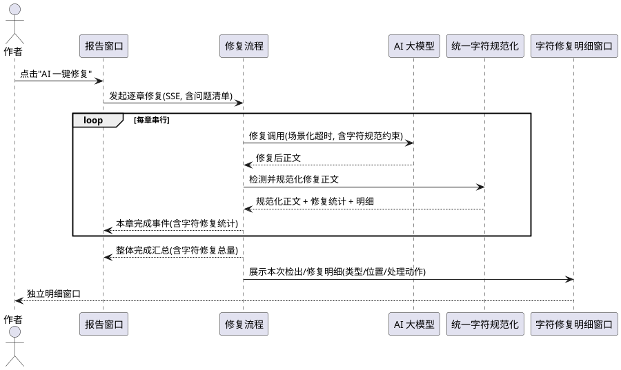

### 5.4.3 异常场景

1. **AI 修复超时/失败但仅需规范化**
   a. 触发条件：某章仅存在字符/格式问题，AI 调用超时或失败。
   b. 系统行为：使用确定性规范化处理该章原文并落盘，或在无法保证质量时按既有规则跳过并说明。
   c. 用户感知：修复事件说明该章以"规范化"方式处理或跳过原因。

2. **修复后正文过短**
   a. 触发条件：规范化或修复后正文低于既有最小有效长度（如原文 80%）。
   b. 系统行为：按既有规则跳过该章，不落盘不合格正文。
   c. 用户感知：跳过事件给出既有原因提示。

3. **章节锁定或无内容**
   a. 触发条件：目标章节已锁定或无正文。
   b. 系统行为：按既有规则跳过，不执行规范化与落盘。
   c. 用户感知：既有跳过提示保持一致。

4. **不可逆乱码**
   a. 触发条件：正文含无法还原的替换字符。
   b. 系统行为：清除不可逆乱码字符，保留其余内容，统计标注。
   c. 用户感知：修复统计显示已清除的不可逆乱码数量。

---

## 5.5 统一字符规范化机制与修复结果报告

### 5.5.1 业务规则

1. **统一机制规则**：字符乱码与格式错乱的检测与修复必须由统一、可复用的机制提供，全部覆盖场景均调用同一机制，禁止重复实现。
   a. 验收条件：[对同一段含乱码文本以不同覆盖场景分别处理] → [得到一致的规范化结果与一致的命中类别判定]

2. **报告展示规则**：各场景按下列方式向作者呈现字符/格式检测修复结果：
   - **校验类场景**（撰写页校验、章节编辑页校验、大纲校验、钩子校验）：将字符/格式问题以结构化问题形式在报告窗口与纯文本报告中展示；
   - **批量补写场景**：以日志 + 完成统计（命中类别、修复数量、剩余数量）形式呈现；
   - **AI 一键修复场景**：除日志 + 完成统计外，必须弹出独立的「字符修复明细窗口」，逐条展示检出/修复明细（类型、位置或片段、处理动作）；
   - **编辑润色、直接更新、梗概/世界观润色、大纲修复、钩子修复场景**：以结果统计或日志形式呈现字符修复统计。
   a. 验收条件：[校验发现乱码] → [报告中以结构化问题展示]
   b. 验收条件：[补写处理乱码] → [日志与完成统计中展示修复统计]
   c. 验收条件：[一键修复处理乱码] → [弹出字符修复明细窗口，逐条展示类型/位置/处理动作]
   d. 验收条件：[润色/直接更新/大纲修复/钩子修复处理乱码] → [结果统计或日志中展示字符修复统计]

3. **统计维度规则**：字符修复报告至少应包含：涉及章节数、检测到的乱码/格式问题类别及数量、已修复字符数量、剩余未解决数量。
   a. 验收条件：[完成一次覆盖场景处理] → [可获知上述统计维度]

4. **一致性规则**：同一文本在检测、落盘、报告三处的判定结果必须一致，不得出现"报告已修复但文本仍含乱码"或反之。
   a. 验收条件：[报告显示某文本乱码已修复] → [该文本落盘后确不含该类乱码]

5. **可扩展规则**：新增乱码/格式类别时，仅需扩展统一机制的判定规则，各覆盖场景与报告结构无需改动。
   a. 验收条件：[新增一种格式异常类别] → [全部覆盖场景自动生效，报告结构不变]

6. **禁止项**：禁止为绕过统一机制而在任一场景内单独实现重复的乱码处理逻辑。
   a. 验收条件：[审查全部覆盖场景接入] → [均引用统一机制，无重复实现]

7. **配置生效规则**：全部覆盖场景均须遵循解析后的生效配置（项目级覆盖优先，回退全局默认，再回退内置默认）——开关关闭时统一不执行检测修复，开关开启时按生效阈值执行。
   a. 验收条件：[项目级覆盖了阈值] → [全部覆盖场景均按项目级值执行]
   b. 验收条件：[作者关闭开关] → [全部覆盖场景均不执行检测修复]

### 5.5.2 交互流程

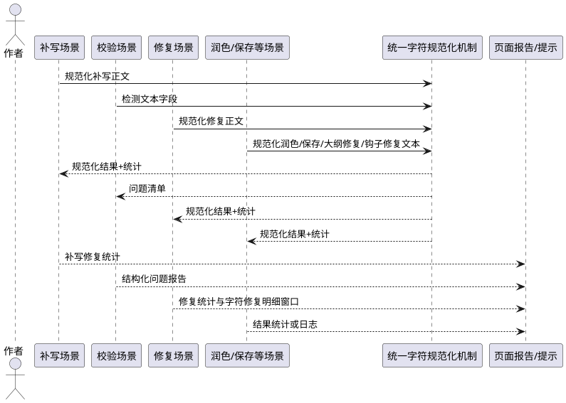

### 5.5.3 异常场景

1. **统计与文本不一致**
   a. 触发条件：报告显示的修复数量与实际文本不符。
   b. 系统行为：以落盘文本为准重新统计，记录告警日志。
   c. 用户感知：报告数值与文本实际状态一致。

2. **某场景未接入统一机制**
   a. 触发条件：覆盖场景中任一未调用统一机制。
   b. 系统行为：视为缺陷，须补齐接入。
   c. 用户感知：全部覆盖场景行为一致，无遗漏。

---

## 5.6 UI 开关与自定义参数配置及链路传递

### 5.6.1 业务规则

1. **启用开关规则**：撰写页必须提供"乱码与格式检测修复"启用开关，默认开启，作者可随时开启或关闭；开关值采用"全局默认 + 项目可覆盖"作用域（详见第 9、10 条与 6.6）。
   a. 验收条件：[打开撰写页] → [可见该开关且默认为开启状态]

2. **控件形态与位置规则**：开关与参数入口应放置于撰写页操作区（与"批量补写""校验一致性"等按钮相邻的同一区域）或撰写页设置入口；开关采用复选框/开关控件形态，数值型阈值采用数值输入控件。
   a. 验收条件：[进入撰写页] → [可在操作区或设置入口找到该开关与参数配置]

3. **自定义参数规则**：作者可自定义以下判定阈值（默认值见 6.5）：连续空行上限、连续标点重复上限、段落内连续空格压缩上限，以及是否启用全角空格缩进规整、是否启用重复标点规整、是否启用异常空白字符清除、是否启用不可逆乱码清除。
   a. 验收条件：[作者修改任一可自定义阈值] → [全部覆盖场景按该值执行，未修改项使用默认值]

4. **默认值与优先级规则**：配置生效优先级为 **内置默认值 < 全局配置 < 项目级配置**；开关默认开启；所有可自定义参数未设置时按该优先级解析，最终回退 6.5 所列内置默认值。
   a. 验收条件：[作者从未修改任何配置] → [开关为开启、各阈值均为内置默认值]
   b. 验收条件：[全局与项目级对同一阈值设置了不同值] → [以项目级配置生效]

5. **链路完整传递规则**：开关与参数必须沿 **UI → Worker → 服务层 → AI 调用** 链路完整传递，任一环节缺失即视为缺陷；禁止出现"UI 已设置但 Worker/服务层未接收"或"服务层未读取"的只写不读问题。
   a. 验收条件：[在 UI 关闭开关] → [Worker 携带该配置、服务层读取后跳过检测修复、AI 调用按配置执行]
   b. 验收条件：[在 UI 设置某阈值] → [服务层实际按该阈值处理，可通过结果与日志验证被读取]

6. **AI 调用传递规则**：开关开启时，服务层应当将"是否执行字符/格式检测修复"及必要约束随 AI 调用参数传递，使 AI 侧重（校验的乱码/格式维度、补写/修复/润色的规范字符约束）与开关一致；开关关闭时不得向 AI 下达相关约束。
   a. 验收条件：[开关开启] → [AI 调用携带字符规范相关参数]
   b. 验收条件：[开关关闭] → [AI 调用不携带字符规范相关参数]

7. **配置持久化与作用域规则**：配置采用"全局默认 + 项目可覆盖"两层——全局（应用级）配置持久化保存并作为默认；每个小说项目可单独覆盖全局默认且项目级优先。二者均沿用 SQLite 持久化层保存，应用重启后保持；读取失败时按优先级回退。
   a. 验收条件：[作者修改全局开关后重启应用] → [全局开关仍保持该状态]
   b. 验收条件：[某项目覆盖了全局阈值] → [该项目按项目级阈值生效，其他项目仍按全局默认]

8. **禁止项**：禁止将配置仅保存在 UI 内存而不持久化，或仅在 UI 生效而未传递至服务层与 AI 调用。
   a. 验收条件：[检查配置使用路径] → [UI、服务层、AI 调用三处均一致读取同一生效配置]

9. **读取与生效规则**：全部覆盖场景在执行时，必须按"**项目级覆盖优先 → 回退全局默认 → 再回退内置默认值**"的顺序解析生效配置，并据此决定是否执行检测修复与所用判定阈值。
   a. 验收条件：[项目级未覆盖、全局已设置] → [按全局配置执行]
   b. 验收条件：[项目级已覆盖] → [按项目级配置执行，忽略全局同名项]
   c. 验收条件：[项目级与全局均未设置] → [按 6.5 内置默认值执行]

10. **配置存储规则**：全局配置与项目级配置须分别持久化（沿用 SQLite 持久化层）：全局配置作为应用级默认；项目级配置以项目标识关联保存，读取时按当前项目标识查找项目级覆盖，缺失则回退全局配置。
    a. 验收条件：[切换不同小说项目] → [各项目按自身项目级配置（若有）或全局默认解析生效]

### 5.6.2 交互流程

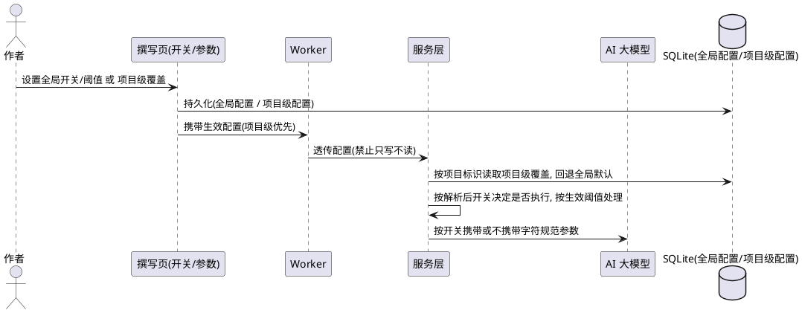

### 5.6.3 异常场景

1. **配置未传递到服务层**
   a. 触发条件：UI 设置了开关/参数但 Worker 或服务层未接收到。
   b. 系统行为：视为缺陷，须修复链路；服务层在配置缺省时按默认值处理。
   c. 用户感知：修复后配置行为与作者设置一致。

2. **配置值非法**
   a. 触发条件：阈值配置为空、为负或超出合理范围。
   b. 系统行为：回退默认值并记录告警日志。
   c. 用户感知：检测正常进行，不受非法配置影响。

3. **配置持久化失败**
   a. 触发条件：配置写入持久层失败。
   b. 系统行为：本次运行使用内存中的设置，记录告警。
   c. 用户感知：当前会话设置生效，重启后可能回退默认值。

4. **项目级配置缺失或损坏**
   a. 触发条件：当前项目的项目级配置不存在或损坏。
   b. 系统行为：回退全局配置；全局也缺失或损坏时回退内置默认值。
   c. 用户感知：该项目按全局默认或内置默认生效，不报错中断。

---

## 5.7 编辑润色场景的乱码与格式检测修复

### 5.7.1 业务规则

1. **润色接入规则**：当执行章节 AI 润色（scene=auto-polish）获得润色后正文后、存入待确认润色记录之前，系统应当对该润色后正文执行统一字符乱码与格式错乱检测与规范化。
   a. 验收条件：[润色返回含乱码的正文] → [存入待确认记录的润色正文已规范化]

2. **采纳写回规则**：当作者采纳润色（confirm_polish, action=accept）将润色正文写回 chapter.content 之前，系统应当对润色正文再次执行统一规范化，防止待确认期间引入异常。
   a. 验收条件：[采纳润色写回章节] → [落盘的 chapter.content 已规范化]

3. **提示词约束规则**：润色提示词模板必须新增"输出规范字符、禁止乱码与格式错乱"的明确约束。
   a. 验收条件：[润色提示词模板] → [包含禁止乱码与格式错乱的约束]

4. **修复统计规则**：润色完成与采纳写回时，系统应当向作者返回字符修复统计。
   a. 验收条件：[润色正文含乱码] → [润色结果携带字符修复统计]

5. **语义不改变规则**：规范化不得改变润色的文字内容与语义，仅清洗异常字符与规整格式。
   a. 验收条件：[润色正文规范化] → [文字内容与语义不变，仅乱码/格式被修复]

6. **检测作用文本字段规则**：编辑润色场景的检测作用文本字段为润色后正文（polished_content）。
   a. 验收条件：[润色场景执行检测] → [检测对象为润色后正文字段]

7. **配置遵循规则**：编辑润色场景必须读取作者设置的开关与阈值——开关关闭时跳过检测修复，开关开启时按生效阈值执行。
   a. 验收条件：[开关关闭后触发 AI 润色] → [润色正常进行但不执行字符/格式检测修复]
   b. 验收条件：[作者自定义阈值后触发 AI 润色] → [按自定义阈值执行]

### 5.7.2 交互流程

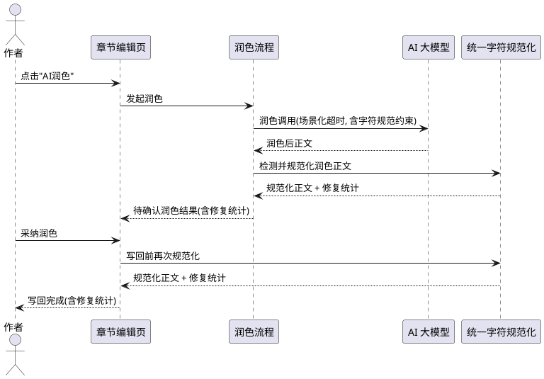

### 5.7.3 异常场景

1. **润色正文规范化后过短**
   a. 触发条件：清除乱码后润色正文低于最小有效长度。
   b. 系统行为：按既有规则提示内容过短，不落盘不合格正文。
   c. 用户感知：润色结果提示"规范化后内容过短"。

2. **润色正文含不可逆乱码**
   a. 触发条件：润色正文含已无法还原的替换字符。
   b. 系统行为：清除不可逆乱码字符并保留其余内容，统计中标注。
   c. 用户感知：修复统计显示已清除的不可逆乱码数量。

3. **章节锁定或生成中**
   a. 触发条件：目标章节已锁定或正在生成中。
   b. 系统行为：按既有规则拒绝润色。
   c. 用户感知：既有拒绝提示保持一致。

---

## 5.8 直接更新章节正文场景的乱码与格式检测修复

### 5.8.1 业务规则

1. **写回接入规则**：当通过直接更新章节正文（update_chapter_content）将新内容写回 chapter.content 之前，系统应当对新内容执行统一字符乱码与格式错乱检测与规范化。
   a. 验收条件：[用户保存含乱码的编辑内容] → [落盘的 chapter.content 已规范化]

2. **非 AI 场景规则**：直接更新章节正文为用户手动输入而非 AI 生成，不涉及 AI 提示词约束，仅执行落盘前统一确定性规范化。
   a. 验收条件：[手动编辑保存] → [落盘前执行确定性规范化，不发起 AI 调用]

3. **修复统计规则**：保存完成时，系统应当向作者返回字符修复统计（检测数、修复字符数、剩余问题数）。
   a. 验收条件：[保存内容含乱码] → [保存结果携带字符修复统计]

4. **修改记录规则**：规范化后的正文写入 chapter.content 与 ModifyRecord.content_after；字数按规范化后正文计算。
   a. 验收条件：[保存规范化后正文] → [chapter.word_count 与规范化后正文长度一致]

5. **语义不改变规则**：规范化不得改变用户编辑的文字内容与语义。
   a. 验收条件：[手动编辑内容规范化] → [文字内容与语义不变]

6. **检测作用文本字段规则**：直接更新场景的检测作用文本字段为待写入的章节正文（new_content）。
   a. 验收条件：[直接更新场景执行检测] → [检测对象为待写入正文字段]

7. **配置遵循规则**：直接更新场景必须读取作者设置的开关与阈值——开关关闭时跳过检测修复，开关开启时按生效阈值执行。
   a. 验收条件：[开关关闭后保存章节] → [正文原样落盘，不执行检测修复]
   b. 验收条件：[作者自定义阈值后保存章节] → [按自定义阈值执行规整]

### 5.8.2 交互流程

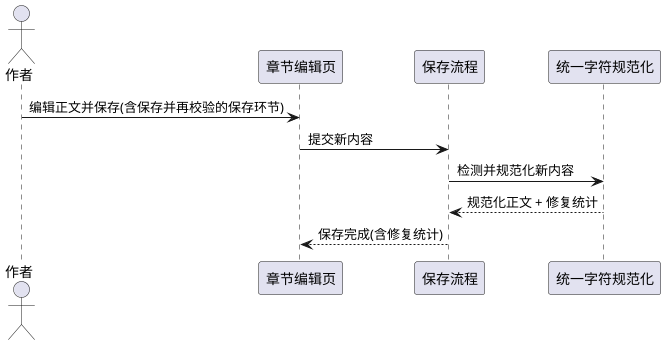

### 5.8.3 异常场景

1. **规范化后内容为空**
   a. 触发条件：清除乱码后新内容为空或仅剩空白。
   b. 系统行为：按既有"内容不能为空"规则拒绝保存。
   c. 用户感知：保存提示"章节内容不能为空"。

2. **规范化失败回退**
   a. 触发条件：规范化处理发生异常。
   b. 系统行为：回退为原始新内容，记录告警日志。
   c. 用户感知：保存正常完成，不因规范化异常中断。

3. **章节锁定或生成中**
   a. 触发条件：目标章节已锁定或正在生成中。
   b. 系统行为：按既有规则拒绝编辑。
   c. 用户感知：既有拒绝提示保持一致。

---

## 5.9 大纲校验与修复场景的乱码与格式检测修复

### 5.9.1 业务规则

1. **校验接入规则**：当执行大纲一致性校验（scene=check-consistency/outline）时，系统应当在既有校验维度之外，对大纲各章的梗概要点等检测作用文本字段执行字符乱码与格式错乱检测，并将结果作为结构化问题纳入报告。
   a. 验收条件：[大纲梗概要点含乱码] → [校验问题清单包含字符/格式问题条目]

2. **检测作用文本字段规则**：大纲校验场景的检测作用文本字段为大纲各章的梗概要点（synopsis_points）与章节名等文本字段，而非章节正文（chapter.content）。
   a. 验收条件：[大纲校验执行检测] → [检测对象为梗概要点等大纲文本字段，不检测章节正文]

3. **仅检测不改写规则**：大纲校验仅检测与报告，不得自动改写大纲文本；修复须由作者发起大纲修复。
   a. 验收条件：[执行大纲校验] → [大纲文本未被修改，仅产出问题清单]

4. **修复接入规则**：当执行大纲修复（scene=repair-outline）获得修复后大纲文本后、写回大纲之前，系统应当对修复后的大纲文本字段执行统一规范化。
   a. 验收条件：[大纲修复返回含乱码的文本] → [写回的大纲文本已规范化]

5. **提示词约束规则**：大纲修复提示词模板应当新增"修复结果须输出规范字符、清除乱码与格式错乱"的约束。
   a. 验收条件：[大纲修复提示词模板] → [包含禁止乱码与格式错乱的约束]

6. **问题类型规则**：大纲校验产出的字符/格式问题复用既有大纲问题结构，新增类型取值"字符乱码"与"格式错乱"。
   a. 验收条件：[大纲梗概要点含乱码] → [产出问题类型为"字符乱码"或"格式错乱"]

7. **确定性检测规则**：大纲校验的字符与格式检测为确定性规则检测，不依赖 AI，不得因 AI 校验超时或失败而缺失。
   a. 验收条件：[AI 大纲校验超时降级] → [字符/格式检测结果仍然产出]

8. **配置遵循规则**：大纲校验与修复场景必须读取作者设置的开关与阈值——开关关闭时不产出字符/格式问题或不执行规范化，开关开启时按生效阈值执行。
   a. 验收条件：[开关关闭后触发大纲校验] → [报告不含字符/格式问题]
   b. 验收条件：[开关关闭后触发大纲修复] → [大纲文本原样写回，不执行规范化]

### 5.9.2 交互流程

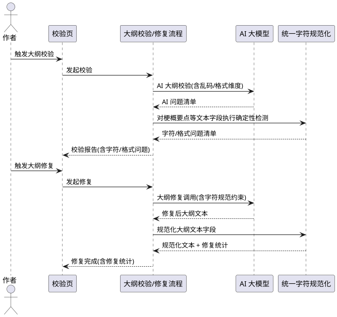

### 5.9.3 异常场景

1. **大纲文本含不可逆乱码**
   a. 触发条件：大纲梗概要点含已无法还原的替换字符。
   b. 系统行为：清除不可逆乱码字符并保留其余内容，统计中标注。
   c. 用户感知：修复统计显示已清除的不可逆乱码数量。

2. **大纲修复返回数据不完整**
   a. 触发条件：AI 大纲修复返回的大纲数据不完整。
   b. 系统行为：按既有规则跳过覆盖写入，保留原数据。
   c. 用户感知：修复事件提示"AI返回数据不完整，保留原数据"。

3. **AI 校验超时降级**
   a. 触发条件：AI 大纲校验超过场景化超时。
   b. 系统行为：仅返回确定性规则结果（含字符与格式检测）。
   c. 用户感知：报告提示"AI校验超时，仅展示规则校验结果"，且包含字符/格式问题。

---

## 5.10 爽点钩子校验与修复场景的乱码与格式检测修复

### 5.10.1 业务规则

1. **校验接入规则**：当执行爽点钩子一致性校验（scene=check-consistency/hook）时，系统应当在既有校验维度之外，对爽点内容描述与钩子内容等检测作用文本字段执行字符乱码与格式错乱检测，并将结果作为结构化问题纳入报告。
   a. 验收条件：[钩子内容含乱码] → [校验问题清单包含字符/格式问题条目]

2. **检测作用文本字段规则**：钩子校验场景的检测作用文本字段为爽点内容描述（content_desc）与钩子内容（hook_content）等文本字段，而非章节正文。
   a. 验收条件：[钩子校验执行检测] → [检测对象为爽点/钩子文本字段，不检测章节正文]

3. **仅检测不改写规则**：钩子校验仅检测与报告，不得自动改写钩子文本；修复须由作者发起钩子修复。
   a. 验收条件：[执行钩子校验] → [钩子文本未被修改，仅产出问题清单]

4. **修复接入规则**：当执行钩子修复（scene=repair-hook）获得修复后爽点与钩子文本后、写回之前，系统应当对修复后的爽点/钩子文本字段执行统一规范化。
   a. 验收条件：[钩子修复返回含乱码的文本] → [写回的爽点/钩子文本已规范化]

5. **修复统计规则**：钩子修复逐章完成时，系统应当随 SSE 事件返回该章字符修复统计。
   a. 验收条件：[某章钩子修复含乱码] → [修复完成事件携带字符修复统计]

6. **提示词约束规则**：钩子修复提示词模板应当新增"修复结果须输出规范字符、清除乱码与格式错乱"的约束。
   a. 验收条件：[钩子修复提示词模板] → [包含禁止乱码与格式错乱的约束]

7. **问题类型规则**：钩子校验产出的字符/格式问题复用既有钩子问题结构，新增类型取值"字符乱码"与"格式错乱"。
   a. 验收条件：[钩子内容含乱码] → [产出问题类型为"字符乱码"或"格式错乱"]

8. **确定性检测规则**：钩子校验的字符与格式检测为确定性规则检测，不依赖 AI，不得因 AI 校验超时或失败而缺失。
   a. 验收条件：[AI 钩子校验超时降级] → [字符/格式检测结果仍然产出]

9. **配置遵循规则**：钩子校验与修复场景必须读取作者设置的开关与阈值——开关关闭时不产出字符/格式问题或不执行规范化，开关开启时按生效阈值执行。
   a. 验收条件：[开关关闭后触发钩子校验] → [报告不含字符/格式问题]
   b. 验收条件：[开关关闭后触发钩子修复] → [钩子文本原样写回，不执行规范化]

### 5.10.2 交互流程

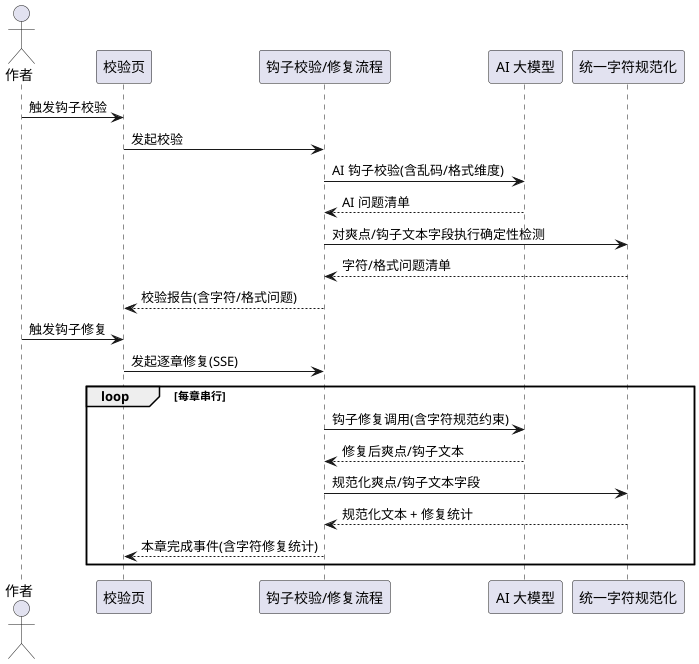

### 5.10.3 异常场景

1. **钩子文本含不可逆乱码**
   a. 触发条件：爽点或钩子内容含已无法还原的替换字符。
   b. 系统行为：清除不可逆乱码字符并保留其余内容，统计中标注。
   c. 用户感知：修复统计显示已清除的不可逆乱码数量。

2. **钩子修复返回数据不完整**
   a. 触发条件：AI 钩子修复返回的爽点/钩子数据不完整。
   b. 系统行为：按既有规则跳过覆盖写入，保留原数据。
   c. 用户感知：修复事件提示"AI返回数据不完整，保留原数据"。

3. **AI 校验超时降级**
   a. 触发条件：AI 钩子校验超过场景化超时。
   b. 系统行为：仅返回确定性规则结果（含字符与格式检测）。
   c. 用户感知：报告提示"AI校验超时，仅展示规则校验结果"，且包含字符/格式问题。

---

## 5.11 章节编辑页校验一致性场景的乱码与格式检测与报告

### 5.11.1 业务规则

1. **校验接入规则**：当作者在章节编辑页触发校验一致性（scene=check-consistency/chapter）时，系统应当在既有校验维度之外，对该章正文执行字符乱码与格式错乱检测，并将结果作为结构化问题纳入报告。
   a. 验收条件：[章节编辑页校验，某章正文含乱码] → [校验问题清单包含字符/格式问题条目]

2. **问题类型规则**：产出的字符/格式问题复用既有章节校验问题结构，新增类型取值"字符乱码"与"格式错乱"。
   a. 验收条件：[产出字符乱码问题] → [问题类型为"字符乱码"，结构不变]
   b. 验收条件：[产出格式错乱问题] → [问题类型为"格式错乱"，结构不变]

3. **确定性检测规则**：字符与格式检测为确定性规则检测，不依赖 AI，不得因 AI 校验超时或失败而缺失。
   a. 验收条件：[AI 校验超时降级] → [字符/格式检测结果仍然产出]

4. **仅检测不改写规则**：章节编辑页校验仅检测与报告，不得自动改写章节正文。
   a. 验收条件：[执行章节编辑页校验] → [章节正文未被修改，仅产出问题清单]

5. **AI 维度协同规则**：AI 校验提示词应当新增"检查正文是否存在乱码/异常字符与格式错乱"的校验维度；AI 产出与确定性检测合并去重。
   a. 验收条件：[章节校验提示词] → [包含字符乱码与格式错乱校验维度]

6. **检测作用文本字段规则**：章节编辑页校验场景的检测作用文本字段为当前章节正文（chapter.content）。
   a. 验收条件：[章节编辑页校验执行检测] → [检测对象为当前章节正文字段]

7. **配置遵循规则**：章节编辑页校验场景必须读取作者设置的开关与阈值——开关关闭时不产出字符/格式问题，开关开启时按生效阈值检测。
   a. 验收条件：[开关关闭后触发章节校验] → [报告不含字符/格式问题，既有校验不受影响]
   b. 验收条件：[作者自定义阈值后触发章节校验] → [按自定义配置产出问题]

### 5.11.2 交互流程

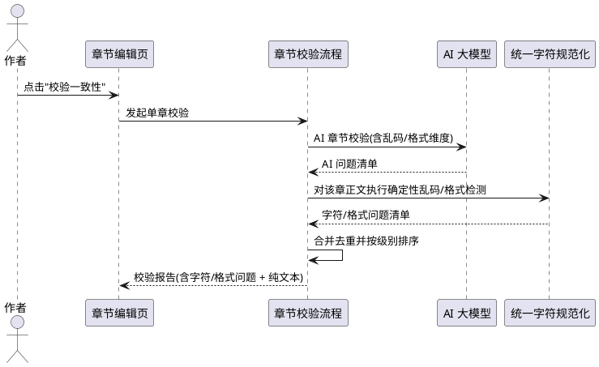

### 5.11.3 异常场景

1. **AI 校验超时或失败**
   a. 触发条件：AI 章节校验超过场景化超时或返回异常。
   b. 系统行为：仅返回确定性规则结果（含字符与格式检测）。
   c. 用户感知：报告提示"AI校验未完成"，且包含字符/格式问题。

2. **同一乱码被规则与 AI 重复产出**
   a. 触发条件：同一类型问题被确定性与 AI 同时产出。
   b. 系统行为：按类型去重，保留级别更高的一条。
   c. 用户感知：报告不出现重复条目。

3. **无乱码与格式问题**
   a. 触发条件：该章正文无乱码与格式错乱。
   b. 系统行为：不产出字符/格式问题，不影响既有校验评分。
   c. 用户感知：报告中无字符/格式问题条目。

---

## 5.12 梗概与世界观 AI 润色场景的乱码与格式检测修复

### 5.12.1 业务规则

1. **润色接入规则**：当执行梗概或世界观 AI 润色获得润色后文本后、保存写回之前，系统应当对润色后文本执行统一字符乱码与格式错乱检测与规范化。
   a. 验收条件：[梗概润色返回含乱码] → [保存的梗概正文已规范化]
   b. 验收条件：[世界观润色返回含乱码] → [保存的世界观正文已规范化]

2. **提示词约束规则**：梗概与世界观润色提示词模板必须新增"输出规范字符、禁止乱码与格式错乱"的明确约束。
   a. 验收条件：[梗概/世界观润色提示词模板] → [包含禁止乱码与格式错乱的约束]

3. **修复统计规则**：润色完成时，系统应当向作者返回字符修复统计。
   a. 验收条件：[梗概/世界观润色含乱码] → [润色结果携带字符修复统计]

4. **语义不改变规则**：规范化不得改变梗概/世界观的文字内容与语义。
   a. 验收条件：[梗概/世界观润色规范化] → [文字内容与语义不变]

5. **检测作用文本字段规则**：梗概润色场景的检测作用文本字段为梗概正文（synopsis.content），世界观润色场景为世界观正文（worldview.content）。
   a. 验收条件：[梗概润色执行检测] → [检测对象为梗概正文字段]
   b. 验收条件：[世界观润色执行检测] → [检测对象为世界观正文字段]

6. **配置遵循规则**：梗概与世界观润色场景必须读取作者设置的开关与阈值——开关关闭时跳过检测修复，开关开启时按生效阈值执行。
   a. 验收条件：[开关关闭后触发梗概/世界观润色] → [润色正常进行但不执行字符/格式检测修复]
   b. 验收条件：[作者自定义阈值后触发润色] → [按自定义阈值执行]

### 5.12.2 交互流程

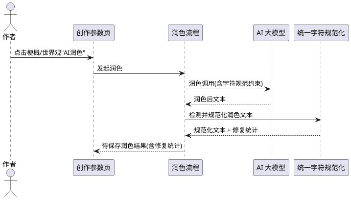

### 5.12.3 异常场景

1. **润色文本含不可逆乱码**
   a. 触发条件：梗概或世界观润色文本含已无法还原的替换字符。
   b. 系统行为：清除不可逆乱码字符并保留其余内容，统计中标注。
   c. 用户感知：修复统计显示已清除的不可逆乱码数量。

2. **润色文本规范化后过短**
   a. 触发条件：清除乱码后润色文本低于最小有效长度（如梗概要求 ≥50 字）。
   b. 系统行为：按既有规则提示内容过短，不保存不合格文本。
   c. 用户感知：润色结果提示"规范化后内容过短"。

3. **AI 润色超时或失败**
   a. 触发条件：梗概/世界观润色 AI 调用超时或返回异常。
   b. 系统行为：按既有规则提示润色失败，不保存。
   c. 用户感知：润色提示失败原因。

---

## 5.13 校验报告展示的乱码与格式问题呈现

### 5.13.1 业务规则

1. **展示支持规则**：校验报告页必须能够展示"字符乱码"与"格式错乱"问题类型，与既有问题类型同等对待，在报告表格与详情中正常呈现。
   a. 验收条件：[校验产出"字符乱码"问题] → [校验报告页表格中显示该条目，检查类型列显示"字符乱码"]
   b. 验收条件：[校验产出"格式错乱"问题] → [校验报告页表格中显示该条目，检查类型列显示"格式错乱"]

2. **结构兼容规则**：校验报告页的表格结构与字段不得因新增问题类型而破坏既有列定义与解析逻辑。
   a. 验收条件：[校验报告含字符/格式问题] → [既有列（检查类型/结果/问题描述/卷/章）正常展示，无结构破坏]

3. **纯文本报告规则**：纯文本报告中应当包含字符/格式问题条目，与结构化报告一致。
   a. 验收条件：[存在字符/格式问题] → [纯文本报告包含对应条目]

4. **配置遵循规则**：当开关关闭时，校验报告页不展示字符/格式问题（因校验场景未产出）；开关开启时正常展示。
   a. 验收条件：[开关关闭] → [校验报告页无字符/格式问题条目]

### 5.13.2 交互流程

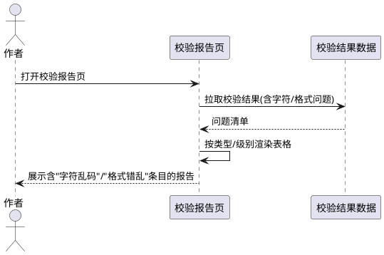

### 5.13.3 异常场景

1. **问题类型无法识别**
   a. 触发条件：校验结果中存在前端无法识别的问题类型。
   b. 系统行为：按既有兜底逻辑展示原始类型字符串，不崩溃。
   c. 用户感知：该条目正常显示，类型列为原始值。

2. **报告数据缺失**
   a. 触发条件：校验结果数据为空或拉取失败。
   b. 系统行为：按既有空态逻辑展示。
   c. 用户感知：报告页显示空态提示。

---

# 6. 数据约束

## 6.1 章节正文（content）

1. **字符洁净**：规范化后的正文不得包含控制字符（合法换行除外）、零宽/不可见字符、Unicode 替换字符（不可逆部分予以清除）、非法私用区字符。
2. **格式规范**：规范化后的正文不得违反第 6.5 节所列默认阈值（连续空行、连续标点重复、行首行尾空白、异常空白字符等）。
3. **语义保留**：规范化后的正文须保留原文全部文字内容、情节、对话与合法标点。
4. **长度一致**：章节字数（word_count）须与规范化后正文长度保持一致。
5. **不可为空恶化**：规范化不得使非空正文变为空正文。

## 6.2 校验问题（WritingConsistencyIssue / ChapterConsistencyIssue / OutlineConsistencyIssue / HookConsistencyIssue）

1. **类型扩展**：问题类型取值除既有类型外，新增"字符乱码"与"格式错乱"。
2. **级别**：字符乱码问题级别依据影响程度为"严重/一般/轻微"，格式错乱问题默认"轻微"或"一般"。
3. **定位**：须包含卷号、章号（大纲/钩子问题可为大纲章号或卷章号），detail 指明命中类别与位置，suggestion 给出可执行修复指引。
4. **结构兼容**：字段结构须与既有问题对象一致，不新增必填字段破坏既有调用方。
5. **适用范围**：新增的"字符乱码"与"格式错乱"类型适用于撰写页校验、章节编辑页校验、大纲校验、钩子校验等全部校验场景的问题结构。

## 6.3 字符修复报告（CharacterRepairStat）

1. **章节标识**：须标识涉及的卷号与章号（大纲/钩子场景可为大纲章号或卷章号）。
2. **检测数量**：须记录检测到的乱码数与格式问题数。
3. **修复数量**：须记录已修复的字符数与格式修正数。
4. **剩余数量**：须记录处理完成后仍存在的问题数（原则上应为 0）。
5. **命中类别**：须记录命中的乱码/格式类别集合。
6. **修复明细**：须包含逐条修复明细，每条记录问题类型、位置或原文片段、处理动作，供「字符修复明细窗口」展示。
7. **整体汇总**：批量处理完成后须提供涉及章节数、累计修复字符数的汇总。

## 6.4 SSE 事件数据（补写/修复/钩子修复 chunk）

1. **向后兼容**：新增的字符修复统计字段须为可选字段，既有字段语义与取值不变。
2. **逐章携带**：单章完成/跳过事件须可携带该章的字符修复统计。
3. **整体携带**：整体完成事件须可携带字符修复的整体汇总。
4. **明细携带**：AI 一键修复场景须可携带字符修复明细列表，供前端弹出「字符修复明细窗口」。

## 6.5 判定阈值默认值（可配置）

以下阈值为系统内置默认值，作者未自定义时按此生效；所有阈值均可由作者通过撰写页参数自定义覆盖（详见 5.6），调整后全部覆盖场景的检测结果随之变化。

1. **连续空行**：默认允许最多 1 个空行，出现 ≥2 个连续空行判定为异常并规整。
2. **连续标点/符号重复**：默认允许同一标点最多连续 2 次，出现 ≥3 次判定为重复标点；省略号「……」、破折号「——」等合法多字符标点豁免。
3. **行首行尾多余空白**：默认 0 容忍，一律去除。
4. **段落内连续普通空格**：默认压缩为 1 个。
5. **制表符（\t）**：默认 0 容忍，文本中出现即去除并计入格式问题。
6. **非断行空格（U+00A0）**：默认替换为普通空格并按连续空格规则压缩。
7. **全角空格（U+3000）**：仅允许用于段落首行缩进，默认统一规整为 2 个全角空格；非行首位置的全角空格视为异常。
8. **零宽/不可见字符、控制字符（换行除外）**：默认 0 容忍，一律删除。
9. **U+FFFD 替换字符**：默认一律清除，并标注为不可逆乱码，不臆造替代内容。

## 6.6 用户配置（乱码修复开关与判定阈值）

配置采用"全局默认 + 项目可覆盖"模式。

1. **配置层次**：配置分为**全局（应用级）配置**与**项目级配置**两层；全局配置作为所有项目的默认，项目级配置可对全局默认进行覆盖。
2. **开关状态**：须持久化"乱码修复开关"状态（布尔值）；全局默认开启，项目级可覆盖。
3. **阈值参数**：须持久化判定阈值集合；全局与项目级均可设置，未设置项使用 6.5 默认值。
4. **优先级**：配置生效优先级为 **内置默认值 < 全局配置 < 项目级配置**；项目级存在覆盖项时以项目级为准，其余项回退全局配置，再回退内置默认值。
5. **读取规则**：全部覆盖场景执行时，按第 4 条优先级解析生效配置（项目级覆盖优先 → 回退全局默认 → 再回退内置默认值）并据此执行。
6. **存储方式**：全局配置与项目级配置均沿用 SQLite 持久化层存储；项目级配置以项目标识关联保存，读取时按当前项目标识查找覆盖。
7. **读取兼容**：任一层次配置不存在或损坏时按优先级回退，不得导致功能异常。
8. **链路一致**：解析后的生效配置须被 UI、Worker、服务层与 AI 调用一致读取，不得出现仅部分环节生效。

## 6.7 大纲与钩子文本字段

1. **梗概要点（synopsis_points）**：大纲各章的梗概要点文本，大纲校验/修复场景的检测作用文本字段之一；规范化后须字符洁净与格式规范，语义与情节要点保留。
2. **章节名（chapter_name）**：大纲各章的章节名文本，大纲校验场景的检测作用文本字段之一；规范化后须字符洁净。
3. **爽点内容描述（content_desc）**：爽点的内容描述文本，钩子校验/修复场景的检测作用文本字段之一；规范化后须字符洁净与格式规范，语义保留。
4. **钩子内容（hook_content）**：钩子的内容文本，钩子校验/修复场景的检测作用文本字段之一；规范化后须字符洁净与格式规范，语义保留。
5. **梗概正文（synopsis.content）**：故事梗概正文，梗概润色场景的检测作用文本字段；规范化后须字符洁净与格式规范，语义保留。
6. **世界观正文（worldview.content）**：世界观设定正文，世界观润色场景的检测作用文本字段；规范化后须字符洁净与格式规范，语义保留。
7. **通用约束**：上述文本字段规范化后均不得包含控制字符（合法换行除外）、零宽/不可见字符、Unicode 替换字符、非法私用区字符，且不得违反 6.5 所列格式阈值。