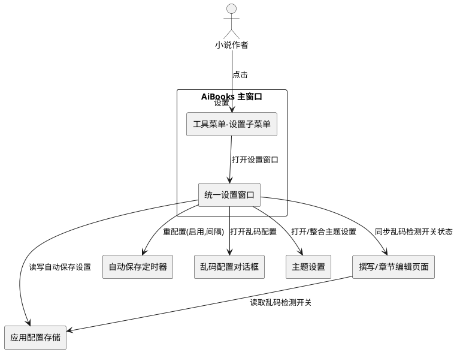
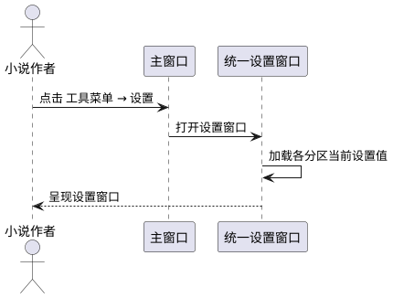
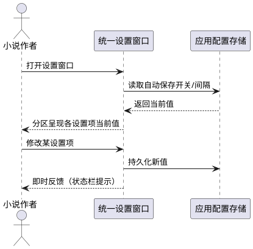
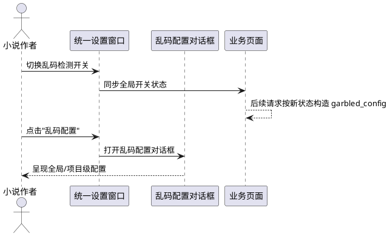
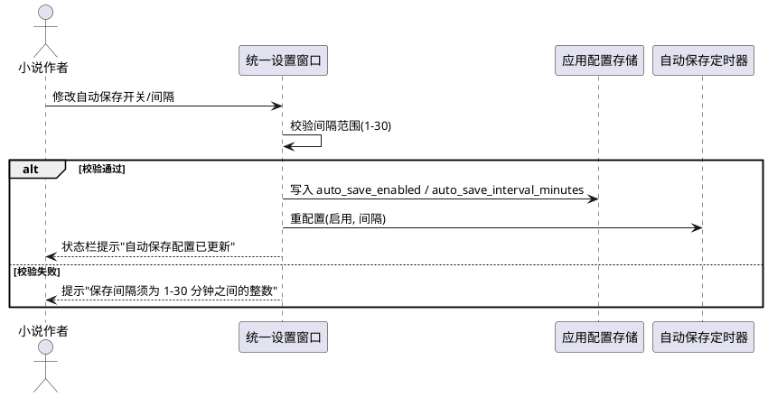

# 设置菜单与统一设置窗口 需求规格

> 本文档描述 AiBooks 桌面端"工具菜单增加设置子菜单 + 统一设置窗口"功能的需求规格。
> 仅描述"做什么"（业务行为、规则、验收条件），不描述"怎么做"（类名、函数签名、数据库表结构）。

---

# 1. 组件定位

## 1.1 核心职责

本组件负责在工具菜单下新增"设置"子菜单入口，并提供一个统一设置窗口，集中承载原散落在撰写页面、章节编辑页面、备份管理页面中的全局性设置控件，实现设置项的聚合呈现与即时生效。

## 1.2 核心输入

1. 用户在工具菜单点击"设置"子菜单项的触发指令
2. 用户在设置窗口中切换乱码检测开关、打开乱码配置、修改自动保存开关与间隔的操作指令
3. 应用启动时读取已持久化的设置项初始值（自动保存开关、自动保存间隔）
4. 设置窗口打开时读取当前乱码检测开关状态的请求

## 1.3 核心输出

1. 向用户呈现的设置窗口界面（含乱码检测区、自动保存区、主题区等分区）
2. 设置变更后对自动保存定时器的重配置信号（启用状态 + 间隔分钟数）
3. 设置变更后写入应用配置存储的持久化结果
4. 乱码检测开关状态变更后向各业务页面（撰写、章节编辑）同步的全局开关状态
5. 设置窗口关闭后返回主窗口的控制权

## 1.4 职责边界

本组件**不负责**以下事项：

1. 不负责乱码修复的具体算法与修复参数的存储实现（仍由现有乱码配置对话框承担）
2. 不负责自动保存定时器的备份执行逻辑（仅负责配置变更后触发定时器重配置）
3. 不负责主题切换的渲染实现（仅提供主题设置入口，渲染仍由主题管理器承担）
4. 不负责各业务页面（撰写、章节编辑、备份）的非设置类业务功能
5. 不负责 AI 源配置、调用日志、应用日志等非全局设置类入口的组织
6. 不引入新的持久化存储介质，自动保存设置仍写入现有应用配置

---

# 2. 领域术语

**设置子菜单**
: 工具菜单下新增的二级菜单项，作为打开统一设置窗口的唯一入口。

**统一设置窗口**
: 一个模态或非模态弹窗，以分区方式聚合呈现多个全局设置项，替代原散落在各页面的设置控件。

**全局设置项**
: 影响整个应用行为、跨页面生效的设置项，如乱码检测开关、自动保存开关与间隔、全局主题。

**项目级设置项**
: 仅对当前打开项目生效的设置项，如乱码修复参数的项目级配置。
: 备注：乱码配置对话框已支持全局/项目级作用域切换，本规格不改变其作用域机制。

**乱码检测开关**
: 控制是否对 AI 生成/修复/润色/填充/保存结果执行乱码与格式检测修复的布尔开关。
: 备注：原撰写页面与章节编辑页面各有一个独立开关，迁移后应统一为单一全局开关。

**自动保存开关**
: 控制是否启用定时自动保存的布尔开关，对应配置项 auto_save_enabled。

**自动保存间隔**
: 定时自动保存的触发间隔，取值范围为 1-30 分钟的整数，对应配置项 auto_save_interval_minutes。

**自动保存定时器重配置**
: 自动保存配置变更后，通知主窗口自动保存定时器按新的启用状态与间隔重新生效的动作。

**迁移项**
: 原位于业务页面工具栏、需移动至统一设置窗口的设置控件及其关联的配置读写逻辑。

---

# 3. 角色与边界

## 3.1 核心角色

- **小说作者**：通过工具菜单打开设置窗口，修改全局设置项，期望设置即时生效且下次启动保持。

## 3.2 外部系统

- **应用配置存储**：提供自动保存开关与间隔的读写能力。
- **自动保存定时器**：接收重配置信号，按新参数启停定时备份。
- **乱码配置对话框**：由设置窗口触发打开，承担乱码修复参数的全局/项目级配置读写。
- **主题设置对话框**：可由设置窗口触发打开或整合为设置窗口的一个分区，承担主题切换渲染。
- **业务页面（撰写/章节编辑）**：消费统一后的乱码检测开关状态，用于校验、修复、填充、保存等请求。

## 3.3 交互上下文



---

# 4. DFX约束

## 4.1 性能

1. 设置窗口从点击菜单到完成渲染并可见，响应时间不得超过 500 毫秒。
2. 设置窗口内任意单项设置变更后，配置持久化与定时器重配置完成时间不得超过 200 毫秒。
3. 设置窗口打开时不发起任何网络请求（乱码配置对话框打开时才发起 API 读写）。

## 4.2 可靠性

1. 设置窗口关闭后再打开，必须完整回显上次保存的所有设置项当前值。
2. 自动保存设置变更后必须成功触发定时器重配置，否则须向用户提示失败并回滚界面状态。
3. 应用异常退出后再次启动，设置窗口须能正确加载已持久化的自动保存设置。
4. 乱码检测开关状态在设置窗口与各业务页面之间必须保持强一致，不得出现窗口已关闭但页面仍读取旧值的情形。

## 4.3 安全性

1. 设置窗口中的设置项变更须可追溯，关键变更（自动保存启停、间隔修改）须记录应用日志。
2. 设置窗口不得暴露任何敏感配置（如 API Key），此类配置仍由 AI 源配置页面单独承载。

## 4.4 可维护性

1. 设置窗口须采用分区组织，新增全局设置项时只需新增分区，不得修改现有分区结构。
2. 设置窗口须遵循应用统一主题，边框、背景色、字号随主题切换即时更新。
3. 设置窗口的设置项变更须遵循"即时生效 + 即时持久化"范式，不提供单独的"保存"按钮（与现有主题设置对话框范式一致）。

## 4.5 兼容性

1. 迁移后已持久化的自动保存配置（auto_save_enabled、auto_save_interval_minutes）须被设置窗口正确读取，无须数据迁移。
2. 迁移后各业务页面调用乱码检测开关的现有调用点须保持兼容，无须修改请求参数结构。
3. 工具菜单原有菜单项（AI源配置、AI调用日志、应用日志、备份管理）须保持原有跳转行为不变。

---

# 5. 核心能力

## 5.1 设置入口（工具菜单子菜单）

### 5.1.1 业务规则

1. **子菜单存在性**：工具菜单必须包含一个名为"设置"的子菜单项。
   a. 验收条件：[应用启动后打开工具菜单] → [菜单中存在"设置"子菜单项]

2. **子菜单唯一入口**：点击"设置"子菜单项必须打开统一设置窗口，且仅打开一个实例。
   a. 验收条件：[点击"设置"子菜单] → [弹出统一设置窗口]
   b. 验收条件：[设置窗口已打开时再次点击"设置"子菜单] → [激活并置顶已存在的窗口，不新建第二个实例]

3. **原有菜单项保留**：新增"设置"子菜单不得移除或改变工具菜单原有菜单项（AI源配置、全局主题、AI调用日志、应用日志、备份管理）的跳转行为。
   a. 验收条件：[点击"AI源配置"] → [跳转至 AI 源配置页面（与迁移前一致）]
   b. 验收条件：[点击"备份管理"] → [跳转至备份管理页面（与迁移前一致）]

4. **全局主题入口处理**：原"全局主题"菜单项可保留为独立入口，也可整合为设置窗口的一个分区；若整合，须保证主题设置功能行为与迁移前完全一致。
   a. 验收条件：[通过设置窗口修改主题] → [主题即时全局生效，行为与原主题对话框一致]

### 5.1.2 交互流程



### 5.1.3 异常场景

1. **设置窗口打开失败**
   a. 触发条件：设置窗口初始化过程中发生未预期异常
   b. 系统行为：捕获异常并记录应用日志，不创建窗口实例
   c. 用户感知：状态栏提示"设置窗口打开失败，请查看应用日志"，不弹出崩溃

## 5.2 统一设置窗口布局

### 5.2.1 业务规则

1. **分区组织**：设置窗口必须按设置类别分区呈现，至少包含"乱码检测"分区与"自动保存"分区。
   a. 验收条件：[打开设置窗口] → [窗口内可见"乱码检测"分区与"自动保存"分区]

2. **分区独立性**：各分区的设置项变更互不影响，修改一个分区的设置项不得触发其他分区的副作用（自动保存定时器重配置除外）。
   a. 验收条件：[修改乱码检测开关] → [不触发自动保存定时器重配置]
   b. 验收条件：[修改自动保存间隔] → [不改变乱码检测开关状态]

3. **即时生效范式**：设置窗口内所有设置项变更须即时生效并即时持久化，不提供统一的"确定/取消"按钮组（与现有主题设置对话框范式一致）。
   a. 验收条件：[修改自动保存间隔为 10 分钟] → [立即持久化并触发定时器重配置，无须点击额外保存按钮]

4. **窗口标题与尺寸**：设置窗口标题须为"设置"，窗口尺寸须适配各分区内容且不超出主窗口可视区域。
   a. 验收条件：[打开设置窗口] → [窗口标题为"设置"，内容完整可见无裁切]

5. **主题跟随**：设置窗口须跟随应用全局主题，主题切换时窗口外观即时更新。
   a. 验收条件：[在设置窗口打开状态下切换主题] → [设置窗口外观即时更新为新主题]

### 5.2.2 交互流程



### 5.2.3 异常场景

1. **配置读取失败**
   a. 触发条件：设置窗口初始化时读取应用配置存储失败
   b. 系统行为：各设置项回退至默认值（自动保存开关默认启用、间隔默认 5 分钟），记录应用日志
   c. 用户感知：设置窗口正常打开，设置项显示默认值，状态栏提示"部分设置加载失败，已使用默认值"

## 5.3 乱码检测设置迁移

### 5.3.1 业务规则

1. **开关统一化**：原撰写页面与章节编辑页面各自独立的乱码检测开关须统一为单一全局开关，迁移至设置窗口"乱码检测"分区。
   a. 验收条件：[在设置窗口关闭乱码检测开关] → [撰写页面与章节编辑页面的乱码检测均处于关闭状态]
   b. 验收条件：[在设置窗口开启乱码检测开关] → [撰写页面与章节编辑页面的乱码检测均处于开启状态]

2. **开关默认值**：统一后的乱码检测开关默认值须为开启（与迁移前各页面默认勾选一致）。
   a. 验收条件：[首次打开设置窗口] → [乱码检测开关处于开启状态]

3. **配置入口迁移**：原撰写页面与章节编辑页面的"乱码配置"按钮须迁移至设置窗口"乱码检测"分区，点击后打开现有乱码配置对话框。
   a. 验收条件：[在设置窗口点击"乱码配置"] → [弹出乱码配置对话框，行为与迁移前一致]
   b. 验收条件：[迁移后撰写页面工具栏] → [不再存在"乱码配置"按钮]
   c. 验收条件：[迁移后章节编辑页面工具栏] → [不再存在"乱码配置"按钮]

4. **开关控件移除**：迁移后撰写页面与章节编辑页面工具栏须移除原乱码检测复选框控件。
   a. 验收条件：[迁移后撰写页面工具栏] → [不再存在"乱码检测修复"复选框]
   b. 验收条件：[迁移后章节编辑页面工具栏] → [不再存在"乱码修复"复选框]

5. **调用点兼容**：迁移后撰写页面与章节编辑页面所有原读取乱码检测开关状态的调用点（校验、修复、填充、保存、润色等）须改为读取统一全局开关状态，请求参数结构不变。
   a. 验收条件：[撰写页面发起一致性校验] → [请求中 garbled_config 字段值反映统一开关状态，参数结构与迁移前一致]
   b. 验收条件：[章节编辑页面保存章节] → [请求中 garbled_config 字段值反映统一开关状态，参数结构与迁移前一致]

6. **开关状态持久化（建议项）**：统一后的乱码检测开关状态宜持久化至应用配置，使下次启动保持上次设置；若不持久化，须明确每次启动默认为开启。
   a. 验收条件：[关闭乱码检测开关后重启应用] → [若已实现持久化，开关为关闭状态；否则为开启状态并明确此为设计行为]

### 5.3.2 交互流程



### 5.3.3 异常场景

1. **业务页面读取开关状态时设置窗口未打开**
   a. 触发条件：用户关闭设置窗口后，在撰写或章节编辑页面发起需读取乱码检测开关的操作
   b. 系统行为：业务页面从统一全局开关状态源读取当前值（不依赖设置窗口是否打开）
   c. 用户感知：操作正常执行，乱码检测按上次设置的状态生效

2. **乱码配置对话框打开失败**
   a. 触发条件：点击"乱码配置"时对话框初始化异常
   b. 系统行为：捕获异常并记录应用日志
   c. 用户感知：提示"乱码配置打开失败，请查看应用日志"

## 5.4 自动保存设置迁移

### 5.4.1 业务规则

1. **控件迁移**：原备份管理页面的"启用定时自动保存"复选框与"保存间隔(分钟)"数值输入框须迁移至设置窗口"自动保存"分区。
   a. 验收条件：[迁移后备份管理页面] → [不再存在"启用定时自动保存"复选框与"保存间隔"输入框]
   b. 验收条件：[打开设置窗口"自动保存"分区] → [可见"启用定时自动保存"复选框与"保存间隔"输入框]

2. **初始值回显**：设置窗口打开时须从应用配置读取 auto_save_enabled 与 auto_save_interval_minutes 并回显。
   a. 验收条件：[配置中 auto_save_enabled=False, auto_save_interval_minutes=10 时打开设置窗口] → [复选框未勾选，间隔输入框显示 10]

3. **间隔取值范围**：自动保存间隔输入框取值范围须为 1-30 的整数，与迁移前一致。
   a. 验收条件：[尝试将间隔设置为 0] → [输入框不接受该值或提示"保存间隔须为 1-30 分钟之间的整数"]
   b. 验收条件：[尝试将间隔设置为 31] → [输入框不接受该值或提示"保存间隔须为 1-30 分钟之间的整数"]

4. **变更持久化**：自动保存开关或间隔变更后须立即写入应用配置 auto_save_enabled 与 auto_save_interval_minutes。
   a. 验收条件：[在设置窗口将间隔修改为 15 分钟] → [应用配置 auto_save_interval_minutes 立即变为 15]

5. **定时器重配置（关键耦合）**：自动保存开关或间隔变更后必须触发主窗口自动保存定时器的重配置，传入新的启用状态与间隔；未触发重配置将导致定时器不更新，属于严重缺陷。
   a. 验收条件：[在设置窗口关闭自动保存开关] → [自动保存定时器停止，不再触发定时备份]
   b. 验收条件：[在设置窗口将间隔从 5 改为 20 分钟并保持开启] → [自动保存定时器按 20 分钟间隔触发]
   c. 验收条件：[在设置窗口开启自动保存开关] → [自动保存定时器启动并按当前间隔触发]

6. **变更反馈**：自动保存设置变更后须向用户给出即时反馈。
   a. 验收条件：[修改自动保存设置] → [状态栏提示"自动保存配置已更新"（与迁移前行为一致）]

7. **间隔非法值处理**：当间隔输入框值超出 1-30 范围时，须阻止持久化与定时器重配置。
   a. 验收条件：[间隔输入框值为 0 时触发变更] → [提示"保存间隔须为 1-30 分钟之间的整数"，不写入配置，不重配置定时器]

### 5.4.2 交互流程



### 5.4.3 异常场景

1. **定时器重配置失败**
   a. 触发条件：自动保存设置变更后调用定时器重配置时主窗口不存在自动保存定时器实例
   b. 系统行为：跳过重配置并记录应用日志告警，配置仍持久化
   c. 用户感知：状态栏提示"自动保存配置已更新"，但须在日志中记录定时器未重配置告警

2. **间隔输入框值非法**
   a. 触发条件：用户输入或程序设置间隔值小于 1 或大于 30
   b. 系统行为：阻止变更生效，不持久化、不重配置定时器
   c. 用户感知：弹出提示"保存间隔须为 1-30 分钟之间的整数"

## 5.5 其他全局设置整合（可选扩展）

### 5.5.1 业务规则

1. **整合判定**：若项目中其他页面存在类似全局设置功能（影响跨页面行为且当前散落在业务页面工具栏的设置控件），宜一并迁移至设置窗口对应分区。
   a. 验收条件：[发现某页面存在全局性设置控件] → [评估并迁移至设置窗口，原页面移除该控件]

2. **非全局设置保留**：仅对当前页面生效的局部设置（如撰写页面分隔条位置、面板展开状态）不得迁移至设置窗口，须保留在原页面。
   a. 验收条件：[某设置仅影响单一页面 UI 布局] → [保留在原页面，不迁移至设置窗口]

3. **整合不破坏现有行为**：任何整合迁移须保证设置项的业务行为与迁移前完全一致，仅改变其呈现位置。
   a. 验收条件：[整合迁移某设置项后] → [该设置项的生效行为、持久化方式、默认值与迁移前一致]

---

# 6. 迁移项清单

| 序号 | 迁移项 | 原位置 | 目标位置 | 关联配置/耦合 | 默认值 |
|------|--------|--------|----------|---------------|--------|
| M1 | 乱码检测开关（撰写页面） | 撰写页面工具栏 `_garbled_switch`（QCheckBox"乱码检测修复"） | 设置窗口"乱码检测"分区（统一全局开关） | 各调用点读取统一开关状态 | 开启 |
| M2 | 乱码配置按钮（撰写页面） | 撰写页面工具栏 `_garbled_config_btn`（QPushButton"乱码配置"） | 设置窗口"乱码检测"分区 | 打开 GarbledConfigDialog | — |
| M3 | 乱码检测开关（章节编辑页面） | 章节编辑页面工具栏 `_garbled_switch`（QCheckBox"乱码修复"） | 设置窗口"乱码检测"分区（与 M1 合并为统一开关） | 各调用点读取统一开关状态 | 开启 |
| M4 | 乱码配置按钮（章节编辑页面） | 章节编辑页面工具栏 `_garbled_config_btn`（QPushButton"乱码配置"） | 设置窗口"乱码检测"分区（与 M2 合并为单一入口） | 打开 GarbledConfigDialog | — |
| M5 | 自动保存开关 | 备份管理页面 `auto_save_checkbox`（QCheckBox"启用定时自动保存"） | 设置窗口"自动保存"分区 | 读写 config.auto_save_enabled；触发定时器重配置 | 启用 |
| M6 | 自动保存间隔 | 备份管理页面 `auto_save_interval_spin`（QSpinBox 1-30 分钟） | 设置窗口"自动保存"分区 | 读写 config.auto_save_interval_minutes；触发定时器重配置 | 5 分钟 |

**合并说明**：
- M1 与 M3 合并为单一全局乱码检测开关，消除原两页面开关独立导致的状态不一致风险。
- M2 与 M4 合并为单一"乱码配置"入口，点击均打开同一 GarbledConfigDialog。

**不迁移项**：
- 撰写页面分隔条位置、想法面板展开状态等局部 UI 状态（属页面级设置，保留原页面）。
- 备份管理页面的备份策略、立即备份、备份记录表格、恢复/删除/刷新等操作（属备份业务功能，非全局设置）。
- AI 源配置、AI 调用日志、应用日志（属独立功能页面，非设置项）。

---

# 7. 设置窗口布局设计

设置窗口采用纵向分区布局，自上而下依次为：

```
┌─────────────────────────────────────────┐
│  设置                                    │
├─────────────────────────────────────────┤
│  【乱码检测】分区                         │
│   □ 启用乱码检测修复                      │
│      [乱码配置]  → 打开乱码配置对话框      │
│                                          │
│  【自动保存】分区                         │
│   □ 启用定时自动保存                      │
│      保存间隔(分钟): [    5  ] (1-30)     │
│                                          │
│  【全局主题】分区（可选整合）              │
│   主题预设按钮组 / 自定义颜色 / 跟随系统   │
│                                          │
└─────────────────────────────────────────┘
```

**布局规则**：

1. 每个分区须有可视的分区标题（如"乱码检测""自动保存"），字号加粗以区分。
2. 分区间须有适当间距，避免视觉拥挤（本迁移的核心目标之一）。
3. 分区内设置项左对齐，相关控件横向排列（如自动保存开关与间隔输入框同一行或紧邻行）。
4. "乱码配置"按钮置于乱码检测开关下方或右侧，明确其从属关系。
5. 窗口无须"确定/取消"按钮组（即时生效范式）；可提供"关闭"按钮或使用窗口标题栏关闭按钮。
6. 窗口尺寸须固定或可调，但不得超出主窗口可视区域；推荐固定尺寸以保证布局稳定。
7. 全局主题分区为可选项：若整合，须复用现有主题设置对话框的全部功能；若不整合，"全局主题"菜单项保留原独立入口。

---

# 8. 关键约束与耦合点处理

## 8.1 自动保存定时器重配置耦合

**耦合描述**：自动保存配置变更后必须调用主窗口自动保存定时器的重配置接口，传入启用状态与间隔，否则定时器不更新。

**处理要求**：
1. 设置窗口变更自动保存设置后，须通过主窗口获取自动保存定时器实例并触发重配置。
2. 须防御性检查定时器实例是否存在（主窗口未初始化定时器时不崩溃，记录告警日志）。
3. 重配置须在配置持久化成功之后执行，顺序为：校验 → 持久化 → 重配置 → 反馈。
4. 此耦合逻辑须从备份管理页面原 `_on_auto_save_config_changed` 方法迁移至设置窗口，行为保持一致。

**验收条件**：
- [变更自动保存设置] → [定时器按新参数生效，备份管理页面不再承担此职责]

## 8.2 乱码检测开关多调用点耦合

**耦合描述**：乱码检测开关状态被撰写页面与章节编辑页面的多处请求调用（校验、修复、填充、保存、润色），迁移后所有调用点须读取统一全局开关状态。

**处理要求**：
1. 须建立统一的乱码检测开关状态读取源（如应用配置或全局状态持有者），各业务页面调用点改为从该源读取。
2. 原各页面 `_get_garbled_config()` 方法的返回值逻辑须保持：开关开启时返回 None（使用服务端默认配置），开关关闭时返回 {"enabled": False}。
3. 请求参数结构（garbled_config 字段）不得改变，保证服务端兼容。
4. 须消除原两页面开关独立可能导致的状态不一致：迁移后不存在"撰写页面开启但章节编辑页面关闭"的歧义状态。

**验收条件**：
- [在设置窗口关闭乱码检测] → [撰写页面校验/修复/填充请求 garbled_config={"enabled":False}]
- [在设置窗口关闭乱码检测] → [章节编辑页面保存/校验请求 garbled_config={"enabled":False}]
- [在设置窗口开启乱码检测] → [各请求 garbled_config=None]

## 8.3 工具菜单子菜单引入约束

**耦合描述**：工具菜单当前全部为平铺 addAction，无子菜单先例；引入子菜单须保证菜单结构清晰且不破坏现有项。

**处理要求**：
1. "设置"子菜单须作为工具菜单的一个 addMenu 项，与现有 addAction 项并列。
2. 子菜单项位置宜置于工具菜单末尾或"全局主题"附近，便于用户发现。
3. 须保证子菜单点击行为可靠触发设置窗口打开。

**验收条件**：
- [打开工具菜单] → [可见"设置"子菜单项，原有菜单项全部保留且行为不变]

## 8.4 设置窗口单例与主题跟随约束

**耦合描述**：设置窗口宜采用单例范式（与现有主题设置对话框一致），避免重复打开多个实例；且须跟随全局主题切换。

**处理要求**：
1. 设置窗口已打开时再次触发打开，须激活并置顶已存在实例，不新建。
2. 窗口关闭后须清除单例引用，避免内存泄漏。
3. 窗口须订阅主题变更信号，主题切换时即时更新外观。

**验收条件**：
- [设置窗口已打开时再次点击"设置"子菜单] → [激活已存在窗口，不新建实例]
- [设置窗口打开时切换主题] → [窗口外观即时更新]

---

# 9. 数据约束

## 9.1 自动保存设置

1. **auto_save_enabled**：布尔类型，表示是否启用定时自动保存。取值范围：True（启用）/ False（禁用）。默认值：True。须持久化至应用配置。
2. **auto_save_interval_minutes**：整数类型，表示定时自动保存的触发间隔（分钟）。取值范围：1-30 的整数。默认值：5。须持久化至应用配置。

## 9.2 乱码检测开关设置

1. **garbled_detection_enabled**：布尔类型，表示是否启用乱码检测修复（统一全局开关）。取值范围：True（启用）/ False（禁用）。默认值：True。
   : 备注：迁移前该状态为页面内 QCheckBox 状态未持久化；迁移后宜持久化至应用配置以保持跨启动一致，若不持久化则每次启动默认为 True。
2. **garbled_config 请求字段**：字典类型或 None。开关关闭时为 {"enabled": False}，开关开启时为 None（使用服务端默认配置）。此结构为各业务请求的既有契约，迁移后不得改变。

## 9.3 设置窗口 UI 状态

1. **窗口可见性**：布尔类型，表示设置窗口当前是否可见。不须持久化，每次启动默认不可见。
2. **窗口尺寸**：若采用固定尺寸，须保证各分区内容完整可见；若可调，须持久化窗口尺寸以保持用户偏好（可选）。

---

# 10. 验收标准汇总

## 10.1 功能验收

| 编号 | 验收项 | 触发场景 | 预期行为 |
|------|--------|----------|----------|
| AC1 | 设置子菜单存在 | 应用启动后打开工具菜单 | 菜单中存在"设置"子菜单项 |
| AC2 | 设置窗口打开 | 点击"设置"子菜单 | 弹出标题为"设置"的统一设置窗口 |
| AC3 | 设置窗口单例 | 设置窗口已打开时再次点击"设置" | 激活已存在窗口，不新建实例 |
| AC4 | 原有菜单项保留 | 点击"AI源配置"/"备份管理"等 | 跳转行为与迁移前一致 |
| AC5 | 乱码开关迁移-撰写 | 迁移后查看撰写页面工具栏 | 不存在"乱码检测修复"复选框与"乱码配置"按钮 |
| AC6 | 乱码开关迁移-章节 | 迁移后查看章节编辑页面工具栏 | 不存在"乱码修复"复选框与"乱码配置"按钮 |
| AC7 | 乱码开关统一 | 在设置窗口关闭乱码检测后发起撰写校验/章节保存 | 请求 garbled_config={"enabled":False} |
| AC8 | 乱码开关统一开启 | 在设置窗口开启乱码检测后发起撰写校验/章节保存 | 请求 garbled_config=None |
| AC9 | 乱码配置入口 | 在设置窗口点击"乱码配置" | 弹出乱码配置对话框，行为与迁移前一致 |
| AC10 | 自动保存迁移 | 迁移后查看备份管理页面 | 不存在"启用定时自动保存"复选框与"保存间隔"输入框 |
| AC11 | 自动保存回显 | 配置 auto_save_enabled=False, interval=10 时打开设置窗口 | 复选框未勾选，间隔显示 10 |
| AC12 | 自动保存持久化 | 在设置窗口将间隔改为 15 | config.auto_save_interval_minutes 立即变为 15 |
| AC13 | 定时器重配置-关闭 | 在设置窗口关闭自动保存 | 定时器停止，不再触发定时备份 |
| AC14 | 定时器重配置-间隔 | 在设置窗口将间隔从 5 改为 20（保持开启） | 定时器按 20 分钟间隔触发 |
| AC15 | 定时器重配置-开启 | 在设置窗口开启自动保存 | 定时器启动并按当前间隔触发 |
| AC16 | 间隔非法值 | 将间隔设置为 0 或 31 | 提示"保存间隔须为 1-30 分钟之间的整数"，不生效 |
| AC17 | 即时生效范式 | 修改任意设置项 | 即时生效并持久化，无须额外保存按钮 |
| AC18 | 变更反馈 | 修改自动保存设置 | 状态栏提示"自动保存配置已更新" |
| AC19 | 主题跟随 | 设置窗口打开时切换主题 | 窗口外观即时更新 |
| AC20 | 窗口重开回显 | 关闭设置窗口后再打开 | 完整回显已保存的所有设置项当前值 |

## 10.2 非功能验收

| 编号 | 验收项 | 触发场景 | 预期行为 |
|------|--------|----------|----------|
| NF1 | 打开响应时间 | 点击"设置"子菜单 | 窗口 500ms 内可见 |
| NF2 | 变更生效时间 | 修改单项设置 | 持久化与重配置 200ms 内完成 |
| NF3 | 无网络请求 | 打开设置窗口 | 不发起任何网络请求 |
| NF4 | 异常不崩溃 | 设置窗口初始化异常 | 捕获异常并提示，不崩溃 |
| NF5 | 配置兼容 | 迁移后启动应用 | 已持久化的自动保存配置被正确读取 |

## 10.3 测试要求

1. 所有测试用例须使用 pytest 框架。
2. 每个测试用例的描述与断言内容须不少于 50 字，明确说明验证的业务意图。
3. 须覆盖正向路径（设置变更生效）、边界值（间隔 1 与 30）、异常路径（间隔 0 与 31、定时器实例缺失）。
4. 须验证迁移后原页面控件已移除（UI 结构断言）。
5. 须验证乱码检测开关统一后各调用点读取一致状态。
6. 所有面向用户的提示信息须使用简体中文。
7. 须遵循 PySide6 枚举正确用法（如 QDialog.DialogCode.Accepted 而非 QDialog.Accepted）。