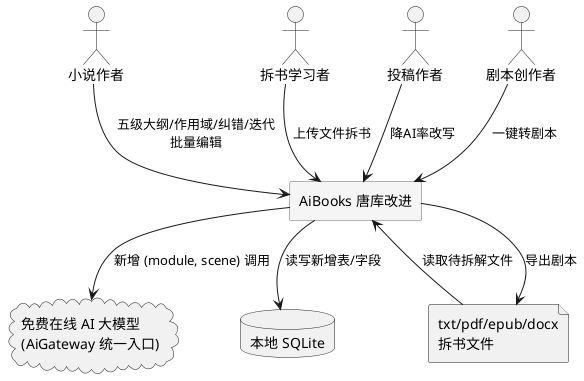
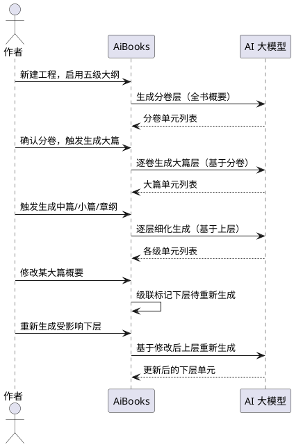
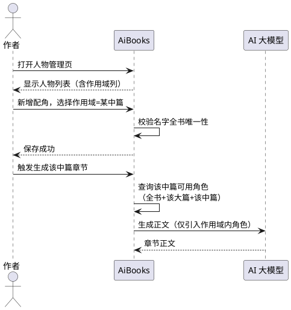
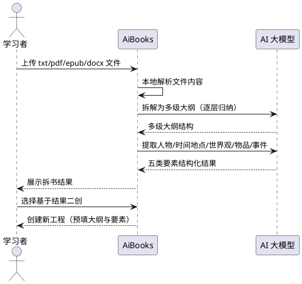
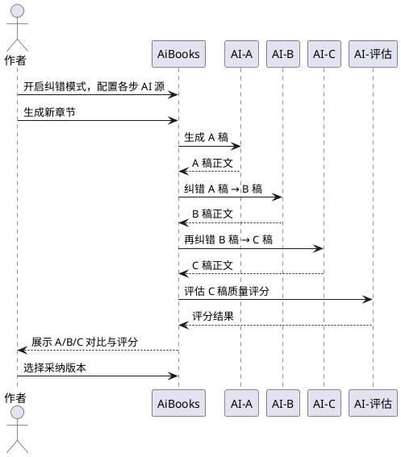
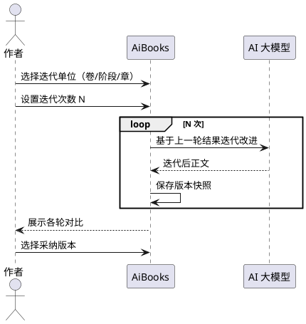
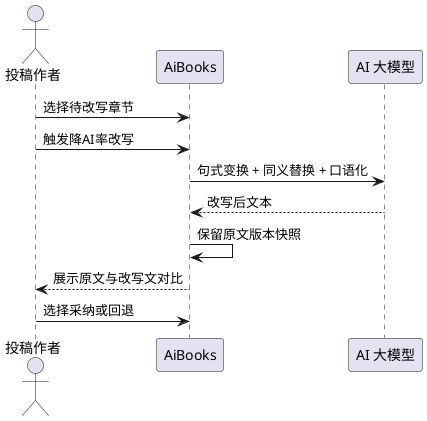
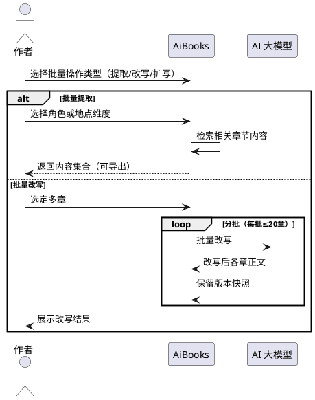
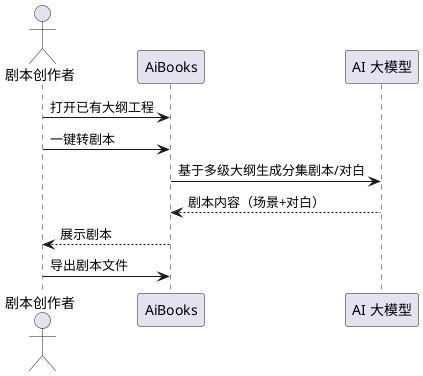
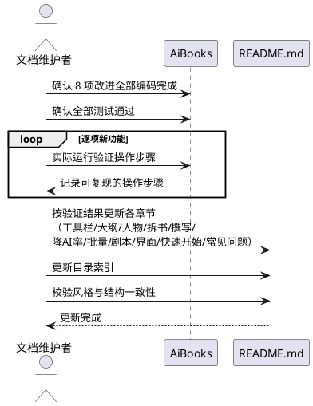

# 唐库借鉴改进需求规格

> 生成日期：2026-10-10
> 功能名称：tangku_improvements
> 来源：唐库（tanglib.org）竞品对比分析
> 策略：渐进式叠加（策略A），对现有工程零影响或极低影响

---

# **1. 组件定位**

## **1.1 核心职责**
本组件负责在 AiBooks 现有小说创作能力之上叠加 8 项借鉴唐库的改进功能，实现长篇可控叙事、配角作用域管理、拆书学习、多AI纠错、迭代生成、降AI率改写、批量编辑与剧本生成等增强能力。

## **1.2 核心输入**
1. **用户创作参数**：梗概、世界观、人物设定、风格库选择（现有输入，不变）
2. **用户操作指令**：启用五级大纲、选择作用域、上传拆书文件、开启纠错模式、设置迭代次数、触发降AI率改写、批量选取章节、一键转剧本
3. **上传文件**：txt/pdf/epub/docx 格式的待拆解书籍文件（改进3专用）
4. **现有工程数据**：已存在的卷章大纲、人物、章节正文（改进须向后兼容读取）
5. **AI 源选择**：每步纠错/迭代可选不同 AI 源（改进4、改进5）

## **1.3 核心输出**
1. **五级分层大纲**：分卷→大篇→中篇→小篇→章纲的树形结构数据
2. **带作用域的人物列表**：标注全书/某卷/某大篇/某中篇作用域的角色
3. **拆书结果**：多级大纲 + 人物 + 时间地点 + 世界观设定 + 特殊物品 + 事件要点
4. **纠错稿件**：A稿/B稿/C稿及评估评分
5. **迭代版本**：多次迭代后的改进正文
6. **降AI率改写文本**：句式变换后的投稿友好文本
7. **批量操作结果**：提取的内容集合 / 改写后的章节正文
8. **分集剧本**：基于大纲生成的对白与场景剧本
9. **AI 调用日志**：每条标注来源功能（scene/module 参数）

## **1.4 职责边界**
本组件**不负责**以下事项：
1. **不改变核心写作流程9步**：创作参数→人物→大纲→爽点钩子→风格库→撰写→编辑→校验→导出，该流程完全不变
2. **不修改已有章节正文**：AB稿纠错、迭代生成对已生成章节不回溯，仅作用于新生成或用户显式选定的章节
3. **不替换现有 AI 调用入口**：AiGateway 统一入口完全保留，新增功能仅新增 (module, scene) 组合
4. **不改变现有数据定位键**：`(volume_no, chapter_no)` 定位键和现有 6 张核心表结构不动
5. **不负责在线网页版部署**：AiBooks 保持桌面单机本地架构，数据不外泄
6. **不负责官方代写服务**：不引入人工审校付费流程
7. **不改变现有版本快照/回滚机制**：新增功能复用现有快照能力，不另建体系

---

# **2. 领域术语**

**雪花式分层大纲**
: 一种从全书高层逐层细化到单章的树形大纲架构，共五级，每级有明确叙事职责和篇幅范围，形似雪花从中心向外分形生长。

**故事单元（StoryUnit）**
: 分层大纲中除分卷和章纲外的中间层节点，包含大篇、中篇、小篇三种层级类型，以自引用树结构组织，每个单元承载特定叙事职责。

**大篇单元**
: 分层大纲第三级节点，篇幅 21-100 章，负责大阶段叙事（大目标达成、大反派击败、主角实力跃迁），呼应全局概要。

**中篇单元**
: 分层大纲第四级节点，篇幅 5-20 章，负责完整故事弧（起因-发展-冲突-解决），是单元配角上下线的主要层级。

**小篇单元**
: 分层大纲第五级节点，篇幅 2-4 章，负责小事件完整起落与小高潮，进行 2-4 章节奏分配。

**章纲单元**
: 分层大纲最底层节点，1 章/单元，关注单场戏的节奏与钩子，开头承接上章，结尾留悬念或爽点。
: 备注：AiBooks 现有 ChapterOutline 即章纲层，改进1为其增加向上关联。

**单元配角作用域（scope）**
: 角色的活动范围约束，取值为全书/某卷/某大篇/某中篇，作用域内的配角仅在该单元内活动，全书核心角色贯穿始终。

**拆书（Book Teardown）**
: 将已完成的小说文件上传后，由 AI 拆解为多级大纲并提取人物、时间地点、世界观设定、特殊物品、事件要点的逆向分析过程。

**二创（Secondary Creation）**
: 基于拆书结果改写生成新作品的过程，用于学习爆款结构快速起步。

**AB稿纠错**
: A稿生成后由 B 稿 AI 进行纠错的两步接力流程，每步可选不同 AI 源。

**ABC稿纠错**
: A稿生成→B稿纠错→C稿再纠错→评估AI评分的四步接力流程，多模型互补提升质量。

**迭代生成**
: 按卷/阶段/章为单位，基于上一次生成结果反复改进的渐进式生成方式，可指定迭代次数。

**降AI率改写**
: 针对朱雀等 AI 率检测器，通过句式变换、同义替换、口语化处理降低检测命中率的改写操作。

**批量提取**
: 按角色或地点维度，批量检索并汇总相关章节内容的二次创作辅助操作。

**分集剧本**
: 基于小说多级大纲生成的包含场景描述与角色对白的剧本格式产物，与小说共享大纲。

**渐进式叠加（策略A）**
: 一种改进实施策略，保留现有数据结构不动，通过新增表/字段实现增强，旧数据无新字段时退化为现有行为，实现零影响向后兼容。

**场景化超时**
: 按 AI 调用场景（module, scene）设定的差异化超时时长，与现有三层超时（全局/源/调用）协调一致。

---

# **3. 角色与边界**

## **3.1 核心角色**
- **小说作者**：使用 AiBooks 进行小说创作的核心用户，触发各项改进功能、审查生成结果、确认采纳
- **拆书学习者**：上传已有作品进行拆解分析以学习结构的用户，使用改进3
- **投稿作者**：需要降低 AI 率以通过投稿审核的用户，使用改进6
- **剧本创作者**：将小说转化为短剧/剧本的用户，使用改进8

## **3.2 外部系统**
- **免费在线 AI 大模型**：通过 AiGateway 统一入口调用的多个 AI 源，新增功能新增 (module, scene) 组合
- **本地 SQLite 数据库**：存储新增的故事单元、作用域、拆书结果、纠错稿件等数据
- **文件系统**：读取上传的 txt/pdf/epub/docx 拆书文件，写入导出的剧本文件

## **3.3 交互上下文**

---

# **4. DFX约束**

## **4.1 性能**
1. **分层大纲生成响应**：单级单元生成响应时间上限 60 秒，逐层细化时每层独立可暂停续写
2. **拆书文件处理**：单文件拆解响应时间上限 120 秒，超 10 万字文件分批处理
3. **纠错接力流程**：单步纠错响应时间上限 90 秒，ABC 四步总时长上限 360 秒
4. **降AI率改写**：单章改写响应时间上限 60 秒
5. **批量操作吞吐**：批量提取/改写支持分批处理，单批上限 20 章，批次间可暂停
6. **场景化超时**：新增 AI 调用须传入场景化超时，与现有三层超时（全局/源/调用）协调一致，不得绕过统一入口

## **4.2 可靠性**
1. **向后兼容可用性**：现有工程（如《无为神功》）打开后所有原有功能 100% 可用，无报错、无数据丢失
2. **退化保证**：旧工程无新增字段时自动退化为两级大纲模式和无作用域模式，不阻塞任何现有操作
3. **断点续传**：分层大纲逐层生成、拆书、迭代、批量操作均支持中断后续传
4. **并发安全**：新增功能复用现有章节级锁与操作锁机制，不引入新的并发冲突
5. **失败回滚**：纠错/迭代/改写失败时不覆盖原始正文，保留可回滚版本快照

## **4.3 安全性**
1. **本地数据隐私**：所有新增功能数据存储于本地 SQLite，不上传服务器
2. **AI 调用日志标注**：每条 AI 调用日志须标注来源功能（scene/module 参数），新增功能不得遗漏
3. **拆书文件安全**：上传文件仅在本地解析，不外传；解析完成后临时缓存可清理
4. **API Key 保护**：新增 AI 调用复用现有加密存储的 API Key，不另行明文存储

## **4.4 可维护性**
1. **提示词外置**：所有新增提示词模板置于 src/prompts/ 目录，使用 Jinja2 模板，不硬编码
2. **功能默认关闭**：新功能默认关闭或退化为现有行为，用户无需重新学习
3. **日志规范**：新增功能日志复用现有日志格式，含场景标识与耗时
4. **测试覆盖**：新增功能须有 pytest 测试用例，测试框架为 pytest
5. **内容校验**：所有 AI 生成内容须≥50字校验，不达标的重试或提示

## **4.5 兼容性**
1. **现有定位键不变**：`(volume_no, chapter_no)` 定位键保留，现有 6 张核心表结构不动
2. **旧工程兼容**：旧工程无 `story_unit_id` 时退化为两级模式；已有人物无 `scope` 时默认"全书"
3. **新工程可选启用**：新工程可选择启用五级模式，也可继续使用两级模式
4. **AI 源兼容**：新增功能兼容现有任意 OpenAI 兼容端点与 Ollama 本地模型
5. **导出兼容**：五级大纲导出时，无中间层的工程退化为两级导出格式
6. **UI 分组合理**：新功能合理分组（菜单 vs 工具栏），工具栏按钮文字不显示不完整

---

# **5. 核心能力**

## **5.1 雪花式5级分层大纲**

### **5.1.1 业务规则**

1. **五级结构规则**：分层大纲必须包含分卷→大篇→中篇→小篇→章纲五个层级，每级有明确叙事职责和篇幅范围
   - 分卷层：101-500 章/单元，全书分卷
   - 大篇层：21-100 章/单元，大阶段叙事
   - 中篇层：5-20 章/单元，完整故事弧
   - 小篇层：2-4 章/单元，小事件起落
   - 章纲层：1 章/单元，单场戏
   - 验收条件：[新建工程启用五级模式] → [生成的各级单元章数落在对应区间内]

2. **逐层细化生成规则**：大纲必须从高层逐层细化生成，下层根据上层上下文生成，不得跨层跳跃
   - 验收条件：[用户触发生成] → [先生成分卷，再大篇，再中篇，再小篇，最后章纲，每层可暂停续写]

3. **级联标记规则**：上层单元内容改动时，其所有下层单元必须自动标记"需重新生成"
   - 验收条件：[修改某大篇单元概要] → [其下属所有中篇/小篇/章纲单元标记为待重新生成]

4. **叙事职责规则**：各级单元必须承载对应叙事职责，生成时提示词须注入该级职责约束
   - 章纲：单场戏、节奏与钩子、承接上章、结尾留悬念
   - 小篇：小事件完整起落、小高潮、2-4 章节奏分配
   - 中篇：完整故事弧、单元配角上下线、推进一条剧情线
   - 大篇：大阶段、呼应全局概要、确保大方向不跑偏
   - 验收条件：[生成某级单元] → [AI 提示词包含该级叙事职责约束且输出符合职责]

5. **向后兼容规则**：旧工程无故事单元关联时，必须退化为现有两级大纲模式（卷→章），不报错不阻塞
   - 验收条件：[打开无 story_unit_id 的旧工程] → [大纲显示为两级，所有原有功能正常]

6. **禁止项**：禁止删除现有 `(volume_no, chapter_no)` 定位键；禁止改动现有 6 张核心表结构
   - 验收条件：[实施改进后] → [现有工程的卷章定位与数据完全不变]

### **5.1.2 交互流程**

### **5.1.3 异常场景**

1. **上层单元未生成即触发下层**
   - 触发条件：用户在分卷层未生成时尝试生成大篇层
   - 系统行为：拦截请求，提示需先完成上层生成
   - 用户感知：中文提示"请先生成分卷层大纲后再生成大篇层"

2. **AI 生成的单元章数超出篇幅范围**
   - 触发条件：AI 返回的大篇单元包含 150 章（超出 21-100 区间）
   - 系统行为：提示词约束重试一次，仍不达标则标记警告供用户人工调整
   - 用户感知：中文提示"该单元章数超出建议范围，请确认或调整"

3. **旧工程数据迁移异常**
   - 触发条件：打开旧工程时故事单元关联字段缺失
   - 系统行为：自动退化为两级模式，不抛出异常
   - 用户感知：无感知，大纲正常显示为两级

4. **逐层生成中断**
   - 触发条件：生成某层时网络中断或 AI 超时
   - 系统行为：保存已生成单元，标记未完成层为待续传
   - 用户感知：中文提示"生成已中断，已保存进度，可继续生成"

---

## **5.2 单元配角作用域**

### **5.2.1 业务规则**

1. **作用域字段规则**：每个角色必须拥有作用域属性，取值为"全书"/"某卷"/"某大篇"/"某中篇"之一
   - 验收条件：[查看任意角色] → [显示作用域字段且有明确取值]

2. **向后兼容规则**：已有人物无作用域时必须默认为"全书"，不改变其现有可见性
   - 验收条件：[打开含已有人物的旧工程] → [所有人物作用域显示"全书"，行为不变]

3. **生成引入规则**：生成某单元内容时，必须只引入该单元作用域内配角 + 全书核心角色，不引入其他单元配角
   - 验收条件：[生成某中篇单元章节] → [提示词仅包含该中篇配角 + 全书角色，不含其他中篇专属配角]

4. **名字唯一性规则**：角色名字全书唯一，禁止在不同单元定义同名配角
   - 验收条件：[尝试在某中篇创建与已有角色同名的人物] → [系统拒绝并提示名字冲突]

5. **作用域下钻规则**：作用域为"某大篇"的角色在该大篇下属所有中篇/小篇可见；作用域为"某中篇"的角色仅在该中篇可见
   - 验收条件：[查询某中篇可用角色] → [返回全书角色 + 该中篇所属大篇角色 + 该中篇角色]

6. **禁止项**：禁止将核心主角的作用域设为某单元级（主角必须全书可见）
   - 验收条件：[尝试将主角作用域改为某中篇] → [系统拒绝并提示主角须全书可见]

### **5.2.2 交互流程**

### **5.2.3 异常场景**

1. **同名角色冲突**
   - 触发条件：在某单元新建角色时名字与已有角色重复
   - 系统行为：拒绝创建，提示冲突
   - 用户感知：中文提示"该名字已存在，请使用其他名字"

2. **作用域单元被删除**
   - 触发条件：删除某中篇单元后，存在作用域指向该中篇的角色
   - 系统行为：将受影响角色作用域提升至父级大篇，并提示用户确认
   - 用户感知：中文提示"XX 单元已删除，其下属角色已调整至大篇作用域，请确认"

---

## **5.3 一键拆书工具**

### **5.3.1 业务规则**

1. **文件格式规则**：拆书必须支持 txt/pdf/epub/docx 四种格式上传
   - 验收条件：[上传任一支持格式文件] → [系统正常解析并进入拆解流程]

2. **多级拆解规则**：拆书必须将书籍拆解为多级大纲（四级→三级→二级→一级→章纲→正文），逐层逆向归纳
   - 验收条件：[完成拆书] → [输出包含多级大纲树形结构]

3. **要素提取规则**：拆书必须提取人物、时间地点、世界观设定、特殊物品、事件要点五类要素
   - 验收条件：[完成拆书] → [输出包含五类要素的结构化结果]

4. **二创支持规则**：拆书结果必须支持作为新工程基础进行二次创作改写
   - 验收条件：[选择拆书结果创建新工程] → [新工程预填大纲与要素，可改写生成]

5. **纯新增规则**：拆书功能必须为纯新增，不修改任何现有代码逻辑
   - 验收条件：[未使用拆书功能时] → [现有所有功能行为完全不变]

6. **禁止项**：禁止将上传文件内容外传至非 AI 调用必要的外部服务
   - 验收条件：[拆书过程] → [文件仅本地解析 + 传 AI 拆解，不外传其他方]

### **5.3.2 交互流程**

### **5.3.3 异常场景**

1. **不支持的文件格式**
   - 触发条件：上传非 txt/pdf/epub/docx 格式文件
   - 系统行为：拒绝上传
   - 用户感知：中文提示"仅支持 txt/pdf/epub/docx 格式"

2. **文件解析失败**
   - 触发条件：文件损坏或编码无法识别
   - 系统行为：终止拆解，提示具体原因
   - 用户感知：中文提示"文件解析失败：[原因]，请检查文件完整性"

3. **文件过大**
   - 触发条件：文件超过 10 万字
   - 系统行为：自动分批处理，提示预计耗时
   - 用户感知：中文提示"文件较大，将分批拆解，请耐心等待"

---

## **5.4 AB稿/ABC稿多AI接力纠错**

### **5.4.1 业务规则**

1. **接力流程规则**：ABC 稿纠错必须按 A稿生成→B稿纠错→C稿再纠错→评估AI评分顺序执行，每步可选不同 AI 源
   - 验收条件：[启用 ABC 纠错模式生成章节] → [按四步顺序产出 A/B/C 稿及评分]

2. **默认关闭规则**：纠错模式必须默认关闭，仅用户主动开启"纠错模式"时才启用
   - 验收条件：[未开启纠错模式] → [撰写流程与现有完全一致，单 AI 生成]

3. **不回溯规则**：纠错模式对已有章节不回溯，仅作用于新生成或用户显式选定的章节
   - 验收条件：[开启纠错模式后查看已有章节] → [已有章节不被自动纠错]

4. **AI 源可选规则**：每步纠错必须支持独立选择 AI 源，允许同源也允许异源
   - 验收条件：[配置 A/B/C/评估各步 AI 源] → [各步使用指定 AI 源执行]

5. **版本保留规则**：每步纠错必须保留版本快照，用户可对比 A/B/C 稿差异并选择采纳
   - 验收条件：[完成 ABC 纠错] → [可查看 A/B/C 三版对比，选择任一版本采纳]

6. **禁止项**：禁止在未开启纠错模式时自动执行多步纠错
   - 验收条件：[纠错模式关闭时撰写] → [仅单次生成，不触发接力纠错]

### **5.4.2 交互流程**

### **5.4.3 异常场景**

1. **某步 AI 源不可用**
   - 触发条件：B 稿纠错时指定 AI 源熔断或超时
   - 系统行为：提示该步失败，保留前序稿件，允许重试或更换 AI 源
   - 用户感知：中文提示"B 稿纠错失败，A 稿已保留，可重试或更换 AI 源"

2. **纠错后内容少于 50 字**
   - 触发条件：某步纠错输出不足 50 字
   - 系统行为：判定为生成失败，重试一次，仍不达标则保留前序稿件并提示
   - 用户感知：中文提示"纠错内容过短，已保留前序稿件，请检查 AI 源"

---

## **5.5 迭代生成**

### **5.5.1 业务规则**

1. **迭代单位规则**：迭代必须支持按卷/阶段/章为单位进行，可指定迭代次数
   - 验收条件：[选择某章并设置迭代3次] → [基于该章正文迭代改进3轮]

2. **渐进改进规则**：每次迭代必须基于上一次迭代结果改进，而非从零重新生成
   - 验收条件：[执行第2次迭代] → [输入为第1次迭代输出，而非原始大纲]

3. **纯新增规则**：迭代功能必须为纯新增，不修改现有撰写流程
   - 验收条件：[未使用迭代功能时] → [现有撰写流程完全不变]

4. **版本保留规则**：每次迭代必须保留版本快照，用户可对比各轮差异并选择采纳
   - 验收条件：[完成3次迭代] → [可查看各轮版本对比，选择任一轮采纳]

5. **可中断规则**：迭代过程必须支持中断，中断后可从当前轮次续传
   - 验收条件：[第2次迭代中中断] → [已完成的第1次迭代保留，可从第2次续传]

### **5.5.2 交互流程**

### **5.5.3 异常场景**

1. **迭代后质量下降**
   - 触发条件：某轮迭代评分低于上一轮
   - 系统行为：保留两轮版本，提示用户对比选择
   - 用户感知：中文提示"本轮迭代评分下降，已保留两轮版本，请对比后选择"

2. **迭代中断**
   - 触发条件：迭代过程中网络中断或用户主动停止
   - 系统行为：保存已完成轮次，标记未完成轮次
   - 用户感知：中文提示"迭代已中断于第X轮，可继续迭代"

---

## **5.6 降AI率改写工具**

### **5.6.1 业务规则**

1. **改写策略规则**：降AI率改写必须通过句式变换、同义替换、口语化处理三种策略降低 AI 率检测命中率
   - 验收条件：[执行降AI率改写] → [输出文本经句式/同义/口语化变换，与原文有可识别差异]

2. **针对检测器规则**：改写必须针对朱雀等主流 AI 率检测器的检测特征进行规避
   - 验收条件：[改写后文本提交朱雀检测] → [AI 率检测结果低于改写前]

3. **纯新增规则**：降AI率改写必须为纯新增功能，不修改现有去AI化/风格库逻辑
   - 验收条件：[未使用降AI率改写时] → [现有风格库/去AI化功能不变]

4. **原文保留规则**：改写必须保留原文版本快照，用户可对比并选择采纳或回退
   - 验收条件：[完成改写] → [可查看原文与改写文对比，可回退至原文]

5. **难度最低规则**：本功能为 8 项改进中实施难度最低的，应优先实施
   - 验收条件：[实施排期] → [降AI率改写排在第一批首位]

### **5.6.2 交互流程**

### **5.6.3 异常场景**

1. **改写后内容少于 50 字**
   - 触发条件：改写输出不足 50 字
   - 系统行为：重试一次，仍不达标则保留原文并提示
   - 用户感知：中文提示"改写内容过短，已保留原文，请重试"

2. **改写后语义偏离**
   - 触发条件：改写文本与原文语义差异过大
   - 系统行为：保留两版本，提示用户人工审查
   - 用户感知：中文提示"改写后语义可能偏离，请人工对比确认"

---

## **5.7 批量提取/改写**

### **5.7.1 业务规则**

1. **批量提取规则**：必须支持按角色或地点维度批量提取相关章节内容
   - 验收条件：[选择某角色执行批量提取] → [返回所有包含该角色的章节内容集合]

2. **批量改写规则**：必须支持对选定章节批量改写或扩写
   - 验收条件：[选定多章执行批量改写] → [各章分别改写并保留版本快照]

3. **分批处理规则**：批量操作必须支持分批处理，单批上限 20 章，批次间可暂停
   - 验收条件：[批量改写 50 章] → [分 3 批处理，每批间可暂停续传]

4. **纯新增规则**：批量提取/改写必须为纯新增功能，不修改现有批量撰写逻辑
   - 验收条件：[未使用批量提取/改写时] → [现有批量撰写功能不变]

5. **二次创作效率规则**：批量操作结果必须支持作为二次创作素材导出或回填
   - 验收条件：[批量提取结果] → [可导出为素材文件或直接用于改写参考]

### **5.7.2 交互流程**

### **5.7.3 异常场景**

1. **批量操作中部分章节失败**
   - 触发条件：批量改写 20 章中第 8 章 AI 超时
   - 系统行为：标记失败章节，继续处理其余章节，最终汇总失败列表
   - 用户感知：中文提示"第8章改写失败，其余已完成，可重试失败章节"

2. **提取维度无匹配结果**
   - 触发条件：按某角色提取但该角色未出现在任何章节
   - 系统行为：返回空结果并提示
   - 用户感知：中文提示"未找到包含该角色的章节"

---

## **5.8 AI写剧本**

### **8.1 业务规则**

1. **大纲共享规则**：剧本必须与小说共享多级大纲，一键转换而非重新规划
   - 验收条件：[对已有大纲工程执行一键转剧本] → [剧本分集结构对应大纲层级]

2. **剧本内容规则**：剧本必须包含场景描述与角色对白两类内容
   - 验收条件：[生成剧本] → [输出包含场景描述与角色对白]

3. **纯新增规则**：剧本功能必须为纯新增，不修改现有小说生成逻辑
   - 验收条件：[未使用剧本功能时] → [现有小说生成功能不变]

4. **导出规则**：剧本必须支持独立导出为剧本格式文件
   - 验收条件：[生成剧本后导出] → [输出剧本格式文件，含分集/场景/对白]

5. **优先级最低规则**：本功能为 8 项改进中优先级最低的，排最后实施
   - 验收条件：[实施排期] → [AI写剧本排在第一批最后]

### **5.8.2 交互流程**

### **5.8.3 异常场景**

1. **大纲不完整**
   - 触发条件：工程大纲未生成即触发转剧本
   - 系统行为：拒绝转换，提示需先完成大纲
   - 用户感知：中文提示"请先生成大纲后再转换为剧本"

2. **剧本内容少于 50 字**
   - 触发条件：某集剧本生成不足 50 字
   - 系统行为：重试一次，仍不达标则提示
   - 用户感知：中文提示"该集剧本内容过短，请重试或检查大纲完整性"

---

## **5.9 README同步更新**

### **5.9.1 业务规则**

1. **时机约束规则**：README 同步更新必须在全部 8 项改进编码完成且测试通过后进行，禁止在改进未完成时提前更新
   - 验收条件：[任一改进未完成或测试未通过时触发 README 更新] → [系统拒绝并提示须先完成全部改进与测试]

2. **实测依据规则**：README 中每个新功能的使用说明必须以实际运行验证过的操作步骤为依据，禁止凭空编写未验证的步骤
   - 验收条件：[README 中任一新功能章节] → [其操作步骤均经过实际运行验证，可复现]

3. **完整覆盖规则**：README 必须按全部已实现功能编写完整用户操作说明，不得过于简略，每个新增功能须有对应的使用说明章节
   - 验收条件：[8 项改进全部实现后检查 README] → [每个新功能在 README 中均有独立或明确的章节说明]

4. **风格一致规则**：README 更新必须保持现有 README 的文档风格和结构一致性，包括标题层级、表格格式、提示框风格、代码块风格等
   - 验收条件：[更新后的 README] → [新增章节的排版风格与原有章节一致]

5. **目录索引更新规则**：README 更新后必须同步更新顶部目录索引，新增章节须在目录中有对应锚点链接
   - 验收条件：[README 新增章节] → [目录中存在指向该章节的锚点链接且可跳转]

6. **工具栏布局更新规则**：README 须更新工具栏布局说明，第一行主流程按钮须补充大纲管理页"分层模式"说明；第二行辅助工具按钮须新增"降AI率改写"、"批量提取/改写"、"一键拆书"、"迭代生成"、"AI写剧本"等按钮说明；按钮较多时须增加第三行或重新分组
   - 验收条件：[查看 README 工具栏章节] → [包含全部新增按钮的分组说明与布局图]

7. **大纲管理章节更新规则**：README 须在大纲管理章节新增"分层大纲模式"说明，包含五级分层（分卷→大篇→中篇→小篇→章纲）结构、分层模式为可选且默认仍为两级模式（向后兼容）、逐层生成操作说明（从高层逐层细化）、上层改动触发下层自动标记需重新生成的说明、各级叙事职责说明表
   - 验收条件：[查看 README 大纲管理章节] → [包含五级分层结构、可选启用、逐层生成、级联标记、叙事职责表五项说明]

8. **人物管理章节更新规则**：README 须在人物管理章节新增"配角作用域"说明，包含作用域取值（全书/某卷/某大篇/某中篇）、已有人物默认"全书"作用域、单元配角仅在本单元活动说明
   - 验收条件：[查看 README 人物管理章节] → [包含作用域取值、默认值、单元活动范围三项说明]

9. **一键拆书章节规则**：README 须新增"一键拆书"章节，包含上传 txt/pdf/epub/docx 文件操作说明、AI 拆解为多级大纲说明、提取人物/世界观/物品/事件要点说明、二创操作说明
   - 验收条件：[查看 README 一键拆书章节] → [包含文件上传、多级大纲拆解、要素提取、二创四项操作说明]

10. **撰写章节更新规则**：README 须在撰写章节新增"AB稿/ABC稿多AI纠错"说明（纠错模式开关、每步可选不同 AI 源）与"迭代生成"说明（按卷/阶段/章迭代、可指定迭代次数），并说明这些功能默认关闭、需主动开启
    - 验收条件：[查看 README 撰写章节] → [包含多AI纠错与迭代生成说明，且标注默认关闭]

11. **降AI率改写章节规则**：README 须新增"降AI率改写"章节，包含针对朱雀等 AI 率检测器的改写功能说明、句式变换/同义替换/口语化处理说明
    - 验收条件：[查看 README 降AI率改写章节] → [包含检测器针对性与三种改写策略说明]

12. **批量提取/改写章节规则**：README 须新增"批量提取/改写"章节，包含批量提取某角色/某地点相关内容说明、批量改写/扩写选定章节说明
    - 验收条件：[查看 README 批量提取/改写章节] → [包含批量提取与批量改写两类操作说明]

13. **AI写剧本章节规则**：README 须新增"AI写剧本"章节，包含基于现有大纲生成分集剧本/对白说明、与小说共享多级大纲与一键转剧本说明
    - 验收条件：[查看 README AI写剧本章节] → [包含剧本生成与大纲共享/一键转换说明]

14. **界面导览更新规则**：README 须更新界面导览的工具栏布局图（新增按钮）与可能新增的菜单栏菜单项
    - 验收条件：[查看 README 界面导览] → [工具栏布局图含新增按钮，菜单栏含新增项]

15. **快速开始更新规则**：README 须更新"首次使用三件事"，补充可能新增的配置说明
    - 验收条件：[查看 README 快速开始] → [含新功能相关的首次配置说明]

16. **常见问题更新规则**：README 须在常见问题章节补充分层大纲与传统大纲的区别、多AI纠错的配置建议、降AI率改写的效果说明
    - 验收条件：[查看 README 常见问题] → [含分层大纲区别、多AI纠错配置、降AI率效果三类问答]

17. **禁止项**：禁止在改进未全部完成时更新 README；禁止凭空编写未经实际运行验证的操作步骤；禁止删除或弱化现有 README 中已有的有效说明
    - 验收条件：[README 更新过程] → [时机、依据、存量保护三项约束均满足]

### **5.9.2 交互流程**

### **5.9.3 异常场景**

1. **改进未全部完成即触发更新**
   - 触发条件：某项改进尚未编码完成或测试未通过时尝试更新 README
   - 系统行为：拒绝更新，提示须先完成全部改进与测试
   - 用户感知：中文提示"尚有 N 项改进未完成或测试未通过，暂不可更新 README"

2. **操作步骤未经实际验证**
   - 触发条件：README 中写入了未实际运行验证的操作步骤
   - 系统行为：评审时标记为不合规，要求补验证
   - 用户感知：中文提示"该操作步骤未经实际验证，请运行确认后再写入"

3. **目录索引与章节不匹配**
   - 触发条件：README 新增章节后目录索引未同步更新
   - 系统行为：校验发现目录锚点失效，提示补全
   - 用户感知：中文提示"目录索引存在失效链接，请同步更新"

4. **文档风格不一致**
   - 触发条件：新增章节的排版风格与原有章节不一致
   - 系统行为：评审时标记风格偏差，要求统一
   - 用户感知：中文提示"新增章节风格与现有文档不一致，请按现有风格调整"

---

# **6. 数据约束**

## **6.1 故事单元（StoryUnit）**
故事单元为分层大纲的中间层节点，以自引用树结构组织。
1. **单元ID**：全局唯一标识，UUID 格式
2. **工程ID**：所属工程外键，非空
3. **父单元ID**：自引用外键，指向父级单元；分卷层父单元为空
4. **层级类型**：取值为"大篇"/"中篇"/"小篇"之一，非空
5. **单元序号**：同级同父下的顺序号，非空，从 1 递增
6. **单元名称**：业务名称，非空，长度≤50
7. **叙事概要**：该单元叙事内容概要，非空
8. **章数范围**：该单元包含的章数，须落在对应层级区间（大篇21-100/中篇5-20/小篇2-4）
9. **生成状态**：取值为"未生成"/"已生成"/"待重新生成"之一，非空
10. **叙事职责**：该级单元的叙事职责约束描述，非空

## **6.2 章纲单元关联扩展**
章纲层（现有 ChapterOutline）增加向上关联。
1. **故事单元ID**：指向最底层（小篇）故事单元的外键，可空
2. **向后兼容约束**：该字段为空时，章纲退化为现有两级模式（直接挂载于卷）
3. **定位键不变约束**：`(volume_no, chapter_no)` 定位键保留不变

## **6.3 角色作用域扩展**
Character 表增加作用域属性。
1. **作用域类型**：取值为"全书"/"某卷"/"某大篇"/"某中篇"之一，非空
2. **作用域单元ID**：当作用域类型非"全书"时，指向对应单元的外键；为"全书"时为空
3. **向后兼容约束**：已有人物无作用域时默认"全书"，作用域单元ID为空
4. **名字唯一性约束**：角色名字全书唯一，不得在不同单元定义同名配角
5. **主角约束**：核心主角作用域必须为"全书"，不得设为单元级

## **6.4 拆书结果**
1. **拆书任务ID**：全局唯一标识
2. **源文件路径**：上传文件本地路径，非空
3. **文件格式**：取值为"txt"/"pdf"/"epub"/"docx"之一，非空
4. **多级大纲**：拆解出的树形大纲结构，非空
5. **人物要素**：提取的人物列表，可为空
6. **时间地点要素**：提取的时间地点列表，可为空
7. **世界观设定**：提取的世界观设定文本，可为空
8. **特殊物品**：提取的特殊物品列表，可为空
9. **事件要点**：提取的事件要点列表，可为空
10. **拆解状态**：取值为"处理中"/"已完成"/"失败"之一，非空

## **6.5 纠错稿件**
1. **稿件ID**：全局唯一标识
2. **章节ID**：关联章节外键，非空
3. **稿件阶段**：取值为"A稿"/"B稿"/"C稿"/"评估"之一，非空
4. **AI源ID**：该步使用的 AI 源外键，非空
5. **稿件内容**：该步生成的正文，非空，长度≥50字
6. **评分**：评估阶段的质量评分，仅"评估"阶段有值
7. **版本快照ID**：关联版本快照，非空
8. **采纳状态**：取值为"待采纳"/"已采纳"/"已丢弃"之一，非空

## **6.6 迭代记录**
1. **迭代任务ID**：全局唯一标识
2. **迭代单位**：取值为"卷"/"阶段"/"章"之一，非空
3. **目标ID**：迭代目标的标识（卷号/阶段号/章节ID），非空
4. **迭代轮次**：当前轮次号，从 1 递增，非空
5. **总轮次数**：用户设定的总迭代次数，非空
6. **输入版本ID**：本轮输入的版本快照ID，非空
7. **输出版本ID**：本轮输出的版本快照ID，非空
8. **迭代状态**：取值为"进行中"/"已完成"/"已中断"之一，非空

## **6.7 降AI率改写记录**
1. **改写任务ID**：全局唯一标识
2. **章节ID**：关联章节外键，非空
3. **原文版本ID**：原文版本快照ID，非空
4. **改写内容**：改写后文本，非空，长度≥50字
5. **改写策略**：应用的策略组合（句式变换/同义替换/口语化），非空
6. **采纳状态**：取值为"待采纳"/"已采纳"/"已回退"之一，非空

## **6.8 批量操作记录**
1. **批量任务ID**：全局唯一标识
2. **操作类型**：取值为"提取"/"改写"/"扩写"之一，非空
3. **目标范围**：操作目标描述（角色名/地点名/章节列表），非空
4. **批次号**：分批处理的批次序号，从 1 递增，非空
5. **单批上限**：每批章数上限，固定为 20
6. **处理状态**：取值为"处理中"/"已完成"/"部分失败"/"已中断"之一，非空

## **6.9 剧本**
1. **剧本ID**：全局唯一标识
2. **工程ID**：关联小说工程外键，非空
3. **分集序号**：集数序号，从 1 递增，非空
4. **场景描述**：该集场景描述文本，非空
5. **角色对白**：该集角色对白内容，非空
6. **对应大纲单元ID**：该集对应的大纲单元外键，可空（无五级大纲时为空）

---

# **7. 实施规划与优先级**

## **7.1 优先级排序**

| 优先级 | 改进项 | 核心价值 |
|--------|--------|----------|
| 最高 | 改进1：雪花式5级分层大纲 | 长篇可控叙事核心架构，最大差距 |
| 高 | 改进2：单元配角作用域 | 避免配角泛滥，人物出场合理 |
| 高 | 改进3：一键拆书工具 | 学习爆款结构，快速起步 |
| 中 | 改进4：AB稿/ABC稿多AI纠错 | 多模型互补，质量提升 |
| 中 | 改进5：迭代生成 | 渐进式提升质量 |
| 中 | 改进6：降AI率改写工具 | 投稿过稿率提升 |
| 中 | 改进7：批量提取/改写 | 二次创作效率提升 |
| 低 | 改进8：AI写剧本 | 拓展短剧/剧本市场 |
| 收尾 | 改进9：README同步更新 | 用户手册同步覆盖全部新功能使用说明 |

## **7.2 实施批次**

### **第一批（低风险纯新增，可并行开发）**
1. 改进6：降AI率改写（难度最低）
2. 改进7：批量提取/改写
3. 改进3：一键拆书工具
4. 改进5：迭代生成
5. 改进8：AI写剧本

**批次特征**：纯新增功能，不修改现有代码，可并行开发，风险最低。

### **第二批（需改动现有代码，影响可控）**
6. 改进2：单元配角作用域（Character 加 scope 字段，已有人物默认"全书"）
7. 改进4：AB稿/ABC稿多AI纠错（修改撰写流程，已有章节不回溯）

**批次特征**：需改动现有代码，但通过默认值/默认关闭实现向后兼容，影响可控。

### **第三批（架构级改动，需慎重决策）**
8. 改进1：雪花式5级分层大纲——采用策略A（渐进式叠加）

**批次特征**：架构级改动，保留现有定位键和核心表不动，新增表实现增强，旧工程退化兼容，需慎重决策。

### **第四批（文档同步，收尾必做）**
9. 改进9：README 同步更新——在全部 8 项改进编码完成且测试通过后，按实测结果更新用户操作手册

**批次特征**：非编码工作，依赖前三批全部完成且测试通过；须以实际运行验证的操作步骤为依据，禁止凭空编写；须保持现有 README 文档风格与结构一致性并同步更新目录索引。

## **7.3 向后兼容策略（策略A：渐进式叠加）**

1. **现有定位键不变**：`(volume_no, chapter_no)` 和现有 6 张核心表结构不动
2. **新增表/字段实现增强**：通过新增 StoryUnit 表、Character.scope 字段等实现
3. **旧数据退化**：无新字段时自动退化为现有行为（两级大纲/全书作用域）
4. **新工程可选启用**：新工程可选择启用增强模式，也可继续使用现有模式
5. **零影响保证**：所有改进对已有小说工程（如《无为神功》）零影响

## **7.4 全局约束**

1. 核心写作流程9步完全不变：创作参数→人物→大纲→爽点钩子→风格库→撰写→编辑→校验→导出
2. 现有 AI 调用逻辑（AiGateway 统一入口）完全符合，新增功能只需新增 (module, scene) 组合
3. 提示词外置于 src/prompts/，使用 Jinja2 模板
4. AI 调用日志须标注来源功能（scene/module 参数）
5. 新增 AI 调用服务须传入场景化超时，与现有三层超时协调一致
6. 内容须≥50字校验
7. 测试框架为 pytest
8. 工具栏按钮文字不显示不完整，新功能合理分组（菜单 vs 工具栏）