# AI小说撰写软件需求规格说明书

# **1. 组件定位**

## **1.1 核心职责**
本组件负责通过免费在线AI大模型辅助用户完成小说的批量撰写、人物管理、爽点钩子设计、内容校验与导出，实现从故事设定到成书输出的全流程自动化创作。

## **1.2 核心输入**
1. **用户创作参数设定**：来源于用户在界面上的操作指令，包括书名、卷数、每卷章节数、每章字数等创作规模参数。
2. **故事梗概输入**：来源于用户手动输入或文件导入，描述整本书的核心故事走向与主题。
3. **世界观设定输入**：来源于用户手动输入或文件导入，描述故事发生的背景规则、时代、地理、势力等设定。
4. **人物设定输入**：来源于用户手动输入、文件导入或AI自动生成，包含主角、配角的姓名、身份、性格、关系等信息。
5. **爽点与钩子设定输入**：来源于用户手动设定或AI辅助生成，包含每章爽点类型、钩子埋设点与回收计划。
6. **文件导入数据**：来源于用户选择的本地文件（支持txt、md、docx、xlsx等格式），用于导入故事梗概、世界观或人物设定。
7. **AI模型配置输入**：来源于用户设定的免费在线AI大模型接口地址、模型名称、密钥等连接参数。
8. **知识库投喂文件输入**：来源于用户选择的一个或多个本地小说文本文件（txt、md、docx等格式），作为风格学习的样本语料投喂给系统，用于AI分析提取写作风格特征并建立风格库。
9. **风格库指定输入**：来源于用户在启动批量撰写前从已有风格库列表中选择的某一风格库标识，指定本次撰写采用该风格库对应的写作风格；若不指定则采用系统默认风格。
10. **章节手动修改输入**：来源于全本撰写完成后用户对任意章节正文的手动编辑操作，包含修改的卷号、章号与修改后的正文内容，作为触发修改后AI再校验与AI自动润色的输入。
11. **润色确认输入**：来源于用户对AI自动润色结果的确认或拒绝操作，决定是否将润色后的内容正式保留覆盖原章节内容。
12. **风格库导入文件输入**：来源于用户选择的本地风格库导出文件，用于将外部风格库导入本机复用，包含风格库名称、风格特征集合等结构化数据。
13. **风格库导出请求输入**：来源于用户对已有风格库的导出操作指令，包含待导出的风格库标识与导出目标文件路径。
14. **历史版本回滚输入**：来源于用户在章节修改记录中选择某条历史修改记录并请求回滚的操作指令，包含目标章节卷号、章号与目标历史记录编号，作为将该章正文恢复至该历史版本内容的输入。
15. **新建项目指令输入**：来源于用户在创作参数页点击"创建新项目"的操作指令，触发系统创建一个新的空小说项目并清除所有页面控件的遗留内容，作为开启一本新小说工程的输入。
16. **项目切换指令输入**：来源于用户在创作参数页项目下拉框中选择另一已有项目的操作指令，包含目标项目标识，触发系统加载该项目的全部数据到各页面控件并更新全局项目上下文，作为多项目并行撰写时在不同小说工程间无缝切换的输入。
17. **项目导出请求输入**：来源于用户对某一已有项目的"导出项目"操作指令，包含待导出的项目标识与导出目标文件路径，以及是否包含关联风格库、是否包含AI调用日志的可选项，作为将整个项目打包为 `.aibk` 归档文件以便跨电脑迁移的输入。
18. **项目导入请求输入**：来源于用户选择本地 `.aibk` 归档文件并请求"导入项目"的操作指令，包含归档文件路径与同名冲突处理策略（覆盖/重命名/取消），作为在另一台电脑上恢复整个项目全部数据以继续撰写的输入。
19. **工程管理器初始页面进入指令输入**：来源于应用启动时或用户从创作主流程点击"返回工程管理器"的操作指令，作为进入小说工程管理器初始页面并加载展示本机全部项目列表摘要信息的输入。
20. **项目打开指令输入**：来源于用户在工程管理器初始页面选择某一项目并点击"打开"或双击该项目的操作指令，包含目标项目标识，作为将该选项目设为当前项目并加载其全部数据进入创作主流程的输入。
21. **项目备份指令输入**：来源于用户在工程管理器初始页面选择某一项目并点击"备份"的操作指令，包含待备份项目标识、备份目标位置与备份策略参数，作为对该项目生成本地备份副本的输入。
22. **项目删除指令输入**：来源于用户在工程管理器初始页面选择某一项目并点击"删除"并经二次确认的操作指令，包含待删除项目标识，作为从本机永久移除该项目及其全部关联数据的输入。
23. **AI源添加指令输入**：来源于用户在AI源配置页面点击"添加AI源"并填写源名称、类型、API地址、模型名称、API Key、优先级、权重、启用状态等参数后提交的操作指令，作为新增一个可用AI模型源到系统AI网关的输入。
24. **AI源编辑指令输入**：来源于用户在AI源配置页面已添加AI源列表中选中某一行后点击"编辑"按钮或双击该行的操作指令，包含目标AI源标识与待修改的字段集合（名称、类型、API地址、模型名称、API Key、优先级、权重、启用状态），作为修改已添加AI源配置属性的输入。
25. **AI源删除指令输入**：来源于用户在AI源配置页面选中某一AI源后点击"删除"并经二次确认的操作指令，包含待删除AI源标识，作为从系统AI网关移除该AI模型源的输入。
26. **AI源连接测试指令输入**：来源于用户在AI源配置页面选中某一AI源后点击"测试连接"的操作指令，或在编辑保存后由系统自动触发，包含目标AI源标识，作为探测该AI模型源当前可用性与连通性的输入。
27. **路由策略配置指令输入**：来源于用户在AI源配置页面选择AI网关路由策略（手动指定/按优先级故障切换/加权负载均衡/成本优先）的操作指令，作为调整多AI源调度行为的输入。
28. **Ollama模型列表获取请求输入**：来源于用户在AI源配置页面新增或编辑AI源时将类型选择为"本地Ollama"的自动触发，或用户在Ollama模型选择区点击"刷新模型列表"的手动触发，包含用户填写的Ollama服务地址，作为获取该Ollama服务所在电脑实际已安装模型列表的输入。
29. **Ollama预设模板选择指令输入**：来源于用户在预设模型下拉框中选择"本地Ollama"预设项的操作指令，作为将该AI源类型设为"本地Ollama"并自动触发本机Ollama模型列表动态发现的输入。
30. **保存工程指令输入**：来源于用户通过文件菜单栏"保存工程"菜单项或创作参数页下方"保存工程"按钮触发的保存操作指令，作为将当前项目的全部已设定数据（创作参数、梗概、世界观、人物、爽点钩子、物品、章节、修改记录、校验报告等）持久化保存到本地数据库的输入。
31. **状态栏运行时信息展示触发输入**：来源于应用启动时自动触发与运行过程中路由策略切换、AI源启禁用、故障转移发生等事件触发，作为在主窗口状态栏右下角持续展示当前AI源、程序运行时长、当前系统日期时间三项运行时信息的输入。
32. **人物多选批量删除指令输入**：来源于用户在人物管理页面通过Ctrl+点击多选、Shift+范围选择选中多个人物后点击"批量删除"并经二次确认的操作指令，包含待删除的人物标识列表，作为一次性从当前项目人物清单中移除多个人物的输入。
33. **人物确认选中指令输入**：来源于用户在人物管理页面选中一个或多个人物后点击"确认选中人物"按钮的操作指令，包含待确认的人物标识列表，作为将选中人物从"待确认"状态标记为"已确认"状态并锁定其信息不被后续AI生成覆盖的输入。
34. **自动保存配置指令输入**：来源于用户在设置页面配置定时自动保存参数（启用/关闭、保存间隔时间）的操作指令，作为调整全工程定时自动保存行为的输入；也来源于应用启动时自动加载已持久化的自动保存配置。
35. **定时自动保存触发信号输入**：来源于应用运行期间定时器按配置间隔周期性触发的信号，作为自动保存当前工程全部数据的输入。
36. **关键节点完成事件输入**：来源于创作参数设定完成、梗概/世界观保存完成、人物提取/生成完成、爽点钩子设定完成、每章撰写完成、校验完成、润色确认完成等关键操作完成时由业务模块发出的事件，作为触发关键节点自动保存的输入。
37. **大纲生成指令输入**：来源于用户在大纲管理页面点击"AI生成大纲"的操作指令，触发系统将故事梗概、世界观、正式人物清单与创作参数（卷数、每卷章节数、每章字数）组合传入AI，由AI规划生成全书卷名、各卷下章节名与每章故事梗概要点，作为大纲自动生成的输入。
38. **大纲编辑保存指令输入**：来源于用户在大纲管理页面手动编辑卷名、章节名或每章梗概要点后点击"保存大纲"的操作指令，包含修改的卷号、章号与修改后的卷名/章节名/梗概要点内容，作为将大纲持久化保存到数据库并供后续撰写与爽点钩子设计参考的输入。

## **1.3 核心输出**
1. **生成的小说正文**：输出给用户在界面预览与编辑，包含按卷、按章组织的完整小说内容，且经过去AI化处理贴近真人作者写作习惯。
2. **自动生成的人物清单**：输出给用户确认与编辑，包含AI从梗概/世界观中提取或自动生成的主角、配角姓名及关系。
3. **爽点钩子设计建议**：输出给用户确认与编辑，包含AI辅助生成的每章爽点与钩子设定及回收方案。
4. **内容校验报告**：输出给用户查看，包含全书章节内容与故事梗概、世界观、人物关系的一致性校验结果，并包含AI化程度评估结果。
5. **导出的小说文件**：输出到用户指定的手机本地文件夹，以"书名.txt"格式保存的完整小说文档。
6. **创作进度反馈**：输出给用户在界面实时查看，包含当前撰写卷数、章节数、完成比例与状态信息。
7. **风格库**：输出给用户在界面查看与管理，包含从投喂语料中由AI提取的写作风格特征集合（如叙事视角、句式偏好、用词习惯、节奏特征、段落结构等），以可命名、可复用的风格库形式存储。
8. **风格分析报告**：输出给用户查看，在建立风格库时展示AI对投喂语料的风格特征分析结果，供用户确认与调整。
9. **修改后AI再校验报告**：输出给用户查看，在全本撰写完成后用户手动修改章节内容时，展示AI对修改内容与故事梗概、世界观、人物关系等一致性比对的结果，并标注不符合项与所在章节。
10. **AI自动润色结果**：输出给用户确认，当修改后AI再校验发现不符合项时，展示AI基于一致性约束自动润色修改后的章节内容，供用户确认是否保留。
11. **风格库导出文件**：输出到用户指定的本地文件夹，以结构化文件形式保存风格库内容，供用户备份或分享至其他设备导入复用。
12. **历史版本回滚结果**：输出给用户查看，当用户请求回滚到某历史版本时，展示回滚后的章节正文内容并提示回滚成功，作为修改记录回滚操作的反馈。
13. **项目导出归档文件**：输出到用户指定的本地文件夹，以"项目名_YYYYMMDD_HHMMSS.aibk"格式保存的完整项目归档压缩包，包含项目基本信息、故事梗概、世界观、人物列表、爽点与钩子列表、全部已生成章节、章节修改历史记录、关联风格库（可选）、校验报告记录、AI调用日志（可选）等全部数据，供用户跨电脑迁移并继续撰写。
14. **项目切换加载结果**：输出给用户在各页面控件查看，当用户切换到某一项目时，系统将该项目的创作参数、梗概、世界观、人物列表、爽点钩子列表、章节列表、撰写进度等全部数据加载到对应页面控件，作为多项目无缝切换的反馈。
15. **工程管理器初始页面项目列表**：输出给用户在工程管理器初始页面查看，包含本机全部已有小说项目的摘要信息（书名、创建时间、最近更新时间、撰写状态、撰写进度），按最近更新时间倒序排列，作为用户选择项目或执行项目管理操作的依据。
16. **项目备份结果**：输出给用户查看，当用户对某一项目执行备份操作时，提示备份成功及备份文件位置，作为项目备份操作的反馈。
17. **项目删除结果**：输出给用户查看，当用户删除某一项目时，提示删除成功并从工程管理器初始页面项目列表中移除该项目，作为项目删除操作的反馈。
18. **AI源列表**：输出给用户在AI源配置页面查看，包含本机全部已配置AI模型源的名称、类型、API地址、模型名称、优先级、权重、启用状态、健康状态、最近检测时间、成功率等信息，作为用户管理与选择AI源的依据。
19. **AI源连接测试结果**：输出给用户在界面查看，包含被测试AI源的连通性结论（成功/失败）、失败原因（如鉴权失败、网络超时、模型不存在等）与响应耗时，作为用户判断该AI源是否可用的依据。
20. **AI源编辑保存结果**：输出给用户在界面查看，当用户编辑AI源并保存后，提示保存成功或失败及具体原因，并即时刷新AI源列表反映修改后的配置，作为AI源编辑操作的反馈。
21. **Ollama已安装模型列表**：输出给用户在AI源配置页面查看与选择，包含指定Ollama服务所在电脑上实际已拉取的全部模型名称，供用户从实际可用模型中选择要使用的模型，替代硬编码预设模型名称。
22. **Ollama服务连接状态提示**：输出给用户在界面查看，当系统尝试获取Ollama模型列表但服务未启动或不可达时，给出明确的错误提示与引导（如"无法连接Ollama服务，请确认Ollama已启动"），禁止静默失败。
23. **工程保存结果反馈**：输出给用户在状态栏查看，当用户执行保存工程操作后，提示保存成功（"工程已保存"）或保存失败及具体错误原因，作为工程保存操作的反馈。
24. **状态栏运行时信息**：输出给用户在主窗口状态栏右下角持续查看，包含当前路由策略下实际选中的AI源名称、从程序启动开始计时的运行时长、当前系统日期时间（含星期几）三项信息，每秒实时刷新，作为用户了解系统运行状态与当前AI源使用情况的常驻反馈。
25. **人物生成进度提示**：输出给用户在状态栏左下角查看，当用户触发AI提取人物、人物及关系自动识别导入、AI生成配角三种人物生成操作时，显示"正在生成...（计时器）"格式的进度提示（如"AI提取人物中... 00:03"），计时器从触发时刻开始计时每秒递增；生成完成后提示"完成，新增N个人物"（N为本次实际新增去重后的人数），作为用户知晓人物生成任务正在执行与执行耗时的反馈。
26. **人物批量删除结果**：输出给用户查看，当用户多选人物并执行批量删除后，提示删除成功及实际删除的人物数量，并从人物列表中移除已删除人物，作为人物批量删除操作的反馈。
27. **人物确认状态标记结果**：输出给用户查看，当用户点击"确认选中人物"后，被选中人物在列表中以可视化方式标记为"已确认"状态（区别于AI生成的"待确认"状态），作为人物确认操作的反馈。
28. **自动保存提示**：输出给用户在状态栏左下角短暂查看，当系统执行定时自动保存或关键节点自动保存时，显示"自动保存中..."提示；保存完成后提示"已自动保存 HH:MM:SS"（含保存完成时间），提示为临时消息显示一定时间后自动消失，不弹窗打扰用户，作为自动保存操作的反馈。
29. **AI生成大纲方案**：输出给用户在大纲管理页面确认与编辑，包含AI根据故事梗概、世界观、正式人物清单与创作参数自动规划的全书卷名、各卷下章节名与每章故事梗概要点（约100-300字），作为全书章节结构与情节走向规划的反馈。
30. **大纲保存结果反馈**：输出给用户在界面查看，当用户编辑或生成大纲后执行保存操作时，提示保存成功或失败及具体原因，并即时刷新大纲管理页面展示最新大纲内容，作为大纲保存操作的反馈。

## **1.4 职责边界**
1. 本组件**不负责**AI大模型本身的训练与微调，仅调用免费在线AI大模型的推理接口。
2. 本组件**不负责**小说内容的版权审查与抄袭检测，仅做与用户设定的一致性校验。
3. 本组件**不负责**在线发布、投稿到小说平台的功能，仅支持本地导出。
4. 本组件**不负责**多用户协同创作与云端同步，当前为单机单用户多项目模式（支持同一用户在单机上创建并管理多个独立小说项目，但项目间数据完全隔离、不联网同步）。
5. 本组件**不负责**插图、封面、排版美化等视觉设计，仅输出纯文本小说内容。
6. 本组件**不负责**强制修改AI生成内容，所有AI生成结果均需用户确认或可手动编辑覆盖。
7. 本组件**不负责**对用户投喂的知识库语料进行版权审查，用户需自行确保投喂内容的使用合法性。
8. 本组件**不负责**风格库的在线分享与云端分发，风格库日常使用仅存储于本地供本机复用；本组件仅提供本地文件形式的导出与导入能力，用户自行决定导出文件的分享与流转，系统不参与任何在线分发渠道。
9. 本组件**不负责**完全消除AI生成痕迹，去AI化处理旨在显著降低AI化特征、贴近真人写作习惯，但不保证达到与真人作者完全一致的水平。
10. 本组件**不负责**在用户手动修改章节内容时强制阻止用户做出与梗概/世界观/人物关系不符的修改，仅提供AI再校验提示与润色建议，最终是否保留由用户确认决定。
11. 本组件**不负责**对用户手动修改内容进行语法或文学性评判，AI再校验仅针对与故事梗概、世界观、人物关系的一致性维度。
12. 本组件**不负责**在用户拒绝AI润色结果后强制覆盖用户修改，用户修改内容始终享有最高保留优先级。
13. 本组件**不负责**项目导出归档文件（`.aibk`）的在线传输与云端分发，仅生成本地文件，用户自行决定文件流转方式，系统不参与任何在线分发渠道。
14. 本组件**不负责**在导入 `.aibk` 归档时自动配置目标机器的AI模型源，AI源配置因机器而异，导入后用户须自行确认AI源可用性。
15. 本组件**不负责**在项目切换时自动保存当前项目的未持久化草稿，切换前各页面已通过后端API持久化的数据方可恢复，界面输入框中尚未提交的临时编辑内容由用户自行确认是否丢弃。
16. 本组件**不负责**在工程管理器初始页面执行具体创作操作（如章节编辑、批量撰写、内容校验等），该页面仅作为项目管理的统一入口与落地页，创作操作须进入具体项目的创作主流程后执行。
17. 本组件**不负责**通过自动保存机制恢复已崩溃会话的未提交界面草稿（如输入框中尚未提交的临时编辑内容），自动保存仅持久化已通过后端API提交或关键节点产生的数据，界面临时草稿的丢失由用户自行承担。
18. 本组件**不负责**在自动保存过程中强制中断正在进行的AI长任务（如批量撰写、全书校验），自动保存须与AI长任务并行执行互不阻塞，AI长任务期间自动保存仅持久化已完成的部分数据。

# **2. 领域术语**

**故事梗概**
: 描述整本小说核心故事走向、主题思想、主要矛盾冲突与结局方向的概括性文本，是全书内容一致性的基准参照。

**世界观**
: 描述故事发生背景的规则集合，包含时代设定、地理环境、社会势力、力量体系、文化风俗等约束，是全书内容合理性的基准参照。

**卷**
: 小说结构的第一级组织单位，一卷包含多个章节，通常对应一个完整的故事阶段或大情节弧。

**章**
: 小说结构的第二级组织单位，一章包含指定字数的正文内容，是AI批量撰写的最小完整单元。

**爽点**
: 章节中让读者产生愉悦感、满足感或代入感的关键情节设计，如逆袭、打脸、获得奇遇等，每章至少设置一个。

**钩子**
: 章节末尾或情节中埋设的悬念或伏笔，用于吸引读者继续阅读下一章，必须在后续章节中回收（给出交代或解答）。

**钩子回收**
: 在后续章节中对先前埋设的钩子进行解答、交代或呼应，使悬念闭环的处理动作。

**主角**
: 故事中处于核心地位、推动情节发展的主要人物，由AI从故事梗概和世界观中提取或由用户指定。

**配角**
: 故事中辅助主角、丰富情节的次要人物，可由AI根据故事梗概和世界观自动生成，也可由用户导入或指定。

**人物关系**
: 主角与配角之间存在的身份、情感、利益等关联，如师徒、敌对、恋人、同门等，需全书保持一致。

**物品**
: 故事中出现的具有特定名称与属性的物件，如法宝、武器、丹药、信物、道具等，需全书保持设定一致，是批量再校验的关键维度之一。

**物品变化**
: 用户手动修改章节内容后引发的全书范围内物品的新增、消失、属性改变、归属转移等变动，需在批量再校验中与故事梗概、世界观比对一致性。

**批量撰写**
: 用户一次性设定全部创作参数后，由AI按卷、按章顺序自动生成全书内容的过程，无需用户逐章触发。

**内容校验**
: 全书撰写完成后，由AI对全书章节内容与故事梗概、世界观、人物关系进行一致性比对并输出报告的过程。

**文件导入**
: 用户通过选择本地文件（txt、md、docx、xlsx等格式）将故事梗概、世界观或人物设定批量载入系统的操作。

**知识库投喂**
: 用户将一个或多个已有小说文本文件作为样本语料提交给系统，由AI分析提取其写作风格特征并建立可复用风格库的过程。

**风格库**
: 从投喂语料中由AI提取的写作风格特征的结构化集合，包含叙事视角、句式偏好、用词习惯、节奏特征、段落结构、对话风格等维度，可命名、可复用、可由用户在撰写时指定。

**风格特征**
: 风格库中的单一维度描述项，如"叙事视角：第三人称限知视角""句式偏好：短句为主、长短交错""用词习惯：偏口语化、少用成语堆砌"等，是AI模仿风格撰写的约束依据。

**AI化**
: AI生成文本中常见的、区别于真人作者写作习惯的特征表现，如过度工整对仗、滥用成语排比、情感表达直白说教、句式单一重复、转折生硬套路化、缺乏生活化细节等。

**去AI化**
: 在AI生成内容基础上，通过风格约束提示词、风格库特征注入、句式与用词调整等手段，显著降低AI化特征、使生成内容更贴近真人作者写作习惯的处理过程。

**默认风格**
: 系统内置的、在用户未建立或未指定风格库时自动采用的写作风格基准，旨在即便无投喂语料也能生成具有较低AI化特征、贴近常见真人网文写作习惯的内容。

**章节手动修改**
: 全本小说撰写完成后，用户对任意已生成章节正文进行手动编辑覆盖的操作，是触发修改后AI再校验的前置动作。

**修改后AI再校验**
: 用户手动修改章节内容后，由AI将修改后的内容与故事梗概、世界观、人物关系、钩子回收等基准进行一致性比对并输出校验结果的过程，区别于全本撰写完成后的全书内容校验。

**AI自动润色**
: 当修改后AI再校验发现用户修改内容存在与梗概/世界观/人物关系等不符的问题时，由AI基于一致性约束对修改内容进行自动调整润色，使其既保留用户修改意图又符合整体设定的处理过程。

**润色确认**
: 用户对AI自动润色结果进行审阅并决定是否采纳保留的操作；确认则润色结果覆盖原章节内容，拒绝则保留用户原始修改内容。

**项目**
: 一个独立的小说创作工程，包含创作参数、故事梗概、世界观、人物列表、爽点钩子列表、全部已生成章节、章节修改历史记录、校验报告等完整数据集合，是系统进行数据隔离与多项目并行管理的最小单元。

**项目上下文**
: 系统全局共享的当前项目标识与信息载体，所有页面通过项目上下文获取当前项目ID并据此加载对应数据；项目切换时上下文更新并通知所有页面刷新。

**新建项目**
: 用户创建一个全新空小说项目的操作，触发系统生成新项目标识、将新项目设为当前项目、并清除所有页面控件中上一个项目遗留的内容，确保新旧项目数据不混杂。

**项目切换**
: 用户在项目下拉框中选择另一已有项目作为当前项目的操作，触发系统将该项目的全部数据加载到各页面控件并更新全局项目上下文，实现多本小说工程间的无缝切换且数据完全隔离。

**项目导出归档**
: 将一个项目的全部关联数据打包为一个 `.aibk` 压缩归档文件的操作，归档内容包含项目基本信息、梗概、世界观、人物、爽点钩子、全部章节正文、修改历史、关联风格库（可选）、校验报告、AI调用日志（可选），用于跨电脑迁移并继续撰写。

**项目导入**
: 从一个 `.aibk` 归档文件恢复整个项目全部数据到本机数据库的操作，导入后项目可正常打开、撰写、校验、导出，实现跨电脑继续创作。

**工程管理器初始页面**
: 应用启动后首先展示的落地页，集中展示本机全部已有小说项目列表摘要信息，并提供项目新建、打开切换、备份、迁移导出、导入、删除的统一入口，用户在此页面选择项目或执行项目管理操作后方可进入后续创作主流程。

**项目摘要**
: 工程管理器初始页面中每个项目项展示的概要信息集合，包含书名、创建时间、最近更新时间、撰写状态与撰写进度，供用户快速识别与选择项目。

**项目备份**
: 对某一已有项目生成本地备份副本的操作，将项目的当前全部数据复制保存到用户指定的本地备份位置，用于防范数据丢失，区别于导出为 `.aibk` 归档的跨电脑迁移操作。

**项目删除**
: 将某一已有项目及其全部关联数据（含创作参数、梗概、世界观、人物、爽点钩子、章节、修改记录、校验报告等）从本机永久移除的操作，删除前须经用户二次确认，删除后不可恢复。

**项目迁移**
: 将某一已有项目打包导出为 `.aibk` 归档文件以便拷贝至另一台电脑导入继续创作的操作，本质为项目导出归档的跨电脑迁移应用场景。

**AI源**
: 系统中配置的一个可用的AI大模型接入点，包含源名称、类型（在线OpenAI兼容接口或本地Ollama）、API地址、模型名称、API Key、优先级、权重、启用状态等属性，是AI网关进行模型调用的基本单元。

**AI网关**
: 系统中统一管理多个AI源、屏蔽不同模型接口差异、按路由策略选择可用AI源并执行健康检查与熔断降级的调度中枢。

**路由策略**
: AI网关在多个已启用AI源中选择调用目标的决定规则，包含手动指定、按优先级故障切换（Failover）、加权负载均衡、成本优先四种策略。

**健康状态**
: AI源当前的可用性标记，取值为健康、降级、熔断、未知之一，由AI网关周期性探测与运行时调用结果共同维护，路由时仅从健康与降级状态的源中选择。

**熔断**
: 当某AI源连续调用失败达到阈值时，AI网关将其临时排除不再路由调用，经过冷却期后自动恢复探测的保护机制。

**AI源连接测试**
: 用户手动触发或系统在保存AI源配置后自动发起的一次针对该AI源的连通性探测操作，用于验证API地址、鉴权信息与模型名称是否可用并即时反馈结果。

**Ollama模型动态发现**
: 系统在用户选择"本地Ollama"类型AI源时，自动向用户所填写的Ollama服务地址查询该电脑实际已安装（已拉取）的全部模型列表并展示供用户选择的过程，替代硬编码预设固定模型名称的做法。
: 备注：不同电脑安装的Ollama模型不同，动态发现确保展示的模型列表与该电脑实际可用模型一致。

**Ollama预设模板**
: 预设模型下拉框中代表"本地Ollama"类型的模板项，不绑定任何具体模型名称，选中后自动将AI源类型设为"本地Ollama"并触发Ollama模型动态发现流程。

**当前AI源**
: 系统在当前路由策略下实际选中的用于AI调用的AI模型源，其显示内容随路由策略不同而变化：手动指定策略下为指定源名称，故障转移策略下为优先级最高的可用源，负载均衡策略下为"负载均衡(N源)"汇总形式，成本优先策略下为当前按成本优先选中的源。

**程序运行时长**
: 从应用主窗口启动时刻开始计时的累计运行时间，以"HH:MM:SS"格式展示，每秒刷新，用于用户了解当前应用已持续运行的时间。

**工程保存**
: 用户通过文件菜单"保存工程"菜单项或创作参数页"保存工程"按钮触发的将当前项目全部已设定数据持久化保存到本地数据库的操作，新建项目先创建再保存，已有项目更新数据，保存成功后状态栏提示"工程已保存"。

**人物增量去重**
: AI提取人物、人物及关系自动识别导入、AI生成配角三种人物生成方式在生成新人物时，将新生成人物与当前项目已有人物列表按姓名合并，姓名已存在的人物跳过不重复添加，仅追加姓名不存在的新人物，保留已有人物不变的一种合并模式。
: 备注：区别于覆盖模式（新生成人物覆盖已有人物），增量去重确保已有人物不被丢失，多次生成结果累计叠加。

**人物ID统一生成**
: 三种人物生成方式（AI提取人物、人物及关系自动识别导入、AI生成配角）生成的人物标识符采用统一的UUID生成规则，确保不同生成方式产生的人物ID不冲突、不重复，避免因ID重复导致同名人物被误判为同一人或数据覆盖。

**人物确认状态**
: 人物在人物清单中的确认阶段标记，取值为"待确认"或"已确认"之一。AI提取或AI生成的人物初始为"待确认"状态，用户点击"确认选中人物"后标记为"已确认"状态；已确认人物的信息锁定，不被后续AI生成操作覆盖或重新生成。

**人物生成进度提示**
: 用户触发人物生成操作时，系统在状态栏左下角显示的包含操作类型与计时器的进度提示信息（如"AI提取人物中... 00:03"），用于让用户知晓系统正在执行AI生成任务及已执行耗时，生成完成后提示新增人数。

**定时自动保存**
: 程序运行期间由定时器按配置间隔周期性触发的将当前工程全部数据自动持久化保存到本地数据库的机制，无需用户手动点击保存，用于防范用户忘记保存导致数据丢失。

**大纲**
: 在正式批量撰写前，根据故事梗概、世界观、正式人物清单与创作参数由AI规划或用户手动编写的全书章节结构规划集合，包含每卷的卷名、各卷下每章的章节名与每章故事梗概要点，是后续撰写时每章内容生成的核心情节约束，也是爽点钩子设计时分布规划的参考依据。
: 备注：大纲位于创作流程中人物管理与爽点钩子设计之间，作为承上（承接梗概、世界观、人物）启下（指导爽点钩子分布与逐章撰写）的规划环节。

**卷名**
: 大纲中每一卷的名称，通常概括该卷的故事阶段或大情节弧主题（如"第一卷：风起云涌"），由AI根据梗概与卷数规划生成或用户手动编辑。

**章节名**
: 大纲中每一章节的名称，通常概括该章的主要情节或事件（如"第一章：初入江湖"），由AI根据梗概、世界观、人物与章节规划生成或用户手动编辑。

**章节梗概要点**
: 大纲中每一章的故事情节概述文本（约100-300字），描述该章的主要事件、情节走向、人物活动与矛盾推进要点，是撰写时该章正文生成的核心情节约束，确保全书各章情节连贯不偏离主线。

**大纲生成**
: 用户在大纲管理页面点击"AI生成大纲"后，系统将故事梗概、世界观、正式人物清单与创作参数（卷数、每卷章节数、每章字数）组合传入AI，由AI自动规划生成全书卷名、章节名与每章梗概要点的过程，生成结果供用户确认与编辑。

**关键节点自动保存**
: 在创作参数设定完成、梗概/世界观保存完成、人物提取/生成完成、爽点钩子设定完成、每章撰写完成、校验完成、润色确认完成等关键操作完成后由系统自动触发的保存操作，确保每个关键步骤的成果立即持久化。

**撰写中实时保存**
: 一键撰写全本小说时，每完成一章立即将该章内容持久化到数据库的机制，避免撰写中途死机或异常导致已写章节丢失；校验时同理，每完成一项校验立即保存结果。

# **3. 角色与边界**

## **3.1 核心角色**
- **小说作者（用户）**：本软件的直接使用者，负责设定创作参数、故事梗概、世界观，确认AI生成的人物与爽点钩子，编辑与导出最终小说。

## **3.2 外部系统**
- **免费在线AI大模型服务**：提供文本生成、人物提取、爽点钩子设计、内容校验等AI推理能力，本组件通过其接口发送提示词并接收生成结果。
- **本地大模型服务（Ollama）**：部署于本机的大模型推理服务，提供与在线AI大模型相同的文本生成等能力，通过本地接口调用，无需联网且不消耗在线额度，是AI源的一种可选类型。
- **本地文件系统**：提供文件导入（读取txt、md、docx、xlsx）与文件导出（写入书名.txt）能力。
- **手机本地文件夹**：作为小说导出的目标位置，接收最终生成的完整小说文本文件。

## **3.3 交互上下文**
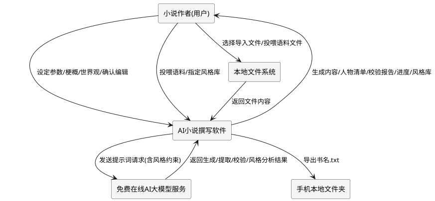

# **4. DFX约束**

## **4.1 性能**
1. 单章生成请求响应时间上限：60秒（受AI模型接口实际性能影响，需提供超时重试机制）。
2. 批量撰写过程中界面必须保持可响应状态，禁止出现主线程无响应（ANR）或界面冻结。
3. 文件导入解析时间上限：单文件10MB以内应在5秒内完成解析。
4. 全书内容校验时间上限：100万字以内应在10分钟内完成校验报告输出。
5. 风格库建立时间上限：投喂语料总计100万字以内应在3分钟内完成风格特征提取与风格库生成。
6. 单章修改后AI再校验响应时间上限：30秒内返回该章修改内容与梗概/世界观/人物关系的一致性校验结果。
7. 单章AI自动润色响应时间上限：60秒内返回润色后的章节内容（受AI模型接口实际性能影响，需提供超时重试机制）。
8. 批量再校验响应时间上限：单次批量再校验涉及章节不超过50章时，应在3分钟内完成逐章校验与全书人物物品变化一致性汇总并输出结果。
9. 历史版本回滚响应时间上限：单章回滚操作（不含回滚后再校验）应在3秒内完成正文替换与修改记录留存。
10. 风格库导出/导入响应时间上限：单个风格库导出或导入操作应在5秒内完成。
11. 项目切换响应时间上限：用户在下拉框切换项目后，系统加载该项目的全部数据到各页面控件应在3秒内完成（100万字规模以内），且切换过程中界面保持可响应。
12. 项目导出响应时间上限：将一个项目（含全部章节正文、修改记录等，100万字规模以内）打包为 `.aibk` 归档文件应在30秒内完成。
13. 项目导入响应时间上限：从 `.aibk` 归档文件恢复一个项目（100万字规模以内）到本机数据库应在30秒内完成。
14. 工程管理器初始页面加载时间上限：应用启动后加载本机全部项目列表摘要信息并渲染工程管理器初始页面应在3秒内完成（100个项目规模以内）。
15. 项目列表刷新时间上限：从创作主流程返回工程管理器初始页面或执行导入/删除/新建项目后刷新项目列表应在2秒内完成。
16. 项目删除响应时间上限：删除一个项目（含其全部关联数据，100万字规模以内）应在5秒内完成。
17. AI源连接测试响应时间上限：单次AI源连通性探测应在15秒内返回结论（成功/失败及原因）。
18. AI源编辑保存响应时间上限：保存单个AI源配置修改应在3秒内完成持久化并刷新列表。
19. Ollama模型列表获取响应时间上限：单次获取Ollama已安装模型列表应在5秒内返回结果（服务正常时）；Ollama服务不可达时应在5秒内返回明确的错误提示，禁止长时间无响应。
20. 状态栏运行时信息刷新性能约束：状态栏每秒刷新运行时长与当前日期时间显示的操作耗时不得超过50毫秒，刷新过程不得导致主线程卡顿或界面无响应；查询当前AI源信息的耗时不得超过500毫秒。
21. 工程保存响应时间上限：单次保存工程操作（含创建或更新项目及保存全部关联数据，100万字规模以内）应在5秒内完成并反馈结果，保存过程中界面保持可响应。
22. 人物增量去重合并性能约束：单次人物生成操作返回的新人物与已有人物列表按姓名去重合并的操作耗时不得超过500毫秒（已有人物规模500人以内），合并过程不得导致界面卡顿。
23. 人物多选批量删除性能约束：单次批量删除人物操作（含数据库级联删除关联数据）应在2秒内完成（删除人物数量100人以内），删除过程中界面保持可响应。
24. 定时自动保存性能约束：单次定时自动保存操作耗时不得超过5秒（100万字规模以内），保存过程不得阻塞主线程或导致界面无响应；自动保存期间用户可继续正常操作。
25. 关键节点自动保存性能约束：关键节点触发的自动保存操作耗时不得超过3秒，保存过程不得阻塞该关键节点的后续流程推进。

## **4.2 可靠性**
1. AI接口调用失败时，系统必须自动重试至少3次，重试间隔递增。
2. 批量撰写过程中若中断（网络断开、用户手动停止），已生成章节必须保留，支持断点续写。
3. 故事梗概与世界观在全书撰写过程中必须保持唯一且不可被AI擅自修改，作为一致性基准。
4. 所有用户手动编辑的内容必须优先于AI生成内容保留，不被后续AI生成覆盖。
5. 风格库一旦建立必须持久化存储于本地，即使关闭重启系统后仍可正常加载与使用。
6. 用户指定的风格库在撰写过程中不可被擅自切换或丢失，确保全书风格一致。
7. 用户手动修改并确认保留的章节内容必须持久化存储，不被后续任何AI再校验或润色操作擅自覆盖。
8. 用户拒绝AI润色结果时，用户原始修改内容必须完整保留，禁止丢失或回退至修改前状态。
9. 修改后AI再校验与AI自动润色过程中若中断，已修改的章节内容必须保留，支持重新触发校验或润色。
10. 章节修改记录必须持久化存储于本地，即使关闭重启系统后仍可正常读取历史版本列表并支持回滚操作。
11. 历史版本回滚操作必须可逆，回滚后产生的新修改记录同样可作为未来回滚的目标，确保回滚链路不丢失历史版本。
12. 风格库导出文件必须完整保留风格库全部特征与元数据，导入后还原的风格库与导出前在名称、特征集合、来源信息上保持一致。
13. 多项目数据隔离规则：各项目的创作参数、梗概、世界观、人物、爽点钩子、章节、修改记录、校验报告等数据必须完全隔离存储，禁止项目间数据相互覆盖或混杂。
14. 项目切换数据完整性规则：切换项目时，系统必须将目标项目的全部已持久化数据完整加载到各页面控件，且不修改、不丢失目标项目的任何数据；切回原项目时原项目的全部数据完整恢复。
15. 新建项目清除完整性规则：新建项目时必须清除所有页面控件中上一个项目遗留的内容，清除操作不得残留任何上一个项目的数据到新项目，避免新旧项目数据混杂。
16. 项目导出导入无损规则：项目导出为 `.aibk` 归档后，在另一台机器上导入必须能无损恢复项目的全部数据（含创作参数、梗概、世界观、人物、爽点钩子、全部章节正文、修改历史、校验报告等），恢复后可继续撰写、校验、导出。
17. 项目导出原子性规则：项目导出过程必须保证原子性，全部数据写入完成且校验和计算无误后方可生成最终 `.aibk` 文件，中途失败不得产生半成品归档文件。
18. 项目删除完整性规则：项目删除必须将该项目的全部关联数据（含创作参数、梗概、世界观、人物、爽点钩子、物品、章节、修改记录、校验报告等）一并删除，不得残留孤立数据导致数据库污染；删除后该项目数据不可被任何页面引用或加载。
19. 工程管理器项目列表一致性规则：工程管理器初始页面展示的项目列表必须与本机数据库实际项目状态保持一致，每次进入页面时刷新以确保列表反映最新的项目数量、状态与进度，禁止展示已删除项目或遗漏新增项目。
20. 工程保存数据完整性规则：工程保存操作必须将当前项目的全部已设定关联数据（创作参数、梗概、世界观、人物、爽点钩子、物品、章节、修改记录、校验报告等）完整持久化保存，禁止部分保存或静默丢弃任何已设定数据；保存失败时不得产生部分写入的脏数据，须回滚至保存前状态。
21. 状态栏运行时信息持续可用规则：应用运行期间状态栏运行时信息必须持续可用，定时刷新机制不得因异常中断导致运行时长停止计时或日期时间停止刷新；当前AI源显示在查询失败时须显示明确的不可用状态而非空白。
22. 人物增量去重数据保留规则：三种人物生成方式（AI提取人物、人物及关系自动识别导入、AI生成配角）生成新人物时必须采用增量去重模式，已有人物列表中的人物必须完整保留不被覆盖或删除，仅追加姓名不存在的新人物；同名人物（姓名完全相同）不重复添加，跳过已存在同名人物。
23. 人物ID唯一性规则：三种人物生成方式生成的人物标识符必须采用统一的UUID生成规则，确保全局唯一、不冲突、不重复；按姓名去重时已存在同名人物跳过不重复添加，不产生重复姓名人物。
24. 人物确认状态锁定规则：已确认状态的人物信息必须锁定，后续AI提取人物、AI生成配角等生成操作不得覆盖或重新生成已确认人物的姓名、身份、简介、关系等信息；已确认人物仅允许用户手动编辑修改。
25. 定时自动保存数据完整性规则：定时自动保存必须将当前项目的全部已设定关联数据完整持久化保存，禁止部分保存或静默丢弃；自动保存失败时不得产生部分写入的脏数据，须回滚至保存前状态并在状态栏提示保存失败。
26. 关键节点自动保存触发规则：创作参数设定完成、梗概/世界观保存完成、人物提取/生成完成、爽点钩子设定完成、每章撰写完成、校验完成、润色确认完成等关键操作完成后系统必须自动触发保存，确保关键步骤成果立即持久化，不依赖用户手动保存。
27. 撰写中实时保存规则：一键撰写全本小说时每完成一章必须立即将该章内容持久化到数据库，撰写中途死机或异常后重启须能恢复已写章节；校验时每完成一项校验必须立即保存校验结果。
28. 自动保存不影响业务规则：定时自动保存与关键节点自动保存不得中断或阻塞正在进行的AI长任务（如批量撰写、全书校验、AI润色），自动保存与业务流程并行执行互不干扰。

## **4.3 安全性**
1. AI模型接口密钥必须加密存储，禁止明文保存于配置文件。
2. 用户创作内容仅存储于本地，禁止未经用户同意上传至任何第三方服务（AI模型接口除外）。
3. 导出文件操作必须经用户明确确认目标路径，禁止静默写入任意位置。
4. 用户投喂的知识库语料仅用于本地风格分析，禁止未经用户同意上传至第三方服务（AI模型接口除外）。
5. 风格库内容仅存储于本地，禁止自动上传或外传。
6. AI源编辑窗口中API Key必须以密文形式显示，禁止在界面回显明文密钥；编辑时API Key留空表示保留原值不修改，禁止因留空而清空已有密钥。

## **4.4 可维护性**
1. 必须记录每次AI调用的提示词、模型响应、耗时与状态，便于问题排查。
2. 必须提供创作日志查看功能，记录批量撰写的每步执行情况。
3. AI接口地址、模型名称、生成参数等必须可配置，无需修改代码即可切换模型。
4. 状态栏运行时信息的刷新机制必须独立于业务逻辑，采用定时器驱动而非业务事件轮询，确保即使无业务操作时运行时长与日期时间仍持续刷新。
5. 工程保存操作必须记录保存日志，包含保存时间、项目标识、保存的数据项数量与保存结果（成功/失败及原因），便于问题排查。
6. 自动保存操作必须记录保存日志，包含触发类型（定时/关键节点/撰写中实时）、触发时间、项目标识、保存的数据项数量与保存结果，便于排查自动保存异常与确认数据持久化时机。
7. 人物增量去重合并操作必须记录合并日志，包含生成方式、本次生成人物数、已存在同名跳过数、实际新增数，便于排查人物丢失或重复问题。

## **4.5 兼容性**
1. 文件导入必须兼容txt、md、docx、xlsx四种格式，且对同一内容不同格式的导入结果一致。
2. 导出的txt文件必须兼容主流手机阅读应用，采用UTF-8编码。
3. AI模型接口切换时，已生成的小说内容与设定必须保留可用。
4. 风格库在不同AI模型接口切换后必须保持可用，风格特征描述应与具体模型解耦。
5. 系统初次运行无任何风格库时，必须自动提供默认风格并可用，不因缺少风格库而无法启动撰写。
6. 项目导出归档（`.aibk`）必须支持跨版本兼容：归档文件记录格式版本号，新版本应用读取旧版本归档时按版本号执行迁移脚本正常导入；归档版本号高于当前应用支持版本时拒绝导入并明确提示版本不兼容。
7. 项目导出归档（`.aibk`）必须为标准 zip 压缩包格式，可在不同操作系统的不同机器间传输并正常导入，不依赖特定数据库在线状态。

# **5. 核心能力**

## **5.1 创作参数设定**

### **5.1.1 业务规则**
1. **书名必填规则**：用户必须设定书名后方可启动批量撰写。
   a. 验收条件：[用户未填写书名点击开始撰写] → [系统提示"请先填写书名"并阻止启动]
2. **卷数章节数字数规则**：卷数、每卷章节数、每章字数必须为正整数，且每章字数下限为500字。
   a. 验收条件：[用户输入卷数=0或章节数=0或字数=400] → [系统提示参数无效并要求重新输入]
3. **故事梗概必填规则**：启动批量撰写前必须存在故事梗概内容。
   a. 验收条件：[用户未填写或导入故事梗概即点击开始撰写] → [系统提示"请先设定故事梗概"并阻止启动]
4. **世界观必填规则**：启动批量撰写前必须存在世界观设定内容。
   a. 验收条件：[用户未填写或导入世界观即点击开始撰写] → [系统提示"请先设定世界观"并阻止启动]
5. **禁止项**：禁止设定每章字数超过10000字，避免单次AI生成质量下降。
   a. 验收条件：[用户输入每章字数=15000] → [系统提示"单章字数上限10000字"并要求调整]

### **5.1.2 交互流程**
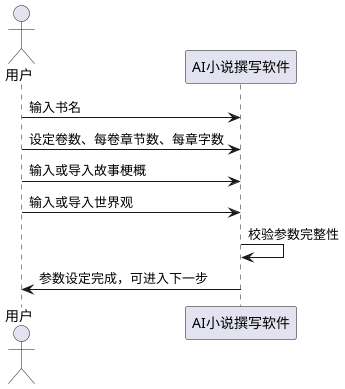

### **5.1.3 异常场景**
1. **参数缺失异常**
   a. 触发条件：用户未填写必填参数即尝试进入下一步
   b. 系统行为：阻止流程推进，高亮缺失字段
   c. 用户感知：明确提示缺失的字段名称
2. **参数格式异常**
   a. 触发条件：用户在数字字段输入非数字字符或负数
   b. 系统行为：拒绝输入并清空非法字符
   c. 用户感知：提示"请输入有效正整数"

## **5.2 文件导入**

### **5.2.1 业务规则**
1. **格式支持规则**：系统必须支持txt、md、docx、xlsx四种文件格式的导入解析。
   a. 验收条件：[用户分别导入同内容的txt、md、docx、xlsx文件] → [四种格式解析出的文本内容一致]
2. **导入内容分类规则**：用户导入文件时必须指定该文件内容属于"故事梗概""世界观"或"人物设定"中的某一类。
   a. 验收条件：[用户导入文件未选择分类] → [系统提示"请选择导入内容类型"]
3. **覆盖确认规则**：若目标分类已存在内容，导入新文件前必须经用户确认是否覆盖。
   a. 验收条件：[故事梗概已存在，用户导入新梗概文件] → [系统弹出确认框"是否覆盖现有故事梗概"]
4. **禁止项**：禁止导入超过50MB的文件，避免内存溢出。
   a. 验收条件：[用户选择60MB文件导入] → [系统提示"文件超过50MB上限"并拒绝导入]

### **5.2.2 交互流程**
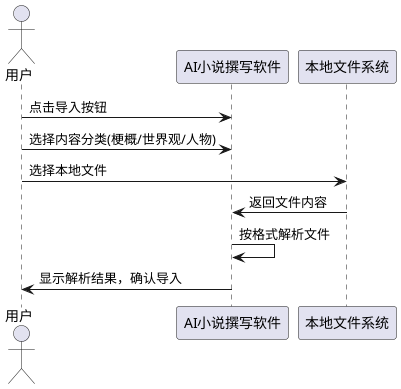

### **5.2.3 异常场景**
1. **不支持的文件格式**
   a. 触发条件：用户选择pdf、doc等不支持格式的文件
   b. 系统行为：拒绝导入
   c. 用户感知：提示"仅支持txt、md、docx、xlsx格式"
2. **文件解析失败**
   a. 触发条件：文件内容损坏或格式不符合规范
   b. 系统行为：中止导入，保留原有内容不变
   c. 用户感知：提示"文件解析失败，请检查文件完整性"
3. **文件过大异常**
   a. 触发条件：文件大小超过50MB
   b. 系统行为：拒绝导入
   c. 用户感知：提示"文件超过50MB上限"

## **5.3 人物管理**

### **5.3.1 业务规则**
1. **AI自动提取人物规则**：系统必须支持AI从故事梗概和世界观中自动提取主角与配角姓名及关系。
   a. 验收条件：[用户点击"AI提取人物"且已存在梗概与世界观] → [系统调用AI返回人物清单含姓名、身份、关系]
2. **AI自动生成配角规则**：系统必须支持AI根据故事梗概和世界观自动生成符合设定的相关配角姓名。
   a. 验收条件：[用户点击"AI生成配角"] → [系统返回若干符合世界观设定的配角姓名及简介]
3. **人物来源多样规则**：人物可通过AI提取、AI生成、用户手动输入、文件导入四种方式获得，且可混合使用。
   a. 验收条件：[用户通过AI提取3人+手动输入2人] → [人物清单显示5人且标注各自来源]
4. **人物关系一致性规则**：人物关系在全书撰写过程中必须保持一致，不可出现矛盾。
   a. 验收条件：[第1卷设定A与B为师徒，第3卷AI生成内容出现A与B为敌对] → [校验报告标记此处人物关系不一致]
5. **用户确认规则**：AI提取或生成的所有人物初始为"待确认"状态，须经用户确认后方可纳入正式人物清单参与撰写。
   a. 验收条件：[AI返回人物清单] → [系统展示清单供用户确认/编辑/删除，未确认人物不参与撰写]
6. **人物增量去重规则**：AI提取人物、人物及关系自动识别导入、AI生成配角三种人物生成方式在生成新人物时必须采用增量去重模式——新生成的人物与当前项目已有人物列表按姓名合并，姓名已存在的人物跳过不重复添加，仅追加姓名不存在的新人物，保留已有人物不变。禁止新生成人物覆盖或清除已有人物列表。
   a. 验收条件：[当前人物列表已有姓名"张三"的人物，用户点击"AI提取人物"返回含"张三"与"李四"的人物清单] → [合并后人物列表保留原"张三"不变，新增"李四"，不产生重复"张三"，不覆盖原"张三"信息]
   b. 验收条件：[当前人物列表已有3人，用户依次点击"AI提取人物"新增2人、"AI生成配角"新增1人（无同名）] → [人物列表最终为6人，三次操作结果累计叠加，已有人物始终保留]
   c. 验收条件：[当前人物列表已有姓名"王五"的人物，用户点击"AI生成配角"返回含"王五"的人物] → [合并后不新增"王五"，人物列表中"王五"仍为原有一条，提示"新增0个人物，1人已存在跳过"]
7. **人物ID统一生成规则**：三种人物生成方式（AI提取人物、人物及关系自动识别导入、AI生成配角）生成的人物标识符必须采用统一的UUID生成规则，确保全局唯一、不冲突、不重复，避免因ID重复导致同名人物被误判为同一人或数据覆盖。
   a. 验收条件：[用户依次通过AI提取人物、AI生成配角两种方式各生成若干人物] → [所有生成人物的ID均为UUID格式且全局唯一，无ID冲突或重复]
   b. 验收条件：[按姓名去重时已存在同名人物] → [跳过不重复添加，不为新同名人物生成新ID，已有人物ID保持不变]
8. **人物生成进度提示规则**：用户触发AI提取人物、人物及关系自动识别导入、AI生成配角三种人物生成操作时，系统必须在状态栏左下角显示包含操作类型与计时器的进度提示，提示格式为"[操作类型]中... MM:SS"（如"AI提取人物中... 00:03"），计时器从触发时刻开始计时每秒递增；生成完成后提示"完成，新增N个人物"（N为本次实际新增去重后的人数），提示为临时消息显示一定时间后自动消失。
   a. 验收条件：[用户点击"AI提取人物"] → [状态栏左下角显示"AI提取人物中... 00:00"并开始计时，每秒递增]
   b. 验收条件：[AI提取人物操作耗时5秒完成，实际新增去重后3人] → [状态栏提示"完成，新增3个人物"，提示显示约3秒后自动消失]
   c. 验收条件：[用户点击"AI生成配角"] → [状态栏左下角显示"AI生成配角中... 00:00"并开始计时，区别于AI提取人物的提示文案]
   d. 验收条件：[人物生成过程中] → [界面保持可响应，用户可查看人物列表已有内容，进度提示持续显示直至生成完成]
9. **人物多选批量删除规则**：人物列表必须支持多选操作，用户可通过Ctrl+点击多选不连续的多个人物、Shift+点击范围选择连续的多个人物，选中多个人物后可一键批量删除。批量删除前须经二次确认，确认后一次性从当前项目人物清单中移除所选人物及其关联数据。
   a. 验收条件：[用户Ctrl+点击选中人物A、C、E后点击"批量删除"] → [弹出二次确认框，确认后A、C、E从人物列表移除，其余人物保留]
   b. 验收条件：[用户点击人物B后Shift+点击人物E] → [选中B、C、D、E连续范围的人物]
   c. 验收条件：[用户选中5个人物批量删除并确认] → [提示"已删除5个人物"，人物列表刷新反映删除结果]
   d. 验收条件：[用户选中人物后点击"批量删除"但在确认框点击"取消"] → [不执行删除，人物列表保持不变]
10. **确认选中人物按钮作用规则**：人物管理页面的"确认选中人物"按钮用于将用户选中的一个或多个"待确认"状态人物标记为"已确认"状态。已确认人物的信息（姓名、身份、简介、关系）即被锁定，后续AI提取人物、AI生成配角等生成操作不得覆盖或重新生成已确认人物的信息。已确认人物仍允许用户手动编辑修改。已确认状态在人物列表中以可视化方式标注，区别于AI生成的"待确认"状态。
   a. 验收条件：[AI提取返回3人均为"待确认"状态，用户选中其中2人点击"确认选中人物"] → [被选中的2人状态变为"已确认"，未选中的1人仍为"待确认"，列表中以可视化方式区分两种状态]
   b. 验收条件：[人物A已为"已确认"状态，用户再次点击"AI提取人物"返回含同名"人物A"的清单] → [增量去重跳过"人物A"，已确认的"人物A"信息不被覆盖或重新生成]
   c. 验收条件：[用户选中已确认状态的人物A手动编辑其简介并保存] → [编辑成功，已确认人物允许用户手动修改，仅锁定不被AI生成覆盖]
   d. 验收条件：[用户未选中任何人物点击"确认选中人物"] → [按钮禁用或提示"请先选中要确认的人物"]
11. **禁止项**：禁止三种人物生成方式采用覆盖模式清除已有人物列表，必须采用增量去重模式保留已有人物。
   a. 验收条件：[当前人物列表已有5人，用户点击"AI提取人物"返回3人] → [合并后人物列表不少于5人（已有人物全部保留），而非被新生成的3人覆盖]
12. **禁止项**：禁止后续AI生成操作覆盖或重新生成已确认状态人物的信息，已确认人物信息锁定。
   a. 验收条件：[人物A已确认，用户点击"AI生成配角"] → [AI生成结果中若含同名人物A则跳过，已确认的人物A信息保持不变]
13. **禁止项**：禁止批量删除人物时未经二次确认直接执行删除，避免误删。
   a. 验收条件：[用户选中多个人物点击"批量删除"] → [系统必须弹出二次确认框，用户未确认时不执行删除]
14. **撰写过程配角不足自动生成触发规则**：全文批量撰写（5.6）逐章生成时，若该章大纲梗概要点或剧情场景所需配角人物数量不足（正式人物清单中已确认配角无法覆盖该章剧情需要），系统必须自动触发AI生成配角，生成符合世界观设定的配角补充该章剧情需要，生成过程复用规则6增量去重、规则7 UUID统一生成、规则8进度提示机制。
   a. 验收条件：[撰写第5章时该章大纲梗概要点需要一名"客栈老板"配角，正式人物清单无此角色] → [系统自动触发AI生成配角，生成符合世界观的"客栈老板"配角并按增量去重合并入人物清单]
   b. 验收条件：[撰写某章时正式人物清单中已确认配角已覆盖该章剧情需要] → [系统不触发自动生成配角，直接使用现有人物撰写]
   c. 验收条件：[自动生成配角过程中] → [状态栏左下角显示"自动生成配角中... MM:SS"计时提示，界面保持可响应]
15. **大纲生成配角不足自动生成触发规则**：大纲管理（5.17）AI生成大纲时，若根据故事梗概与世界观规划某卷某章剧情需要配角而正式人物清单中已确认配角数量不足，系统必须自动触发AI生成配角补充规划所需配角，生成的配角按增量去重合并入人物清单并参与后续大纲规划。
   a. 验收条件：[用户点击"AI生成大纲"，某卷规划需要配角"江湖侠客"但人物清单无此角色] → [系统自动触发AI生成配角生成"江湖侠客"并合并入人物清单后继续大纲规划]
   b. 验收条件：[大纲生成时正式人物清单已确认配角充足] → [系统不触发自动生成配角，直接使用现有人物规划大纲]
16. **自动生成配角属性生成规则**：系统自动生成配角时必须生成配角的姓名、身份、简介、关系四项属性，属性生成须符合当前项目世界观设定——若世界观为历史/神话题材，生成的历史/神话人物姓名、身份、关系等信息必须符合对应历史/神话记载的准确信息，禁止凭空捏造历史人物的核心信息；生成的配角身份默认为"配角"，关系根据剧情场景需要生成。
   a. 验收条件：[世界观为"三国演义"题材，自动生成配角"赵云"] → [生成的"赵云"身份、简介、关系符合三国历史记载，如身份为"蜀汉将领"而非凭空捏造]
   b. 验收条件：[世界观为"架空玄幻"题材，自动生成配角"青云子"] → [生成的"青云子"属性符合该玄幻世界观设定，身份为"配角"]
   c. 验收条件：[自动生成配角属性缺少姓名关键字段] → [该配角不纳入合并，提示"自动生成配角缺少姓名，已跳过"]
17. **自动生成配角数量与场景需求匹配规则**：系统自动生成配角的数量必须与触发场景的短期剧情需求匹配——根据该章大纲梗概要点或该卷大纲规划所需的配角缺口数量决定生成数量，禁止生成数量过多导致人物冗余或过少导致剧情无法推进。单次自动生成配角数量上限为5人，超过5人时分批生成并提示用户确认。
   a. 验收条件：[某章剧情需要2名配角，正式人物清单缺口2人] → [系统自动生成2名配角补充，不多不少]
   b. 验收条件：[某卷大纲规划需要8名配角，超过单次上限5人] → [系统分批生成（如先5人后3人），并提示用户确认后再继续]
   c. 验收条件：[某章剧情仅需1名配角] → [系统仅生成1名配角，禁止额外生成无关配角]
18. **自动生成配角持久化条件规则**：系统采用"仅当后续剧情仍需引用时才持久化"策略——自动生成的配角仅在系统判断该配角在后续章节或后续书籍中仍需出现时，才持久化写入"人物管理列表"及"配角数据库"；仅在单章一次性出现、后续不再引用的配角不持久化，标记为"临时配角"仅在该章正文内使用，不写入正式人物管理列表。系统通过以下方式判断是否后续引用：（1）大纲规划显示该配角在多个章节出现；（2）AI生成时标注该配角有后续剧情引用价值；（3）无法判断时默认持久化（保守策略，避免丢失需再次出场的配角）。
   a. 验收条件：[自动生成配角"李四"，大纲规划显示"李四"在第5章、第10章、第15章均出现] → [系统将"李四"持久化写入人物管理列表及配角数据库，来源标记"auto_generated"]
   b. 验收条件：[自动生成配角"路人甲"，仅在第5章一次性出现，后续章节大纲无引用] → [系统不将"路人甲"持久化，标记为"临时配角"仅在第5章正文使用，不写入人物管理列表]
   c. 验收条件：[自动生成配角"王五"，系统无法判断后续是否引用] → [系统默认持久化"王五"写入人物管理列表，避免丢失需再次出场的配角]
19. **自动生成配角来源标记规则**：自动生成并持久化的配角在人物管理列表中必须以来源标记"auto_generated"区分于手动输入（"手动输入"）、AI提取（"AI提取"）、用户主动点击"AI生成配角"生成（"AI生成"）、文件导入（"文件导入"）四种方式生成的人物，便于用户识别与系统统计。来源标记"auto_generated"的配角初始状态为"待确认"，须经用户确认后方可纳入正式人物清单参与撰写，复用规则5用户确认、规则10确认选中人物机制。
   a. 验收条件：[自动生成配角"李四"持久化写入人物管理列表] → [该人物来源字段标记为"auto_generated"，区别于其他来源人物]
   b. 验收条件：[来源为"auto_generated"的配角初始状态] → [为"待确认"，须经用户点击"确认选中人物"后标记为"已确认"方可参与撰写]
   c. 验收条件：[用户查看人物管理列表] → [可按来源筛选查看所有"auto_generated"来源的配角]
20. **已持久化配角检索引用规则**：已持久化写入人物管理列表及配角数据库的配角，在后续大纲生成（5.17）或逐章撰写（5.6）时必须被系统自动检索并作为人物约束传入AI请求，确保后续章节引用已存在的配角而非重复生成新配角。检索方式为按项目ID关联查询当前项目所有已确认状态人物（含来源"auto_generated"的配角），作为人物约束传入AI。
   a. 验收条件：[第5章自动生成并持久化配角"李四"且已确认，撰写第10章时AI请求] → [AI请求人物约束中包含"李四"的姓名、身份、简介、关系，引用已有"李四"而非重新生成]
   b. 验收条件：[大纲生成时已持久化配角"李四"存在] → [大纲规划可引用"李四"作为某章出场人物，不重复生成同名配角]
   c. 验收条件：[已持久化配角仍为"待确认"状态] → [不作为人物约束传入AI，须用户确认后方可被检索引用]
21. **配角属性跨章节继承规则**：同一配角在不同章节中出现时必须继承其已持久化的属性（姓名、身份、简介、关系），禁止不同章节对同一配角生成不一致的属性描述。后续章节引用该配角时系统必须将该配角已持久化的完整属性作为约束传入AI，确保AI生成内容中该配角的姓名、身份、关系与初始设定一致。
   a. 验收条件：[配角"李四"在第5章身份为"客栈老板"、关系为"与主角为旧识"，撰写第10章引用"李四"] → [第10章AI请求中"李四"的属性约束为第5章已持久化的身份与关系，生成内容中"李四"身份关系一致]
   b. 验收条件：[第10章AI生成内容将"李四"描述为"铁匠"且与主角为"陌生人"] → [校验报告标记"第10章配角'李四'属性与第5章不一致"]
22. **配角出场记录追踪规则**：系统必须为每位已持久化配角维护出场记录，记录该配角在哪些章节（卷号+章号）出现过及出场顺序，出场记录随撰写进度自动更新。用户可在人物管理列表中查看配角的出场记录，便于追踪配角分布与出场频率，避免人物出场混乱。
   a. 验收条件：[配角"李四"在第5章、第10章、第15章出场] → [该配角出场记录显示"第1卷第5章、第1卷第10章、第2卷第5章"，出场顺序为5→10→15]
   b. 验收条件：[撰写第10章完成且配角"李四"出场] → [系统自动更新"李四"出场记录追加第10章，无需用户手动维护]
   c. 验收条件：[用户在人物管理列表查看配角"李四"] → [可查看其出场记录列表含出场章节与顺序]
23. **自动生成配角姓名去重规则**：自动生成配角复用规则6增量去重机制——新生成的配角与当前项目已有人物列表按姓名合并，姓名已存在的人物跳过不重复添加，仅追加姓名不存在的新配角，保留已有人物不变。禁止自动生成配角覆盖或清除已有人物列表，禁止生成与已有人物姓名重复的新配角。
   a. 验收条件：[已有人物列表含姓名"张三"，自动生成配角返回含"张三"与"李四"] → [合并后保留原"张三"不变，新增"李四"，不产生重复"张三"]
   b. 验收条件：[已有人物列表含已确认"张三"，自动生成配角返回含"张三"] → [跳过"张三"不新增，提示"新增0个配角，1人已存在跳过"，已确认"张三"信息不被覆盖]
24. **自动生成配角角色定位重叠避免规则**：系统自动生成配角时必须将当前项目已有人物的身份与角色定位作为约束传入AI，避免生成的配角与已有人物角色定位重叠（如已有人物"张三"为"反派军师"，自动生成配角不应再生成身份为"反派军师"的配角导致角色重叠）。生成的配角身份应与已有人物形成差异化互补。
   a. 验收条件：[已有人物"张三"身份为"反派军师"，自动生成配角时AI请求] → [AI请求中包含"张三"的身份约束，生成的配角身份不为"反派军师"等重叠定位]
   b. 验收条件：[自动生成配角"李四"身份为"客栈老板"，已有人物无此身份] → [角色定位不重叠，"李四"可正常合并入人物清单]
25. **配角跨章节属性一致性校验规则**：系统必须对同一配角在不同章节中的属性描述进行一致性校验，若发现同一配角在不同章节的姓名、身份、关系等属性描述不一致，校验报告必须标记不一致项供用户确认修改，确保全书配角属性一致。该规则与规则4人物关系一致性规则协同。
   a. 验收条件：[配角"李四"在第5章身份为"客栈老板"，第10章生成内容描述为"铁匠"] → [校验报告标记"第10章配角'李四'身份与第5章不一致"，供用户确认修改]
   b. 验收条件：[配角"李四"在全书各章属性描述一致] → [校验报告不标记不一致项，该配角属性一致性校验通过]
26. **自动生成配角适用场景规则**：自动生成配角机制适用于以下场景：（1）全文批量撰写（5.6）逐章生成时该章剧情所需配角不足；（2）大纲管理（5.17）AI生成大纲时规划所需配角不足；（3）爽点与钩子设计（5.4）逐章生成依赖大纲时所需配角不足。不适用于用户手动添加人物、文件导入人物、AI提取人物、用户主动点击"AI生成配角"等已有人物获取方式。
   a. 验收条件：[全文批量撰写时某章配角不足] → [触发自动生成配角机制]
   b. 验收条件：[大纲生成时规划配角不足] → [触发自动生成配角机制]
   c. 验收条件：[用户手动添加人物或文件导入人物或主动点击"AI生成配角"] → [不触发自动生成配角机制，走已有人物添加流程]
27. **自动生成配角局限性告知规则**：系统必须向用户明示自动生成配角的以下局限性：（1）AI生成配角的质量受AI大模型能力限制，可能存在性格扁平、背景套路化等质量问题；（2）历史/神话人物信息虽要求准确但AI仍可能生成不准确信息，须用户核实；（3）自动生成配角的剧情作用可能不如手动设计的人物深入。系统须在自动生成配角完成提示中附带局限性提醒，引导用户确认与修改。
   a. 验收条件：[自动生成配角完成] → [系统提示"完成，新增N个配角"并附带"AI生成配角可能存在质量或历史信息准确性问题，请确认核实"提醒]
   b. 验收条件：[世界观为历史题材且自动生成历史人物] → [系统额外提示"历史人物信息请核实准确性"]
28. **自动生成配角人工介入规则**：以下情况系统必须提示用户人工确认或修改自动生成的配角：（1）单次自动生成配角数量超过5人时，须用户确认后方可继续；（2）自动生成配角与已有人物角色定位重叠时，须用户确认或修改；（3）自动生成配角属性与世界观明显不符时，须用户修改；（4）历史/神话人物信息疑似不准确时，须用户核实；（5）自动生成配角跨章节属性不一致时，须用户确认修改。人工介入复用规则5用户确认、规则10确认选中人物机制。
   a. 验收条件：[单次自动生成配角8人超过上限5人] → [系统提示"本次生成8个配角超过上限，请确认后继续"]
   b. 验收条件：[自动生成配角"李四"与已有人物"张三"角色定位重叠] → [系统提示"配角'李四'与'张三'角色定位重叠，请确认或修改"]
   c. 验收条件：[自动生成配角属性与世界观不符] → [系统提示"配角属性与世界观不符，请修改"]
   d. 验收条件：[历史人物信息疑似不准确] → [系统提示"历史人物信息请核实准确性"]
29. **禁止项**：禁止自动生成配角覆盖或清除已有人物列表，必须采用增量去重模式保留已有人物（复用规则11）。
   a. 验收条件：[当前人物列表已有5人，自动生成配角返回3人] → [合并后人物列表不少于5人，已有人物全部保留]
30. **禁止项**：禁止自动生成配角覆盖或重新生成已确认状态人物的信息，已确认人物信息锁定（复用规则12）。
   a. 验收条件：[人物A已确认，自动生成配角返回含同名"人物A"] → [跳过"人物A"，已确认的"人物A"信息保持不变]
31. **禁止项**：禁止自动生成配角生成与已有人物姓名重复的新配角，必须按姓名增量去重跳过同名（复用规则6）。
   a. 验收条件：[已有人物含"张三"，自动生成配角返回含"张三"] → [跳过"张三"不新增，不产生重复]
32. **禁止项**：禁止将仅在单章一次性出现、后续不再引用的配角持久化写入人物管理列表，避免人物列表被一次性配角污染。
   a. 验收条件：[配角"路人甲"仅在第5章一次性出现，后续无引用] → [不持久化"路人甲"入人物管理列表，标记为"临时配角"仅在该章使用]

### **5.3.2 交互流程**
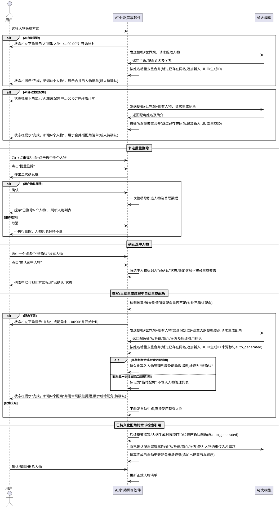

### **5.3.3 异常场景**
1. **AI提取人物失败**
   a. 触发条件：AI接口返回错误或返回内容无法解析为人物信息
   b. 系统行为：停止计时器，提示失败并允许重试或手动输入，已有人物列表不变
   c. 用户感知：状态栏进度提示消失，提示"AI提取人物失败，请重试或手动添加"
2. **人物信息不完整**
   a. 触发条件：AI返回的人物缺少姓名关键字段
   b. 系统行为：标记信息不完整，要求用户补充，该人物不纳入增量合并
   c. 用户感知：提示"人物[XX]缺少姓名，请补充"
3. **增量去重时同名人物信息冲突**
   a. 触发条件：新生成人物与已有人物姓名相同但身份/关系等信息不同
   b. 系统行为：跳过新同名人物不重复添加，保留已有人物信息不变，在完成提示中告知跳过数量
   c. 用户感知：提示"完成，新增N个人物，M人已存在跳过"，已有人物信息未被覆盖
4. **批量删除时关联数据级联失败**
   a. 触发条件：批量删除人物时数据库级联删除关联数据（如该人物参与的章节引用）失败
   b. 系统行为：回滚事务，不产生部分删除，提示失败及原因
   c. 用户感知：提示"批量删除失败，请检查数据库状态后重试"，人物列表保持不变
5. **确认选中人物时无选中项**
   a. 触发条件：用户未选中任何人物即点击"确认选中人物"
   b. 系统行为：按钮禁用或提示先选中人物
   c. 用户感知：提示"请先选中要确认的人物"或按钮无响应
6. **人物生成进度提示计时器异常**
   a. 触发条件：进度提示计时器因异常停止计时
   b. 系统行为：系统须具备计时器自动恢复机制，恢复后继续计时不丢失已计时长
   c. 用户感知：进度提示在短暂停顿后恢复计时
7. **自动生成配角失败**
   a. 触发条件：撰写或大纲生成过程中触发自动生成配角，但AI接口返回错误或返回内容无法解析为配角信息
   b. 系统行为：停止自动生成，提示失败并允许重试或跳过该配角继续撰写，已有人物列表不变
   c. 用户感知：提示"自动生成配角失败，可重试或跳过继续撰写"
8. **自动生成配角姓名与已有人物冲突**
   a. 触发条件：自动生成的配角姓名与已有人物列表中人物姓名重复
   b. 系统行为：按增量去重跳过同名配角不重复添加，保留已有人物不变，在完成提示中告知跳过数量
   c. 用户感知：提示"完成，新增N个配角，M人已存在跳过"
9. **自动生成配角属性不符合世界观**
   a. 触发条件：自动生成的配角属性（身份、关系等）与当前项目世界观设定不符
   b. 系统行为：标记该配角属性不符世界观，提示用户修改或重新生成，该配角不纳入合并
   c. 用户感知：提示"配角[XX]属性与世界观不符，请修改或重新生成"
10. **历史/神话人物信息不准确**
    a. 触发条件：世界观为历史/神话题材，自动生成的历史/神话人物信息与历史记载不符
    b. 系统行为：标记该人物信息疑似不准确，提示用户核实修改
    c. 用户感知：提示"历史人物[XX]信息可能不准确，请核实"
11. **自动生成配角角色定位重叠**
    a. 触发条件：自动生成的配角角色定位与已有人物重叠（如身份相同）
    b. 系统行为：提示用户确认或修改该配角身份，避免角色重叠
    c. 用户感知：提示"配角[XX]与已有人物[YY]角色定位重叠，请确认或修改"
12. **自动生成配角跨章节属性不一致**
    a. 触发条件：同一配角在不同章节的属性描述不一致
    b. 系统行为：校验报告标记不一致项，提示用户确认修改
    c. 用户感知：提示"配角[XX]在第A章与第B章属性不一致，请确认修改"
13. **自动生成配角数量超过上限**
    a. 触发条件：单次自动生成配角数量超过5人上限
    b. 系统行为：分批生成，首批生成5人后暂停，提示用户确认后再继续生成剩余配角
    c. 用户感知：提示"本次需生成N个配角超过上限5人，已生成5人，请确认后继续"

## **5.4 爽点与钩子设计**

### **5.4.1 业务规则**
1. **每章爽点规则**：每一章节必须至少设置一个爽点，由AI辅助设定或用户手动设定。
   a. 验收条件：[某章节未设置爽点] → [系统提示"第X章未设置爽点"并阻止该章撰写或建议AI补充]
2. **每章钩子规则**：每一章节必须至少埋设一个钩子，由AI辅助设定或用户手动设定。
   a. 验收条件：[某章节未设置钩子] → [系统提示"第X章未设置钩子"并阻止该章撰写或建议AI补充]
3. **钩子回收规则**：所有埋设的钩子必须在后续章节中回收，系统必须跟踪每个钩子的回收状态。
   a. 验收条件：[第3章埋设钩子H1，全书结束H1未回收] → [校验报告标记"钩子H1未回收"]
4. **AI辅助设定规则**：系统必须支持AI根据故事梗概辅助生成符合设定的爽点与钩子方案及回收计划。
   a. 验收条件：[用户点击"AI辅助设定爽点钩子"] → [系统返回每章爽点类型、钩子内容与回收章节安排]
5. **爽点符合梗概规则**：AI设定的爽点必须符合故事梗概的基调与走向，不可与主线矛盾。
   a. 验收条件：[故事梗概为悲剧结局，AI在某章设定大团圆爽点] → [系统提示"该爽点可能与梗概基调不符"供用户判断]
6. **禁止项**：禁止钩子跨卷回收距离超过3卷，避免读者遗忘悬念。
   a. 验收条件：[第1卷第2章钩子在第5卷回收] → [系统提示"钩子回收距离过远，建议在3卷内回收"]
7. **逐章生成依赖大纲规则**：AI辅助设定爽点钩子时必须以大纲管理中各章的梗概要点作为逐章生成的核心情节参考，按大纲章节顺序逐章生成该章的爽点与钩子，禁止一次性生成全书所有章节的爽点钩子方案，避免提示词含梗概+世界观+人物+全书总章数计划导致输出极长、AI响应慢及超时。
   a. 验收条件：[用户点击"AI辅助设定爽点钩子"且已存在大纲] → [系统按大纲章节顺序逐章生成，每章生成时请求中包含该章梗概要点]
   b. 验收条件：[用户点击"AI辅助设定爽点钩子"但大纲不存在] → [系统提示"请先在大纲管理中生成大纲"并阻止逐章生成]
8. **逐章生成循环规则**：系统必须按大纲章节顺序循环执行逐章爽点钩子生成——生成完第N章爽点钩子并返回结果后，自动继续生成第N+1章，直至全书所有章节爽点钩子生成完成，无需用户逐章手动触发。
   a. 验收条件：[全书30章，用户点击逐章生成] → [系统自动从第1章循环生成至第30章，每章生成完成后自动续写下一章]
9. **逐章生成即时返回规则**：每章爽点钩子生成完成后必须即时返回该章结果并持久化保存，再执行下一章生成，禁止等待全书所有章节生成完毕后一次性返回。
   a. 验收条件：[第5章爽点钩子生成完成] → [系统即时保存第5章爽点钩子并更新界面展示，随后开始生成第6章]
10. **逐章生成暂停与续写规则**：逐章生成过程中用户必须可随时暂停，暂停后已生成章节的爽点钩子保留；再次启动时从上次暂停章节的下一章继续生成，不重复生成已完成的章节。
    a. 验收条件：[生成到第10章用户点击暂停] → [系统完成当前章后停止，保留前10章爽点钩子]
    b. 验收条件：[暂停后用户点击续写] → [系统从第11章继续生成，前10章爽点钩子不重复生成]
11. **逐章生成超时避免规则**：通过逐章生成机制将单次AI请求负载限制在单章爽点钩子范围内，避免一次性生成全书爽点钩子导致提示词过长、AI响应慢及超时问题。单章生成请求超时阈值应独立设置，超时后按重试策略处理。
    a. 验收条件：[全书100章逐章生成] → [每次AI请求仅包含单章梗概要点与上下文，单次请求负载远小于全书一次性生成]
12. **逐章生成收束点规则**：每章爽点钩子生成时必须将故事梗概、世界观、正式人物清单及该章大纲梗概要点作为收束约束传入AI，确保生成的爽点钩子既符合全书主线又贴合该章情节走向。
    a. 验收条件：[生成第5章爽点钩子时AI请求] → [请求提示词中包含故事梗概、世界观、人物清单与第5章大纲梗概要点]
13. **禁止项**：禁止在未生成大纲的情况下启动逐章爽点钩子生成。
    a. 验收条件：[大纲未生成，用户点击逐章生成爽点钩子] → [系统提示"请先在大纲管理中生成大纲"并阻止启动]

### **5.4.2 交互流程**
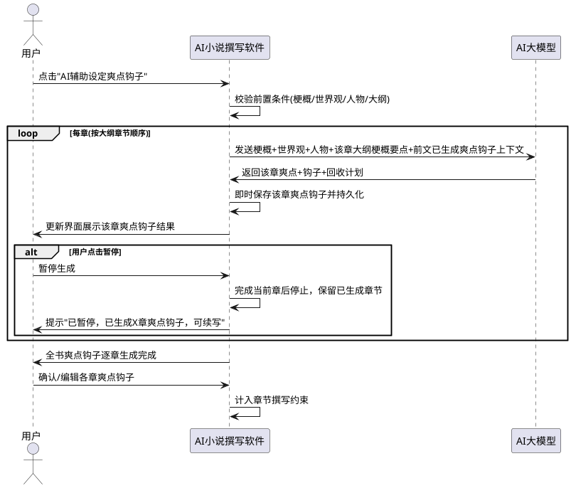

### **5.4.3 异常场景**
1. **AI设定爽点钩子失败**
   a. 触发条件：AI接口返回错误或返回内容无法解析
   b. 系统行为：提示失败并允许重试或手动设定
   c. 用户感知：提示"AI设定失败，请重试或手动设定爽点钩子"
2. **钩子回收冲突**
   a. 触发条件：两个钩子被安排在同一章节回收导致情节冲突
   b. 系统行为：标记冲突并建议调整回收章节
   c. 用户感知：提示"第X章回收钩子过多，建议分散回收"
3. **单章爽点钩子生成失败**
   a. 触发条件：逐章生成过程中某章AI请求返回错误或返回内容无法解析
   b. 系统行为：标记该章生成失败，自动重试3次，仍失败则暂停逐章生成并保留已生成章节，提示用户可重试该章、跳过该章或手动设定
   c. 用户感知：提示"第X章爽点钩子生成失败，可重试/跳过/手动设定"
4. **逐章生成暂停后续写失败**
   a. 触发条件：用户暂停后点击续写，但续写时AI接口不可用或大纲数据丢失
   b. 系统行为：提示续写失败及原因，保留已生成章节不变，允许稍后重试续写
   c. 用户感知：提示"续写失败：[原因]，已生成章节已保留，可稍后重试"
5. **逐章生成中途大纲被修改**
   a. 触发条件：逐章生成过程中用户在大纲管理页面修改了未生成章节的梗概要点
   b. 系统行为：后续章节生成采用修改后的大纲梗概要点，已生成章节爽点钩子不变，提示用户可选择性重新生成受影响章节
   c. 用户感知：提示"大纲已修改，后续章节将采用新大纲生成，已生成章节可选择性重新生成"
6. **单章爽点钩子生成超时**
   a. 触发条件：单章爽点钩子生成AI请求超过单章超时阈值（如120秒）未返回
   b. 系统行为：中断该次请求并自动重试，重试仍超时则暂停逐章生成并提示
   c. 用户感知：提示"第X章爽点钩子生成超时，已暂停，可重试"

## **5.5 知识库投喂与风格库管理**

### **5.5.1 业务规则**
1. **语料投喂规则**：用户必须能够选择一个或多个本地小说文本文件（txt、md、docx等格式）作为风格学习语料投喂给系统。
   a. 验收条件：[用户选择3个txt小说文件并点击投喂] → [系统接收全部文件并开始风格分析]
2. **风格特征提取规则**：系统必须调用AI对投喂语料进行写作风格特征分析，提取包括叙事视角、句式偏好、用词习惯、节奏特征、段落结构、对话风格等维度的风格特征。
   a. 验收条件：[用户投喂有效语料并点击建立风格库] → [系统调用AI返回多维风格特征描述]
3. **风格库命名规则**：建立风格库时必须为其命名，命名方式支持以下两种之一：（a）用户直接指定风格库名称；（b）用户提供所投喂语料的作者名，系统以该作者名作为风格库名称。无论采用何种命名方式，风格库名称非空且在本机唯一。
   a. 验收条件：[用户建立风格库未命名即点击确认] → [系统提示"请为风格库命名，可输入自定义名称或作者名"]
   b. 验收条件：[用户以已存在的风格库名称命名] → [系统提示"该名称已存在，请更换"]
   c. 验收条件：[用户输入作者名"金庸"作为命名来源并确认] → [系统以"金庸"作为风格库名称建立风格库]
4. **风格库持久化规则**：风格库建立后必须持久化存储于本地，支持后续撰写任务复用，无需重复投喂。
   a. 验收条件：[建立风格库后关闭并重启系统] → [风格库列表中仍显示该风格库且可正常选用]
5. **风格库管理规则**：系统必须支持对已有风格库的查看、编辑、导出、导入、删除操作。其中编辑包括重命名风格库、新增/修改/删除风格特征项、调整特征描述内容；导出将风格库以结构化文件形式写入用户指定的本地路径；导入从用户指定的本地风格库文件载入并纳入本机风格库列表；删除经用户确认后从列表移除并删除本地存储。
   a. 验收条件：[用户选择某风格库点击删除] → [系统确认后从列表移除并删除本地存储]
   b. 验收条件：[用户选择某风格库点击编辑并修改某风格特征描述后保存] → [系统更新该风格库对应特征并持久化]
   c. 验收条件：[用户选择某风格库点击导出并指定本地路径] → [系统将风格库以结构化文件写入该路径并提示导出成功]
   d. 验收条件：[用户点击导入并选择本地风格库文件] → [系统解析文件并将风格库纳入本机列表，提示导入成功]
6. **风格库导出格式规则**：风格库导出文件必须采用结构化格式（如json），完整包含风格库名称、全部风格特征项、来源语料信息、建立时间等元数据，且可被本系统导入还原。
   a. 验收条件：[用户导出风格库"金庸武侠风"至文件F] → [F为json格式且包含该风格库全部特征与元数据，再次导入F可还原为同名同特征的风格库]
7. **风格库导入命名冲突规则**：导入风格库时若本机已存在同名风格库，系统必须提示冲突并要求用户选择"覆盖""重命名（自动追加后缀）"或"取消"之一，禁止静默覆盖。
   a. 验收条件：[本机已有风格库"金庸武侠风"，用户导入同名文件] → [系统提示"已存在同名风格库，请选择覆盖/重命名/取消"]
8. **风格特征确认规则**：AI提取的风格特征必须展示给用户，用户可确认、编辑或补充后再正式入库。
   a. 验收条件：[AI返回风格特征] → [系统展示特征详情供用户确认/编辑，未确认不入库]
9. **默认风格可用规则**：系统必须内置默认风格，在用户未建立任何风格库或未指定风格库时自动采用，且默认风格也需具备较低AI化特征。
   a. 验收条件：[系统初次运行无任何风格库，用户直接启动撰写] → [系统采用默认风格并生成贴近真人网文习惯的内容]
10. **禁止项**：禁止投喂单个文件超过50MB或总计超过200MB的语料，避免分析超时或内存溢出。
    a. 验收条件：[用户投喂总计250MB语料] → [系统提示"投喂语料总量超过200MB上限"并拒绝]
11. **禁止项**：禁止投喂内容过少（单个文件少于1000字）的语料，避免风格特征提取不充分。
    a. 验收条件：[用户投喂一个仅500字的文件] → [系统提示"语料过少，建议投喂不少于1000字的完整小说片段"]
12. **禁止项**：禁止导入非本系统导出的或不符合格式规范的风格库文件，避免解析异常。
    a. 验收条件：[用户选择一个非结构化风格库文件导入] → [系统提示"该文件不是有效的风格库文件，无法导入"]

### **5.5.2 交互流程**
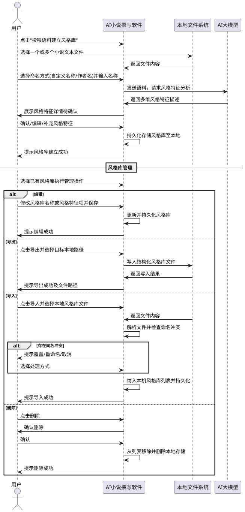

### **5.5.3 异常场景**
1. **语料格式不支持**
   a. 触发条件：用户投喂pdf、doc等不支持格式的文件
   b. 系统行为：拒绝该文件并提示支持的格式
   c. 用户感知：提示"投喂语料仅支持txt、md、docx格式"
2. **语料解析失败**
   a. 触发条件：投喂文件内容损坏或编码无法识别
   b. 系统行为：跳过该文件并继续处理其他文件，提示跳过原因
   c. 用户感知：提示"文件[XX]解析失败已跳过，其余文件继续处理"
3. **AI风格分析失败**
   a. 触发条件：AI接口返回错误或返回内容无法解析为风格特征
   b. 系统行为：提示失败并允许重试或手动设定风格特征
   c. 用户感知：提示"AI风格分析失败，请重试或手动描述风格特征"
4. **风格库存储失败**
   a. 触发条件：本地存储空间不足或无写入权限
   b. 系统行为：提示失败并保留本次分析结果供重试
   c. 用户感知：提示"风格库存储失败，请检查存储空间与权限"
5. **风格库导出失败**
   a. 触发条件：导出目标路径不可写或磁盘空间不足
   b. 系统行为：中止导出并保留原风格库不变
   c. 用户感知：提示"风格库导出失败，请检查目标路径与存储空间"
6. **风格库导入文件无效**
   a. 触发条件：用户选择的文件非本系统导出的结构化风格库文件或文件损坏
   b. 系统行为：拒绝导入并提示文件格式要求
   c. 用户感知：提示"该文件不是有效的风格库文件，无法导入"
7. **风格库导入命名冲突**
   a. 触发条件：导入的风格库名称与本机已有风格库重名
   b. 系统行为：提示冲突并要求用户选择覆盖、重命名或取消
   c. 用户感知：提示"已存在同名风格库，请选择覆盖/重命名/取消"

## **5.6 全文批量撰写**

### **5.6.1 业务规则**
1. **一键批量撰写规则**：用户点击开始后，系统必须按卷、按章顺序自动调用AI生成全书内容，无需用户逐章触发。
   a. 验收条件：[用户设定3卷每卷10章并点击开始] → [系统自动依次生成30章内容并实时显示进度]
2. **梗概世界观一致性规则**：每章生成时必须将故事梗概与世界观作为约束传入AI，确保全书一致。
   a. 验收条件：[撰写第20章时AI请求] → [请求提示词中包含完整故事梗概与世界观]
3. **人物一致性规则**：每章生成时必须将正式人物清单及关系作为约束传入AI，确保人物行为一致。
   a. 验收条件：[撰写某章涉及人物A] → [AI请求中包含人物A的设定与关系约束]
4. **爽点钩子落实规则**：每章生成时必须将该章的爽点与钩子设定作为约束传入AI，确保生成内容包含对应爽点并埋设钩子。
   a. 验收条件：[第5章设定爽点S1和钩子H2] → [生成内容包含S1情节并在末尾埋设H2]
5. **断点续写规则**：批量撰写中断后再次启动时，必须从上次中断的章节继续，已生成章节保留。
   a. 验收条件：[撰写到第15章中断，重新启动] → [系统从第15章继续撰写，前14章内容保留]
6. **进度反馈规则**：撰写过程中必须实时向用户反馈当前卷、当前章、完成比例与状态。
   a. 验收条件：[撰写进行中] → [界面显示"第2卷第5章 撰写中 总进度15/30"]
7. **风格库指定规则**：用户可在启动批量撰写前指定采用某一已有风格库，系统必须将该风格库的风格特征作为写作风格约束注入每章生成的AI请求中。
   a. 验收条件：[用户选择风格库"金庸武侠风"并启动撰写] → [每章AI请求提示词中包含该风格库的风格特征约束]
8. **默认风格回退规则**：用户未指定风格库时，系统必须自动采用内置默认风格，并将默认风格特征作为约束注入AI请求，确保即便无投喂语料也能降低AI化程度。
   a. 验收条件：[用户未选择风格库直接启动撰写] → [系统采用默认风格并在AI请求中注入默认风格约束]
9. **去AI化约束规则**：每章生成时必须在AI请求提示词中注入去AI化约束，要求AI避免过度工整对仗、滥用成语排比、情感说教直白、句式单一重复、转折生硬套路化等AI化特征，增加生活化细节与自然表达。
   a. 验收条件：[任意章节生成请求] → [提示词中包含明确的去AI化写作约束指令]
10. **全书风格一致规则**：全书撰写过程中风格库（或默认风格）一经确定不可中途切换，确保全书风格统一。
    a. 验收条件：[撰写进行到第10章用户尝试切换风格库] → [系统提示"撰写进行中不可切换风格，建议完成后重新生成"]
11. **主要物品全书一致性规则**：主要物品的名称、类型等关键属性在全书各章节中必须保持一致，禁止同一物品在不同章节出现命名或属性不一致（如同一法宝在第3章名为"玄铁剑"为武器类型，在第10章不得改称"寒铁剑"或变为丹药类型），除非情节明确交代其转移、消失或转化。每章生成时系统必须将已出现的主要物品清单及其关键属性作为约束传入AI，确保后续章节对既有物品的引用与初始设定一致。
    a. 验收条件：[第3章设定物品"玄铁剑"为武器类型，撰写第10章时AI请求] → [请求提示词中包含"玄铁剑"的名称与武器类型约束，生成内容不得改称或变更类型]
    b. 验收条件：[第3章设定物品"玄铁剑"为武器类型，第10章AI生成内容将同一物品称为"寒铁剑"或描述为丹药类型且无情节交代] → [校验报告标记"第10章物品命名/类型与第3章不一致"]
12. **禁止项**：禁止在未确认人物清单和爽点钩子方案的情况下启动批量撰写。
    a. 验收条件：[用户未确认人物清单即点击开始撰写] → [系统提示"请先确认人物清单"并阻止启动]
13. **逐章撰写即时返回规则**：批量撰写时每章生成必须即时返回该章正文并持久化保存后，再自动续写下一章，禁止等待全书或多章生成完毕后一次性返回，避免在线AI大模型因单次请求负载过大而超时。
    a. 验收条件：[撰写第5章生成完成] → [系统即时保存第5章正文并更新进度显示，随后开始撰写第6章]
14. **逐章撰写以大纲梗概要点为主规则**：每章撰写时必须以大纲管理中该章的梗概要点作为该章撰写的核心情节指引，AI请求中该章大纲梗概要点作为主要情节约束，确保生成内容遵循大纲规划的情节走向。
    a. 验收条件：[撰写第2卷第5章时AI请求] → [请求提示词中第2卷第5章大纲梗概要点作为核心情节约束]
    b. 验收条件：[大纲该章梗概要点为空] → [系统提示"第X章大纲梗概要点缺失，请先补充大纲"并阻止该章撰写]
15. **逐章撰写收束点规则**：每章撰写时必须将故事梗概、世界观、正式人物清单中主要人物、该章爽点钩子设定作为撰写收束约束传入AI，与该章大纲梗概要点共同约束生成内容，确保内容不偏离主线、人物行为一致、爽点钩子落实。
    a. 验收条件：[撰写某章时AI请求] → [请求提示词中包含故事梗概、世界观、主要人物、该章爽点钩子与该章大纲梗概要点作为收束约束]
16. **逐章撰写暂停与续写规则**：逐章撰写过程中用户必须可随时暂停，暂停后已生成章节正文保留；再次启动时从上次暂停章节的下一章继续撰写，不重复生成已完成的章节。
    a. 验收条件：[撰写到第15章用户点击暂停] → [系统完成当前章后停止，保留前15章正文]
    b. 验收条件：[暂停后用户点击续写] → [系统从第16章继续撰写，前15章正文不重复生成]
17. **逐章撰写超时避免规则**：通过逐章撰写机制将单次AI请求负载限制在单章正文范围内，避免一次性撰写全书或多章导致提示词过长、AI响应慢及超时问题。单章撰写请求超时阈值应独立设置，超时后按重试策略处理。
    a. 验收条件：[全书100章逐章撰写] → [每次AI请求仅包含单章梗概要点与上下文约束，单次请求负载远小于全书一次性撰写]
18. **禁止项**：禁止在未生成大纲的情况下启动逐章撰写。
    a. 验收条件：[大纲未生成，用户点击开始撰写] → [系统提示"请先在大纲管理中生成大纲"并阻止启动]
19. **撰写过程配角不足自动生成触发规则**：逐章撰写时若该章大纲梗概要点或剧情场景所需配角人物数量不足（正式人物清单中已确认配角无法覆盖该章剧情需要），系统必须自动触发AI生成配角补充该章所需配角，生成过程复用5.3人物管理的自动生成配角机制（5.3规则14-18、23-25），生成的配角按增量去重合并入人物清单，符合持久化条件的写入人物管理列表及配角数据库供后续章节引用。已持久化且已确认的配角在后续章节撰写时自动检索引用，不重复生成。
    a. 验收条件：[撰写第5章时该章剧情需要配角"客栈老板"但人物清单无此角色] → [系统自动触发AI生成配角生成"客栈老板"并合并入人物清单后继续撰写]
    b. 验收条件：[撰写某章时已确认配角已覆盖该章剧情需要] → [系统不触发自动生成配角，直接使用现有人物撰写]
    c. 验收条件：[自动生成并持久化且已确认的配角在后续章节撰写时] → [系统自动检索引用该配角属性作为约束传入AI，不重复生成]
    d. 验收条件：[自动生成配角仅在该章一次性出现后续无引用] → [标记为"临时配角"不写入人物管理列表，仅在该章正文使用]

### **5.6.2 交互流程**
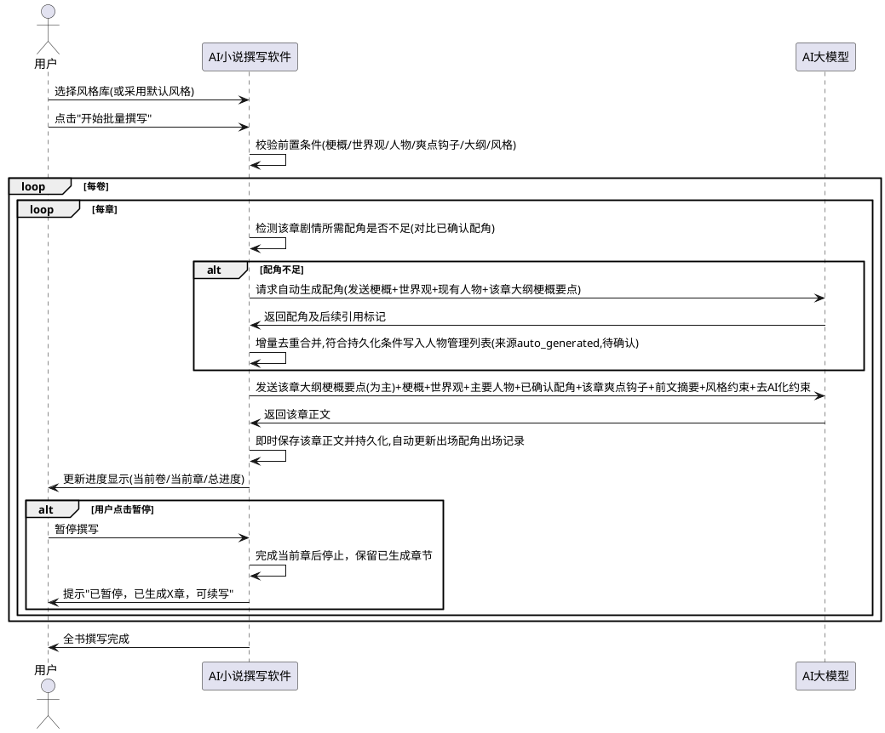

### **5.6.3 异常场景**
1. **AI接口调用失败**
   a. 触发条件：网络中断或AI服务不可用
   b. 系统行为：自动重试3次，仍失败则暂停撰写并保留已生成内容
   c. 用户感知：提示"AI服务连接失败，已暂停，可稍后继续"
2. **生成内容字数偏差过大**
   a. 触发条件：AI生成章节字数与设定字数偏差超过50%
   b. 系统行为：标记该章并提示用户确认或重新生成
   c. 用户感知：提示"第X章生成字数偏差过大，是否重新生成"
3. **撰写中途用户停止**
   a. 触发条件：用户点击停止按钮
   b. 系统行为：完成当前章节后停止，保存进度
   c. 用户感知：提示"已停止撰写，已生成X章，可继续"
4. **指定风格库不存在或损坏**
   a. 触发条件：用户指定的风格库文件被删除或损坏
   b. 系统行为：提示异常并询问是否改用默认风格继续
   c. 用户感知：提示"指定风格库不可用，是否使用默认风格继续"
5. **单章撰写生成失败**
   a. 触发条件：逐章撰写过程中某章AI请求返回错误或返回内容无法解析
   b. 系统行为：标记该章生成失败，自动重试3次，仍失败则暂停撰写并保留已生成章节，提示用户可重试该章或跳过该章
   c. 用户感知：提示"第X章撰写失败，可重试/跳过"
6. **逐章撰写暂停后续写失败**
   a. 触发条件：用户暂停后点击续写，但续写时AI接口不可用、大纲数据丢失或前文上下文缺失
   b. 系统行为：提示续写失败及原因，保留已生成章节不变，允许稍后重试续写
   c. 用户感知：提示"续写失败：[原因]，已生成章节已保留，可稍后重试"
7. **单章撰写超时**
   a. 触发条件：单章撰写AI请求超过单章超时阈值（如180秒）未返回
   b. 系统行为：中断该次请求并自动重试，重试仍超时则暂停撰写并提示
   c. 用户感知：提示"第X章撰写超时，已暂停，可重试"
8. **逐章撰写中途大纲被修改**
   a. 触发条件：逐章撰写过程中用户在大纲管理页面修改了未撰写章节的梗概要点
   b. 系统行为：后续章节撰写采用修改后的大纲梗概要点，已生成章节正文不变，提示用户可选择性重新生成受影响章节
   c. 用户感知：提示"大纲已修改，后续章节将采用新大纲撰写，已生成章节可选择性重新生成"

## **5.7 内容校验**

### **5.7.1 业务规则**
1. **全书校验规则**：全部撰写完成后，系统必须支持AI对全书章节内容进行一次性整体校验。
   a. 验收条件：[全书撰写完成，用户点击"AI校验全书"] → [系统调用AI逐项校验并输出报告]
2. **梗概一致性校验规则**：校验必须包含全书内容是否符合故事梗概的走向与结局。
   a. 验收条件：[全书内容结局与梗概结局不符] → [校验报告标记"结局与梗概不符"]
3. **世界观一致性校验规则**：校验必须包含全书内容是否符合世界观设定（时代、地理、力量体系等）。
   a. 验收条件：[某章出现世界观未设定的力量体系] → [校验报告标记"第X章存在与世界观不符的设定"]
4. **人物关系一致性校验规则**：校验必须包含全书人物关系是否前后一致，有无矛盾。
   a. 验收条件：[A与B前期为友人后期无交代变为敌对] → [校验报告标记"人物A与B关系转变缺乏交代"]
5. **钩子回收完整性校验规则**：校验必须包含所有埋设钩子是否已回收。
   a. 验收条件：[存在未回收钩子H3] → [校验报告标记"钩子H3未回收，埋设于第X章"]
6. **物品全书一致性校验规则**：校验必须包含主要物品在全书各章节中的名称、类型等关键属性是否一致，禁止同一物品在不同章节出现命名或属性不一致（除非情节明确交代其转移、消失或转化）。
   a. 验收条件：[同一法宝在第3章名为"玄铁剑"为武器类型，在第10章被描述为"寒铁剑"或丹药类型且无情节交代] → [校验报告标记"第10章物品命名/类型与第3章不一致"]
   b. 验收条件：[全书各章对物品"玄铁剑"的名称、类型、归属描述均一致] → [校验报告物品全书一致性项标记"通过"]
7. **AI化程度评估规则**：校验必须包含对全书内容的AI化程度评估，检测是否存在过度工整对仗、滥用成语排比、情感说教直白、句式单一重复、转折生硬套路化等AI化特征，并给出AI化程度评分与典型问题定位。
   a. 验收条件：[全书校验完成] → [校验报告包含AI化程度评估项，含整体评分与问题章节定位]
8. **风格一致性校验规则**：当用户指定了风格库时，校验必须包含全书内容是否符合指定风格库的风格特征。
   a. 验收条件：[用户指定"金庸武侠风"风格库，某章风格明显偏离] → [校验报告标记"第X章风格与指定风格库不符"]
9. **校验报告输出规则**：校验完成后必须输出结构化报告，包含校验项、结果、问题描述、所在章节。
   a. 验收条件：[校验完成] → [系统展示报告含通过项与问题项，问题项可定位到章节]
10. **禁止项**：禁止在校验过程中修改小说内容，校验为只读操作。
    a. 验收条件：[校验进行中用户尝试编辑内容] → [系统提示"校验进行中，暂不可编辑"]

### **5.7.2 交互流程**
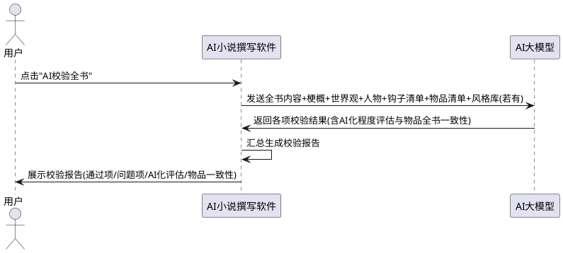

### **5.7.3 异常场景**
1. **校验超时**
   a. 触发条件：全书字数过大导致AI校验超过10分钟
   b. 系统行为：分批校验并合并结果
   c. 用户感知：提示"内容较多，正在分批校验，请稍候"
2. **AI校验失败**
   a. 触发条件：AI接口返回错误
   b. 系统行为：提示失败并允许重试
   c. 用户感知：提示"AI校验服务失败，请重试"

## **5.8 小说导出**

### **5.8.1 业务规则**
1. **导出格式规则**：导出文件必须为txt格式，文件名为"书名.txt"，编码为UTF-8。
   a. 验收条件：[用户导出书名为"星辰变"的小说] → [生成文件"星辰变.txt"，编码UTF-8]
2. **导出内容完整性规则**：导出文件必须包含全书所有卷、所有章节的完整正文，按卷章结构组织。
   a. 验收条件：[全书3卷30章导出] → [txt文件包含3卷30章全部内容且有卷章标题分隔]
3. **导出路径规则**：导出目标必须为用户明确指定的手机本地文件夹路径。
   a. 验收条件：[用户未选择导出路径即点击导出] → [系统提示"请选择导出目标文件夹"]
4. **导出确认规则**：若目标路径已存在同名文件，必须经用户确认是否覆盖。
   a. 验收条件：[目标文件夹已存在"星辰变.txt"] → [系统提示"文件已存在，是否覆盖"]
5. **禁止项**：禁止导出未完成撰写的小说（存在未生成章节）。
   a. 验收条件：[全书30章仅生成25章即点击导出] → [系统提示"尚有5章未生成，无法导出完整小说"]

### **5.8.2 交互流程**
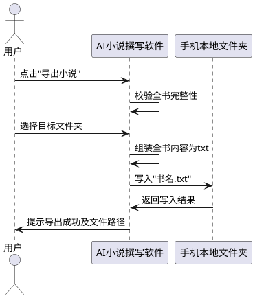

### **5.8.3 异常场景**
1. **目标路径不可写**
   a. 触发条件：用户选择的文件夹无写入权限
   b. 系统行为：提示错误并要求重新选择
   c. 用户感知：提示"目标文件夹无法写入，请选择其他位置"
2. **导出空间不足**
   a. 触发条件：目标磁盘剩余空间小于文件大小
   b. 系统行为：中止导出
   c. 用户感知：提示"存储空间不足，请清理后重试"

## **5.9 章节手动修改与AI再校验**

### **5.9.1 业务规则**
1. **修改时机规则**：全本小说撰写完成后，用户必须能够对任意已生成章节的正文进行手动修改编辑。
   a. 验收条件：[全书30章已撰写完成，用户打开第15章编辑正文并保存] → [系统接收修改内容并更新该章正文]
2. **修改触发再校验规则**：用户保存章节修改后，系统必须自动调用AI对该章修改后的内容与故事梗概、世界观、人物关系、钩子回收等基准进行一致性再校验。
   a. 验收条件：[用户修改第15章并保存] → [系统自动调用AI对该章修改内容进行一致性再校验并输出结果]
3. **再校验维度规则**：修改后AI再校验必须至少包含以下维度：与故事梗概走向的一致性、与世界观设定的一致性、与人物关系的一致性、该章涉及钩子的回收状态不受破坏。
   a. 验收条件：[用户修改第15章引入与世界观不符的力量体系] → [再校验报告标记"第15章修改内容与世界观不符"]
4. **符合时保留规则**：若修改后AI再校验全部通过，系统必须直接保留用户修改内容并提示校验通过，不触发AI自动润色。
   a. 验收条件：[用户修改第15章且再校验全部通过] → [系统保留修改内容并提示"修改内容符合整体设定，已保留"]
5. **不符合时触发润色规则**：若修改后AI再校验存在不通过项，系统必须自动调用AI基于一致性约束对修改内容进行自动润色，使润色结果既尽量保留用户修改意图又符合整体设定。
   a. 验收条件：[用户修改第15章引入人物关系矛盾且再校验不通过] → [系统自动调用AI对该章进行润色并返回润色后内容]
6. **润色结果展示规则**：AI自动润色完成后，系统必须以并排预览方式展示用户原始修改内容与润色后内容，左右两侧分别呈现修改前（用户原始修改）与润色后的章节正文，并标注润色调整的具体位置与原因，供用户对比审阅后决定是否采纳。
   a. 验收条件：[AI润色完成] → [系统以并排预览展示用户原始修改与润色后正文，高亮标注调整处及对应的不符合项原因]
7. **润色确认保留规则**：用户确认采纳AI润色结果后，系统必须将润色后内容正式覆盖该章正文并持久化保留。
   a. 验收条件：[用户点击"确认采纳润色结果"] → [系统以润色后内容覆盖该章正文并提示"已保留润色后内容"]
8. **润色拒绝保留规则**：用户拒绝AI润色结果后，系统必须保留用户原始修改内容（而非修改前内容），并提示已保留用户修改。
   a. 验收条件：[用户点击"拒绝润色，保留我的修改"] → [系统保留用户原始修改内容并提示"已保留您的修改内容"]
9. **多次修改规则**：用户可对同一章节进行多次手动修改，每次修改保存后均触发AI再校验与必要的润色流程，最新确认保留的内容覆盖前次。
   a. 验收条件：[用户对第15章先后修改两次并分别确认保留] → [该章最终保留第二次确认的内容]
10. **批量修改校验规则**：用户连续修改多个章节后，系统必须支持对所修改章节进行批量再校验。批量再校验的范围为全书涉及的修改的人物和物品变化，具体包括：（a）逐章校验各修改内容与故事梗概、世界观、人物关系、钩子回收等基准的一致性；（b）全书层面汇总分析本次批量修改引发的人物变化（如身份、关系、状态、出场/退场的增删与改变）与物品变化（如物品的新增、消失、属性改变、归属转移），并校验这些变化在全书范围内是否前后一致、是否与故事梗概和世界观冲突、是否破坏既有钩子回收；（c）物品全书一致性校验，即校验主要物品的名称、类型等关键属性在全书各章节中是否保持一致，禁止同一物品在不同章节出现命名或属性不一致（除非情节明确交代其转移、消失或转化）。系统必须统一输出各章校验结果与全书人物物品变化一致性结论。
    a. 验收条件：[用户依次修改第5、10、15章后点击"批量再校验"] → [系统统一输出三章的逐章再校验结果，并输出全书人物变化与物品变化的一致性结论报告]
    b. 验收条件：[用户修改第5章引入新人物"李四"且设定为剑客，但世界观未设定剑客体系] → [批量再校验全书人物物品变化结论标记"新人物李四的剑客身份与世界观不符"]
    c. 验收条件：[用户修改第10章令法宝"玄铁剑"消失，但第18章仍依赖该法宝推动情节] → [批量再校验全书物品变化结论标记"玄铁剑在第10章消失但第18章仍引用，物品变化不一致"]
    d. 验收条件：[用户修改第10章将法宝"玄铁剑"改称"寒铁剑"，但第3章与第18章仍称"玄铁剑"且无情节交代改名] → [批量再校验全书物品变化结论标记"玄铁剑在第10章被改称寒铁剑，与第3、18章命名不一致"]
11. **修改记录留存规则**：系统必须记录每次章节修改的时间、卷章号、修改前内容、修改后内容、再校验结果与润色确认状态、最终保留内容，便于追溯与回滚。每条修改记录必须独立持久化保存，不因后续修改而删除。
    a. 验收条件：[用户修改第15章并完成润色确认] → [系统留存一条修改记录含上述全部字段]
    b. 验收条件：[用户对第15章先后修改三次] → [系统留存三条独立修改记录，按时间顺序可查]
12. **历史版本回滚规则**：系统必须支持用户将某章节正文回滚到该章历史修改记录中的任意一条历史版本内容。回滚操作必须经用户确认后执行，执行后该章正文被替换为目标历史版本内容，同时本次回滚操作本身也作为一条新的修改记录留存（修改前内容为回滚前正文、修改后内容为目标历史版本内容、并标注为回滚类型）。
    a. 验收条件：[第15章存在3条历史修改记录，用户选择第1条记录点击"回滚到此版本"并确认] → [系统将第15章正文恢复为第1条记录的最终保留内容，并新增一条回滚类型修改记录]
    b. 验收条件：[用户点击"回滚到此版本"但未确认] → [系统弹出确认框提示回滚将覆盖当前正文，需用户明确确认后方可执行]
13. **回滚后再校验规则**：回滚操作完成后，系统必须自动对回滚后的章节内容触发AI再校验，校验其与当前全书人物物品状态、故事梗概、世界观、人物关系、钩子回收的一致性，并按5.9.1第4-5条规则决定是否触发润色。
    a. 验收条件：[用户回滚第15章至历史版本并确认] → [系统自动对该章回滚后内容进行AI再校验，若不通过则按规则触发润色并并排预览供用户确认]
14. **禁止项**：禁止在AI再校验或润色过程中允许用户同时编辑同一章节，避免内容冲突。
    a. 验收条件：[第15章正在AI润色中，用户尝试再次编辑该章] → [系统提示"该章正在AI处理中，请稍候"并阻止编辑]
15. **禁止项**：禁止AI自动润色在未经用户确认的情况下直接覆盖用户修改内容，润色结果必须经用户确认方可保留。
    a. 验收条件：[AI润色完成但用户尚未确认] → [系统不覆盖原章节内容，等待用户确认]
16. **禁止项**：禁止回滚到已被删除或损坏的历史记录，回滚目标必须为可正常读取的历史版本。
    a. 验收条件：[用户选择一条已损坏的历史记录点击回滚] → [系统提示"该历史版本不可用，无法回滚"]

### **5.9.2 交互流程**
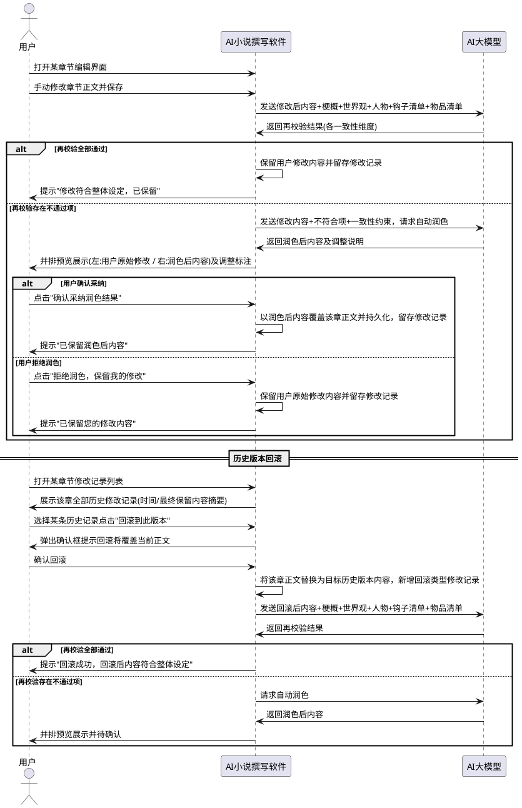

### **5.9.3 异常场景**
1. **AI再校验失败**
   a. 触发条件：用户保存修改后AI接口返回错误或结果无法解析
   b. 系统行为：提示失败并保留用户修改内容，允许手动触发重新校验
   c. 用户感知：提示"AI再校验失败，您的修改已保留，可点击重新校验"
2. **AI自动润色失败**
   a. 触发条件：再校验不通过后AI润色接口返回错误或结果无法解析
   b. 系统行为：提示失败并保留用户原始修改内容，允许手动触发重新润色或手动调整
   c. 用户感知：提示"AI润色失败，您的修改已保留，可重新润色或手动调整"
3. **润色结果字数偏差过大**
   a. 触发条件：AI润色后章节字数与原设定字数偏差超过50%
   b. 系统行为：标记偏差并提示用户确认是否采纳
   c. 用户感知：提示"润色后字数偏差较大，是否仍要采纳"
4. **用户修改内容为空**
   a. 触发条件：用户将章节正文清空后保存
   b. 系统行为：阻止保存并提示
   c. 用户感知：提示"章节正文不可为空，请输入内容后保存"
5. **并发修改冲突**
   a. 触发条件：用户在多窗口或多次操作中同时对同一章节提交不同修改
   b. 系统行为：以最新一次保存为准，提示前次修改已被覆盖
   c. 用户感知：提示"该章节已被 newer 修改覆盖，请确认当前内容"
6. **回滚目标历史版本不可用**
   a. 触发条件：用户选择的历史修改记录已被损坏或最终保留内容缺失
   b. 系统行为：阻止回滚并提示该历史版本不可用
   c. 用户感知：提示"该历史版本不可用，无法回滚，请选择其他版本"
7. **回滚后再校验失败**
   a. 触发条件：回滚完成后触发AI再校验时AI接口返回错误
   b. 系统行为：保留回滚后的正文内容，提示再校验失败并允许手动重新校验
   c. 用户感知：提示"回滚已完成，但AI再校验失败，可点击重新校验"
8. **历史记录读取失败**
   a. 触发条件：修改记录存储损坏或读取异常导致无法展示历史版本列表
   b. 系统行为：提示读取失败并尽可能展示可读取的记录
   c. 用户感知：提示"部分历史修改记录读取失败，仅展示可用记录"

## **5.10 项目管理与多项目切换**

### **5.10.1 业务规则**
1. **新建项目规则**：用户在创作参数页点击"创建新项目"时，系统必须创建一个新的空小说项目（生成唯一项目标识），并将新项目设为当前项目。
   a. 验收条件：[用户点击"创建新项目"] → [系统创建新项目并在项目下拉框中新增该项目，将其设为当前选中项目]
2. **新建项目清除控件规则**：新建项目时系统必须自动清除所有页面控件中上一个项目遗留的内容，确保新旧项目数据不混杂。清除范围至少包括以下页面控件：
   - 创作参数页：书名、卷数、章节数、字数、故事梗概、世界观输入框
   - 人物管理页：人物列表表格、姓名/身份/简介/关系输入框
   - 爽点钩子页：爽点列表、钩子列表
   - 风格库页：已选文件、风格库详情
   - 撰写进度页：进度条、章节列表、撰写日志
   - 章节编辑页：章节下拉框、编辑器内容、润色预览
   - 校验报告页：校验结果表格、AI化程度评估
   - 历史回滚页：章节下拉框、历史记录表格、内容预览
   - 备份管理页：备份记录列表
   a. 验收条件：[A项目已填写书名"星辰变"、梗概、人物3人，用户点击"创建新项目"创建B项目] → [创作参数页书名/梗概/世界观输入框为空，人物管理页人物列表为空，爽点钩子页列表为空，章节编辑页编辑器为空，所有页面控件均不显示A项目的任何内容]
   b. 验收条件：[新建项目B后在各页面输入B项目内容并持久化] → [B项目内容与A项目内容完全隔离，互不影响]
3. **项目切换入口规则**：系统必须在两处提供项目切换入口，且两处切换行为完全一致：（a）创作参数页的项目下拉框，展示本机全部已有小说项目列表，当前项目处于选中状态；（b）主窗口工具栏的项目切换入口（项目下拉框或快捷按钮），同样展示全部项目列表并支持切换。新建项目后两处入口均自动包含新项目并将其选中。
   a. 验收条件：[本机存在A、B两个项目，当前为A] → [创作参数页下拉框与主窗口工具栏切换入口均显示A、B两项且A选中]
   b. 验收条件：[在A项目下新建C项目] → [创作参数页下拉框与主窗口工具栏切换入口均显示A、B、C三项且C选中]
   c. 验收条件：[用户通过主窗口工具栏切换入口从A切换到B] → [切换行为与通过创作参数页下拉框切换完全一致，各页面加载B项目数据]
4. **项目切换加载规则**：用户通过创作参数页项目下拉框或主窗口工具栏切换入口选择另一已有项目时，系统必须自动加载所选项目的全部数据到各页面控件，包括但不限于创作参数、故事梗概、世界观、人物列表、爽点钩子列表、章节列表、撰写进度、校验报告、修改历史等。
   a. 验收条件：[A项目已写至第10章，用户从B项目切换到A项目] → [创作参数页显示A项目的书名/卷数/章节数/字数/梗概/世界观，人物管理页显示A项目人物列表，爽点钩子页显示A项目爽点钩子，撰写进度页显示A项目已写至第10章的进度，章节编辑页可选择A项目各章节]
5. **项目上下文更新规则**：切换项目时系统必须更新全局项目上下文（ProjectContext）的当前项目ID与项目信息，并通过信号通知所有页面刷新；所有页面必须通过项目上下文获取当前项目ID，禁止页面自行缓存项目ID导致切换后仍引用旧项目。
   a. 验收条件：[用户从A项目切换到B项目] → [全局项目上下文的当前项目ID变为B项目ID，所有页面接收到刷新信号并基于B项目ID重新加载数据]
   b. 验收条件：[某页面缓存了A项目ID未通过上下文获取，切换到B项目后该页面仍引用A项目ID] → [视为缺陷，系统须确保所有页面通过上下文获取当前项目ID]
6. **多项目数据隔离规则**：各项目的全部数据（创作参数、梗概、世界观、人物、爽点钩子、章节、修改记录、校验报告等）必须完全隔离存储，项目切换不得导致数据相互覆盖或混杂。
   a. 验收条件：[A项目人物3人、B项目人物5人，从A切换到B再切回A] → [A项目人物列表仍为3人，B项目人物列表仍为5人，两者独立无影响]
7. **切换前草稿处理规则**：项目切换前，系统必须检测当前项目各页面控件中是否存在未保存的草稿（已编辑但未提交到后端的内容）。如检测到未保存草稿，系统必须弹出提示框告知用户"当前项目有未保存的修改，请先保存后再切换项目"，并阻止切换操作，直到用户保存或放弃修改后方可切换；禁止静默丢弃用户输入。各页面已通过后端API持久化的数据方可在切回时完整恢复。
   a. 验收条件：[用户在A项目创作参数页修改了书名但未点击保存，直接切换到B项目] → [系统提示"当前项目有未保存的修改，请先保存后再切换项目"并阻止切换，用户保存后可切换]
   b. 验收条件：[用户在A项目各页面均无未保存修改，切换到B项目] → [系统直接执行切换，不弹出草稿提示]
8. **新建项目自动设为当前规则**：新建项目后系统必须自动将新项目设为当前项目（更新项目上下文并通知所有页面），并清除所有控件内容，用户无需手动切换到新项目。
   a. 验收条件：[用户在A项目下点击"创建新项目"创建B] → [系统自动将B设为当前项目，项目上下文更新为B，所有页面控件清空，用户可直接开始B项目的创作]
9. **禁止项**：禁止在批量撰写进行中切换项目，避免撰写状态混乱。
   a. 验收条件：[A项目正在批量撰写中，用户尝试切换到B项目] → [系统提示"撰写进行中，请暂停或完成后再切换项目"并阻止切换]
10. **禁止项**：禁止项目切换时静默丢弃当前项目已持久化的数据，已持久化数据必须完整保留在数据库中供切回时恢复。
    a. 验收条件：[A项目已写至第10章并持久化，切换到B再切回A] → [A项目的10章内容完整存在，无丢失]

### **5.10.2 交互流程**
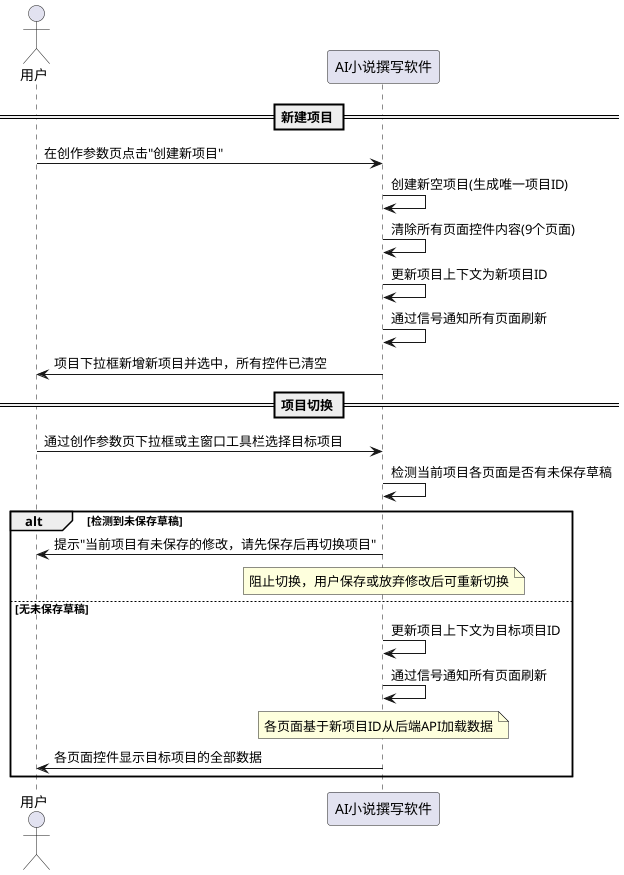

### **5.10.3 异常场景**
1. **新建项目数据库写入失败**
   a. 触发条件：本地数据库存储空间不足或无写入权限
   b. 系统行为：提示失败，保留当前项目状态不变，不清除控件内容
   c. 用户感知：提示"新建项目失败，请检查存储空间与权限"
2. **项目切换数据加载失败**
   a. 触发条件：目标项目数据在数据库中损坏或读取异常
   b. 系统行为：提示加载失败，保留切换前的项目状态不变
   c. 用户感知：提示"目标项目数据加载失败，已保持当前项目不变"
3. **切换时有未保存草稿**
   a. 触发条件：用户在当前项目各页面控件有未提交的编辑内容时尝试切换项目
   b. 系统行为：弹出提示框告知用户先保存，并阻止切换操作，直到用户保存或放弃修改
   c. 用户感知：提示"当前项目有未保存的修改，请先保存后再切换项目"
4. **撰写中切换被阻止**
   a. 触发条件：当前项目正在批量撰写时用户尝试切换项目
   b. 系统行为：阻止切换并提示
   c. 用户感知：提示"撰写进行中，请暂停或完成后再切换项目"

## **5.11 项目导出与导入**

### **5.11.1 业务规则**
1. **导出内容完整性规则**：项目导出必须将整个项目的全部关联数据打包为一个 `.aibk` 归档文件，包含但不限于：项目基本信息（书名、卷数、章节数、字数）、故事梗概、世界观设定、人物列表（含确认状态）、爽点与钩子列表（含回收状态）、物品清单、全部已生成章节（含正文内容、生成状态、修改状态）、章节修改历史记录、关联的风格库（可选）、校验报告记录、AI调用日志（可选）。
   a. 验收条件：[用户导出已写至第10章的A项目] → [生成的 .aibk 文件包含A项目的书名/梗概/世界观/人物/爽点钩子/物品/前10章正文/修改历史/校验报告等全部数据]
2. **导出文件格式规则**：导出文件必须为 `.aibk` 格式（zip 压缩包容器），文件名格式为"项目名_YYYYMMDD_HHMMSS.aibk"，内部包含 manifest.json（归档清单含版本号、SHA256校验和）与各 JSON 数据文件。
   a. 验收条件：[用户导出项目"星辰变"] → [生成文件名为"星辰变_YYYYMMDD_HHMMSS.aibk"的 zip 压缩包，内含 manifest.json 与各数据 JSON 文件]
3. **导出可选项规则**：导出时关联风格库默认包含（因项目依赖），用户可取消；AI调用日志默认不包含（体积大且敏感），用户可选包含。
   a. 验收条件：[用户导出时取消"包含风格库"选项] → [归档不含风格库数据，导入时若目标机无同名风格库则回退默认风格]
   b. 验收条件：[用户导出时勾选"包含AI调用日志"选项] → [归档含 ai_call_logs.json]
4. **导出原子性规则**：导出过程必须保证原子性，写入临时文件，全部数据写入完成且校验和计算无误后原子重命名为最终 `.aibk` 文件，中途失败不得产生半成品归档。
   a. 验收条件：[导出过程中磁盘空间不足导致写入失败] → [不生成 .aibk 文件，无半成品残留，提示导出失败]
5. **导入完整性校验规则**：导入 `.aibk` 归档时必须逐文件校验 SHA256 与 manifest 中记录的校验和一致，任一不一致则中止导入并提示归档损坏。
   a. 验收条件：[用户导入一个被篡改或损坏的 .aibk 文件] → [系统校验 SHA256 不一致，中止导入并提示"归档文件损坏，无法导入"]
6. **导入版本兼容规则**：导入时必须读取归档的格式版本号，若高于当前应用支持版本则拒绝导入并明确提示版本不兼容；若低于当前版本则按版本号执行迁移脚本正常导入。
   a. 验收条件：[用户导入一个由未来版本导出的 .aibk 文件] → [系统提示"该归档版本高于当前应用支持版本，请升级应用后导入"并拒绝]
   b. 验收条件：[用户导入一个由旧版本导出的 .aibk 文件] → [系统执行迁移脚本后正常导入]
7. **导入同名冲突处理规则**：导入时若本机已存在同名项目，系统必须提示冲突并要求用户选择"覆盖"（覆盖前二次确认）、"重命名"（自动追加 `_imported_N` 后缀）或"取消"之一，禁止静默覆盖。
   a. 验收条件：[本机已有项目"星辰变"，用户导入同名归档] → [系统提示"已存在同名项目，请选择覆盖/重命名/取消"]
8. **导入依赖顺序写入规则**：导入时必须按依赖顺序写入数据库（项目→梗概/世界观→人物→爽点/钩子→物品→章节→修改记录→风格库→校验报告），同一事务提交，避免外键断裂。
   a. 验收条件：[导入含10章正文与修改记录的项目] → [按依赖顺序写入，章节引用的人物/物品已先写入，修改记录引用的章节已先写入，无外键断裂]
9. **导入风格库冲突规则**：导入的风格库若本机已存在同名同特征则复用本机版本；若同名但特征不同则提示用户选择覆盖/重命名/取消。
   a. 验收条件：[导入归档含风格库"金庸武侠风"，本机已有同名同特征风格库] → [系统复用本机版本，不重复创建]
   b. 验收条件：[导入归档含风格库"金庸武侠风"，本机已有同名但特征不同的风格库] → [系统提示"风格库同名但特征不同，请选择覆盖/重命名/取消"]
10. **导入后可继续撰写规则**：导入完成后项目必须能正常打开、撰写、校验、导出，全部数据无损恢复，用户可继续创作。
    a. 验收条件：[用户在电脑A导出A项目，拷贝到电脑B导入] → [电脑B上A项目可正常打开，前10章内容完整，可继续撰写第11章、校验、导出]
11. **导出导入UI入口规则**：系统必须在UI上提供明确的"导出项目"和"导入项目"入口。导出入口可在创作参数页（针对当前项目）与备份管理页提供；导入入口可在备份管理页与主窗口菜单提供。
    a. 验收条件：[用户打开备份管理页] → [页面显示"导出项目"与"导入项目"按钮]
    b. 验收条件：[用户在创作参数页针对当前项目点击"导出项目"] → [系统弹出导出配置（目标路径、是否含风格库、是否含AI日志）并执行导出]
12. **禁止项**：禁止导出归档文件（`.aibk`）包含当前机器的AI模型源密钥与接口配置，避免密钥泄露。
    a. 验收条件：[导出 .aibk 文件并检查内容] → [文件不含 AI 源密钥、接口地址等配置]
13. **禁止项**：禁止导入非本系统导出的或不符合 `.aibk` 格式规范的文件，避免解析异常。
    a. 验收条件：[用户选择一个普通 txt 文件尝试导入项目] → [系统提示"该文件不是有效的项目归档文件，无法导入"]
14. **导入后AI源配置确认规则**：由于 `.aibk` 归档不含AI源配置，导入项目后用户须自行在新电脑上确认或重新配置AI源。新电脑的AI源配置可以与原电脑不同（如原电脑使用在线免费源，新电脑可改用本地 Ollama 源）。系统在导入成功后必须提示用户"请确认 AI 源配置可用后再开始撰写"。
    a. 验收条件：[用户在电脑A用在线源撰写并导出项目，在电脑B导入] → [电脑B导入成功后系统提示"请确认 AI 源配置可用后再开始撰写"，用户可在电脑B配置本地 Ollama 源后继续撰写]
    b. 验收条件：[导入成功后用户未配置任何可用AI源即尝试撰写] → [系统提示"未检测到可用AI源，请先配置AI源"并阻止撰写]

### **5.11.2 交互流程**
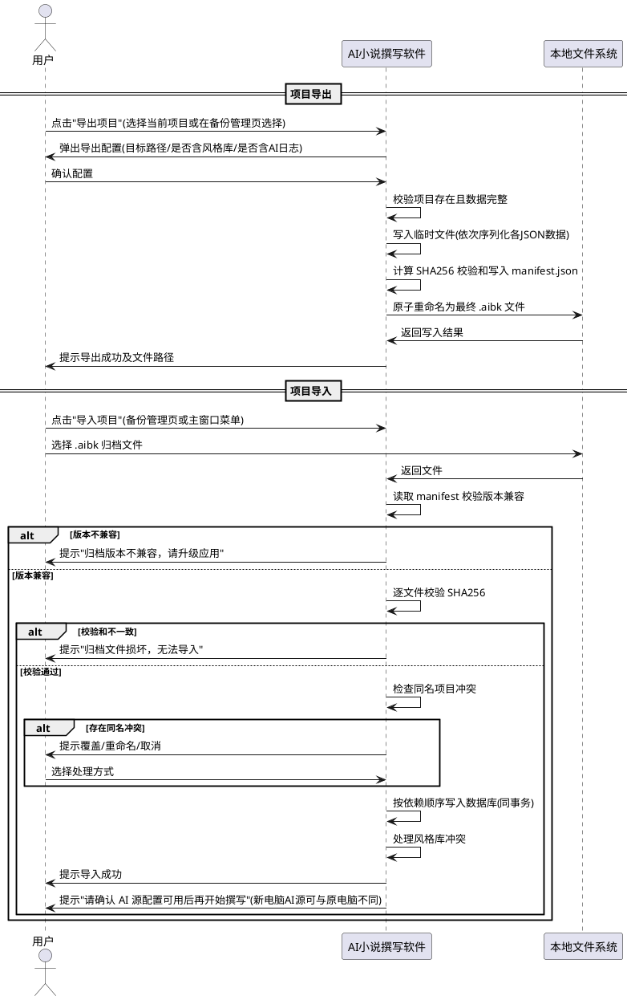

### **5.11.3 异常场景**
1. **导出目标路径不可写**
   a. 触发条件：用户选择的导出目标文件夹无写入权限
   b. 系统行为：提示错误并要求重新选择路径
   c. 用户感知：提示"目标文件夹无法写入，请选择其他位置"
2. **导出空间不足**
   a. 触发条件：目标磁盘剩余空间小于归档文件大小
   b. 系统行为：中止导出，不产生半成品文件
   c. 用户感知：提示"存储空间不足，请清理后重试"
3. **导入文件无效**
   a. 触发条件：用户选择的文件非本系统导出的 `.aibk` 归档或文件损坏无法解析
   b. 系统行为：拒绝导入并提示文件格式要求
   c. 用户感知：提示"该文件不是有效的项目归档文件，无法导入"
4. **导入版本不兼容**
   a. 触发条件：归档的格式版本号高于当前应用支持版本
   b. 系统行为：拒绝导入并提示升级应用
   c. 用户感知：提示"该归档版本高于当前应用支持版本，请升级应用后导入"
5. **导入校验和不一致**
   a. 触发条件：归档中某数据文件的 SHA256 与 manifest 记录不一致（文件被篡改或损坏）
   b. 系统行为：中止导入，不写入任何数据，提示归档损坏
   c. 用户感知：提示"归档文件损坏（校验失败），无法导入"
6. **导入同名项目冲突**
   a. 触发条件：本机已存在与归档同名的项目
   b. 系统行为：提示冲突并要求用户选择覆盖、重命名或取消
   c. 用户感知：提示"已存在同名项目，请选择覆盖/重命名/取消"
7. **导入风格库冲突**
   a. 触发条件：导入的风格库与本机已有风格库同名但特征不同
   b. 系统行为：提示冲突并要求用户选择覆盖、重命名或取消
   c. 用户感知：提示"风格库同名但特征不同，请选择覆盖/重命名/取消"
8. **导入过程中数据库写入失败**
   a. 触发条件：导入写入数据库时空间不足或事务失败
   b. 系统行为：回滚事务，不产生部分导入数据，提示失败
   c. 用户感知：提示"导入失败，数据库写入异常，已回滚"

## **5.12 小说工程管理器初始页面**

### **5.12.1 业务规则**
1. **初始落地页规则**：应用启动后必须首先展示小说工程管理器初始页面作为落地页，而非直接进入创作主流程或某一具体项目页面。用户在此页面选择项目或执行项目管理操作后，方可进入后续创作流程。
   a. 验收条件：[用户启动应用] → [系统首先展示工程管理器初始页面，显示本机全部已有项目列表，不自动进入任何具体项目的创作页面]
2. **项目列表展示规则**：工程管理器初始页面必须展示本机全部已有小说项目的列表，每个项目项须至少包含以下摘要信息：书名、创建时间、最近更新时间、撰写状态（空项目/参数已设定/撰写中/撰写完成/校验完成）、撰写进度（已生成章节数/总章节数）。项目列表按最近更新时间倒序排列，最近操作的项目排在最前。
   a. 验收条件：[本机存在A、B、C三个项目，A最近更新] → [工程管理器初始页面项目列表显示A、B、C三项，A排在最前，每项显示书名、创建时间、最近更新时间、撰写状态与进度]
   b. 验收条件：[本机无任何项目] → [工程管理器初始页面显示空列表与"创建新项目"引导提示]
3. **项目新建入口规则**：工程管理器初始页面必须提供"创建新项目"入口，点击后触发新建项目流程（遵循5.10.1新建项目规则），新建完成后自动将新项目设为当前项目并进入创作主流程。
   a. 验收条件：[用户在工程管理器初始页面点击"创建新项目"] → [系统创建新空项目，将其设为当前项目，并进入创作主流程的创作参数页]
4. **项目切换入口规则**：工程管理器初始页面必须提供项目切换入口，用户在项目列表中选择某一项目后点击"打开"或双击该项目，系统将所选项目设为当前项目并加载其全部数据进入创作主流程。此入口与创作参数页下拉框、主窗口工具栏切换入口行为一致（遵循5.10.1项目切换规则）。
   a. 验收条件：[用户在工程管理器初始页面选择项目B并点击"打开"] → [系统将B设为当前项目，加载B项目全部数据，进入创作主流程]
   b. 验收条件：[用户在工程管理器初始页面双击项目C] → [系统将C设为当前项目并进入创作主流程，效果与点击"打开"一致]
5. **项目备份入口规则**：工程管理器初始页面必须提供"备份"入口，用户选择某一项目后点击"备份"，系统对该项目执行备份操作生成本地备份副本。备份操作须经用户确认目标位置与备份策略后方可执行。
   a. 验收条件：[用户在工程管理器初始页面选择项目A并点击"备份"] → [系统弹出备份配置（目标位置、备份策略），用户确认后执行备份并提示成功及备份文件位置]
6. **项目迁移导出入口规则**：工程管理器初始页面必须提供"迁移/导出"入口，用户选择某一项目后点击"迁移"或"导出"，系统将该项目打包为 `.aibk` 归档文件（遵循5.11.1导出规则），用于跨电脑迁移或归档保存。
   a. 验收条件：[用户在工程管理器初始页面选择项目A并点击"迁移"] → [系统弹出导出配置（目标路径、是否含风格库、是否含AI日志），用户确认后执行导出生成 .aibk 文件并提示成功及文件路径]
7. **项目导入入口规则**：工程管理器初始页面必须提供"导入项目"入口，用户点击后选择本地 `.aibk` 归档文件，系统执行导入流程（遵循5.11.1导入规则），导入成功后新项目出现在项目列表中。
   a. 验收条件：[用户在工程管理器初始页面点击"导入项目"并选择 .aibk 文件] → [系统执行导入流程，导入成功后项目列表新增导入的项目并提示成功]
8. **项目删除入口规则**：工程管理器初始页面必须提供"删除"入口，用户选择某一项目后点击"删除"，系统弹出二次确认框提示删除将永久移除该项目的全部数据（含创作参数、梗概、世界观、人物、爽点钩子、章节、修改记录、校验报告等），经用户明确确认后方可执行删除。删除完成后该项目从项目列表移除。
   a. 验收条件：[用户在工程管理器初始页面选择项目A并点击"删除"] → [系统弹出确认框"确定要删除项目A吗？此操作将永久删除该项目的全部数据且不可恢复"，用户确认后删除A项目并从列表移除]
   b. 验收条件：[用户点击"删除"但在确认框点击"取消"] → [系统不执行删除，项目A仍保留在列表中]
9. **统一入口聚合规则**：工程管理器初始页面必须作为项目新建、切换、备份、迁移导出、导入、删除的统一入口聚合页，上述所有操作均可从此页面一键触发。创作参数页与主窗口工具栏的项目切换入口保留作为创作过程中的快捷切换方式，但工程管理器初始页面是应用启动后的首选与完整入口。
   a. 验收条件：[用户在工程管理器初始页面可看到"创建新项目""打开""备份""迁移""导出""导入项目""删除"全部操作入口] → [所有项目管理操作均可从工程管理器初始页面一键触发，无需跳转到其他页面]
10. **返回工程管理器规则**：用户在创作主流程中必须能够返回工程管理器初始页面，返回入口可在主窗口工具栏或菜单提供。返回前须检测当前项目是否有未保存草稿（遵循5.10.1草稿处理规则），有未保存草稿则提示先保存。
    a. 验收条件：[用户在创作主流程中点击"返回工程管理器"] → [系统检测当前项目是否有未保存草稿，无则返回工程管理器初始页面并刷新项目列表，有则提示先保存]
11. **项目列表刷新规则**：每次进入工程管理器初始页面（应用启动、从创作主流程返回、导入/删除/新建项目后）时，系统必须刷新项目列表以确保展示最新的项目状态与摘要信息。
    a. 验收条件：[用户在创作主流程中对项目A撰写至第15章后返回工程管理器初始页面] → [项目列表中A项目的撰写进度更新为"15/30章"，最近更新时间更新为最新]
12. **禁止项**：禁止在工程管理器初始页面直接执行创作操作（如编辑章节、撰写、校验等），该页面仅用于项目管理，创作操作须进入具体项目的创作主流程后执行。
    a. 验收条件：[用户在工程管理器初始页面尝试编辑某项目章节内容] → [系统提示"请先打开项目进入创作主流程后再执行编辑操作"或该页面不提供编辑入口]
13. **禁止项**：禁止删除正在批量撰写中的项目，避免撰写状态混乱与数据损坏。
    a. 验收条件：[项目A正在批量撰写中，用户在工程管理器初始页面尝试删除A项目] → [系统提示"该项目正在撰写中，请暂停或完成撰写后再删除"并阻止删除]
14. **禁止项**：禁止在工程管理器初始页面删除项目时静默执行，必须经用户二次明确确认后方可删除，避免误删。
    a. 验收条件：[用户点击"删除"项目A] → [系统必须弹出二次确认框，用户未确认时不执行删除]

### **5.12.2 交互流程**
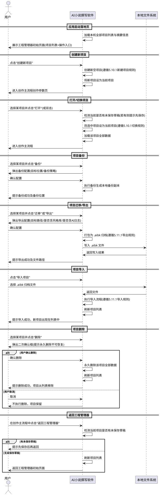

### **5.12.3 异常场景**
1. **项目列表加载失败**
   a. 触发条件：本地数据库读取异常导致无法加载项目列表
   b. 系统行为：提示加载失败，显示空列表与重试按钮
   c. 用户感知：提示"项目列表加载失败，请重试"
2. **项目打开时数据加载失败**
   a. 触发条件：选中项目的数据在数据库中损坏或读取异常
   b. 系统行为：提示加载失败，不进入创作主流程，保留工程管理器页面状态
   c. 用户感知：提示"项目数据加载失败，无法打开，请检查项目数据完整性"
3. **项目备份失败**
   a. 触发条件：备份目标位置不可写或磁盘空间不足
   b. 系统行为：中止备份，提示失败原因
   c. 用户感知：提示"备份失败，请检查目标位置与存储空间"
4. **项目迁移导出失败**
   a. 触发条件：导出目标路径不可写、磁盘空间不足或打包过程失败
   b. 系统行为：中止导出，不产生半成品文件（遵循5.11.1导出原子性规则）
   c. 用户感知：提示"导出失败，请检查目标路径与存储空间"
5. **项目导入失败**
   a. 触发条件：.aibk 文件无效、损坏、版本不兼容或导入过程数据库写入失败
   b. 系统行为：遵循5.11.1导入异常处理规则，中止导入并提示具体原因
   c. 用户感知：提示对应的导入失败原因（文件无效/损坏/版本不兼容/写入失败）
6. **项目删除失败**
   a. 触发条件：项目数据删除时数据库写入异常或权限不足
   b. 系统行为：中止删除，保留项目数据，提示失败
   c. 用户感知：提示"删除失败，请检查数据库权限"
7. **删除正在撰写中的项目**
   a. 触发条件：用户尝试删除正在批量撰写中的项目
   b. 系统行为：阻止删除并提示
   c. 用户感知：提示"该项目正在撰写中，请暂停或完成撰写后再删除"
8. **打开项目时有未保存草稿**
   a. 触发条件：当前已在某项目中且有未保存修改时尝试打开另一项目
   b. 系统行为：提示先保存当前项目修改
   c. 用户感知：提示"当前项目有未保存的修改，请先保存后再切换项目"

## **5.13 AI源配置管理**

### **5.13.1 业务规则**

1. **AI源列表展示规则**：AI源配置页面必须展示本机全部已配置AI模型源的列表，每行包含源名称、类型、API地址、模型名称、优先级、权重、启用状态、健康状态等信息，按优先级升序排列。
   a. 验收条件：[用户进入AI源配置页面] → [页面展示全部已配置AI源列表，含名称/类型/地址/模型/优先级/权重/启用状态/健康状态，按优先级升序排列]

2. **AI源添加规则**：用户必须能够通过"添加AI源"入口新增AI模型源，填写源名称、类型、API地址、模型名称、API Key、优先级、权重、启用状态等字段后提交保存，保存成功后即时刷新列表。
   a. 验收条件：[用户点击"添加AI源"并填写合法参数后提交] → [新AI源出现在列表中，列表即时刷新]

3. **AI源编辑入口规则**：用户在已添加AI源列表中选中某一行后，必须能够通过"编辑"按钮或双击该行打开编辑窗口；未选中任何行时"编辑"按钮应禁用。
   a. 验收条件：[用户选中某AI源行后点击"编辑"按钮] → [弹出编辑窗口展示该AI源全部可编辑字段]
   b. 验收条件：[用户双击某AI源列表行] → [弹出编辑窗口展示该AI源全部可编辑字段]
   c. 验收条件：[未选中任何AI源行时] → ["编辑"按钮处于禁用状态，点击无响应]

4. **AI源编辑窗口字段展示规则**：编辑窗口必须展示当前选中AI源的全部可编辑字段，包括名称、类型（在线OpenAI兼容/本地Ollama）、API地址、模型名称、API Key、优先级、权重、启用状态；其中API Key必须以密文显示，且保留原值时不强制重新输入（留空表示不修改Key），其余字段须回显当前值供用户修改。
   a. 验收条件：[用户打开某AI源编辑窗口] → [窗口展示名称/类型/API地址/模型名称/优先级/权重/启用状态当前值，API Key以密文占位显示]
   b. 验收条件：[用户在编辑窗口中不修改API Key（留空）并保存] → [系统保留原API Key不变，不因留空而清空]
   c. 验收条件：[用户在编辑窗口中输入新API Key并保存] → [系统以新API Key替换原值并加密存储]

5. **AI源编辑保存规则**：用户在编辑窗口点击"保存"按钮后，系统必须将修改后的配置持久化保存，保存成功后即时刷新AI源列表反映修改后的配置，并关闭编辑窗口。系统必须提供支持部分字段更新的AI源更新能力，至少支持名称、类型、API地址、模型名称、API Key、优先级、权重、启用状态的更新，更新后须即时生效（影响后续AI网关路由）。
   a. 验收条件：[用户修改某AI源名称后点击"保存"] → [保存成功，列表中该源名称更新为新值，编辑窗口关闭]
   b. 验收条件：[用户修改某AI源优先级/权重/启用状态后保存] → [保存成功后后续AI网关路由按新配置执行]
   c. 验收条件：[用户仅修改部分字段（如仅改名称）保存] → [未修改字段保留原值，不丢失]

6. **编辑保存后自动连接测试规则**：保存AI源修改后，系统必须自动对该AI源发起一次连接测试，并在编辑窗口或状态栏明确显示测试结果（成功/失败及原因），确保修改后的配置即时生效且可用。
   a. 验收条件：[用户编辑并保存某AI源] → [系统自动发起连接测试并在界面显示成功或失败及原因]
   b. 验收条件：[编辑保存后连接测试失败（如API地址错误）] → [界面明确提示失败原因，但保存的修改仍保留，用户可再次编辑修正]

7. **AI源编辑取消规则**：编辑窗口必须提供"取消"按钮，点击后放弃当前修改并关闭窗口，不触发保存与连接测试。
   a. 验收条件：[用户在编辑窗口修改字段后点击"取消"] → [修改被放弃，AI源配置不变，编辑窗口关闭，不触发保存与连接测试]

8. **AI源编辑校验规则**：编辑窗口保存前必须执行基本校验，校验规则与新增AI源一致，至少包含：名称非空、API地址非空、模型名称非空；在线OpenAI兼容类型须校验API Key（留空表示保留原值时豁免，新输入时须非空）；优先级与权重须为正整数。校验不通过时阻止保存并提示具体原因。
   a. 验收条件：[用户在编辑窗口清空名称后点击"保存"] → [阻止保存，提示"名称不能为空"]
   b. 验收条件：[用户在编辑窗口清空API地址后点击"保存"] → [阻止保存，提示"API地址不能为空"]
   c. 验收条件：[用户在编辑窗口清空模型名称后点击"保存"] → [阻止保存，提示"模型名称不能为空"]
   d. 验收条件：[用户将优先级设为0或负数后点击"保存"] → [阻止保存，提示"优先级须为正整数"]

9. **AI源删除规则**：用户选中某一AI源后必须能够通过"删除"入口移除该AI源，删除前须经二次确认，确认后从列表中移除并持久化删除；删除正在被路由策略手动指定的AI源时须提示用户先调整路由策略。
   a. 验收条件：[用户选中某AI源点击"删除"] → [弹出二次确认框，确认后该源从列表移除并持久化删除]
   b. 验收条件：[用户删除被路由策略手动指定的AI源] → [提示"该AI源正被路由策略手动指定，请先调整路由策略后再删除"]

10. **AI源连接测试规则**：用户选中某一AI源后必须能够通过"测试连接"入口手动发起连通性探测，系统须在界面明确反馈测试结果（成功/失败及原因与耗时）。
    a. 验收条件：[用户选中可用AI源点击"测试连接"] → [界面提示"连接成功"及响应耗时]
    b. 验收条件：[用户选中不可用AI源（如API地址错误）点击"测试连接"] → [界面提示"连接失败"及具体原因]

11. **路由策略配置规则**：用户必须能够查看与切换AI网关路由策略（手动指定/按优先级故障切换/加权负载均衡/成本优先），切换后全局即时生效；撰写进行中切换策略时须提示用户确认以避免风格/质量波动。
    a. 验收条件：[用户在非撰写状态下切换路由策略] → [策略即时全局生效，后续AI调用按新策略路由]
    b. 验收条件：[用户在撰写进行中切换路由策略] → [弹出确认提示，用户确认后生效，取消则不切换]

12. **AI源配置全局共享规则**：AI源配置为全局共享，不随项目切换而变化、不随项目清除而清空，所有项目共用同一套AI源配置。
    a. 验收条件：[用户切换项目] → [AI源配置页面内容不变，不随项目切换刷新或清除]

13. **编辑功能与现有功能并存规则**：编辑功能必须与现有的添加、删除、测试连接功能并存且互不干扰，各功能入口独立、操作互不冲突。
    a. 验收条件：[用户在AI源配置页面分别执行添加/编辑/删除/测试连接操作] → [各操作独立完成，互不干扰，列表始终反映最新状态]

14. **禁止项**：禁止在编辑窗口中明文回显API Key原值；禁止因编辑时API Key留空而清空已有密钥；禁止编辑保存后不刷新列表导致界面与实际配置不一致。
    a. 验收条件：[用户打开编辑窗口] → [API Key字段不以明文显示原值，仅密文占位]
    b. 验收条件：[用户编辑时API Key留空并保存] → [原API Key保留不变]
    c. 验收条件：[用户编辑保存成功] → [列表即时刷新，展示修改后的配置]

15. **本地Ollama模型动态发现规则**：当用户在添加或编辑AI源时将类型选择为"本地Ollama"，系统必须自动向用户所填写的Ollama服务地址发起模型列表查询，获取该Ollama服务上实际已安装（已拉取）的全部模型，并将模型列表展示给用户供其选择，禁止硬编码预设固定的模型名称。
    a. 验收条件：[用户将AI源类型选为"本地Ollama"且本机Ollama服务已启动并已拉取模型qwen2.5:7b与llama3:8b] → [系统自动获取并展示包含"qwen2.5:7b"与"llama3:8b"的模型列表供用户选择，而非硬编码显示固定模型名]
    b. 验收条件：[用户将AI源类型选为"本地Ollama"但本机Ollama服务未拉取任何模型] → [系统提示"Ollama服务上未安装任何模型，请先拉取模型后再选择"]
    c. 验收条件：[电脑A安装了Ollama模型qwen2.5:7b，电脑B安装了Ollama模型llama3:8b，分别在两台电脑上选择"本地Ollama"类型] → [电脑A展示的模型列表含"qwen2.5:7b"不含"llama3:8b"，电脑B展示的模型列表含"llama3:8b"不含"qwen2.5:7b"，均与该电脑实际安装情况一致]

16. **本地Ollama模型选择规则**：用户必须从系统动态获取的实际可用模型列表中选择要使用的模型名称，禁止要求用户手动输入可能不存在的模型名称；模型列表获取成功后模型名称字段应呈现为可选择的下拉列表而非纯文本输入框。
    a. 验收条件：[系统成功获取Ollama模型列表后] → [模型名称字段变为下拉列表，选项为实际获取的模型名称，用户从中选择而非手动输入]
    b. 验收条件：[用户从下拉列表选择模型"llama3:8b"并保存] → [该AI源的模型名称保存为"llama3:8b"，后续AI调用使用该模型]

17. **Ollama服务不可达提示规则**：当系统尝试获取Ollama模型列表但Ollama服务未启动或网络不可达时，系统必须向用户给出明确的错误提示，说明无法连接Ollama服务并引导用户确认Ollama已启动，禁止静默失败或仅显示空列表而无任何提示。
    a. 验收条件：[用户将AI源类型选为"本地Ollama"但Ollama服务未启动] → [系统提示"无法连接Ollama服务，请确认Ollama已启动"或同等明确的引导提示，不静默失败]
    b. 验收条件：[用户填写的Ollama服务地址错误或不可达] → [系统提示连接失败及具体原因，引导用户检查Ollama服务地址与启动状态]

18. **预设Ollama模板规则**：预设模型下拉框中的"本地Ollama"项不得硬编码具体模型名称，而是作为一个"本地Ollama"类型模板；用户选中该预设项后，系统自动将AI源类型设为"本地Ollama"并立即尝试获取该电脑Ollama服务的模型列表，由用户从实际可用模型中选择。
    a. 验收条件：[用户在预设模型下拉框选择"本地Ollama"预设项] → [系统将类型设为"本地Ollama"并自动尝试获取本机Ollama已安装模型列表，不硬编码填入固定模型名称]
    b. 验收条件：[查看预设模型下拉框中的"本地Ollama"项] → [该项不绑定固定的模型名称（如不绑定"qwen2.5:7b"），仅作为类型模板触发动态模型发现流程]

19. **Ollama模型列表刷新规则**：用户在AI源添加或编辑窗口中可手动触发重新获取Ollama模型列表（如用户在Ollama服务启动后或新拉取模型后刷新列表），刷新后列表反映Ollama服务当前实际已安装的全部模型。
    a. 验收条件：[用户首次获取模型列表时Ollama未启动导致列表为空，启动Ollama后点击"刷新模型列表"] → [系统重新获取并展示当前已安装的模型列表]
    b. 验收条件：[用户在Ollama中新拉取模型"mistral:7b"后点击"刷新模型列表"] → [刷新后的列表包含"mistral:7b"]

20. **Ollama模型列表获取能力规则**：系统必须提供获取指定Ollama服务已安装模型列表的能力，支持用户自定义Ollama服务地址（不限于默认本地地址），并根据指定地址返回该Ollama服务上实际可用的模型列表；Ollama服务不可达时返回空列表与明确的错误信息。
    a. 验收条件：[系统向指定Ollama服务地址请求模型列表且服务正常] → [返回该服务实际已安装的全部模型名称列表]
    b. 验收条件：[系统向指定Ollama服务地址请求模型列表但服务不可达] → [返回空列表与错误信息"无法连接Ollama服务"]

21. **禁止项**：禁止在AI源配置中硬编码任何具体的Ollama模型名称作为预设默认值，本地Ollama类型的模型名称必须来自该电脑Ollama服务实际已安装模型的动态获取结果。
    a. 验收条件：[用户选择"本地Ollama"类型] → [系统不预填任何固定模型名称（如不预填"qwen2.5:7b"），而是通过动态获取展示实际可用模型供用户选择]

### **5.13.2 交互流程**

编辑AI源的主干交互流程：

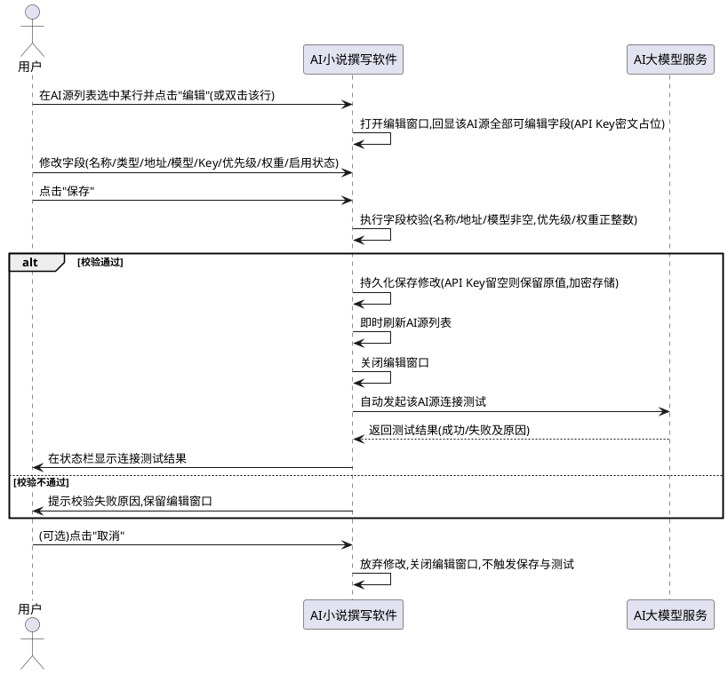

本地Ollama模型动态发现的主干交互流程：

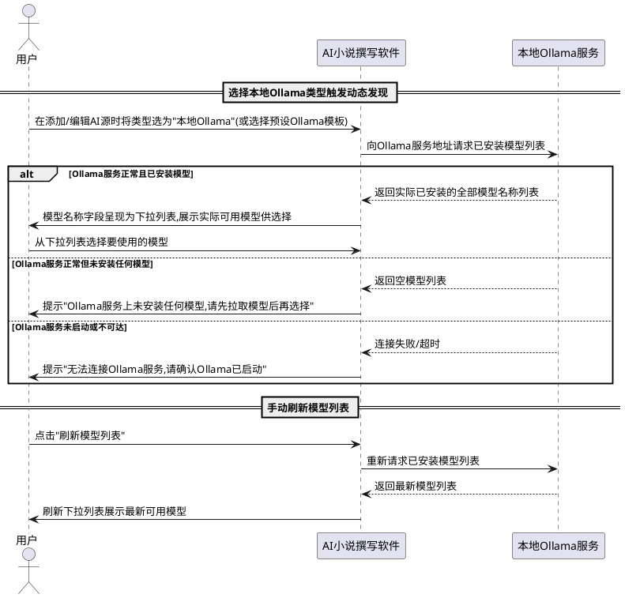

### **5.13.3 异常场景**

1. **编辑保存时校验失败**
   a. 触发条件：用户在编辑窗口提交了不合法的字段（名称为空、API地址为空、模型名称为空、优先级或权重非正整数等）
   b. 系统行为：阻止保存，保留编辑窗口与用户已输入内容，提示具体校验失败原因
   c. 用户感知：提示"名称不能为空""API地址不能为空""模型名称不能为空""优先级须为正整数"等对应原因

2. **编辑保存时后端持久化失败**
   a. 触发条件：后端更新接口因数据库异常或权限不足等原因保存失败
   b. 系统行为：提示保存失败及原因，保留编辑窗口与用户已输入内容，不关闭窗口、不刷新列表
   c. 用户感知：提示"保存失败，请检查后端服务或数据库状态"

3. **编辑保存后自动连接测试失败**
   a. 触发条件：保存成功但该AI源当前不可用（API地址错误、鉴权失败、模型不存在、网络不通等）
   b. 系统行为：保存的修改保留生效，在界面明确提示连接测试失败及具体原因，不回滚已保存的配置
   c. 用户感知：提示"保存成功，但连接测试失败：[具体原因]"，用户可再次编辑修正或忽略

4. **编辑保存后自动连接测试超时**
   a. 触发条件：连接测试在规定时间内未返回结果
   b. 系统行为：提示连接测试超时，保存的修改保留生效
   c. 用户感知：提示"保存成功，但连接测试超时，请检查网络或AI服务可用性"

5. **删除被路由策略手动指定的AI源**
   a. 触发条件：用户尝试删除当前被路由策略设置为手动指定的AI源
   b. 系统行为：阻止删除并提示先调整路由策略
   c. 用户感知：提示"该AI源正被路由策略手动指定，请先调整路由策略后再删除"

6. **撰写中切换路由策略**
   a. 触发条件：批量撰写进行中用户尝试切换路由策略
   b. 系统行为：弹出确认提示，用户确认后切换生效，取消则保持原策略
   c. 用户感知：提示"撰写进行中切换路由策略可能导致风格/质量波动，是否确认切换？"

7. **编辑窗口打开时该AI源已被其他操作删除**
   a. 触发条件：用户打开编辑窗口后，该AI源在别处被删除（如另一窗口或后端直接操作）
   b. 系统行为：保存时提示该AI源已不存在，关闭编辑窗口并刷新列表
   c. 用户感知：提示"该AI源已不存在，可能已被删除，请刷新列表"

8. **API Key编辑后鉴权失败**
   a. 触发条件：用户在编辑窗口输入了新的API Key，保存后自动连接测试返回鉴权失败
   b. 系统行为：保存的新API Key保留，提示连接测试鉴权失败及原因
   c. 用户感知：提示"保存成功，但连接测试失败：鉴权失败（API Key无效）"，用户可重新编辑输入正确Key

9. **Ollama服务未启动或不可达**
   a. 触发条件：用户将AI源类型选为"本地Ollama"后系统尝试获取模型列表，但Ollama服务未启动、服务地址错误或网络不可达
   b. 系统行为：不展示空模型列表而无提示，而是向用户给出明确的错误提示并引导确认Ollama已启动，模型名称字段不预填任何固定模型名称
   c. 用户感知：提示"无法连接Ollama服务，请确认Ollama已启动"或同等明确的引导提示，用户可启动Ollama后点击"刷新模型列表"重试

10. **Ollama服务已启动但未安装任何模型**
   a. 触发条件：Ollama服务正常运行但未拉取任何模型，系统获取模型列表返回空
   b. 系统行为：提示用户Ollama服务上未安装任何模型并引导先拉取模型，模型名称字段不提供可选项
   c. 用户感知：提示"Ollama服务上未安装任何模型，请先拉取模型后再选择"

11. **Ollama模型列表获取超时**
   a. 触发条件：系统向Ollama服务请求模型列表在规定时间内未返回结果
   b. 系统行为：提示获取超时，不阻塞用户其他操作，允许用户重试刷新
   c. 用户感知：提示"获取Ollama模型列表超时，请检查Ollama服务状态后重试"

12. **Ollama模型列表返回格式异常**
   a. 触发条件：Ollama服务返回的模型列表数据格式不符合预期（如字段缺失、非预期结构）
   b. 系统行为：提示模型列表解析失败，不展示异常数据，允许用户重试
   c. 用户感知：提示"Ollama模型列表获取失败，请检查Ollama服务版本后重试"

13. **用户自定义Ollama服务地址无效**
   a. 触发条件：用户填写的Ollama服务地址格式错误或指向不存在的服务
   b. 系统行为：提示地址无效或连接失败，不获取模型列表
   c. 用户感知：提示"Ollama服务地址无效或不可达，请检查地址后重试"

14. **Ollama模型列表获取后用户所选模型被卸载**
   a. 触发条件：用户从模型列表选择某模型并保存AI源后，该模型在Ollama服务中被卸载删除，后续AI调用时模型不存在
   b. 系统行为：AI调用失败时提示模型不存在并引导用户刷新模型列表重新选择，已保存的AI源配置保留
   c. 用户感知：提示"模型[XX]不存在，可能已被卸载，请刷新模型列表后重新选择"

## **5.14 状态栏运行时信息展示**

### **5.14.1 业务规则**
1. **运行时信息展示位置规则**：当AI源设置完成后，系统必须在主窗口状态栏右下角区域持续显示三项运行时信息：当前真正使用的AI源、程序运行时长、当前系统日期时间（含星期几）。三项信息在状态栏右下角区域常驻显示，实时更新。
   a. 验收条件：[用户完成AI源配置并运行程序] → [状态栏右下角区域显示当前AI源、运行时长、当前日期时间三项信息]
   b. 验收条件：[用户尚未配置任何AI源] → [状态栏右下角当前AI源显示"未配置"或"无可用源"，运行时长与日期时间仍正常显示]

2. **当前AI源显示规则**：状态栏必须显示当前路由策略下实际选中的AI源名称，显示格式为"当前AI源：[源名称]"。具体显示规则如下：
   - **手动指定策略**：显示被手动指定的AI源名称（如"当前AI源：硅基流动-Qwen2.5-7B"）
   - **故障转移策略**：显示当前优先级最高的可用（健康或降级状态）AI源名称；若所有源均熔断或不可用，显示"当前AI源：无可用源"
   - **加权负载均衡策略**：显示"负载均衡(N源)"，其中N为当前参与负载均衡的已启用且可用的AI源数量（如"当前AI源：负载均衡(3源)"）
   - **成本优先策略**：显示当前按成本优先策略选中的AI源名称
   a. 验收条件：[路由策略为手动指定源"硅基流动-Qwen2.5-7B"] → [状态栏显示"当前AI源：硅基流动-Qwen2.5-7B"]
   b. 验收条件：[路由策略为故障转移，优先级最高的可用源为"阿里通义-Qwen-Max"] → [状态栏显示"当前AI源：阿里通义-Qwen-Max"]
   c. 验收条件：[路由策略为加权负载均衡，当前有3个已启用且可用的AI源] → [状态栏显示"当前AI源：负载均衡(3源)"]
   d. 验收条件：[所有AI源均熔断或不可用] → [状态栏显示"当前AI源：无可用源"]

3. **程序运行时长显示规则**：状态栏必须显示从程序主窗口启动开始计时的运行时长，格式为"运行时长：HH:MM:SS"（如"运行时长：02:35:18"），每秒刷新一次。运行时长从00:00:00开始累计，不超过24小时后继续累计（如25小时显示"25:03:42"）。
   a. 验收条件：[程序启动后运行35分18秒] → [状态栏显示"运行时长：00:35:18"]
   b. 验收条件：[程序启动后运行2小时35分18秒] → [状态栏显示"运行时长：02:35:18"]
   c. 验收条件：[程序持续运行观察状态栏运行时长显示] → [每秒递增1秒，显示持续更新无跳秒或停滞]

4. **当前日期时间显示规则**：状态栏必须显示当前系统日期和时间，含星期几，格式为"YYYY-MM-DD 周X HH:MM:SS"（如"2026-09-21 周一 13:45:30"），每秒刷新一次。星期几取值为一至日（周一、周二、周三、周四、周五、周六、周日）。
   a. 验收条件：[当前系统时间为2026年9月21日星期一13时45分30秒] → [状态栏显示"2026-09-21 周一 13:45:30"]
   b. 验收条件：[当前系统时间为2026年9月27日星期日9时05分00秒] → [状态栏显示"2026-09-27 周日 09:05:00"]
   c. 验收条件：[程序持续运行观察状态栏日期时间显示] → [每秒递增1秒，显示与系统时间保持一致]

5. **AI源信息实时更新规则**：当发生以下事件时，状态栏当前AI源显示必须即时更新反映最新状态，不得延迟或需手动刷新：
   - 路由策略切换
   - AI源启用/禁用状态变更
   - AI源新增或删除
   - 故障转移发生（某源熔断后切换到下一可用源）
   - AI源健康状态变化（降级、熔断、恢复）
   a. 验收条件：[用户将路由策略从手动指定源A切换为负载均衡] → [状态栏当前AI源显示即时更新为"负载均衡(N源)"格式]
   b. 验收条件：[故障转移策略下优先级最高的源A熔断，源B变为最高可用源] → [状态栏当前AI源显示即时从源A更新为源B]
   c. 验收条件：[用户禁用某AI源导致负载均衡可用源数从3变为2] → [状态栏当前AI源显示即时从"负载均衡(3源)"更新为"负载均衡(2源)"]

6. **定时刷新独立于业务规则**：运行时长与当前日期时间的每秒刷新必须由独立定时器驱动，不依赖任何业务操作或AI调用事件触发；即使无任何用户操作与AI调用，状态栏运行时长与日期时间仍持续每秒刷新。
   a. 验收条件：[程序启动后用户无任何操作静置5分钟] → [状态栏运行时长持续从00:00:00递增至00:05:00，日期时间持续与系统时间同步]

7. **临时提示与常驻信息共存规则**：状态栏运行时信息为常驻显示，当系统需要显示临时提示消息（如"工程已保存""连接成功"等）时，临时提示消息显示在状态栏其他区域（如左下角或中间区域），不得遮挡或覆盖右下角运行时信息；临时提示消息显示一定时间后自动消失，恢复状态栏常规状态，运行时信息始终可见。
   a. 验收条件：[用户执行保存工程操作成功] → [状态栏左下角或中间区域显示"工程已保存"临时提示，右下角运行时信息持续可见不被遮挡]
   b. 验收条件：[临时提示"工程已保存"显示3秒后自动消失] → [状态栏恢复常规状态，右下角运行时信息始终可见]

8. **禁止项**：禁止状态栏运行时信息遮挡或覆盖其他重要状态提示消息，两者须分区显示互不干扰；禁止运行时信息刷新导致主线程卡顿或界面无响应；禁止运行时长计时因异常中断而停止，计时器须具备自动恢复能力。
   a. 验收条件：[状态栏同时显示运行时信息与临时提示] → [两者分区显示互不遮挡]
   b. 验收条件：[运行时信息每秒刷新] → [界面保持可响应，无卡顿或冻结]

### **5.14.2 交互流程**
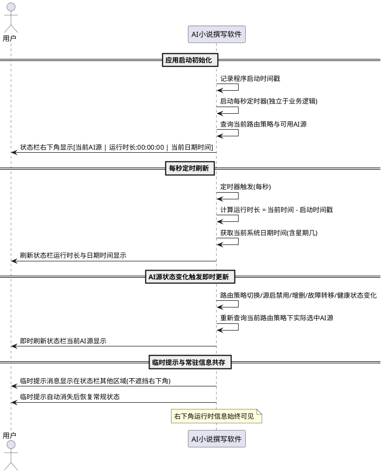

### **5.14.3 异常场景**
1. **查询当前AI源失败**
   a. 触发条件：系统查询当前路由策略下可用AI源时后端服务异常或数据库读取失败
   b. 系统行为：状态栏当前AI源显示"当前AI源：查询失败"，运行时长与日期时间正常显示不受影响，定时器继续运行后续重试
   c. 用户感知：状态栏当前AI源显示"查询失败"，其余运行时信息正常

2. **无可用AI源**
   a. 触发条件：所有已配置AI源均被禁用、熔断或不可用，或用户尚未配置任何AI源
   b. 系统行为：状态栏当前AI源显示"当前AI源：无可用源"或"当前AI源：未配置"，运行时长与日期时间正常显示
   c. 用户感知：状态栏当前AI源显示"无可用源"或"未配置"，提示用户需配置或启用AI源

3. **系统时间异常跳变**
   a. 触发条件：系统时间被用户手动修改或因同步发生跳变（如向前或向后大幅调整）
   b. 系统行为：当前日期时间显示跟随系统时间更新；运行时长基于启动时间戳重新计算，若系统时间回拨导致运行时长为负则显示00:00:00并重新计时
   c. 用户感知：状态栏日期时间跟随系统时间变化，运行时长在异常后重新正常累计

4. **定时器异常中断**
   a. 触发条件：状态栏刷新定时器因异常停止运行
   b. 系统行为：系统须具备定时器自动恢复机制，检测到定时器停止后自动重启，恢复后运行时长基于启动时间戳重新计算（不丢失已运行时长）
   c. 用户感知：状态栏运行时信息在短暂停顿后恢复刷新，运行时长连续不丢失

## **5.15 工程保存**

### **5.15.1 业务规则**
1. **保存工程入口规则**：系统必须在两处提供"保存工程"入口，且两处入口行为完全一致：
   - （a）文件菜单栏增加"保存工程"菜单项，作为全局保存功能
   - （b）创作参数页面下方按钮栏增加"保存工程"按钮，方便用户在创作参数页直接保存
   a. 验收条件：[用户打开文件菜单栏] → [菜单中显示"保存工程"菜单项，位于"新建项目"与"导出小说"之间或相邻位置]
   b. 验收条件：[用户打开创作参数页] → [页面下方按钮栏显示"保存工程"按钮，与"创建新项目"按钮同处按钮栏]
   c. 验收条件：[用户分别通过文件菜单与创作参数页按钮执行保存] → [两处入口保存行为与结果完全一致]

2. **保存工程数据范围规则**：保存工程必须保存当前项目的所有已设定数据，包括但不限于：创作参数（书名、卷数、每卷章节数、每章字数）、故事梗概、世界观设定、人物列表（含确认状态）、爽点与钩子列表（含回收状态）、物品清单、全部已生成章节内容、章节修改历史记录、校验报告记录等全部关联数据。
   a. 验收条件：[用户设定了书名、梗概、世界观、人物3人、爽点钩子后点击"保存工程"] → [系统将上述全部已设定数据持久化保存到本地数据库]
   b. 验收条件：[用户已撰写至第10章并修改过第5章后点击"保存工程"] → [系统保存创作参数、梗概、世界观、人物、爽点钩子、前10章正文、第5章修改记录等全部数据]

3. **新建项目保存规则**：如果当前项目尚未创建（项目上下文无项目ID，即用户在新建项目后尚未通过任何持久化操作创建项目记录），保存工程时系统必须先创建新项目（生成唯一项目ID并写入项目基本信息），再将当前所有已设定数据保存到该新项目下。
   a. 验收条件：[用户新建项目后设定了书名与梗概但项目尚未创建（无项目ID），点击"保存工程"] → [系统先创建新项目生成项目ID，再将书名与梗概等数据保存到该项目下，保存成功后状态栏提示"工程已保存"]
   b. 验收条件：[新建项目保存成功后查看项目下拉框] → [新项目出现在下拉框中并处于选中状态]

4. **已有项目保存规则**：如果当前项目已存在（项目上下文已有项目ID），保存工程时系统必须更新该项目的所有数据，覆盖原有数据为当前最新内容。
   a. 验收条件：[用户在已有项目A中修改了书名并新增人物后点击"保存工程"] → [系统更新项目A的书名与人物列表为当前最新内容，保存成功后状态栏提示"工程已保存"]
   b. 验收条件：[已有项目保存成功后重新加载该项目] → [加载的数据为保存时的最新内容，无丢失或回退]

5. **保存成功反馈规则**：保存成功后系统必须在状态栏提示"工程已保存"，提示为临时消息，显示一定时间后自动消失。
   a. 验收条件：[保存工程操作成功完成] → [状态栏显示"工程已保存"提示消息]
   b. 验收条件：["工程已保存"提示消息显示约3秒后] → [提示消息自动消失，状态栏恢复常规状态]

6. **保存失败反馈规则**：保存失败时系统必须提示错误原因，提示方式为状态栏显示错误信息并以弹窗形式展示具体错误原因，便于用户明确知晓失败原因并采取相应措施。
   a. 验收条件：[保存工程时数据库写入失败] → [状态栏显示"保存失败"并弹窗提示具体错误原因（如"数据库写入异常，请检查存储空间与权限"）]
   b. 验收条件：[保存工程时磁盘空间不足] → [状态栏显示"保存失败"并弹窗提示"存储空间不足，请清理后重试"]

7. **保存前置校验规则**：保存工程前系统必须校验当前项目数据的基本完整性与合法性，校验规则至少包含：书名非空（若已填写）、卷数章节数字数为有效正整数（若已填写）、梗概与世界观不少于50字（若已填写）。校验不通过时阻止保存并提示具体原因，保留用户已输入内容不变。
   a. 验收条件：[用户填写书名但卷数为0，点击"保存工程"] → [系统提示"卷数须为有效正整数"并阻止保存，已输入内容保留不变]
   b. 验收条件：[用户填写梗概仅30字，点击"保存工程"] → [系统提示"故事梗概不少于50字"并阻止保存]

8. **无当前项目保存规则**：当无当前项目（项目上下文为空）且用户未填写任何创作参数时，点击"保存工程"应提示用户先设定创作参数或先创建新项目，禁止创建空项目。
   a. 验收条件：[项目上下文为空且所有创作参数均为空，用户点击"保存工程"] → [系统提示"请先设定创作参数或创建新项目后再保存"]
   b. 验收条件：[项目上下文为空但用户已填写书名"星辰变"，点击"保存工程"] → [系统创建新项目并保存书名等已填写数据，保存成功]

9. **保存与撰写状态规则**：批量撰写进行中点击"保存工程"时，系统应允许保存当前已生成的数据，不阻止保存操作；保存操作不得中断或影响正在进行的撰写流程。
   a. 验收条件：[项目正在批量撰写至第10章，用户点击"保存工程"] → [系统保存当前已生成的数据（含前10章），保存成功后提示"工程已保存"，撰写流程继续不中断]
   b. 验收条件：[保存操作执行期间] → [撰写流程持续进行，保存与撰写互不阻塞]

10. **保存后项目上下文更新规则**：保存工程成功后，若为新建项目保存，系统必须更新项目上下文为新创建的项目ID并通知所有页面；若为已有项目保存，项目上下文保持不变。
    a. 验收条件：[新建项目保存成功] → [项目上下文更新为新项目ID，项目下拉框新增该项目并选中，各页面基于新项目ID关联数据]
    b. 验收条件：[已有项目保存成功] → [项目上下文项目ID不变，各页面状态保持不变]

11. **禁止项**：禁止保存工程时静默丢弃任何已设定的数据，保存必须完整持久化当前项目的全部已设定关联数据；禁止保存操作产生部分写入的脏数据，保存失败时须回滚至保存前状态；禁止保存工程操作覆盖或清除其他项目的数据（数据隔离）。
    a. 验收条件：[用户设定了书名、梗概、世界观、人物5人后保存] → [全部数据完整保存，无任何数据被静默丢弃]
    b. 验收条件：[保存过程中数据库写入失败] → [回滚至保存前状态，不产生部分写入的脏数据]
    c. 验收条件：[保存项目A的数据] → [项目B的数据不受影响，保持不变]

### **5.15.2 交互流程**
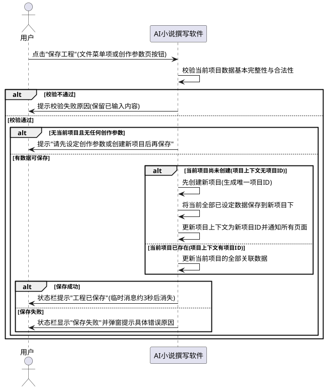

### **5.15.3 异常场景**
1. **保存时数据校验失败**
   a. 触发条件：用户填写的创作参数不合法（如卷数为0、梗概不足50字等）
   b. 系统行为：阻止保存，保留用户已输入内容不变，提示具体校验失败原因
   c. 用户感知：提示"卷数须为有效正整数""故事梗概不少于50字"等对应原因

2. **保存时数据库写入失败**
   a. 触发条件：后端数据库存储空间不足、无写入权限或数据库异常
   b. 系统行为：回滚至保存前状态，不产生部分写入脏数据，提示保存失败及原因
   c. 用户感知：状态栏显示"保存失败"，弹窗提示"数据库写入异常，请检查存储空间与权限"

3. **无当前项目且无创作参数**
   a. 触发条件：项目上下文为空且用户未填写任何创作参数即点击"保存工程"
   b. 系统行为：阻止保存并提示用户先设定参数或创建项目
   c. 用户感知：提示"请先设定创作参数或创建新项目后再保存"

4. **保存时磁盘空间不足**
   a. 触发条件：本地磁盘剩余空间不足以写入项目数据
   b. 系统行为：中止保存，回滚至保存前状态，提示空间不足
   c. 用户感知：状态栏显示"保存失败"，弹窗提示"存储空间不足，请清理后重试"

5. **新建项目保存时项目创建失败**
   a. 触发条件：新建项目保存时项目创建接口调用失败（如数据库异常、书名重复冲突等）
   b. 系统行为：提示项目创建失败及原因，不保存任何数据，保留用户已输入内容
   c. 用户感知：提示"项目创建失败：[具体原因]，工程未保存，请修正后重试"

6. **保存时后端服务不可达**
   a. 触发条件：保存工程时后端API服务未启动或网络不通
   b. 系统行为：提示后端服务不可达，保留用户已输入内容
   c. 用户感知：状态栏显示"保存失败"，弹窗提示"无法连接后端服务，请确认服务已启动后重试"

## **5.16 全工程定时自动保存**

### **5.16.1 业务规则**
1. **定时自动保存规则**：程序运行期间，系统必须按用户配置的保存间隔（默认5分钟）周期性自动保存当前工程的所有数据（创作参数、梗概、世界观、人物、爽点钩子、风格库、已写章节、校验结果等），无需用户手动点击保存。定时保存由独立定时器驱动，不依赖用户操作触发。
   a. 验收条件：[用户配置自动保存间隔为5分钟并启用，程序运行期间不执行任何手动保存] → [系统每隔5分钟自动保存一次当前工程全部数据，保存后在状态栏左下角短暂提示"已自动保存 HH:MM:SS"]
   b. 验收条件：[用户配置自动保存间隔为2分钟] → [系统每隔2分钟自动保存一次]
   c. 验收条件：[程序运行期间用户无任何操作静置10分钟，自动保存间隔为5分钟] → [系统在第5分钟与第10分钟各自动保存一次，不因无操作而跳过]
2. **关键节点自动保存规则**：在以下关键操作完成后系统必须自动触发保存，确保关键步骤成果立即持久化，不依赖定时保存或用户手动保存：
   - 创作参数设定完成
   - 梗概/世界观保存完成
   - 人物提取/生成完成
   - 爽点钩子设定完成
   - 每章撰写完成
   - 校验完成
   - 润色确认完成
   a. 验收条件：[用户完成创作参数设定] → [系统自动触发保存，将创作参数持久化，状态栏短暂提示"已自动保存 HH:MM:SS"]
   b. 验收条件：[用户点击"AI提取人物"完成] → [系统自动触发保存，将合并后的人物列表持久化]
   c. 验收条件：[用户完成第5章润色确认] → [系统自动触发保存，将润色后章节内容与修改记录持久化]
3. **撰写中实时保存规则**：一键撰写全本小说时，每完成一章必须立即将该章内容持久化到数据库，避免撰写中途死机或异常导致已写章节丢失。校验时同理，每完成一项校验立即保存校验结果。实时保存不得中断或阻塞撰写/校验主流程。
   a. 验收条件：[用户启动一键撰写全本30章，撰写至第10章时突然死机] → [重启后前10章内容完整保留在数据库中，可从第11章断点续写]
   b. 验收条件：[用户启动全书校验，校验至第3项时程序异常退出] → [重启后前3项校验结果完整保留，可继续后续校验]
   c. 验收条件：[撰写过程中每章完成时] → [该章内容立即持久化，撰写流程不中断]
4. **自动保存提示规则**：自动保存时系统必须在状态栏左下角短暂提示"自动保存中..."，保存完成后提示"已自动保存 HH:MM:SS"（含保存完成时间），提示为临时消息显示一定时间后自动消失，不弹窗打扰用户。提示不得遮挡状态栏右下角的运行时信息。
   a. 验收条件：[定时自动保存触发] → [状态栏左下角显示"自动保存中..."，保存完成后显示"已自动保存 14:23:05"约3秒后自动消失]
   b. 验收条件：[关键节点自动保存触发] → [状态栏左下角短暂提示"已自动保存 HH:MM:SS"，不弹窗]
   c. 验收条件：[自动保存提示显示期间] → [状态栏右下角运行时信息持续可见不被遮挡]
5. **自动保存可配置规则**：定时自动保存间隔可在设置中配置，默认5分钟，可设为1-30分钟之间的任意整数值；用户也可关闭定时自动保存（关闭后仅保留关键节点自动保存与撰写中实时保存）。配置变更后立即生效，无需重启程序。配置须持久化存储，重启后保持上次配置。
   a. 验收条件：[用户在设置中将自动保存间隔从5分钟改为10分钟] → [变更立即生效，后续定时保存按10分钟间隔执行]
   b. 验收条件：[用户在设置中关闭定时自动保存] → [系统停止定时自动保存，但关键节点自动保存与撰写中实时保存仍正常执行]
   c. 验收条件：[用户在设置中将自动保存间隔设为0或35分钟] → [系统提示"保存间隔须为1-30分钟"并阻止设置]
   d. 验收条件：[用户配置自动保存间隔为3分钟后关闭并重启程序] → [重启后自动保存间隔仍为3分钟]
6. **自动保存数据范围规则**：自动保存必须保存当前项目的全部已设定关联数据，数据范围与手动保存工程（5.15.1规则2）一致，包括创作参数、梗概、世界观、人物列表（含确认状态）、爽点钩子、物品、章节、修改记录、校验报告等。禁止部分保存或静默丢弃。
   a. 验收条件：[当前项目已设定书名、梗概、世界观、人物5人、爽点钩子、已写10章，定时自动保存触发] → [系统将上述全部数据完整持久化]
7. **自动保存与业务并行规则**：定时自动保存与关键节点自动保存不得中断或阻塞正在进行的AI长任务（如批量撰写、全书校验、AI润色）。自动保存与业务流程并行执行互不干扰。撰写中实时保存作为撰写流程的内嵌步骤执行，不构成额外阻塞。
   a. 验收条件：[项目正在批量撰写至第10章，定时自动保存触发] → [自动保存与撰写并行执行，撰写流程不中断不暂停，保存完成后提示"已自动保存"]
   b. 验收条件：[项目正在全书校验，关键节点（每章校验完成）自动保存触发] → [校验流程不中断，校验结果实时保存]
8. **自动保存失败处理规则**：自动保存失败时不得产生部分写入的脏数据，须回滚至保存前状态，在状态栏左下角短暂提示"自动保存失败"及原因，不弹窗打扰用户（连续失败多次后可弹窗告警）。自动保存失败不影响正在进行的业务流程。
   a. 验收条件：[定时自动保存时数据库写入失败] → [回滚至保存前状态，状态栏左下角提示"自动保存失败：数据库写入异常"，撰写流程继续不中断]
   b. 验收条件：[自动保存连续失败3次] → [系统弹窗告警"自动保存多次失败，请检查存储空间与数据库状态"，用户可确认后继续]
9. **无当前项目时不自动保存规则**：当无当前项目（项目上下文为空）时，定时自动保存不执行，避免保存空数据。
   a. 验收条件：[项目上下文为空，定时自动保存间隔到达] → [系统跳过本次自动保存，不执行保存操作]
10. **禁止项**：禁止自动保存过程中强制中断正在进行的AI长任务，自动保存须与AI长任务并行执行互不阻塞。
    a. 验收条件：[批量撰写进行中触发定时自动保存] → [撰写不中断，自动保存并行执行]
11. **禁止项**：禁止自动保存弹窗打扰用户，自动保存提示须以状态栏左下角临时消息形式显示，不弹窗（连续失败告警除外）。
    a. 验收条件：[定时自动保存成功] → [仅状态栏左下角短暂提示，不弹窗]
12. **禁止项**：禁止关闭定时自动保存后连关键节点自动保存与撰写中实时保存也一并关闭，关键节点自动保存与撰写中实时保存为强制启用不可关闭。
    a. 验收条件：[用户在设置中关闭定时自动保存，用户完成创作参数设定] → [关键节点自动保存仍触发，创作参数持久化]
    b. 验收条件：[用户在设置中关闭定时自动保存，用户启动一键撰写] → [撰写中实时保存仍执行，每章完成立即持久化]

### **5.16.2 交互流程**
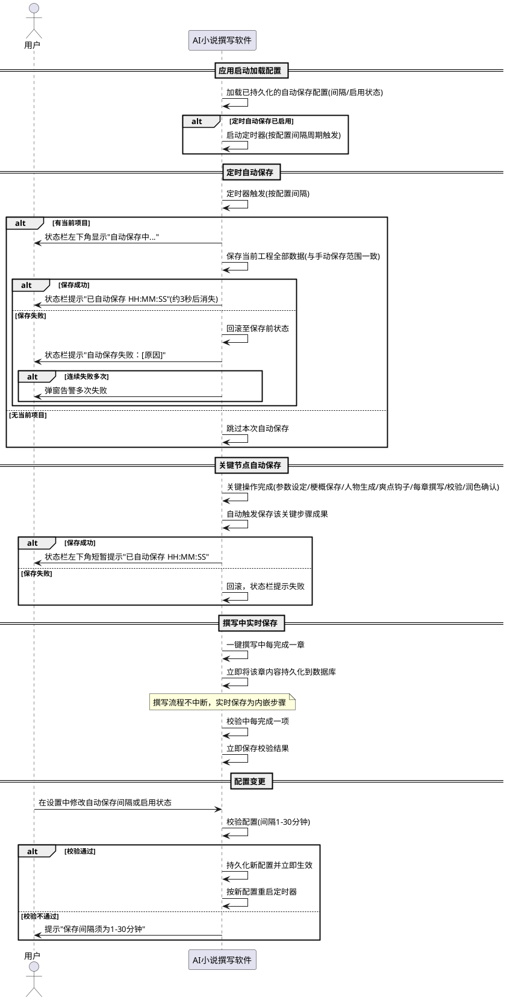

### **5.16.3 异常场景**
1. **定时自动保存时数据库写入失败**
   a. 触发条件：定时自动保存触发时数据库存储空间不足、无写入权限或数据库异常
   b. 系统行为：回滚至保存前状态，不产生部分写入脏数据，状态栏左下角提示"自动保存失败：[原因]"，不影响正在进行的业务流程
   c. 用户感知：状态栏左下角短暂提示"自动保存失败：数据库写入异常"，业务流程继续不中断
2. **自动保存连续失败**
   a. 触发条件：自动保存连续失败达到告警阈值（如3次）
   b. 系统行为：弹窗告警用户自动保存多次失败，引导检查存储空间与数据库状态，用户确认后可继续操作
   c. 用户感知：弹窗提示"自动保存多次失败，请检查存储空间与数据库状态"，确认后继续
3. **自动保存时后端服务不可达**
   a. 触发条件：自动保存触发时后端API服务未启动或网络不通
   b. 系统行为：状态栏提示自动保存失败，不影响业务流程，等待下次定时触发重试
   c. 用户感知：状态栏左下角提示"自动保存失败：无法连接后端服务"
4. **配置自动保存间隔非法**
   a. 触发条件：用户在设置中将自动保存间隔设为0、负数或超过30分钟的值
   b. 系统行为：阻止设置，提示合法范围
   c. 用户感知：提示"保存间隔须为1-30分钟之间的整数"
5. **撰写中实时保存失败**
   a. 触发条件：一键撰写中某章完成后实时保存该章内容时数据库写入失败
   b. 系统行为：标记该章保存失败，暂停撰写并提示用户，避免后续章节基于未持久化内容继续生成导致数据不一致
   c. 用户感知：提示"第X章保存失败，撰写已暂停，请检查存储空间后重试"
6. **定时器异常中断**
   a. 触发条件：定时自动保存定时器因异常停止运行
   b. 系统行为：系统须具备定时器自动恢复机制，检测到定时器停止后自动重启，恢复后按配置间隔继续定时保存
   c. 用户感知：自动保存在短暂停顿后恢复，用户可从状态栏提示确认自动保存恢复正常

## **5.17 大纲管理**

> **页面位置说明**：大纲管理页面在创作主流程中位于"人物管理"（5.3）与"爽点与钩子设计"（5.4）之间，作为承接梗概/世界观/人物、指导爽点钩子分布与逐章撰写的规划环节。创作流程顺序为：创作参数设定 → 文件导入 → 人物管理 → **大纲管理** → 爽点与钩子设计 → 知识库投喂与风格库管理 → 全文批量撰写。

### **5.17.1 业务规则**
1. **页面位置规则**：大纲管理页面必须作为创作主流程的独立环节，位于人物管理页面之后、爽点与钩子设计页面之前，用户完成人物确认后进入大纲管理进行全书章节结构规划，完成大纲后再进入爽点钩子设计。
   a. 验收条件：[用户在人物管理页确认人物后点击下一步] → [进入大纲管理页面]
   b. 验收条件：[用户在大纲管理页完成大纲后点击下一步] → [进入爽点与钩子设计页面]
2. **大纲生成输入依据规则**：AI生成大纲时必须将故事梗概、世界观、正式人物清单（已确认状态人物）与创作参数（卷数、每卷章节数、每章字数）四项组合作为输入传入AI，缺一不可。
   a. 验收条件：[用户点击"AI生成大纲"且已存在梗概、世界观、已确认人物清单与创作参数] → [系统将四项组合传入AI请求生成大纲]
   b. 验收条件：[用户点击"AI生成大纲"但创作参数未设定] → [系统提示"请先设定创作参数"并阻止生成]
   c. 验收条件：[用户点击"AI生成大纲"但无已确认人物] → [系统提示"请先确认人物清单"并阻止生成]
3. **AI生成大纲内容规则**：AI生成大纲必须规划输出全书每一卷的卷名、每一卷下每一章的章节名与每一章的故事梗概要点，三者缺一不可。
   a. 验收条件：[用户设定3卷每卷10章并点击"AI生成大纲"] → [系统返回3个卷名、每卷下10个章节名、共30条章节梗概要点]
   b. 验收条件：[AI生成结果缺少某卷的卷名] → [系统标记该卷大纲不完整并提示用户补充或重新生成]
4. **大纲结构与创作参数一致规则**：AI生成或用户编辑的大纲结构必须与创作参数严格一致——大纲的卷数等于创作参数的卷数，每卷下的章节数等于创作参数的每卷章节数，禁止大纲结构与创作参数不匹配。
   a. 验收条件：[创作参数设定3卷每卷10章，AI生成大纲含3卷每卷10章] → [大纲结构校验通过]
   b. 验收条件：[创作参数设定3卷每卷10章，AI生成大纲含4卷或某卷含11章] → [系统提示"大纲结构与创作参数不匹配"并阻止保存]
5. **章节梗概要点字数规则**：每章故事梗概要点的字数应在100-300字之间，足以概括该章主要情节但不冗长。
   a. 验收条件：[AI生成某章梗概要点为200字] → [该章梗概要点字数合规]
   b. 验收条件：[AI生成某章梗概要点为50字或500字] → [系统提示"第X卷第Y章梗概要点字数偏离建议范围（100-300字）"供用户判断是否调整]
6. **大纲编辑规则**：用户必须可手动编辑大纲中的卷名、章节名与每章梗概要点三项内容，编辑后可保存覆盖原值。
   a. 验收条件：[用户将第一卷卷名从"第一卷：风起云涌"改为"第一卷：乱世初现"并保存] → [大纲中第一卷卷名更新为"第一卷：乱世初现"]
   b. 验收条件：[用户编辑某章梗概要点并保存] → [该章梗概要点更新为编辑后内容]
7. **大纲保存规则**：用户编辑或AI生成大纲后必须可保存到数据库持久化，保存后后续撰写与爽点钩子设计时作为约束参考读取。
   a. 验收条件：[用户编辑大纲后点击"保存大纲"] → [大纲持久化保存到数据库，提示保存成功]
   b. 验收条件：[用户未保存大纲直接切换页面] → [系统提示"大纲未保存，是否保存"避免丢失编辑内容]
8. **大纲与撰写的关系规则**：全文批量撰写时，每章生成必须将该章的大纲梗概要点作为核心情节约束传入AI请求，确保生成内容遵循大纲规划的情节走向，全书各章情节连贯不偏离主线。
   a. 验收条件：[撰写第2卷第5章时AI请求] → [请求提示词中包含第2卷第5章的大纲梗概要点作为情节约束]
   b. 验收条件：[某章大纲梗概要点为"主角初入江湖遭遇暗算"，AI生成内容为"主角在书院读书"] → [校验报告标记"第X章生成内容偏离大纲梗概要点"]
9. **大纲与爽点钩子的关系规则**：爽点与钩子设计时系统必须将大纲中每章的梗概要点作为参考提供给用户与AI，使爽点钩子的类型选择与埋设分布更贴合各章情节走向，避免爽点钩子与章节情节脱节。
   a. 验收条件：[用户进入爽点钩子设计页面且已存在大纲] → [界面展示各章梗概要点供参考，AI辅助设定爽点钩子时请求中包含各章梗概要点]
   b. 验收条件：[某章梗概要点为"主角突破境界"，AI建议该章爽点类型为"突破逆袭"] → [爽点类型与章节情节走向匹配]
10. **大纲生成前置条件规则**：AI生成大纲前必须满足以下前置条件全部成立：创作参数已设定（卷数、每卷章节数、每章字数）、故事梗概已输入、世界观已输入、存在至少一个已确认状态人物。任一不满足则阻止生成并提示对应缺失项。
    a. 验收条件：[四项前置条件全部满足] → [允许点击"AI生成大纲"并执行生成]
    b. 验收条件：[故事梗概为空] → [系统提示"请先输入故事梗概"并禁用生成按钮]
    c. 验收条件：[人物清单均为"待确认"状态无"已确认"人物] → [系统提示"请先确认至少一个人物"并禁用生成按钮]
11. **大纲重新生成处理规则**：用户在已存在大纲的情况下再次点击"AI生成大纲"时，系统必须弹出二次确认框提示"已存在大纲，重新生成将覆盖当前大纲内容，是否继续"，用户确认后重新生成并覆盖原大纲，取消则保留原大纲不变。
    a. 验收条件：[已存在大纲，用户点击"AI生成大纲"并在确认框点击"确认"] → [重新生成大纲并覆盖原大纲内容]
    b. 验收条件：[已存在大纲，用户点击"AI生成大纲"并在确认框点击"取消"] → [不执行生成，原大纲内容保持不变]
12. **大纲与项目数据隔离规则**：大纲数据必须通过项目ID关联归属当前项目，禁止跨项目引用大纲，项目切换时加载目标项目的大纲、项目导出时包含大纲、项目导入时恢复大纲。
    a. 验收条件：[用户从项目A切换到项目B] → [大纲管理页面加载项目B的大纲，不展示项目A的大纲]
    b. 验收条件：[用户导出项目A] → [归档文件中包含项目A的大纲数据]
13. **禁止项**：禁止在未满足前置条件（创作参数、梗概、世界观、已确认人物）的情况下允许AI生成大纲。
    a. 验收条件：[任一前置条件不满足] → [生成按钮禁用或点击后提示对应缺失项，不发送AI请求]
14. **禁止项**：禁止保存与创作参数结构不匹配的大纲（卷数或章节数不一致）。
    a. 验收条件：[大纲卷数或某卷章节数与创作参数不一致] → [系统阻止保存并提示"大纲结构与创作参数不匹配"]
15. **禁止项**：禁止全文批量撰写时忽略大纲梗概要点约束，每章生成必须包含该章梗概要点作为情节约束。
    a. 验收条件：[撰写某章时AI请求未包含该章大纲梗概要点] → [视为系统缺陷，生成内容不受情节约束可能导致偏离主线]
16. **大纲生成配角不足自动生成触发规则**：AI生成大纲时若根据故事梗概与世界观规划某卷某章剧情需要配角而正式人物清单中已确认配角数量不足，系统必须自动触发AI生成配角补充规划所需配角，生成过程复用5.3人物管理的自动生成配角机制（5.3规则15-18、23-25），生成的配角按增量去重合并入人物清单并参与后续大纲规划，符合持久化条件的写入人物管理列表及配角数据库供后续大纲生成或撰写引用。已持久化且已确认的配角在后续大纲生成时自动检索引用，不重复生成同名配角。
    a. 验收条件：[用户点击"AI生成大纲"，某卷规划需要配角"江湖侠客"但人物清单无此角色] → [系统自动触发AI生成配角生成"江湖侠客"并合并入人物清单后继续大纲规划]
    b. 验收条件：[大纲生成时已确认配角充足] → [系统不触发自动生成配角，直接使用现有人物规划大纲]
    c. 验收条件：[自动生成并持久化且已确认的配角在后续大纲生成时] → [系统自动检索引用该配角作为人物约束，不重复生成同名配角]

### **5.17.2 交互流程**
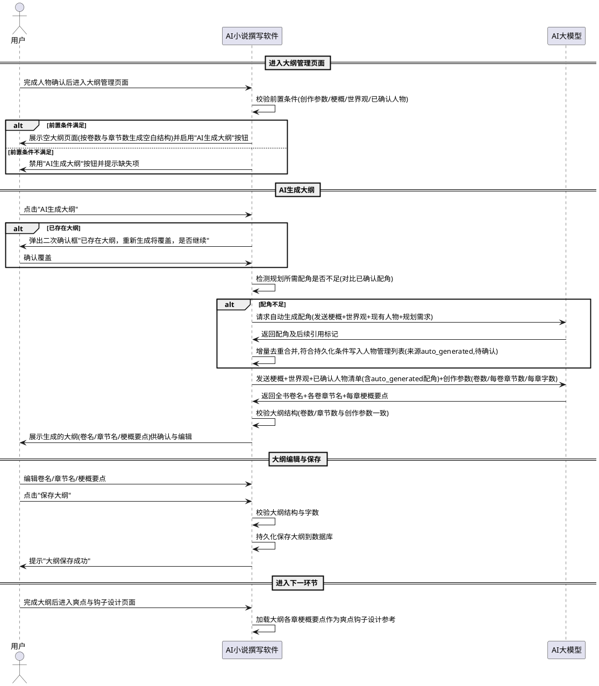

### **5.17.3 异常场景**
1. **AI生成大纲失败**
   a. 触发条件：AI接口返回错误、网络中断或返回内容无法解析为大纲结构
   b. 系统行为：提示失败并允许重试或手动编辑，已有人物/梗概/世界观等数据不变，若已存在原大纲则保留原大纲不变（仅在用户确认覆盖后才覆盖）
   c. 用户感知：提示"AI生成大纲失败，请重试或手动编辑大纲"
2. **前置条件不满足**
   a. 触发条件：用户点击"AI生成大纲"但创作参数未设定、梗概为空、世界观为空或无已确认人物
   b. 系统行为：禁用生成按钮或点击后提示具体缺失项，不发送AI请求
   c. 用户感知：提示"请先[设定创作参数/输入故事梗概/输入世界观/确认人物]"中对应缺失项
3. **大纲生成结果结构不完整**
   a. 触发条件：AI返回的大纲缺少某些卷的卷名、某些章的章节名或某些章的梗概要点
   b. 系统行为：标记缺失项并提示用户补充或重新生成，不完整大纲可展示但保存时校验阻止
   c. 用户感知：提示"第X卷缺少卷名"或"第X卷第Y章缺少梗概要点，请补充或重新生成"
4. **大纲结构与创作参数不匹配**
   a. 触发条件：AI生成或用户编辑后的大纲卷数或某卷章节数与创作参数不一致
   b. 系统行为：阻止保存并提示不匹配的具体差异
   c. 用户感知：提示"大纲结构(3卷)与创作参数(4卷)不匹配，请调整后保存"
5. **大纲保存失败**
   a. 触发条件：大纲保存时数据库写入失败、存储空间不足或数据库异常
   b. 系统行为：回滚至保存前状态，不产生部分写入脏数据，提示失败及原因
   c. 用户感知：提示"大纲保存失败：[原因]，请检查后重试"
6. **未保存大纲直接切换页面**
   a. 触发条件：用户编辑大纲后未保存即点击切换到其他页面或关闭项目
   b. 系统行为：弹出提示框询问是否保存当前编辑内容
   c. 用户感知：提示"大纲未保存，是否保存？"，选择保存则保存后切换，选择不保存则丢弃编辑切换，选择取消则留在当前页面
7. **章节梗概要点字数偏离建议范围**
   a. 触发条件：AI生成或用户编辑的某章梗概要点字数不在100-300字建议范围内
   b. 系统行为：提示偏离但不阻止保存（字数范围为建议值非强制约束）
   c. 用户感知：提示"第X卷第Y章梗概要点字数为[N字]，偏离建议范围(100-300字)，是否调整"
8. **大纲生成时AI返回内容含非法字符或格式异常**
   a. 触发条件：AI返回的大纲内容包含无法解析的格式或非法字符
   b. 系统行为：尝试容错解析可识别部分，无法解析的部分标记为空并提示用户补充
   c. 用户感知：提示"部分大纲内容解析失败，请检查并手动补充"

# **6. 数据约束**

## **6.1 创作参数**
1. **书名**：非空字符串，长度1-50字符，允许中文、英文、数字。
2. **卷数**：正整数，取值范围1-20。
3. **每卷章节数**：正整数，取值范围1-100。
4. **每章字数**：正整数，取值范围500-10000。

## **6.2 故事梗概**
1. **内容**：非空文本，长度不少于50字，建议500-5000字。
2. **唯一性**：全书仅存在一份故事梗概，作为一致性基准不可被AI修改。
3. **来源**：标记来源为"手动输入"或"文件导入"。

## **6.3 世界观**
1. **内容**：非空文本，长度不少于50字，建议500-5000字。
2. **唯一性**：全书仅存在一份世界观设定，作为一致性基准不可被AI修改。
3. **来源**：标记来源为"手动输入"或"文件导入"。

## **6.4 人物**
1. **人物ID**：唯一标识，系统通过AI提取人物、人物及关系自动识别导入、AI生成配角三种方式生成人物时统一采用UUID生成规则，确保全局唯一、不冲突、不重复；按姓名去重时已存在同名人物跳过不重复添加，不为新同名人物生成新ID。
2. **姓名**：非空字符串，长度1-20字符，作为增量去重的判定键——三种生成方式生成新人物时按姓名与已有人物列表合并，姓名已存在则跳过不重复添加。
3. **身份**：文本描述，如主角、配角，必填。
4. **简介**：文本描述，可选，建议不超过200字。
5. **关系**：与其他人物的关联描述，如"与B为师徒"，可选。
6. **来源**：枚举值，取值为"AI提取""AI生成""手动输入""文件导入""auto_generated"之一。其中"auto_generated"标记由系统在撰写或大纲生成过程中自动生成并持久化的配角，区别于用户主动点击"AI生成配角"生成的"AI生成"来源人物。
7. **确认状态**：枚举值，取值为"待确认"或"已确认"之一。AI提取或AI生成的人物初始为"待确认"状态；用户点击"确认选中人物"后标记为"已确认"状态。已确认人物的信息（姓名、身份、简介、关系）锁定，不被后续AI生成操作覆盖或重新生成；已确认人物仍允许用户手动编辑修改。
8. **出场记录**：该人物在全书各章节的出场记录列表，每条记录包含卷号、章号、出场顺序，随撰写进度自动更新。已持久化配角必须维护出场记录，便于追踪配角分布与出场频率。可选，手动输入或文件导入人物初始为空。
9. **配角类型**：枚举值，取值为"正式配角"或"临时配角"之一。"正式配角"为已持久化写入人物管理列表的配角（含auto_generated来源且符合持久化条件的配角），"临时配角"为仅在单章一次性出现、后续不再引用的配角（不写入人物管理列表）。仅对身份为"配角"的人物适用，主角无此字段。
10. **自动生成场景上下文**：来源为"auto_generated"的配角必须记录其自动生成的触发场景上下文，包含触发场景类型（"撰写过程"或"大纲生成"）、触发章节（卷号+章号）、生成时间，便于追溯配角的生成来源与场景。其他来源人物此字段为空。
11. **后续引用标记**：布尔值，标记该自动生成配角是否在后续章节或后续书籍中仍需引用。值为"是"时该配角持久化写入人物管理列表及配角数据库；值为"否"时该配角标记为"临时配角"不持久化。仅对来源为"auto_generated"的配角适用，其他来源人物此字段为空。

## **6.5 爽点**
1. **所属章节**：明确标注该爽点所属的卷号与章号。
2. **类型**：文本描述，如"逆袭""打脸""奇遇"等。
3. **内容描述**：非空文本，描述爽点的具体情节设计。
4. **来源**：枚举值，取值为"AI设定""手动设定"之一。

## **6.6 钩子**
1. **所属章节**：明确标注该钩子埋设的卷号与章号。
2. **内容描述**：非空文本，描述钩子的悬念内容。
3. **回收章节**：标注该钩子计划回收的卷号与章号，可与埋设章节不同卷。
4. **回收状态**：枚举值，取值为"待回收""已回收""未回收"之一。
5. **来源**：枚举值，取值为"AI设定""手动设定"之一。

## **6.7 章节内容**
1. **卷号**：正整数，对应所属卷。
2. **章号**：正整数，对应卷内章节序号。
3. **标题**：字符串，章节标题。
4. **正文**：非空文本，字数接近设定字数（偏差不超过50%）。
5. **生成状态**：枚举值，取值为"待生成""生成中""已完成""失败"之一。
6. **字数**：正整数，正文实际字数。
7. **修改状态**：枚举值，取值为"未修改""用户已修改""润色已采纳"之一，标记该章正文是否经用户手动修改或润色覆盖，默认为"未修改"。
8. **最近修改时间**：时间戳，记录该章正文最近一次用户修改或润色确认的时间，未修改时为空。

## **6.8 校验报告**
1. **校验项**：枚举值，取值为"梗概一致性""世界观一致性""人物关系一致性""钩子回收完整性""物品全书一致性""AI化程度评估""风格一致性""修改后梗概一致性""修改后世界观一致性""修改后人物关系一致性""修改后钩子回收完整性""修改后物品全书一致性""批量修改后人物变化一致性""批量修改后物品变化一致性""批量修改后物品全书一致性"之一。
2. **校验结果**：枚举值，取值为"通过""不通过"之一；AI化程度评估项可取"优""良""中""差"分级。
3. **问题描述**：文本，当结果为不通过时描述具体问题。
4. **所在章节**：标注问题出现的卷号与章号，可选。
5. **校验时间**：记录校验执行的时间戳。
6. **校验类型**：枚举值，取值为"全书校验""修改后再校验"之一，区分全本撰写完成后的整体校验与用户手动修改后的单章/批量再校验。

## **6.9 风格库**
1. **风格库名称**：非空字符串，长度1-30字符，允许中文、英文、数字，在本机唯一。
2. **命名来源**：枚举值，取值为"用户自定义名称""作者名""导入命名""默认内置"之一，标记风格库名称的由来方式。
3. **风格特征集合**：包含多个风格特征项的结构化集合，每项含维度名称与特征描述。
4. **来源语料信息**：记录建立该风格库时投喂的语料文件名与字数统计，便于追溯；导入建立的风格库记录来源导出文件名。
5. **建立时间**：记录风格库创建的时间戳。
6. **建立方式**：枚举值，取值为"投喂建立""手动建立""导入建立""默认内置"之一。
7. **确认状态**：布尔值，标记风格特征是否经用户确认入库。
8. **导出文件格式**：风格库导出文件必须为json等结构化格式，文件内容包含风格库名称、命名来源、全部风格特征项、来源语料信息、建立时间、建立方式等完整元数据，且可被本系统导入完整还原。

## **6.10 风格特征**
1. **维度名称**：枚举值，取值为"叙事视角""句式偏好""用词习惯""节奏特征""段落结构""对话风格""其他"之一。
2. **特征描述**：非空文本，描述该维度的具体风格表现，如"第三人称限知视角""短句为主、长短交错"等。
3. **所属风格库**：明确标注该风格特征所属的风格库名称。
4. **来源**：枚举值，取值为"AI提取""用户编辑""用户补充""默认内置"之一。

## **6.11 章节修改记录**
1. **记录编号**：唯一标识，每次章节修改保存或回滚操作生成一条新记录。
2. **卷号**：正整数，对应被修改章节所属卷。
3. **章号**：正整数，对应被修改章节的卷内序号。
4. **修改类型**：枚举值，取值为"手动修改""历史版本回滚"之一，标记本条记录的来源动作类型。
5. **修改前内容**：文本，记录该章修改前的正文内容，便于回溯对比。
6. **修改后内容**：文本，记录用户手动修改后的正文内容；当为回滚类型时，记录回滚后的目标历史版本内容。
7. **回滚目标记录编号**：当修改类型为"历史版本回滚"时，记录被回滚到的源历史记录编号；当为"手动修改"时为空。
8. **修改时间**：时间戳，记录用户保存修改或确认回滚的时间。
9. **再校验结果**：结构化数据，记录修改后AI再校验的各项维度结果（通过/不通过及问题描述），含批量再校验时的人物变化与物品变化一致性结论。
10. **是否触发润色**：布尔值，标记本次修改是否因再校验不通过而触发了AI自动润色。
11. **润色后内容**：文本，当触发润色时记录AI润色后的正文内容，未触发润色时为空。
12. **润色调整说明**：文本，当触发润色时记录AI标注的调整位置与原因说明。
13. **润色确认状态**：枚举值，取值为"待确认""已采纳""已拒绝""未触发润色"之一，标记用户对润色结果的确认动作。
14. **最终保留内容**：文本，记录该次修改最终确认保留的正文内容（用户修改或润色后内容之一）。
15. **确认时间**：时间戳，记录用户最终确认保留的时间，未确认时为空。
16. **是否可回滚**：布尔值，标记该条历史记录是否可作为回滚目标使用，默认为真；当记录损坏或最终保留内容缺失时为假。

## **6.12 物品**
1. **物品名称**：非空字符串，长度1-30字符，允许中文、英文、数字，在全书范围内按设定唯一。
2. **物品类型**：文本描述，如"法宝""武器""丹药""信物""道具""功法"等，可选。
3. **关键属性**：文本，概要描述物品的核心属性（如品阶、效果、来源等），可选。
4. **归属人物**：标注该物品当前归属的人物姓名，可选，可随情节转移。
5. **首次出现章节**：标注该物品在全书首次出现的卷号与章号。
## **6.13 项目**
1. **项目ID**：唯一标识，系统新建项目时自动生成，全局唯一，作为项目数据隔离与关联的核心键。
2. **书名**：非空字符串，长度1-50字符，允许中文、英文、数字，对应创作参数中的书名，本机允许同名项目存在（通过项目ID区分）。
3. **卷数**：正整数，取值范围1-20，对应创作参数。
4. **每卷章节数**：正整数，取值范围1-100，对应创作参数。
5. **每章字数**：正整数，取值范围500-10000，对应创作参数。
6. **项目状态**：枚举值，取值为"空项目""参数已设定""撰写中""撰写完成""校验完成"之一，标记项目的生命周期阶段。
7. **关联风格库ID**：标注该项目撰写时采用的风格库标识，可为空（表示采用默认风格）。
8. **创建时间**：时间戳，记录项目创建的时间。
9. **最近更新时间**：时间戳，记录项目数据最近一次变更的时间，用于自动备份变更检测与项目列表排序。
10. **数据隔离约束**：项目的全部子数据（梗概、世界观、人物、爽点钩子、物品、章节、修改记录、校验报告）必须通过项目ID关联，禁止跨项目引用，确保数据完全隔离。

## **6.14 项目导出归档**
1. **归档文件格式**：必须为 `.aibk` 扩展名的 zip 压缩包，内部包含 manifest.json（归档清单）与各 JSON 数据文件。
2. **归档文件名**：格式为"项目名_YYYYMMDD_HHMMSS.aibk"，其中项目名取自导出项目的书名，时间为导出执行的本地时间。
3. **manifest.json 内容**：必须包含归档格式版本号（archive_version，语义化版本）、导出时间（exported_at）、导出时的应用版本（app_version）、项目ID（project_id）、项目名称（project_name）、归档条目数（item_count）、各数据文件清单（files，含路径 path、字节数 size_bytes、SHA256 校验和 sha256）、导出选项（options，含 include_ai_call_logs、include_style_libraries）。
4. **数据文件清单**：归档必须包含 project.json（项目参数+梗概+世界观）、characters.json（人物清单）、cool_points.json（爽点）、hooks.json（钩子）、items.json（物品清单）、chapters.json（全部章节正文）、modify_records.json（全部修改记录）、validation_reports.json（校验报告）；style_libraries.json（项目引用的风格库）与 ai_call_logs.json（AI调用日志）为可选，按导出选项决定是否包含。
5. **SHA256 校验和**：归档内每个数据文件必须在 manifest.json 中记录其 SHA256 校验和，导入时逐文件校验一致性，任一不一致视为归档损坏。
6. **归档版本兼容性**：archive_version 采用语义化版本，主版本号变更表示不兼容结构变更（需显式迁移脚本），次版本号变更表示兼容新增字段（旧版本读取新归档忽略新字段）。
7. **不含AI源配置**：归档禁止包含当前机器的AI模型源配置（接口地址、密钥等），避免密钥泄露；AI源配置因机器而异，导入后用户须自行确认AI源可用性。
8. **跨机迁移能力**：归档为标准 zip 格式，可在不同操作系统的不同机器间传输并正常导入，不依赖特定数据库在线状态。
## **6.15 项目摘要**
1. **书名**：非空字符串，长度1-50字符，对应项目的书名，展示在工程管理器初始页面项目列表项中。
2. **创建时间**：时间戳，对应项目创建时间，展示在项目列表项中供用户识别项目新旧。
3. **最近更新时间**：时间戳，对应项目数据最近一次变更时间，用于项目列表排序（倒序，最近更新排在最前）与展示。
4. **撰写状态**：枚举值，取值为"空项目""参数已设定""撰写中""撰写完成""校验完成"之一，对应6.13项目状态，展示在项目列表项中供用户了解项目当前阶段。
5. **撰写进度**：结构化数据，包含已生成章节数与总章节数（总章节数=卷数×每卷章节数），以"已生成/总数章"格式展示在项目列表项中供用户了解撰写进度；空项目或未设定参数时进度为空。
6. **项目标识**：唯一标识，对应6.13项目ID，作为用户在工程管理器初始页面选择项目后执行打开、备份、迁移、删除等操作的关联键。
7. **排序规则**：项目列表必须按最近更新时间倒序排列，最近操作的项目排在列表最前，便于用户快速找到近期创作的项目。
## **6.16 AI源配置**
1. **源标识**：唯一标识，系统添加AI源时自动生成，全局唯一。
2. **源名称**：非空字符串，长度1-50字符，允许中文、英文、数字，用于用户识别不同AI源。
3. **类型**：枚举值，取值为"在线OpenAI兼容"或"本地Ollama"之一，决定调用协议与密钥要求。
4. **API地址**：非空字符串，在线源为以https://或http://开头的接口地址，本地Ollama源默认为本地接口地址。
5. **模型名称**：非空字符串，对应目标AI模型的标识名称。
6. **API Key**：在线OpenAI兼容类型必填，本地Ollama类型通常为空；必须加密存储，禁止明文保存；编辑时留空表示保留原值不修改。
7. **优先级**：正整数，数字越小优先级越高，用于按优先级故障切换（Failover）策略的源排序，默认为1。
8. **权重**：正整数，用于加权负载均衡策略的源选择概率，默认为1。
9. **启用状态**：布尔值，标记该AI源是否参与AI网关路由，禁用的源不被路由调用，默认为启用。
10. **健康状态**：枚举值，取值为"健康""降级""熔断""未知"之一，由AI网关周期性探测与运行时调用结果维护，路由时仅从健康与降级状态的源中选择。
11. **最近检测时间**：时间戳，记录该AI源最近一次连接测试或健康探测的时间，未检测时为空。
12. **成功率**：浮点数，取值范围0-1，记录该AI源近期调用的成功率，用于健康状态评估与降级决策。
13. **标签**：字符串列表，如"免费""快速""长上下文"等，用于成本优先策略的源筛选，可选。
14. **全局共享约束**：AI源配置不与任何项目关联，全局唯一共享，所有项目共用同一套配置，禁止按项目隔离AI源。
15. **模型名称来源约束（本地Ollama类型）**：当AI源类型为"本地Ollama"时，模型名称必须来源于系统动态获取的该Ollama服务实际已安装模型列表，禁止硬编码或预填任何固定模型名称（如禁止默认填入"qwen2.5:7b"）；模型列表获取失败时模型名称字段应为空并提示用户先确认Ollama服务可用。
16. **Ollama服务地址约束**：本地Ollama类型的API地址为以http://或https://开头的Ollama服务接口地址，默认为本地默认端口地址，允许用户修改为自定义Ollama服务地址（如远程Ollama服务或非默认端口）。
17. **Ollama模型列表动态性约束**：Ollama已安装模型列表为动态数据，反映查询时刻该Ollama服务实际已拉取的全部模型，不缓存为静态预设；同一Ollama服务在不同时刻拉取或卸载模型后，再次查询返回的列表应反映最新状态。
## **6.17 状态栏运行时信息**
1. **当前AI源显示内容**：文本字符串，格式为"当前AI源：[源名称]"或"当前AI源：负载均衡(N源)"或"当前AI源：无可用源"或"当前AI源：未配置"或"当前AI源：查询失败"之一，反映当前路由策略下实际选中的AI源状态。
2. **程序运行时长**：时间时长值，格式为"运行时长：HH:MM:SS"，从程序主窗口启动时间戳开始累计，每秒递增，不超过24小时继续累计（如"运行时长：25:03:42"）。
3. **当前系统日期时间**：日期时间字符串，格式为"YYYY-MM-DD 周X HH:MM:SS"，星期几取值为周一、周二、周三、周四、周五、周六、周日之一，每秒刷新与系统时间保持一致。
4. **刷新频率**：运行时长与当前日期时间每秒刷新一次，当前AI源在路由策略切换、AI源启禁用、故障转移、健康状态变化等事件触发时即时更新。
5. **展示位置**：三项运行时信息在主窗口状态栏右下角区域常驻显示，不得被临时提示消息遮挡。
6. **定时器独立性**：运行时长与日期时间的刷新由独立定时器驱动，不依赖业务操作或AI调用事件；定时器异常中断时须自动恢复，恢复后运行时长基于启动时间戳重新计算不丢失。
## **6.18 工程保存记录**
1. **保存时间**：时间戳，记录用户执行保存工程操作的时间。
2. **项目标识**：对应6.13项目ID，新建项目保存时为保存过程中新生成的项目ID，已有项目保存时为当前项目上下文中的项目ID。
3. **保存类型**：枚举值，取值为"新建项目保存"或"已有项目更新"之一，标记本次保存是创建新项目还是更新已有项目。
4. **保存数据项**：结构化数据，记录本次保存涉及的数据项类型与数量（如创作参数、梗概、世界观、人物N人、爽点钩子N条、章节N章等），便于追溯保存内容范围。
5. **保存结果**：枚举值，取值为"成功"或"失败"之一。
6. **失败原因**：文本，当保存结果为失败时记录具体错误原因（如"数据库写入异常""存储空间不足""校验失败：卷数无效"等），成功时为空。
7. **数据完整性约束**：保存成功时当前项目的全部已设定关联数据必须完整持久化，禁止部分保存或静默丢弃；保存失败时须回滚至保存前状态，不产生部分写入脏数据。
8. **数据隔离约束**：保存操作仅影响当前项目数据，禁止覆盖或清除其他项目的数据。
## **6.19 自动保存配置**
1. **启用状态**：布尔值，标记定时自动保存是否启用，默认为启用（true）；用户可在设置中关闭，关闭后仅保留关键节点自动保存与撰写中实时保存。
2. **保存间隔**：正整数，单位为分钟，取值范围1-30，默认为5；用户可在设置中配置，配置变更后立即生效并持久化，重启后保持上次配置。
3. **配置持久化约束**：自动保存配置必须持久化存储于本地，应用启动时自动加载已持久化的配置并据此初始化定时器。
4. **关键节点自动保存不可关闭约束**：关键节点自动保存（创作参数设定完成、梗概/世界观保存完成、人物提取/生成完成、爽点钩子设定完成、每章撰写完成、校验完成、润色确认完成）为强制启用，用户不可关闭。
5. **撰写中实时保存不可关闭约束**：撰写中实时保存（每完成一章立即持久化、每完成一项校验立即保存结果）为强制启用，用户不可关闭。
6. **自动保存记录**：每次自动保存须记录保存日志，包含触发类型（"定时""关键节点""撰写中实时"之一）、触发时间、项目标识、保存的数据项数量与保存结果（成功/失败及原因），便于排查自动保存异常与确认数据持久化时机。

## **6.20 大纲**
1. **大纲ID**：唯一标识，系统生成，全局唯一，作为大纲数据关联的核心键。
2. **所属项目**：对应6.13项目ID，标注该大纲归属的项目，一个项目最多存在一份大纲，禁止跨项目引用。
3. **生成状态**：枚举值，取值为"未生成""已生成""已编辑""已保存"之一，标记大纲的当前生命周期阶段；AI生成后为"已生成"，用户编辑后为"已编辑"，保存后为"已保存"。
4. **来源**：枚举值，取值为"AI生成""手动编辑""AI生成后手动编辑"之一，标记大纲内容的由来方式；纯AI生成未编辑为"AI生成"，纯手动编写为"手动编辑"，AI生成后用户编辑为"AI生成后手动编辑"。
5. **生成时间**：时间戳，记录AI生成大纲的时间，未生成时为空。
6. **最近编辑时间**：时间戳，记录用户最近一次手动编辑大纲的时间，未编辑时为空。
7. **保存时间**：时间戳，记录用户最近一次保存大纲的时间，未保存时为空。
8. **结构一致约束**：大纲包含的卷数必须等于6.1创作参数的卷数，每卷包含的章节数必须等于6.1创作参数的每卷章节数，禁止大纲结构与创作参数不匹配。
9. **数据隔离约束**：大纲数据必须通过项目ID关联归属当前项目，项目切换时加载目标项目的大纲，项目导出时包含大纲，项目导入时恢复大纲，禁止跨项目引用大纲。

## **6.21 卷大纲**
1. **卷大纲ID**：唯一标识，系统生成，全局唯一。
2. **所属大纲**：对应6.20大纲ID，标注该卷大纲归属的大纲。
3. **卷号**：正整数，对应所属卷的序号，取值范围1-20（对应6.1创作参数卷数范围），在同一大纲内按卷号唯一且递增。
4. **卷名**：非空字符串，长度1-50字符，允许中文、英文、数字，概括该卷的故事阶段或大情节弧主题（如"第一卷：风起云涌"），由AI规划生成或用户手动编辑。
5. **包含章节数**：正整数，等于6.1创作参数的每卷章节数，该卷下章节大纲规划的数量必须与此一致。

## **6.22 章节大纲规划**
1. **章节大纲ID**：唯一标识，系统生成，全局唯一。
2. **所属卷大纲**：对应6.21卷大纲ID，标注该章节大纲规划归属的卷大纲。
3. **卷号**：正整数，对应所属卷的序号，与所属卷大纲的卷号一致。
4. **章号**：正整数，对应卷内章节序号，取值范围1-100（对应6.1创作参数每卷章节数范围），在同一卷大纲内按章号唯一且递增。
5. **章节名**：非空字符串，长度1-50字符，允许中文、英文、数字，概括该章的主要情节或事件（如"第一章：初入江湖"），由AI规划生成或用户手动编辑。
6. **梗概要点**：非空文本，描述该章的主要事件、情节走向、人物活动与矛盾推进要点，建议字数100-300字；该字段是全文批量撰写时该章正文生成的核心情节约束，也是爽点与钩子设计时分布规划的参考依据。
7. **生成来源**：枚举值，取值为"AI生成""手动编辑"之一，标记该章节大纲规划条目的内容由来；AI生成后用户编辑的条目标记为"手动编辑"。
8. **情节约束用途**：该条目的梗概要点在全文批量撰写时必须作为对应卷号、章号章节的AI请求情节约束传入，确保生成内容遵循大纲规划的情节走向；在爽点与钩子设计时作为各章爽点类型选择与钩子埋设分布的参考依据。